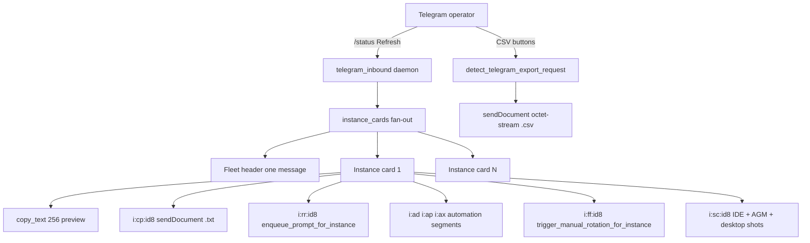

# Architecture Specification: Telegram Feature Enhancement

## 1. Overview & Objectives

Remote operators must take decisions from Telegram without opening the desktop UI. `/balance` already shows who is using what and quota. `/status` / Refresh Status must return **one compact, actionable message per instance** on this machine: running and enqueued projects, running and enqueued prompts (~100-word preview), Copy of the **whole** prompt, recent rerun, enqueue automation ("Is it done?", "Is it released?", randomized), Fast-Forward, and Screenshot.

Four machines send four independent replies; each machine fans out one card per local instance. Data is reused from CLI/UI (`repo_db::list_all_prompts`, instance registry, live project liveness) — Telegram is a return path, not a new pipeline.

Evidence of the current credit-only dashboard: `assets/screenshots/telegram-feature-enhancement-01.png`.

## 2. Design Invariants

- **Caller IDE self-preservation**: never stop Default or `v2-3127` during E2E. Isolated `agm instances test-create` / `test-clean` only.
- **FIFO restore**: `ORDER BY created_at ASC, id ASC`. Telegram rerun/enqueue uses `enqueue_prompt_for_instance`.
- **Telegram Bot API caps**: `callback_data` ≤ 60 bytes (`i:<op>:<id8>`). Native `copy_text` ≤ **256** characters. Full prompt is delivered as `sendDocument` (`.txt`). CSV is `sendDocument` with downloadable filename, never a 12-line HTML preview and never a copy-only button.
- **Strict relative paths** in specs, plans, changelogs, release notes.
- **No silent errors**: document/photo send failures surface in the chat; `record_ignored` only for best-effort follow-up sends.
- **Attribution**: `@aukgit` only.

## 3. Architecture

## 4. Callback protocol (`i:` namespace)

| Payload | Action |
| :--- | :--- |
| `i:st:<id8>` | Refresh this instance card |
| `i:cp:<pid8>` | Send full prompt as `.txt` document |
| `i:rr:<id8>` | Rerun latest prompt on instance |
| `i:ad:<id8>` | Enqueue "Is it done?" on same conversation |
| `i:ap:<id8>` | Enqueue "Is it released?" |
| `i:ax:<id8>` | Enqueue done + released + one randomized follow-up |
| `i:ff:<id8>` | Fast-forward this instance |
| `i:sc:<id8>` | Screenshot this instance IDE + AGM Accounts + desktop |

`<id8>` is an instance id/name prefix resolved uniquely server-side. `<pid8>` is a prompt id prefix.

## 5. CSV / export

Root cause: `process_telegram_command_text` "export" arm returns an HTML preview; `copy_text` over 256 chars rejects entire keyboards so CSV buttons never attach; `text/csv` MIME is treated as inline text on some clients.

Fix: daemon already intercepts `/export …` and must `sendDocument` with `application/octet-stream`, timestamped filename, plain caption, **no** inline keyboard on the file. Buttons go on a follow-up message. Instances CSV includes running/queued prompt and project counts.

## 6. Screenshots

`/screenshot` and `i:sc:` capture, in order: (1) virtual desktop (all running IDE windows), (2) Antigravity Manager / Antigravity Tools window, (3) each IDE window whose title matches Antigravity (capped). Failures are listed in the reply.

## 7. Hover (desktop UI)

Do **not** change hover position (`hover:-translate-y-*` removed from instance cards). CSS3 animates color, shade, border, and box-shadow only. Yellow/amber hover text is black (`#090611`).
