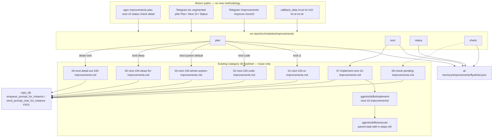

# Architecture Specification: Add New Option for 100 Improvements

| Field | Value |
| :--- | :--- |
| Spec | 235 |
| Slug | `add-new-option-for-100-improvements` |
| Spec path | `02-spec/21-app/235-add-new-option-for-100-improvements/01-architecture-spec.md` |
| Created | 2026-10-29 |
| Author | `@aukgit` |
| Status | Planned |
| Companion | `02-spec/21-app/235-add-new-option-for-100-improvements/02-component-spec.md` |
| AI instructions | `02-spec/21-app/235-add-new-option-for-100-improvements/03-ai-instructions.md` |

---

## User Request (Verbatim)

```text
Add a first-class option to PLAN 100 improvements and IMPLEMENT them
10 at a time as a sequence of thought, from CLI, UI, and Telegram.

Reuse the existing flywheel in 01-prompts/30-improvements/
(01 UI, 02 code, 03 system, 04 detail, 05 ideas, 06 check-pending,
07 implement-next-10) and skills implement-next-10-improvements plus
execute-parent-task-with-n-steps-v6.

Do NOT invent a second methodology.
```

---

## 1. Overview and Objectives

Operators must start and continue the Category 30 continuous-improvement flywheel without opening prompt files by hand. One shared engine plans **100 items as 10 batches of 10**, then each `next-10` claims the next pending batch and dispatches `01-prompts/30-improvements/07-implement-next-10-improvements.md` into the instance prompt queue. That prompt already mandates skill [`implement-next-10-improvements`](file;.agents/skills/implement-next-10-improvements) and parent orchestration [`execute-parent-task-with-n-steps-v6`](file;.agents/skills/execute-parent-task-with-n-steps-v6).

CLI (`agm improvements …`), the Telegram Remote Control Hub page, and Telegram slash commands are **return paths over the same ledger**. They do not author a second discovery/implement methodology, a second batch size, or a second 8-pillar quality gate.

The sequence of thought is the flywheel already documented in `01-prompts/30-improvements/readme.md`:

1. **Plan (discovery):** dispatch one of `01`–`05` so an agent persists 100 items into `.ai-memory/plans/pending/` and `.ai-memory/plans/subtasks/`.
2. **Check:** dispatch or render `06-check-pending-improvements.md` against the backlog plus the new ledger.
3. **Implement:** claim batch *N* of 10 and dispatch `07-implement-next-10-improvements.md` (repeatable `"next"` / `next-10`).
4. **Verify later:** `/execute-with-e2e` remains the decoupled verification gate inside prompt 07. This spec does not move builds or tests into the control plane.

---

## 2. Design Invariants

1. **One methodology.** Discovery, detailing, backlog inspection, and batch implementation stay in `01-prompts/30-improvements/` (`01` UI, `02` code, `03` system, `04` detail, `05` ideas, `06` check-pending, `07` implement-next-10) plus `.agents/skills/implement-next-10-improvements/` and `.agents/skills/execute-parent-task-with-n-steps-v6/`. The new option is a control plane, not a second flywheel.
2. **Shared engine.** CLI, UI, and Telegram call `src-tauri/src/modules/improvements/` (`plan` / `next` / `status` / `check`). Adapters only normalize arguments and render replies.
3. **Ledger.** Canonical state is `.ai-memory/improvements/flywheel.json` with `wave`, `kind`, `total=100`, `batch_size=10`, `next_batch` in `1..10`, and `batches[]` whose `status` is `pending` \| `running` \| `done`.
4. **One in-flight batch.** At most one batch may be `running`. `next-10` refuses while a batch is `running` unless the operator passes `--force` (re-dispatch the same `07` body; do not skip ahead).
5. **Write ledger before dispatch.** Persist the claimed `running` (or newly planned stubs) before calling `enqueue_prompt_for_instance` / `send_prompt_now_for_instance`. If dispatch fails, revert the claim to `pending` and return `AppError`. A silent no-op is forbidden.
6. **FIFO enqueue.** Any prompt insert/drain uses `ORDER BY created_at ASC, id ASC`. LIFO (`ORDER BY updated_at DESC`) is forbidden.
7. **Reuse existing send/enqueue.** Do not add a parallel prompt pipeline. Discovery and implement bodies go through `agm prompt send` / `enqueue_prompt_for_instance` / `send_prompt_now_for_instance`.
8. **Telegram 60-byte cap.** `callback_data` stays in the `im:` namespace: `im:pl`, `im:n10`, `im:st`, `im:ck` (all ≤ 60 bytes; `MAX_CALLBACK_BYTES = 60` in `src-tauri/src/modules/telegram_inbound/`).
9. **Hover is shade only.** Telegram-page pills use `.agm-hover-shade` (color, border, box-shadow, filter). No `hover:-translate-y-*` and no `transform` on hover (`src/App.css`).
10. **Caller IDE self-preservation.** E2E uses `--dry-run` so Default and `v2-3127` are never stopped. Isolated `agm instances test-create` / `test-clean` only if a prompt is actually dispatched. Commands targeting the caller instance fail-fast without `--force` (`detect_caller_instance_id()`).
11. **No silent errors.** Rust fallible ops return `AppError` (or `record_ignored` plus a `// Justification:` comment for genuine best-effort). TypeScript uses `captureError` / `captureException` for user-facing failures and `trackWarning` for benign fallbacks.
12. **Strict relative Git paths** in this spec, plans, changelogs, README files, and release notes. Attribution `@aukgit` only.
13. **Review-first on discovery.** `plan` may dispatch `01`–`05`; those prompts still ban immediate unreviewed code edits. Only `07` implements.

---

## 3. In Scope vs Out of Scope

### 3.1 In scope

- Shared engine `src-tauri/src/modules/improvements/` with `plan`, `next`, `status`, `check`.
- Ledger `.ai-memory/improvements/flywheel.json` and atomic read/write.
- Headless CLI `agm improvements plan|next-10|status|check|detail|help` (aliases `improve`, `next10`, `next`) wired in `src-tauri/src/bin/agm/`.
- GUI-binary CLI parity: `src-tauri/src/modules/cli/args.rs` routes the same verbs to the same engine.
- Telegram `/improvements`, `/improve`, `/next10` plus inline `im:` callbacks.
- Telegram page compact segmented pills (Plan / Next 10 / Status) with a borderless kind `<select>`.
- Tauri invokes `improvements_plan`, `improvements_next`, `improvements_status`.
- Optional dispatch of the matching discovery / detail / check / implement prompt file as the prompt **body**.
- `--dry-run` and `--json` on CLI; `--dry-run` never enqueues and never stops instances.
- Help text: CLI `help`/`--help`, Telegram `/help` section, UI copy of the three pills.

### 3.2 Out of scope

- Generating 100 unique improvement cards inside the CLI/UI process. The dispatched agent (prompts `01`–`05`) authors them into `.ai-memory/plans/`.
- Rewriting `07-implement-next-10-improvements.md`, the 8-pillar matrix, Fast-Forwarding `NO-BUILD`/`NO-TEST`, or `execute-parent-task-with-n-steps-v6`.
- A second backlog format, second batch size, or in-process implementer that bypasses prompt 07.
- Stopping Default or `v2-3127` during E2E.
- Full-crate local `cargo test --lib` on this machine (targeted tests for the new module only).
- Changing prompt-tree restore, account switch, or auto-switcher behavior.
- New Telegram namespaces besides `im:` (do not overload `i:`, `send:`, or `cmd:`).

---

## 4. Architecture



CLI, UI, and Telegram never contain flywheel business rules. They parse flags/callbacks, call the engine, and render `FlywheelState`.

---

## 5. Sequence of Thought (Plan then Next-10)

```mermaid
sequenceDiagram
    participant Op as Operator CLI UI Telegram
    participant Eng as modules/improvements
    participant Led as flywheel.json
    participant Q as enqueue_prompt_for_instance

    Op->>Eng: plan kind=system
    Eng->>Led: write 10 pending stubs wave N total=100 batch_size=10
    Eng->>Q: optional body of 03-next-100-whole-system-improvements.md
    Q-->>Op: queued FIFO ORDER BY created_at ASC, id ASC

    Note over Op,Q: Agent runs 01-05 Review-First; items land in .ai-memory/plans/

    Op->>Eng: next-10
    Eng->>Led: claim lowest pending index set running persist first
    Eng->>Q: body of 07-implement-next-10-improvements.md
    Q-->>Op: queued; operator types next / next-10 for batches 2..10

    Op->>Eng: status / check
    Eng->>Led: read wave kind next_batch counts
    Eng-->>Op: HTML or JSON plus im: keyboard
```

The implement prompt's own `"next"` cadence (inside the IDE conversation) remains valid. The control-plane `next-10` is the **cross-surface** equivalent: it claims the next ledger batch and re-dispatches prompt 07 so a fresh (or idle) conversation can continue the sequence of thought.

---

## 6. Shared Engine

Directory (new): `src-tauri/src/modules/improvements/`

| File | Responsibility |
| :--- | :--- |
| `mod.rs` | Public API: `plan_flywheel`, `next_batch`, `status_report`, `check_pending`. Re-export types. |
| `types.rs` | `ImprovementKind`, `BatchStatus`, `BatchRecord`, `FlywheelState`, `PlanParams`, `NextParams`. |
| `ledger.rs` | Resolve repo-relative path, load, atomic save, default empty state. |
| `dispatch.rs` | Read prompt markdown from repo-relative path; call existing send/enqueue; honor `--dry-run`. |
| `telegram.rs` | Compact HTML status card + inline keyboard `im:pl` / `im:n10` / `im:st` / `im:ck`. |

Declare `pub mod improvements;` in `src-tauri/src/modules/mod.rs`. Keep each file inside the 150–300 line guardrail; split helpers rather than growing `mod.rs`.

### 6.1 Public functions

```text
plan_flywheel(params: PlanParams) -> AppResult<FlywheelState>
next_batch(params: NextParams) -> AppResult<FlywheelState>
status_report() -> AppResult<FlywheelState>
check_pending() -> AppResult<FlywheelState>
format_telegram_html(state: &FlywheelState) -> String
telegram_markup() -> Value
```

`PlanParams` / `NextParams` encapsulate more than two or three arguments (`kind`, `dry_run`, `instance_id`, `do_send`, `force`). Do not pass four loose primitives.

### 6.2 Kind map (plan / detail)

| Kind | Prompt body | When |
| :--- | :--- | :--- |
| `ui` | `01-prompts/30-improvements/01-next-100-ui-improvements.md` | `plan ui` |
| `code` | `01-prompts/30-improvements/02-next-100-code-improvements.md` | `plan code` |
| `system` | `01-prompts/30-improvements/03-next-100-whole-system-improvements.md` | `plan` default, `plan system`, `plan all` |
| `ideas` | `01-prompts/30-improvements/05-next-100-ideas-for-improvements.md` | `plan ideas` |
| *(verb `detail`)* | `01-prompts/30-improvements/04-next-detail-out-100-improvements.md` | `agm improvements detail` — does not change `kind`; dispatches prompt 04 against the current wave |
| *(verb `check`)* | ledger HTML/JSON; optionally enqueue `01-prompts/30-improvements/06-check-pending-improvements.md` | `check` / `im:ck` |

`next` / `next-10` always use `01-prompts/30-improvements/07-implement-next-10-improvements.md` regardless of `kind`.

Unknown kind → `AppError::Config` with the allowed list. Do not guess.

### 6.3 Batch claim rules

- `next_batch` selects the lowest `index` with `status == pending` (FIFO by index `1..10`).
- If none pending: return a successful state with a clear `last_action` of `wave_complete` (not a silent empty Ok).
- If any batch is `running`: return `AppError` unless `force` (then re-dispatch 07 for that running index; do not increment).
- After a successful dispatch, set `next_batch` to `min(claimed_index + 1, 10)` when more pending remain; when the claimed index is 10, `next_batch` stays 10 and status of that batch is `running` until the operator (or a later `check`) marks `done`.
- Marking `done`: `check_pending` may promote `running` → `done` only when the matching `.ai-memory/plans/subtasks/` items for that 10-range are `DONE`. Operators may also pass `agm improvements status` (read-only). Do not invent a second completion protocol; subtask `Status: DONE` from prompt 07 remains authoritative.

---

## 7. State Ledger

Path: `.ai-memory/improvements/flywheel.json` (repository-relative; create parent dir on first `plan`).

```json
{
  "wave": 1,
  "kind": "system",
  "total": 100,
  "batch_size": 10,
  "next_batch": 1,
  "batches": [
    {
      "index": 1,
      "status": "pending",
      "item_start": 1,
      "item_end": 10,
      "title": "Batch 01 (items 1-10)",
      "prompt_rel": "01-prompts/30-improvements/07-implement-next-10-improvements.md",
      "claimed_at": null,
      "dispatched_prompt_id": null
    }
  ],
  "last_action": "plan",
  "updated_at": "2026-10-29T00:00:00Z"
}
```

| Field | Contract |
| :--- | :--- |
| `wave` | Positive integer. Incremented on a new `plan` after the previous wave is fully `done`, or on `plan --force`. |
| `kind` | `ui` \| `code` \| `system` \| `ideas`. |
| `total` | Constant `100`. |
| `batch_size` | Constant `10`. |
| `next_batch` | Integer `1..10` — the next index to claim. |
| `batches` | Exactly 10 records, `index` 1 through 10, contiguous `item_start`/`item_end` (1–10, 11–20, …, 91–100). |
| `batches[].status` | `pending` \| `running` \| `done` only. |
| `prompt_rel` | Repo-relative path of the implement prompt (07) for next-10; discovery `prompt_rel` is not stored per batch (kind maps it). |

**Atomic save:** serialize to `.ai-memory/improvements/flywheel.json.tmp`, `fsync` if available, then rename over the live file. Failure to write returns `AppError::Io` with path context. Never leave a truncated JSON file as the live ledger.

**Missing file:** `status` / `check` / `next` return `AppError::Config` instructing the operator to run `plan` first. Do not auto-plan.

---

## 8. Prompt Dispatch (Reuse Only)

`dispatch.rs` reads the prompt file with `std::fs::read_to_string` from the workspace root (same resolver `agm prompt send` uses for repo path). It then:

| Flag | Backend call |
| :--- | :--- |
| default (queue) | `repo_db::enqueue_prompt_for_instance` / `enqueue_prompt_for_instance_full` |
| `--send` | `repo_db::send_prompt_now_for_instance` (existing `agm prompts send`) |
| `--dry-run` | Neither. Print/return intended `prompt_rel`, instance, and body byte length. |

Instance default: active instance id, else `default`. `--instance` / `-i` overrides. Target repo default: current workspace.

`--dry-run` must not:

- call send/enqueue,
- stop, launch, or restart any instance,
- write the production ledger (return an in-memory `FlywheelState` with `last_action` prefixed `dry_run:`).

If a live (non-dry-run) test must prove dispatch, create `agm instances test-create`, pass `--instance <test-id>`, then `agm instances test-clean`. Never target Default or `v2-3127`.

---

## 9. CLI

Primary binary: `src-tauri/src/bin/agm/improvements_cmds.rs`, registered in `src-tauri/src/bin/agm/main.rs` (`"improvements" | "improve"`) and documented in `src-tauri/src/bin/agm/help_text.rs` / `help_tables.rs`.

GUI companion: `src-tauri/src/modules/cli/args.rs` match arm plus `print_all_cli_help` in `src-tauri/src/modules/cli/help.rs` so `antigravity-manager improvements` matches `agm improvements`.

```text
agm improvements plan [ui|code|system|ideas|all] [--dry-run] [--json] [--instance <id>] [--send] [--force]
agm improvements next | next-10 | run [--dry-run] [--json] [--instance <id>] [--send] [--force]
agm improvements status [--json]
agm improvements check [--json] [--dispatch]
agm improvements detail [--dry-run] [--json] [--instance <id>] [--send]
agm improvements help
```

Aliases: `improve`, `next10`, `next` (when the parent command is `improvements`). `agm help improvements` prints the same block.

JSON uses existing `CliEnvelope` (`src-tauri/src/modules/cli/types.rs`): `CliEnvelope::ok("improvements plan", instance, state)` / `CliEnvelope::err(..., "IMPROVEMENTS_FAILED", &msg)`. Human output is a compact table: wave, kind, `done/running/pending` counts, `next_batch`, last action.

Exit codes: `0` success; `1` engine/`AppError`; `2` caller-instance refusal without `--force` (same convention as `agm instances stop`).

---

## 10. Telegram

### 10.1 Slash verbs

Handled in `src-tauri/src/modules/telegram_inbound/processing.rs` `match cmd_base`:

| Verb | Engine call |
| :--- | :--- |
| `improvements`, `improve` | No args → `status_report` + markup. `plan [kind]` → `plan_flywheel`. `next` / `next10` / `next-10` → `next_batch`. `status` → `status_report`. `check` → `check_pending`. `detail` → dispatch 04. `help` → local help paragraph. |
| `next10`, `next-10` | `next_batch` (shortcut). |

Unknown sub-args return the help paragraph, not `None` (avoid dropping the update).

Register `{ "command": "improvements", "description": "Plan 100 improvements; next-10 implement batches" }` in `register_telegram_bot_commands` (`src-tauri/src/modules/telegram_inbound/config.rs`). Add a short Category 30 section to `format_help_manual` in `src-tauri/src/modules/telegram_inbound/reports_b.rs`.

### 10.2 Callback protocol (`im:` namespace)

Intercept in `src-tauri/src/modules/telegram_inbound/daemon.rs` **beside** the existing `i:` branch (do not fold into `normalize_cmd_callback_payload`). Byte lengths:

| `callback_data` | Bytes | Action |
| :--- | ---: | :--- |
| `im:pl` | 5 | `plan_flywheel` with current/default kind |
| `im:n10` | 6 | `next_batch` |
| `im:st` | 5 | `status_report` |
| `im:ck` | 5 | `check_pending` |

All four are well under `MAX_CALLBACK_BYTES = 60`. Unit-test `assert!(payload.len() <= 60)` next to the `i:` tests in `instance_cards.rs` / `reports_b.rs`.

Markup (one row, compact):

```text
[📋 Plan] [⏭ Next 10] [📊 Status] [🔎 Check]
 im:pl      im:n10       im:st       im:ck
```

Reply HTML: wave, kind, `next_batch`, counts of pending/running/done, last action. Failures (`AppError`) are sent as `❌ <b>Improvements:</b> <code>…</code>` — never swallowed.

---

## 11. Desktop UI

Mount a compact card on `src/pages/Telegram.tsx` (contextual: Telegram remote-control page, not a new navbar route). Prefer extracting `src/components/telegram/ImprovementsFlywheel.tsx` so `Telegram.tsx` stays under the UI line budget.

### 11.1 Segmented pills

Wrap Plan / Next 10 / Status in one contiguous `rounded-full` capsule (shared border, subtle dividers, dark-glass `#171025` / `#40285e`). Kind is an inline `<select>` **inside** the capsule with transparent borderless styling: `bg-transparent border-0 focus:ring-0 focus:outline-none` (no nested white pill).

The card root uses `agm-hover-shade`. Buttons inside the capsule inherit shade/color hover only.

### 11.2 Service and errors

`src/services/improvementsService.ts`:

```ts
invoke('improvements_plan', { kind, dryRun })
invoke('improvements_next', { dryRun })
invoke('improvements_status')
```

User-facing failures: `useErrorStore.getState().captureError(error, { source: 'ImprovementsFlywheel', triggerAction: 'improvements_plan' | 'improvements_next' | 'improvements_status' })`. Do not `catch {}`. Success toasts stay on the success path only.

`status` on the UI is read-only (no prompt dispatch). Plan and Next 10 call the engine without `--dry-run` in production; a hidden/advanced dry-run is not required on the pills.

---

## 12. Tauri IPC

New file `src-tauri/src/commands/improvements.rs`, re-exported from `src-tauri/src/commands/mod.rs`, registered in `src-tauri/src/lib/run.rs` `generate_handler![]`.

| Invoke | Maps to |
| :--- | :--- |
| `improvements_plan` | `plan_flywheel` |
| `improvements_next` | `next_batch` |
| `improvements_status` | `status_report` |

Signatures return `AppResult<FlywheelState>`. `check` stays CLI/Telegram (`check_pending`); the Status pill is enough on the desktop. Do not add a fourth invoke unless a later spec needs a dispatched `06` from the UI.

---

## 13. Error Handling

| Layer | Contract |
| :--- | :--- |
| Ledger IO | `AppError::Io` / `AppError::Config` with the relative path in the message |
| Unknown kind / empty next | `AppError::Config` |
| Dispatch failure | Revert claim; `AppError` from the existing repo_db error string |
| Telegram send | Surface in chat; `record_ignored` only for best-effort follow-up markup with `// Justification:` |
| Frontend | `captureError` on plan/next/status invoke failure |
| CLI | stderr + non-zero exit; `--json` uses `CliEnvelope::err` |

Forbidden: `let _ = fs::write(...)`, `.ok()` on ledger save, `catch {}` in the React card.

---

## 14. E2E and Safety

1. **Default proof:** `agm improvements plan system --dry-run --json` and `agm improvements next-10 --dry-run --json` print intended state and `prompt_rel` without enqueueing and without stopping any instance.
2. **Live dispatch (optional):** `agm instances test-create` → `agm improvements plan --instance <test-id>` or `next-10 --instance <test-id>` → assert a queued row with FIFO order → `agm instances test-clean`.
3. **Never** `agm instances stop default`, never target `v2-3127`, never `CREATE_BREAKAWAY_FROM_JOB` without `spawn_with_job_breakaway_fallback`.
4. Targeted Rust tests in `src-tauri/src/modules/improvements/` for ledger round-trip, claim FIFO, dry-run skip, `im:` byte cap. Skip full `cargo test --lib`.
5. Frontend: `npm run build` after Telegram page edits.

---

## 15. File Blast Radius

| Path | Change |
| :--- | :--- |
| `src-tauri/src/modules/improvements/*` | **New** engine |
| `src-tauri/src/modules/mod.rs` | `pub mod improvements` |
| `src-tauri/src/commands/improvements.rs` | **New** invokes |
| `src-tauri/src/commands/mod.rs` | Re-export |
| `src-tauri/src/lib/run.rs` | `generate_handler` entries |
| `src-tauri/src/bin/agm/improvements_cmds.rs` | **New** CLI |
| `src-tauri/src/bin/agm/main.rs` | Match arm |
| `src-tauri/src/bin/agm/help_text.rs`, `help_tables.rs` | Help catalog |
| `src-tauri/src/modules/cli/args.rs`, `help.rs` | GUI-binary CLI parity |
| `src-tauri/src/modules/telegram_inbound/processing.rs` | Slash verbs |
| `src-tauri/src/modules/telegram_inbound/daemon.rs` | `im:` intercept |
| `src-tauri/src/modules/telegram_inbound/config.rs` | `setMyCommands` |
| `src-tauri/src/modules/telegram_inbound/reports_b.rs` | `/help` section |
| `src/services/improvementsService.ts` | **New** |
| `src/components/telegram/ImprovementsFlywheel.tsx` | **New** |
| `src/pages/Telegram.tsx` | Mount card |
| `.ai-memory/improvements/flywheel.json` | Created at runtime by `plan` |

Do **not** edit `01-prompts/30-improvements/*` or the two skills except to follow them.

---

## 16. Headless / CLI / UI Parity

`plan`, `next`, `status`, and `check` must produce the same `FlywheelState` whether invoked from:

- `agm` binary (`src-tauri/src/bin/agm/`),
- GUI-process CLI (`src-tauri/src/modules/cli/`),
- Tauri invoke,
- Telegram slash or `im:` callback.

Instance selection, `--dry-run`, and enqueue vs send flags pass through `PlanParams` / `NextParams`. Telegram omits `--json` and always renders HTML.

---

## 17. Cross-References

- [Category 30 flywheel index](../../../01-prompts/30-improvements/readme.md)
- [Implement next 10 prompt](../../../01-prompts/30-improvements/07-implement-next-10-improvements.md)
- [Check pending prompt](../../../01-prompts/30-improvements/06-check-pending-improvements.md)
- [Component spec](./02-component-spec.md)
- [AI instructions](./03-ai-instructions.md)
- [Telegram feature enhancement architecture](../234-telegram-feature-enhancement/01-architecture-spec.md) (`i:` namespace, 60-byte cap, `.agm-hover-shade`)

<spec-placeholder reason="Link when the parent plan file is created.">
- [Parent plan](../../../.ai-memory/plans/235-add-new-option-for-100-improvements.md)
</spec-placeholder>
