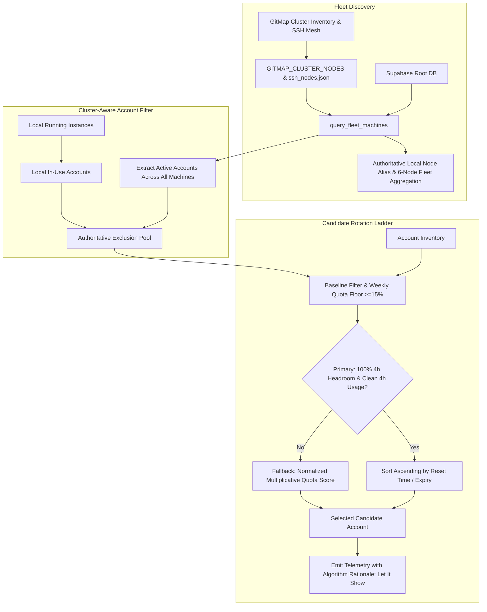

# Specification: Alex Hudson Selection and Clustering Issue

## 1. Overview & Problem Definition

During multi-instance and multi-machine cluster operations in Antigravity Manager, two critical anomalies were identified:
1. **Concurrent Cross-Instance / Cross-Machine Account Collision**:
   - An account (`alex.hudson.riseup@gmail.com`) already selected and active on another instance / another machine in the cluster was selected again by local instance `#2 lara-pub` during Fast-Forward rotation and Smart-Switch.
   - The selection algorithm lacked cluster-wide active account awareness, evaluating only local running sibling instances and neglecting the fleet-wide active accounts pool reported via Supabase and SSH cluster nodes.
2. **Cluster Node Discovery Inversion & W2/W3 Omission**:
   - In the "Shared Cluster / Fleet Nodes" view, the local machine was erroneously hardcoded and labeled as `w1 [Lead]` despite its actual IP being `192.168.1.7` (canonical node `w2` in GitMap cluster inventory).
   - Because `query.rs` hardcoded the local node's alias to `"w1"`, canonical node `w1` (`192.168.1.3`) was dropped due to alias duplication, and canonical node `w2` (`192.168.1.7`) was dropped due to IP duplication.
   - Consequently, `w2` disappeared completely from the cluster table, and remote worker nodes (`w3`, `w4`, `u1`) were improperly masked or displaced.

## 2. Architectural Objectives

1. **Cluster-Aware Account Deduplication**:
   - Exclude any account currently active on ANY instance across ALL discovered cluster nodes (`w1`, `w2`, `w3`, `w4`, `u1`, `main`) from candidate rotation pools in Fast-Forward, Smart-Switch, and manual rotation.
   - Combine local running instance bindings, Supabase active workspace leases, and fleet node active accounts into an authoritative `fleet_in_use_account_ids` filter.
2. **Transparent Algorithm Rationale ("Let It Show")**:
   - Expose the exact decision path, candidate evaluation scores, selection tier (Primary Full Headroom vs. Fallback), and exclusion reasons (local active, remote fleet active, weekly quota floor) in execution telemetry, logs, and UI notifications.
3. **Dynamic Cluster Node Resolution & Zero Node Loss**:
   - Eliminate all hardcoded `"w1"` overrides in `src-tauri/src/modules/supabase_sync/query.rs`.
   - Authoritatively resolve the local machine identity using `resolve_local_node_alias()` (Cluster-IP primacy against `GITMAP_CLUSTER_NODES`, GitMap `variables.json`, and configured `node_alias`).
   - Preserve all 6 canonical cluster nodes (`w1`, `w2`, `w3`, `w4`, `u1`, `main`) in the aggregation pipeline, marking the matching node as `is_local = true` and preserving all other nodes without dropping due to false deduplication.

## 3. Data Flow Diagram

## 4. Key Files Impacted

| File Path | Description |
|---|---|
| `src-tauri/src/modules/supabase_sync/query.rs` | Eliminate hardcoded `"w1"` overrides; preserve all 6 canonical cluster nodes without dropping `w2` or `w1`. |
| `src-tauri/src/modules/supabase_sync/node.rs` | Enhance `resolve_local_node_alias()` to support GitMap `variables.json` machine alias and robust IP matching. |
| `src-tauri/src/modules/auto_switcher/instances.rs` | Update `get_active_in_use_account_ids()` to aggregate active accounts from `query_fleet_machines()` and cached fleet state. |
| `src-tauri/src/modules/auto_switcher/selection.rs` | Ensure candidate selection excludes fleet-wide active accounts and records candidate exclusion rationale. |
| `src-tauri/src/modules/auto_switcher/manual.rs` | Incorporate cluster-wide account exclusions and enrich rotation outcome with selection rationale. |
| `src/stores/useInstanceStore/smart.ts` | Enrich frontend candidate evaluation with cached fleet active accounts to prevent cross-machine collisions. |
| `src/components/instances/fleet/useFleetMachines.ts` | Ensure all 6 nodes render with correct local node identification and active account badges. |
