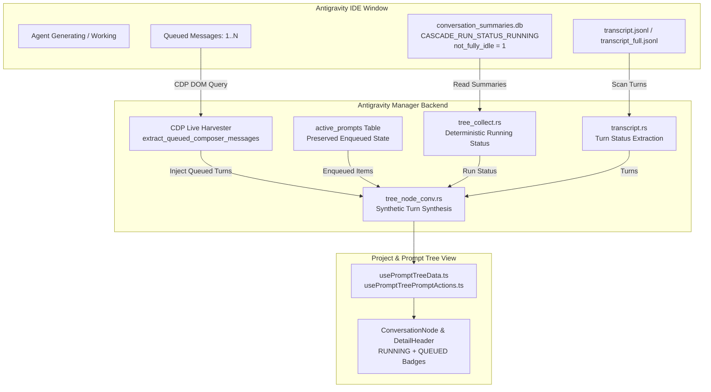

# Architecture Spec: Running and Queued Prompt Detection in Multi-Instance

## 1. Overview & Objective
This specification establishes a robust, future-proof architecture for detecting running conversations, active turns, and enqueued prompts across single-instance and multi-instance Antigravity environments. It guarantees that:
1. When Antigravity IDE is actively working on a task (`CASCADE_RUN_STATUS_RUNNING` or `not_fully_idle > 0` with live IDE processes), the conversation and its active turn are deterministically classified as `RUNNING` without false `IDLE` overrides from historical transcript markers.
2. User prompts enqueued behind active tasks (either submitted via Antigravity Manager's FIFO enqueue flow or entered directly into the IDE composer's "Queued Messages") are preserved, harvested, and displayed immediately in Prompt Tree View and Multi-Instance cards as `QUEUED` turns.
3. Pre-emptively purging dispatched prompts via overly aggressive staleness sweeps (e.g. 120s timeout) is eliminated, maintaining queued prompts until the agent actually dequeues and executes them.
4. Cache invalidation commands (`invalidate_prompt_tree_cache`) are natively registered and synchronized between frontend and backend.

## 2. Architectural Components

## 3. Core Architectural Invariants

### Invariant 1: Affirmative Database & Process Supremacy (No False Idle)
If `conversation_summaries.db` contains `status == "CASCADE_RUN_STATUS_RUNNING"` or `(not_fully_idle > 0 && is_recent)`, and any Antigravity IDE process is running on the host OS:
$$\text{IsRunning} = \text{True}$$
Intermediate planner completions, step-level tool outputs, or transcript tail artifacts MUST NEVER override this affirmative running signal.

### Invariant 2: Persistent Enqueued Prompts Lifecycle
When a prompt is enqueued behind an active turn:
- Its status in `active_prompts` is stored as `queued` or `enqueued_ide`.
- The stale in-flight cleaner (`transition_stale_inflight_prompts`) MUST NOT transition enqueued or dispatched prompts to `completed` while the target conversation remains active or before a generous 3600-second (1-hour) threshold.

### Invariant 3: Live CDP Queued Message Harvesting
When Antigravity IDE has messages in its internal composer queue (`Queued Messages (N)`):
- AGM queries the live DevTools CDP DOM (`extract_queued_composer_messages_for_instance`).
- Any discovered queued messages are converted into synthetic `AgmPromptTurnNode` entries with status `QUEUED` and merged into the active conversation's prompt list.
- They immediately show in the left tree sidebar and detail header badge (`N prompt(s) enqueued in FIFO queue for this conversation`).

### Invariant 4: Dual-Registered Cache Invalidation
Both `invalidate_prompt_tree_cache` and `reset_prompt_tree_cache` must exist as registered Tauri commands, routing to `reset_prompt_tree_cache_inner` without failing.
