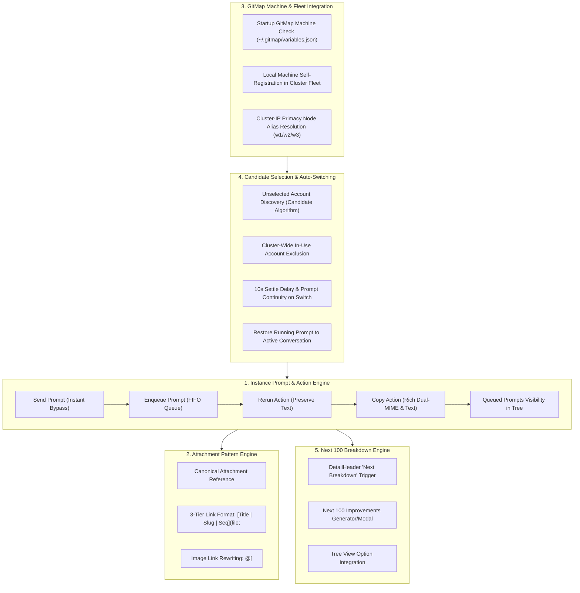

# Architecture Specification: Instance-Based Prompt and UI Functionality Verification

- **Task**: Instance-Based Prompt and UI Functionality Verification
- **Slug**: `instance-based-prompt-and-ui-functionality-verification`
- **Spec ID**: `241`
- **Repository-Relative Path**: `02-spec/21-app/241-instance-based-prompt-and-ui-functionality-verification/01-architecture-spec.md`
- **Attribution**: Strictly `@aukgit` (`(Thanks to @aukgit)`)

---

## 1. Executive Summary & Verification Mandate

The objective of this specification is to execute an exhaustive, multi-tier verification and audit of the Antigravity Manager (AGM) instance-based prompt execution, UI interaction mechanics, cluster machine discovery, candidate account synchronization, auto-switch prompt restoration, and prompt tree improvements breakdown.

Per user instruction, this task enforces a strict **Verification and Root Cause Analysis Only** invariant:
> If any functionality is verified as missing or incomplete, document the complete 4-part Root Cause Analysis (Why it is missing, How it is missing, and Step-by-step How it must be completed) without modifying codebase implementations or cutting speculative code patches.

---

## 2. Core Architecture Topology & Verification Scope

The verification matrix evaluates 8 distinct architectural subsystems:

---

## 3. Subsystem Architectural Contracts

### Subsystem 1: Instance-Based Prompt Sending & Queued Prompts Visibility
- **Contract**: Dispatched prompts to an active instance must immediately persist in `active_prompts` and be visible in `PromptTreeView`. When the IDE agent is active, enqueued prompts must be queued in FIFO order (`ORDER BY created_at ASC, id ASC`) and harvested via CDP (`EXTRACT_QUEUED_MESSAGES_JS`) and `active_prompts` queries.
- **Components**:
  - `src-tauri/src/modules/repo_db/tree_node_conv.rs`
  - `src-tauri/src/modules/instance/cdp_onboarding.rs`
  - `src/components/instances/PromptTreeView/usePromptTreeData.ts`
  - `src/components/instances/PromptTreeView/DetailHeader.tsx`

### Subsystem 2: Prompt Action Controls & UI Parity
- **Contract**: Copy Prompt, Send Prompt, Send Button UI, Enqueue Button, and Rerun Button must operate without unhandled exceptions or loss of user input context.
- **Components**:
  - `src/components/instances/PromptTreeView/DetailHeader.tsx`
  - `src/components/instances/PromptTreeView/usePromptTreePromptActions.ts`
  - `src/utils/clipboard.ts`

### Subsystem 3: Image Attachment Canonical Pattern
- **Contract**: All prompt attachments must adhere to canonical 3-tier syntax:
  - `[Title | Slug | Seq](file;<relative-or-canonical-path>)`
  - `Attachments:\n1. @[<path>]`
- **Components**:
  - `src/components/instances/PromptTreeView/DetailHeader.tsx`
  - `src-tauri/src/modules/repo_db/tree_node_conv.rs`

### Subsystem 4: Candidate Account Selection Without Selecting Existing Account
- **Contract**: Account rotation and auto-switching must evaluate all configured Google accounts using transparent mathematical scoring (`Tier 1: 100% 4h Quota`, `Tier 2: Proportional Fallback`, `Tier 3: Best Candidate Pick`) while strictly excluding accounts actively leased across local instances and remote cluster machines.
- **Components**:
  - `src-tauri/src/modules/auto_switcher/instances.rs`
  - `src-tauri/src/modules/auto_switcher/selection.rs`
  - `src/stores/useInstanceStore/smart.ts`

### Subsystem 5: GitMap Machine Information Check on Startup
- **Contract**: AGM must read GitMap machine variables (`machine.alias`, `machine.ip`, `machine.name`) from `~/.gitmap/variables.json` or GitMap CLI on startup and bind the local node profile dynamically.
- **Components**:
  - `src-tauri/src/modules/supabase_sync/node.rs`
  - `src-tauri/src/modules/supabase_sync/query.rs`

### Subsystem 6: Local Machine Cluster Fleet Addition
- **Contract**: The current machine must be present in the Shared Cluster Fleet list, correctly tagged as `is_local = true` and `is_lead` (if matching lead alias), without dropping or colliding with remote nodes `w2` and `w3`.
- **Components**:
  - `src/components/instances/fleet/useFleetMachines.ts`
  - `src/components/instances/fleet/FleetMachineRow.tsx`

### Subsystem 7: Auto-Switching Prompt Restoration on Current Conversation
- **Contract**: Upon auto-switch or manual switch, AGM must back up running prompts to `active_prompts` and `~/.antigravity_tools/post_switch_resume_state.json`, kill the IDE with Win32 process tree escalation, re-open with switched profile credentials, wait 10 seconds for CDP stabilization, and re-inject running prompts back into the active conversation.
- **Components**:
  - `src-tauri/src/modules/repo_db/backup.rs`
  - `src-tauri/src/modules/auto_switcher/instances.rs`
  - `src-tauri/src/modules/instance/smart_run.rs`

### Subsystem 8: Next Breakdown / Next 100 Improvements Breakdown in Tree View
- **Contract**: An option or action button must exist inside the Instance Prompt Tree View allowing the operator to trigger a breakdown of the next tasks or Next 100 Improvements directly from the active conversation or task context.
- **Components**:
  - `src/components/instances/PromptTreeView/DetailHeader.tsx`
  - `src/components/instances/PromptTreeView/DetailTabs.tsx`
  - `src/services/improvementsService.ts`

---

## 4. Verification Methodology

1. **Static Analysis & Code Tracing**: Read implementations using GitMap tools (`gitmap cat`, `gitmap aum search`).
2. **Runtime & State Inspection**: Query live SQLite databases (`repo_prompts.db`, `variables.json`, active CDP sockets) without modifying databases.
3. **Behavioral Invariant Auditing**: Confirm adherence to FIFO ordering (`ORDER BY created_at ASC, id ASC`), zero-silent errors, and relative Git paths.
4. **Defect & RCA Specification**: For any requirement that is missing or partially implemented, document 4-part RCA with root causes and actionable completion steps.
