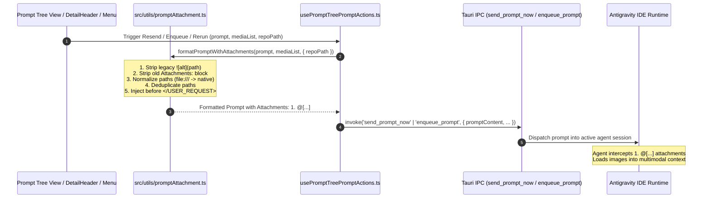

# Specification: Antigravity IDE Attachment Format and Rerun/Enqueue Standardization

- **Spec ID:** `02-spec/21-app/49-image-attachment-format-and-rerun-enqueue/01-architecture-spec.md`
- **Task ID:** `49-image-attachment-format-and-rerun-enqueue`
- **Master Plan:** `.ai-memory/plans/pending/49-image-attachment-format-and-rerun-enqueue.md`
- **Subtask Plans:**
  - `.ai-memory/plans/subtasks/49-image-attachment-format-and-rerun-enqueue/01-subtask-attachment-formatter.md` (Author 01)
  - `.ai-memory/plans/subtasks/49-image-attachment-format-and-rerun-enqueue/02-subtask-prompt-actions-and-rerun.md` (Author 02)
  - `.ai-memory/plans/subtasks/49-image-attachment-format-and-rerun-enqueue/03-subtask-backend-and-tests.md` (Author 03)
- **Status:** `APPROVED`
- **Lead Architect:** Spec Author 01 (Attachment Formatter & Architecture Specialist)
- **Scope:** Canonical Image Attachment Format (`Attachments:\n1. @[...]`), Path Normalization (`src/utils/promptAttachment.ts`), Rerun/Send/Enqueue/Copy Prompt Sanitization, Rerun Enqueue Invariant, `<USER_REQUEST>` Tag Placement Invariant
- **Target Subsystems:** `src/utils/promptAttachment.ts`, `src/components/instances/PromptTreeView/`, `src-tauri/src/modules/repo_db/`

---

## 1. Executive Summary & Problem Classification

In Antigravity Manager (`AGM`), the **Prompt Tree View** (`src/components/instances/PromptTreeView/`) serves as the primary operational console for inspecting historical conversations, dispatching immediate instructions via **Send Now** (`handleResendPrompt`), enqueuing FIFO tasks via **Enqueue** (`handleEnqueuePrompt`), and running iterative prompts via **Rerun** (`DetailHeader.tsx` and `ConversationContextMenu.tsx`).

When prompts include multimodal visual assets (screenshots, architectural diagrams, UI mockups), historical AGM implementations suffered from severe operational defects:

1. **Non-Native Markdown Syntax Rejection:**
   Previously, AGM attached images using markdown image syntax:
   ```markdown
   
   ```
   In the target Antigravity IDE (Gemini protocol agent runtime), markdown image syntax is treated as passive inline text. The agent's prompt ingestion pipeline does not recognize markdown image tags as native workspace attachments, resulting in the model reporting that no images were provided.

2. **Native Antigravity Attachment Format Disconnect:**
   Antigravity IDE expects native attachments formatted in an explicit numbered list with bracketed at-signs:
   ```text
   Attachments:
   1. @[C:\media\screenshot.png]
   2. @[C:\media\diagram.png]
   ```
   When formatted in this canonical pattern, the Antigravity agent runtime intercepts the file paths, attaches them directly to the conversation multimodal context, and supplies full visual comprehension to the model.

3. **`<USER_REQUEST>` Enclosure Violations:**
   When prompts originate from or target Antigravity IDE sessions, user messages are wrapped inside `<USER_REQUEST>...</USER_REQUEST>` tags. Previously, image blocks were either appended blindly after the closing tag `</USER_REQUEST>` or placed outside the conversational envelope. This caused agent parsers to discard the attachments as external metadata.

4. **Protocol and Path Inconsistencies:**
   Image paths in conversation transcripts and clipboard buffers arrive in varied representations:
   - File protocol URIs: `file:///C:/Users/user/AppData/media.png`
   - URL-encoded strings: `file:///C:/My%20Projects/image.png`
   - Mixed slashes: `C:/path/to/media.png` vs `C:\path\to\media.png`
   - Relative workspace targets requiring resolution against the instance repository path.
   Without a standardized normalization pipeline, paths caused file-not-found errors in the target IDE process.

5. **CLI and Buffer Overflow Risk:**
   Embedding raw Base64 data URIs directly inside markdown prompt text causes `agy.rs` CLI truncation at 24,000 bytes and Win32 `CreateProcessW` failures exceeding 32,767 characters. Standardizing on local filesystem path attachments in `@[<path>]` format eliminates multi-megabyte string bloat, guaranteeing lightweight, resilient IPC dispatches.

This specification establishes the architectural contract for the centralized `src/utils/promptAttachment.ts` utility and the integration across the Prompt Tree View and dispatch pipelines.

---

## 2. Canonical Attachment Format & Structural Invariants

### 2.1 The Canonical `Attachments:` Block

All outgoing prompts targeting Antigravity IDE, whether dispatched via **Send Now**, **Enqueue**, **Rerun**, or **Clipboard Copy**, must format attachments strictly using the canonical Antigravity attachment block:

```text
Attachments:
1. @[<normalized-absolute-filesystem-path>]
2. @[<normalized-absolute-filesystem-path>]
```

#### Structural Rules:
1. **Header Line:** The block begins with `Attachments:` followed by a single newline.
2. **Ordered List:** Each attachment is numbered sequentially starting at `1.` (`1.`, `2.`, `3.`, ...).
3. **Bracketed At-Sign Syntax:** The path is enclosed in `@[` and `]` without internal padding: `@[<path>]`.
4. **Spacing:** The block is preceded by two newlines (`\n\nAttachments:\n...`) when appended to body text.
5. **Deduplication:** Multiple references to the same file path (case-insensitive on Windows, case-sensitive on POSIX) are deduplicated into a single entry, preserving the first occurrence.

### 2.2 `<USER_REQUEST>` Injection Invariant

When prompt content contains a closing `</USER_REQUEST>` tag:
- The `Attachments:` block **MUST** be injected **inside** the request envelope, immediately preceding `</USER_REQUEST>`.
- The injection must maintain clean double-newline separation from the user prompt text.
- No trailing attachments may be left outside `</USER_REQUEST>`.

#### Example Before:
```text
<USER_REQUEST>
Please inspect the button alignment on the login page.
</USER_REQUEST>
```

#### Example Formatted with Attachments:
```text
<USER_REQUEST>
Please inspect the button alignment on the login page.

Attachments:
1. @[C:\media\login_screen.png]
2. @[C:\media\spec_diagram.png]
</USER_REQUEST>
```

#### Example Without `<USER_REQUEST>`:
```text
Please inspect the button alignment on the login page.

Attachments:
1. @[C:\media\login_screen.png]
2. @[C:\media\spec_diagram.png]
```

### 2.3 Legacy Syntax Sanitization Invariant

Before appending or injecting the canonical `Attachments:` block, the formatting pipeline must strip:
1. All legacy markdown image tags: `` and ``.
2. Any pre-existing `Attachments:\n(?:\d+\.\s*@\[.*?\]\n?)+` blocks.

This invariant guarantees idempotence: formatting a prompt multiple times produces identical, clean output without stacked attachment blocks or residual markdown tags.

---

## 3. Subsystem Architecture & Data Flow

The following sequence details how image attachments flow from UI triggers to the Antigravity IDE:



---

## 4. Component Contracts & Function Specifications (`src/utils/promptAttachment.ts`)

The centralized module `src/utils/promptAttachment.ts` provides all path normalization, attachment formatting, stripping, and extraction capabilities.

### 4.1 Type Definitions

```typescript
/**
 * Represents a raw attachment input, accepting strings, file objects, or media descriptors.
 */
export type PromptAttachmentInput =
    | string
    | {
          path?: string;
          src?: string;
          dataUri?: string;
      };

/**
 * Options configuring attachment formatting behavior.
 * All boolean flags follow repository-wide positive boolean conventions.
 */
export interface PromptAttachmentFormatOptions {
    /**
     * Absolute or working repository path used to resolve relative attachment paths.
     */
    repoPath?: string;

    /**
     * Controls whether injection respects </USER_REQUEST> enclosing tags.
     * Default: true.
     */
    isUserRequestTagPreserved?: boolean;

    /**
     * Controls whether inline markdown images in prompt body are extracted as attachments.
     * Default: true.
     */
    isInlineImageExtractionEnabled?: boolean;

    /**
     * Platform override for deterministic cross-platform unit testing.
     * When omitted, detects runtime platform (navigator.userAgent / process.platform).
     */
    isWindowsPlatformOverride?: boolean;
}
```

### 4.2 `normalizeAttachmentPath`

```typescript
/**
 * Normalizes a raw filesystem path or file:// URI into a clean, platform-native path.
 *
 * Rules:
 * 1. Strips 'file:///' and 'file://' URI schemes.
 * 2. Decodes URI encoded characters (e.g., %20 -> space).
 * 3. Strips leading slash from Windows drive letters (e.g., /C:/... -> C:/...).
 * 4. On Windows (or when isWindowsPlatformOverride is true), converts all forward slashes to backslashes.
 * 5. On POSIX (macOS/Linux), converts backslashes to forward slashes.
 * 6. Resolves relative paths against repoPath if provided.
 * 7. Trims surrounding whitespace.
 */
export function normalizeAttachmentPath(
    rawPathOrUri: string,
    repoPath?: string,
    isWindowsPlatformOverride?: boolean
): string;
```

#### Path Transformation Matrix:

| Input Path / URI | OS Target | Resolved Native Output |
| :--- | :--- | :--- |
| `file:///C:/Users/name/image.png` | Windows | `C:\Users\name\image.png` |
| `file:///C:/My%20Projects/pic.png` | Windows | `C:\My Projects\pic.png` |
| `/C:/work/repo/assets/img.png` | Windows | `C:\work\repo\assets\img.png` |
| `C:/work/repo/assets/img.png` | Windows | `C:\work\repo\assets\img.png` |
| `relative/dir/screenshot.png` (`repoPath = C:\work\repo`) | Windows | `C:\work\repo\relative\dir\screenshot.png` |
| `file:///Users/name/image.png` | POSIX | `/Users/name/image.png` |
| `file:///home/user/my%20data/img.png` | POSIX | `/home/user/my data/img.png` |
| `relative/img.png` (`repoPath = /home/user/app`) | POSIX | `/home/user/app/relative/img.png` |

### 4.3 `stripAttachmentsFromPrompt`

```typescript
/**
 * Strips all legacy markdown image tags and canonical Attachments: blocks from prompt text.
 *
 * Rules:
 * 1. Removes all !\[.*?\]\(.*?\) markdown image links.
 * 2. Removes Attachments:\s*(?:\r?\n\s*\d+\.\s*@\[.*?\])+ blocks.
 * 3. Collapses excessive vertical whitespace (\n{3,} -> \n\n).
 * 4. Preserves enclosing <USER_REQUEST>...</USER_REQUEST> structure cleanly.
 */
export function stripAttachmentsFromPrompt(prompt: string): string;
```

### 4.4 `extractAttachmentsFromPrompt`

```typescript
/**
 * Discovers and extracts all image attachment paths present in a prompt.
 *
 * Scans both:
 * 1. Canonical Attachments blocks: \d+\.\s*@\[(.*?)\]
 * 2. Legacy markdown image tags: !\[.*?\]\((.*?)\)
 *
 * Returns an array of normalized paths.
 */
export function extractAttachmentsFromPrompt(
    prompt: string,
    repoPath?: string,
    isWindowsPlatformOverride?: boolean
): string[];
```

### 4.5 `formatPromptWithAttachments`

```typescript
/**
 * Assembles a standardized prompt with canonical Antigravity attachments block.
 *
 * Processing Ladder:
 * 1. If prompt contains inline markdown images and options.isInlineImageExtractionEnabled !== false,
 *    extracts their URIs into the attachments collection.
 * 2. Strips all legacy markdown images and prior Attachments: blocks via stripAttachmentsFromPrompt.
 * 3. Extracts and normalizes paths from attachments parameter via normalizeAttachmentPath.
 * 4. Deduplicates normalized paths (case-insensitive on Windows, case-sensitive on POSIX).
 * 5. Filters out empty strings and non-image / invalid paths.
 * 6. If no valid attachments remain, returns the cleaned prompt text.
 * 7. Constructs the canonical block:
 *      Attachments:
 *      1. @[path1]
 *      2. @[path2]
 * 8. If options.isUserRequestTagPreserved !== false and prompt contains </USER_REQUEST>,
 *    injects the block before </USER_REQUEST>.
 * 9. Otherwise, appends the block to the end of prompt with double newline.
 */
export function formatPromptWithAttachments(
    prompt: string,
    attachments: PromptAttachmentInput[],
    options?: PromptAttachmentFormatOptions
): string;
```

---

## 5. Integration Across AGM Subsystems

### 5.1 Send Now (`usePromptTreePromptActions.ts` -> `handleResendPrompt`)

Currently, `handleResendPrompt` concatenates `workspaceImageMarkdown` and runs `rewritePromptImageTargets`:

```typescript
// LEGACY (REPLACE THIS PATTERN)
if (mediaList.length > 0) {
    const missing = mediaList.filter((p) => p && !promptContent.includes(p));
    if (missing.length > 0) {
        const imagesBlock = '\n\n' + missing.map((p, idx) => workspaceImageMarkdown(p, repoPath, idx + 1)).join('\n\n');
        if (promptContent.includes('</USER_REQUEST>')) {
            promptContent = promptContent.replace('</USER_REQUEST>', imagesBlock + '\n</USER_REQUEST>');
        } else {
            promptContent += imagesBlock;
        }
    }
}
promptContent = rewritePromptImageTargets(promptContent, repoPath);
```

#### New Standard Integration:
```typescript
// STANDARDIZED
promptContent = formatPromptWithAttachments(promptContent, mediaList, {
    repoPath,
    isUserRequestTagPreserved: true,
    isInlineImageExtractionEnabled: true,
});
```

### 5.2 Enqueue Prompt (`usePromptTreePromptActions.ts` -> `handleEnqueuePrompt`)

Similarly, `handleEnqueuePrompt` replaces the legacy `workspaceImageMarkdown` and `rewritePromptImageTargets` logic with `formatPromptWithAttachments`. This guarantees that FIFO prompt queue records stored in `repo_prompts.db` (`active_prompts` table) contain the canonical `Attachments:\n1. @[...]` structure ready for immediate execution by the background scheduler.

### 5.3 Rerun Section & Mandatory Enqueue Invariant (`DetailHeader.tsx` & `dispatchRerunMessages`)

In `DetailHeader.tsx` and `dispatchRerunMessages`:
1. **Rerun Enqueue Invariant:**
   The rerun workflow must **always enqueue** into the background SQLite prompt queue (`enqueuePrompt` / `enqueue_prompt_to_repo_db`), and **never send directly** (`sendPromptNow`). Round 1 as well as Rounds 2..N are scheduled strictly through the FIFO queue.
2. **Attachment Formatting:**
   `promptWithImage` is assembled from `existingMedia` and `attachedImage` using `formatPromptWithAttachments`:

```typescript
const allAttachments: PromptAttachmentInput[] = [
    ...existingMedia,
    ...(attachedImage ? [attachedImage.path || attachedImage.dataUri] : []),
];

promptWithImage = formatPromptWithAttachments(promptWithImage, allAttachments, {
    repoPath: effectiveRepoPath,
    isUserRequestTagPreserved: true,
    isInlineImageExtractionEnabled: true,
});
```

### 5.4 Clipboard Copy Operations (`clipboard.ts` & `PromptInstructionView.tsx`)

All copy actions providing prompt text to the user clipboard must output canonical `Attachments:\n1. @[...]` formatting:
- **Copy Prompt:** Strips legacy markdown image links and appends canonical `Attachments:` block.
- **Copy AI Payload:** Emits clean formatted prompt and AI response text.
- **Copy Context:** Formats full context with canonical attachments.

### 5.5 Rust Backend Detection Parity (`src-tauri/src/modules/repo_db/detection.rs`)

To ensure end-to-end alignment between frontend prompt generation and backend analytics/extraction:
- Backend regex scanning in `src-tauri/src/modules/repo_db/detection.rs` must recognize both legacy markdown image tags and canonical `Attachments:\n(?:\d+\.\s*@\[(.*?)\])+` syntax.
- Extracted paths are mapped into `media_paths` columns in SQLite (`repo_prompts.db`), maintaining seamless reverse-search and asset preservation.

---

## 6. Coding Guidelines & Strict Compliance

1. **Strictly Relative Git Paths Invariant:**
   All specifications, plans, and documentation reference files using repository-relative Git paths (`02-spec/...`, `.ai-memory/...`, `src/...`, `src-tauri/...`). Absolute workstation paths are strictly prohibited in documentation and commit messages.

2. **Positive Booleans Convention:**
   All flags and configuration options use positive semantics:
   - `isUserRequestTagPreserved` (NOT `skipUserRequestTag` or `disableTag`)
   - `isInlineImageExtractionEnabled` (NOT `noInlineImages` or `ignoreInlineImages`)
   - `isWindowsPlatformOverride` (NOT `nonWindows` or `notLinux`)
   - `hasAttachments`, `isValidPath`

3. **Zero `any` TypeScript Standard:**
   No `any` types are permitted. All inputs, options, and return types are strictly typed with interfaces and type unions (`unknown` with type narrowing where dynamic input is handled).

4. **Pure Function Design:**
   `promptAttachment.ts` contains stateless, side-effect-free pure functions, facilitating high-speed, deterministic unit testing without requiring mock browser DOM or Tauri runtimes.

---

## 7. Verification & Acceptance Criteria

| ID | Test Scenario | Acceptance Criteria |
| :--- | :--- | :--- |
| **AC-01** | Path Normalization | Strips `file:///`, decodes `%20`, converts Windows forward slashes to backslashes. |
| **AC-02** | POSIX Normalization | Preserves forward slashes on POSIX, decodes URI spaces. |
| **AC-03** | Relative Path Resolution | Resolves relative paths against provided `repoPath`. |
| **AC-04** | Deduplication | Duplicated media entries are collapsed into a single entry (case-insensitive on Windows). |
| **AC-05** | Legacy Tag Stripping | Legacy `` and `` markdown tags are completely stripped from prompt body. |
| **AC-06** | Format Without `<USER_REQUEST>` | Appends `\n\nAttachments:\n1. @[<path1>]\n2. @[<path2>]` to the end of prompt. |
| **AC-07** | Format With `<USER_REQUEST>` | Injects `Attachments:` block inside, immediately before `</USER_REQUEST>`. |
| **AC-08** | Idempotence | Formatting an already formatted prompt yields identical text with no duplicated blocks. |
| **AC-09** | Empty Attachments Handling | If no attachments are supplied or paths are empty, returns prompt with legacy tags stripped and no empty `Attachments:` block. |
| **AC-10** | Strip Attachments | `stripAttachmentsFromPrompt` removes both legacy markdown images and canonical `Attachments:` blocks. |
| **AC-11** | Zero `any` & Linter Pass | TypeScript compilation succeeds with zero `any` and zero clippy/eslint warnings. |
