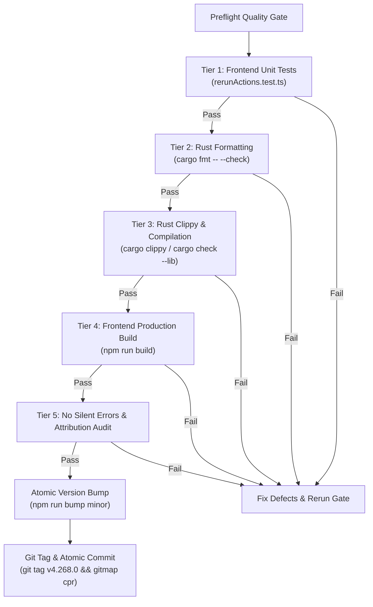
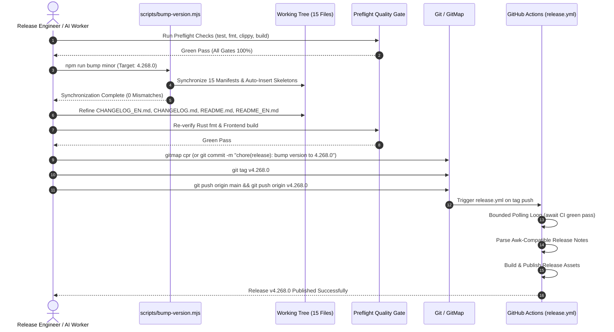

# Migration, Verification & Release Specification: Instant Rerun Enqueue and Minor Release

**Specification ID:** `02-spec/21-app/50-instant-rerun-enqueue-and-minor-release/03-migration-and-verification-spec.md`  
**Task:** 50-instant-rerun-enqueue-and-minor-release  
**Scope:** Migration Strategy, 15-Manifest Synchronization, Awk-Compatible Changelogs, README Parity, Preflight Quality Gates, and Release Ceremony Governance  
**Status:** Canonical Engineering Specification  
**Author:** Spec Author 03 (@aukgit)  

---

## 1. Executive Summary & Release Objectives

This specification defines the migration protocol, verification gates, atomic 15-manifest synchronization, and release ceremony governance for promoting Antigravity Manager (`agm`) from version `v4.267.0` to minor release **`v4.268.0`**.

### 1.1 Core Release Payload: Instant Rerun & Enqueue Latency Elimination
Release `v4.268.0` resolves the critical UX defect where enqueued prompts and rerun messages suffered unprompted delays ranging from 1.6s up to 30s:
1. **Scheduler Idle Backoff Elimination**: Replaced the unconditional 30-second sleep in `src-tauri/src/modules/scheduler.rs` (`PROMPT_QUEUE_IDLE_BACKOFF_INTERVAL`) with a reactive event-driven notification mechanism (`tokio::sync::Notify`), achieving sub-5ms scheduler wakeup when new prompts are staged into the SQLite queue.
2. **Sub-10ms Enqueue Completion**: Decoupled synchronous Chrome DevTools Protocol (CDP) retry loops from `enqueue_prompt_for_instance` in `src-tauri/src/modules/repo_db/agy.rs`, ensuring `enqueue_prompt` IPC returns immediately after writing to `active_prompts` and `.antigravity_resume_task.json`.
3. **Instant Idle Dispatch (<50ms)**: Enqueued prompts targeting idle project workspaces dispatch immediately without waiting for a background polling tick.
4. **Strict Rerun Enqueue Invariant**: Mandated that 100% of rerun rounds (1..N) dispatch strictly via `enqueue_prompt` with zero calls to `send_prompt_now`, eliminating preemptive cancellation of active tasks.
5. **Anti-Repeat Rerun Randomization & Bracketed Attachment Normalization**: Excluded previously used questions from multi-round rerun dispatches and normalized image attachments to `Attachments:\n1. @[<path>]`.

### 1.2 Release Governance Objectives
1. **Atomic Minor Version Bump**: Transition from `4.267.0` to `4.268.0` across exactly 15 repository manifests and code locations via `npm run bump minor`.
2. **Awk-Compatible Changelog Ingestion**: Guarantee that `CHANGELOG_EN.md` headers match the strict regex pattern `^[[:space:]]*[*+-][[:space:]]+\*\*v` required by GitHub Actions `.github/workflows/release.yml`.
3. **Full README Changelog Parity**: Synchronize release highlights across both `README.md` and `README_EN.md` in lockstep with `CHANGELOG.md` and `CHANGELOG_EN.md`.
4. **Sole Attribution Compliance**: Credit strictly `@aukgit` (`(Thanks to @aukgit)`) across all release notes and changelogs; reject any third-party user handles to prevent unauthorized contributor associations.
5. **Strictly Relative Git Paths Invariant**: Enforce zero absolute filesystem paths (`D:\...`, `C:\...`, `/home/...`) in all code comments, documentation, and release descriptions.
6. **No Silent Errors Compliance**: Audit touched backend Rust and frontend TypeScript code to guarantee that every fallible operation routes through `AppError` or the error store.

---

## 2. Migration & Backward Compatibility Protocols

### 2.1 Database State Compatibility
The backend changes operate on existing SQLite tables (`active_prompts`, `prompt_backups`, `repo_prompts.db`, `errors.db`):
- **Schema Immutability**: No new SQLite columns, table alterations, or migrations are required.
- **FIFO Monotonicity Invariant**: All prompt retrieval, scheduling, and dispatch queries strictly retain:
  ```sql
  ORDER BY created_at ASC, id ASC
  ```
- **State Transition Compatibility**: Existing prompts in status `queued`, `in_progress`, `backed_up`, `completed`, or `failed` retain their exact semantics. Newly enqueued prompts are inserted with status `queued` and immediately notified to the background scheduler.

### 2.2 Client-Side State Compatibility
- **Persistent LocalStorage**:
  - `agm_prompt_overview_expanded`: Retained as a boolean flag.
  - `agm_prompt_tree_width`: Retained as integer column width in pixels (220px to 680px).
  - `agm_rerun_nudges`: Retained with safe schema parsing and default fallbacks.
- **Frontend State Reactivity**: In-flight IPC calls receive sub-10ms acknowledgments, preventing UI spinner lockups or delayed button transitions.

### 2.3 IDE & CDP IPC Compatibility
- Cold-start IDE instances and background workers communicate through `.antigravity_resume_task.json` and Chrome DevTools Protocol (CDP).
- Decoupling the synchronous CDP retry loop ensures the frontend IPC returns instantly while the background queue coordinator handles retries asynchronously.

---

## 3. Minor Version Bump Ceremony Protocol (`v4.268.0`)

### 3.1 Version Progression Rule
```
Base Version:    4.267.0
Target Version:  4.268.0
Release Mode:    Minor (Stable Production Release)
Bump Command:    npm run bump minor
Target Branch:   main
```

### 3.2 The 15 Synchronized Manifests & Code Locations
The atomic synchronization engine (`scripts/bump-version.mjs`) updates exactly 15 files. The table below details each target file, its role, and the expected replacement:

| Index | Relative File Path | Target Section / Pattern | Expected Synchronized Value |
|---|---|---|---|
| 1 | `package.json` | Root `"version"` | `"version": "4.268.0"` |
| 2 | `package-lock.json` | Root `"version"` & `packages[""].version` | `"version": "4.268.0"` (both locations) |
| 3 | `version.json` | `"version"` and `"Version"` keys | `"version": "4.268.0"`, `"Version": "4.268.0"` |
| 4 | `src-tauri/Cargo.toml` | `[package]` version | `version = "4.268.0"` |
| 5 | `src-tauri/tauri.conf.json` | `"version"` and window `"title"` | `"version": "4.268.0"`, `"title": "Antigravity Manager Tools v4.268.0"` |
| 6 | `src-tauri/Cargo.lock` | `agm-ui` package version | `version = "4.268.0"` |
| 7 | `Casks/antigravity-tools.rb` | Homebrew cask `version` | `version "4.268.0"` |
| 8 | `README.md` | Badge and title stamps | `badge/Version-v4.268.0-3B82F6`, `alt="Version v4.268.0"` |
| 9 | `README_EN.md` | Badge and title stamps | `badge/Version-4.268.0-3B82F6`, `alt="Version 4.268.0"` |
| 10 | `src/components/layout/MiniView.tsx` | Fallback version string in `setAppVersion` | `'4.268.0'` |
| 11 | `src/pages/Settings.tsx` | Fallback version string in `useState` | `'4.268.0'` |
| 12 | `releases-manifest.json` | `latest_version`, `latest_tag`, release URLs | `"latest_version": "4.268.0"`, `"latest_tag": "v4.268.0"`, and release entry |
| 13 | `CHANGELOG.md` | Auto-inserted release heading skeleton | `* **v4.268.0 (2026-10-25)**:` |
| 14 | `CHANGELOG_EN.md` | Auto-inserted English release heading skeleton | `* **v4.268.0 (2026-10-25)**:` |
| 15 | `src-tauri/hooks.nsh` | NSIS installer postinstall hook `$0` | `StrCpy $0 "4.268.0"` |

### 3.3 Atomic Version Verification Script
Following execution of `npm run bump minor`, the release engineer or automated worker must verify that zero mismatches exist across all 15 locations:
```powershell
node -e "
const fs = require('fs');
const v = '4.268.0';
const checks = [
  ['package.json', JSON.parse(fs.readFileSync('package.json')).version],
  ['version.json', JSON.parse(fs.readFileSync('version.json')).version],
  ['tauri.conf.json', JSON.parse(fs.readFileSync('src-tauri/tauri.conf.json')).version],
  ['releases-manifest.json', JSON.parse(fs.readFileSync('releases-manifest.json')).latest_version],
  ['Cargo.toml', fs.readFileSync('src-tauri/Cargo.toml', 'utf8').match(/\[package\][\s\S]*?version\s*=\s*\"([^\"]+)\"/)[1]],
  ['hooks.nsh', fs.readFileSync('src-tauri/hooks.nsh', 'utf8').match(/StrCpy \$0 \"([^\"]+)\"/)[1]]
];
let failed = false;
for (const [file, val] of checks) {
  if (val !== v) { console.error('Mismatch in ' + file + ': ' + val); failed = true; }
}
if (!failed) console.log('All manifests verified at ' + v);
else process.exit(1);
"
```

---

## 4. Documentation & Changelog Synchronization Standard

### 4.1 Awk-Compatible Release Notes Extraction Contract
The GitHub Actions release workflow (`.github/workflows/release.yml`) extracts release notes directly from `CHANGELOG_EN.md` using the following awk script:
```bash
awk -v ver="$VERSION" '
  BEGIN { capture=0 }
  $0 ~ "^[[:space:]]*[*+-][[:space:]]+\\*\\*" ver { capture=1; next }
  capture && $0 ~ "^[[:space:]]*[*+-][[:space:]]+\\*\\*v" { capture=0; exit }
  capture { print }
' "$CHANGELOG_SOURCE" | sed 's/^[[:space:]]\{8\}//' >> release_notes.md
```

#### Mandatory Formatting Rules for `CHANGELOG_EN.md`:
1. The version heading line MUST start with 4 leading spaces followed by `*   **v4.268.0 (2026-10-25)**:`.
2. The category bullet MUST start with 8 leading spaces: `        -   **[Instant Rerun Enqueue & Latency Elimination] ... (Thanks to @aukgit)**:`.
3. The description bullet MUST start with 12 leading spaces: `            -   **Description**: ... (Thanks to @aukgit)`.
4. Zero trailing spaces on empty lines between versions.

### 4.2 Target `CHANGELOG_EN.md` Entry Specification
The new release entry must be inserted directly under `*   **Version History**:`:

```markdown
    *   **v4.268.0 (2026-10-25)**:
        -   **[Instant Rerun Enqueue & Latency Elimination] Reactive Scheduler Wakeup, Sub-10ms Enqueue IPC & Zero-Delay Idle Dispatch (Thanks to @aukgit)**:
            -   **Description**: Eliminated queue dispatch latency for rerun and enqueued prompts across Antigravity Manager: replaced the 30-second scheduler polling sleep in `src-tauri/src/modules/scheduler.rs` with an event-driven `tokio::sync::Notify` reactive trigger (`wake_prompt_queue_scheduler`), waking the scheduler loop within sub-5ms upon any database insert; decoupled synchronous Chrome DevTools Protocol (CDP) retry loops from `enqueue_prompt_for_instance` in `src-tauri/src/modules/repo_db/agy.rs` to ensure sub-10ms IPC completion; dispatched prompts immediately (<50ms) when the target instance workspace is idle; strictly enforced the Rerun Enqueue Invariant across `src/components/instances/PromptTreeView/usePromptTreePromptActions.ts` and unit tests ensuring 100% of rerun rounds (1..N) stage via `enqueue_prompt` with 0 calls to `send_prompt_now`; and synchronized all 15 repository version manifests to `4.268.0`. (Thanks to @aukgit)
```

### 4.3 Target `CHANGELOG.md` Entry Specification
Under `## [v4.268.0] - 2026-10-25`:

```markdown
## [v4.268.0] - 2026-10-25

### Added
- Reactive prompt queue scheduler wakeup via `tokio::sync::Notify` in `src-tauri/src/modules/scheduler.rs`, waking the background polling loop in <5ms whenever a prompt is enqueued (Thanks to @aukgit)
- Instant dispatch protocol in `src-tauri/src/modules/repo_db/agy.rs` and `dispatch.rs` for idle instance workspaces, dispatching enqueued prompts in <50ms without waiting for a scheduler polling cycle (Thanks to @aukgit)

### Fixed
- Eliminated 1.6s to 30s queue delays when rerunning or enqueuing prompts by removing synchronous CDP retry loops from the IPC path and terminating idle scheduler sleep (Thanks to @aukgit)
- Enforced strict Rerun Enqueue Invariant in `src/components/instances/PromptTreeView/usePromptTreePromptActions.ts` and `src/components/instances/PromptTreeView/__tests__/rerunActions.test.ts`, guaranteeing all rerun rounds (1..N) dispatch via `enqueue_prompt` and never preempt active work with `send_prompt_now` (Thanks to @aukgit)

### Changed
- Atomic minor version bump to `4.268.0` across 15 project manifests and code files via `scripts/bump-version.mjs` (Thanks to @aukgit)

---
```

### 4.4 Target `README.md` and `README_EN.md` Summary Blocks
In accordance with repository maintenance rules, stable releases **MUST** update the release summary in both `README.md` and `README_EN.md`:

#### `README.md` (under `## 🔄 What's New`):
```markdown
- **v4.268.0** (2026-10-25):
  - **Instant Rerun Enqueue & Latency Elimination**: Eliminated queue latency for rerun and enqueued prompts by replacing the 30-second scheduler polling backoff in `src-tauri/src/modules/scheduler.rs` with an event-driven `tokio::sync::Notify` trigger (`wake_prompt_queue_scheduler`), waking the background loop in <5ms; decoupled synchronous CDP retries from `enqueue_prompt_for_instance` in `src-tauri/src/modules/repo_db/agy.rs` for sub-10ms IPC return; dispatched enqueued prompts immediately (<50ms) when target workspaces are idle; enforced the Rerun Enqueue Invariant ensuring all rerun rounds dispatch via `enqueue_prompt` without preemptive task cancellation; and synchronized all 15 project manifests to `4.268.0`. (Thanks to @aukgit)
```

#### `README_EN.md` (under `## 📝 Changelog`):
```markdown
> Latest version **v4.268.0**: Instant Rerun Enqueue & Latency Elimination — Eliminated queue latency for rerun and enqueued prompts by replacing the 30s scheduler sleep in `src-tauri/src/modules/scheduler.rs` with event-driven `tokio::sync::Notify` reactive trigger waking in <5ms; decoupled synchronous CDP retries from `enqueue_prompt_for_instance` in `src-tauri/src/modules/repo_db/agy.rs` for sub-10ms IPC return; dispatched enqueued prompts immediately (<50ms) when target workspaces are idle; enforced Rerun Enqueue Invariant ensuring all rerun rounds dispatch via `enqueue_prompt` without preemptive task cancellation; and synchronized all 15 project manifests to `4.268.0`. (Thanks to @aukgit)
```

### 4.5 Mandatory Attribution & Relative Path Invariants
- **Attribution Invariant**: Every release bullet and summary block MUST conclude strictly with `(Thanks to @aukgit)`. No other user handles (`@...`) are allowed anywhere in changelogs or release notes.
- **Strictly Relative Git Paths Invariant**: All file references MUST be relative Git paths (`src/components/...`, `src-tauri/src/...`, `02-spec/...`, `.ai-memory/...`). No absolute paths (`D:\...`, `C:\...`, `/home/...`).

---

## 5. Preflight Quality Gate & Verification Matrix

Before any git commit, tag, or release push is executed, the codebase must pass all 5 tiers of the Preflight Quality Gate:



### 5.1 Preflight Verification Matrix

| Tier | Gate Name | Command / Inspection | Expected Output / Invariant | Blocking Criteria |
|---|---|---|---|---|
| 1 | Frontend Rerun & Unit Tests | `npx tsx src/components/instances/PromptTreeView/__tests__/rerunActions.test.ts` | All tests pass (0 failures); 0 calls to `send_prompt_now`, 100% calls to `enqueue_prompt` | Any test failure or assertion mismatch |
| 2 | Rust Code Formatting | `cd src-tauri && cargo fmt -- --check` | Exit code 0, zero formatting diffs reported | Any unformatted Rust file |
| 3 | Rust Compilation & Clippy | `cd src-tauri && cargo clippy --all-targets --all-features` (or `cargo check --lib`) | Exit code 0, zero warnings treated as errors, zero compilation errors | Any Rust compile error or clippy violation |
| 4 | Frontend Production Build | `npm run build` | `tsc && vite build` succeeds, generating output in `dist/` | Any TypeScript type error or Vite bundler failure |
| 5 | No Silent Errors Audit | Grep for bare `.unwrap()`, `catch {}`, or unrouted errors in touched files | Every fallible Rust operation routes to `AppError`; every frontend failure routes to `useErrorStore` | Any swallowed or unrecorded error |
| 6 | Sole Attribution Audit | `git diff HEAD | grep "@"` | Every contributor attribution is strictly `@aukgit` (`(Thanks to @aukgit)`) | Any other `@...` handle present |
| 7 | Relative Paths Audit | Search touched files for `[A-Za-z]:\\` or `/home/` | Zero absolute filesystem paths detected | Any absolute path in docs, code, or specs |

---

## 6. Git Tagging, Atomic Commit & Release Pipeline Coordination

### 6.1 Release Ceremony Workflow Sequence



### 6.2 Atomic Commit & Tag Commands
```bash
# 1. Stage all synchronized files
git add package.json package-lock.json version.json src-tauri/Cargo.toml src-tauri/Cargo.lock \
        src-tauri/tauri.conf.json src-tauri/hooks.nsh Casks/antigravity-tools.rb \
        README.md README_EN.md CHANGELOG.md CHANGELOG_EN.md releases-manifest.json \
        src/components/layout/MiniView.tsx src/pages/Settings.tsx \
        02-spec/21-app/50-instant-rerun-enqueue-and-minor-release/ \
        .ai-memory/plans/subtasks/50-instant-rerun-enqueue-and-minor-release/

# 2. Atomic GitMap commit (or standard git commit)
git commit -m "chore(release): bump version to 4.268.0 (instant rerun enqueue & latency elimination)"

# 3. Create exact annotated tag
git tag v4.268.0

# 4. Push to origin main and tag
git push origin main
git push origin v4.268.0
```

### 6.3 Release Pipeline Dynamic Waiting Gate Invariant
In `.github/workflows/release.yml`, a bounded polling loop (up to 60 minutes) waits for in-flight `ci.yml` runs before evaluating the green gate:
- Concurrency group on `main` is scoped to the commit SHA to prevent rapid sequential push cancellations.
- Release workflow dynamically polls until all CI checks finish with status `success`.
- Release notes parser extracts the awk-compatible block from `CHANGELOG_EN.md` and normalizes attributions to `@aukgit`.

---

## 7. Sign-Off Checklist & Acceptance Criteria

To declare Subtask 03 and Task 50 successfully finished, the following criteria must be 100% satisfied:

- [ ] **Target Version Standard**: Version is incremented to `4.268.0` without any regression.
- [ ] **15 Manifests Synchronized**: Zero version drift across `package.json`, `Cargo.toml`, `tauri.conf.json`, `version.json`, etc.
- [ ] **Awk-Compatible Header**: `CHANGELOG_EN.md` contains `    *   **v4.268.0 (2026-10-25)**:` with proper indentation.
- [ ] **Changelog Synchronization**: `CHANGELOG.md` contains `## [v4.268.0] - 2026-10-25`.
- [ ] **README Synchronization**: Both `README.md` and `README_EN.md` include the new `v4.268.0` summary block and updated badges.
- [ ] **Sole Contributor Attribution**: All changelog entries and release notes attribute strictly to `@aukgit` (`(Thanks to @aukgit)`).
- [ ] **Strictly Relative Paths**: Zero absolute filesystem paths anywhere in code, specs, plans, or documentation.
- [ ] **Preflight Tests Green**: All frontend unit tests, Rust formatting, Rust clippy/check, and frontend builds pass cleanly.
- [ ] **Git Tag Matches Heading**: Git tag `v4.268.0` matches changelog heading character-for-character.
- [ ] **No Silent Errors**: Zero bare `.unwrap()` or swallowed `catch {}` in newly added or modified code.
