# Account Switch Testing Architecture Specification

## 1. Overview & Context

This specification defines the testing and verification architecture for Antigravity-Manager (AGM) manual and automated account switching. The core objective is to guarantee zero prompt loss, multimodal image attachment preservation, strict caller IDE self-preservation, and complete audit trail visibility across transient test sandboxes.

The workflow integrates both the native `agm` terminal CLI suite and `gitmap` CLI commands, operating against isolated SQLite database vaults (`repo_prompts.db`, `backup-prompts.db`, `task_index.db`, and `errors.db`).

---

## 2. System Invariants

### Invariant 1: Caller IDE Self-Preservation (Zero Developer Impact)
- The test harness and CLI dispatchers MUST call `detect_caller_instance_id()` before executing any lifecycle or switch operation (`switch`, `stop`, `rm`).
- The developer's active workspace session (`default-copy-5597`, PID 32 immunity) is protected by hard guardrails:
  - CLI operations targeting the caller instance without `--force` or `AGM_FORCE_CALLER_OVERRIDE=1` fail-fast with **exit code 2** via `refuse_if_caller_instance()`.
  - Detection checks environment markers (`ANTIGRAVITY_INSTANCE_ID`, `AGM_INSTANCE_ID`, `ANTIGRAVITY_APP_DATA_DIR`, `ANTIGRAVITY_APP_DIR`, `VSCODE_PID`) and walks the process ancestry tree up to 24 parent levels to resolve whether the executing CLI process descends from an active IDE process.
- All end-to-end tests MUST execute inside transient sandboxes created via `agm instances test-create <name> --json` and purged with `agm instances test-clean <name> --json`.

### Invariant 2: Multimodal Image & Prompt Persistence
- Active running prompts must be captured prior to IDE termination and account transition.
- Prompt text and multimodal image payloads (Base64 data URIs and local file paths) are extracted via `extract_image_uris_or_paths()` in `src-tauri/src/modules/repo_db/detection.rs`.
- Backups are persisted to two distinct layers:
  1. SQLite `prompt_backups` table in `backup-prompts.db`.
  2. Scoped atomic workspace documents: `.antigravity_resume_task.<instance>.json` and `.antigravity_resume_task.json`.
- Multimodal payloads are preserved intact across the switch and re-injected post-launch into the new IDE session.

### Invariant 3: Pre-Switch Termination Ladder ("Kill First -> Write Second -> Start Third")
- Account switching follows a strict three-phase lifecycle ladder:
  1. **Kill First**: Gracefully terminate running IDE processes associated with the target instance (`close_instance_verified()`). Sparing rules (`should_spare_pid()`) protect unrelated instances and the caller IDE.
  2. **Kernel Settle Delay (200ms)**: Enforce a mandatory 200ms kernel settle delay (`std::thread::sleep(Duration::from_millis(200))`) to allow the Windows NTFS file handles, memory-mapped files, and SQLite WAL locks to fully release before file modification.
  3. **Lockfile & Port Cleanup**: Clean stale lock files (`lockfile`, `code.lock`, `DevToolsActivePort`).
  4. **Write Second**: Inject new credentials into the target instance data directory (e.g. `state.vscdb`) and write resumption payloads (`.antigravity_resume_task.<inst>.json`).
  5. **Start Third**: Relaunch the instance with child process tracking and PID discovery.

### Invariant 4: Mandatory 10-Second Settling Delay & Port Probing
- Following an account switch or instance relaunch, a minimum settling delay of 10 seconds (`post_switch_resume_delay_seconds = 10` in `src-tauri/src/models/config.rs`) is observed before verifying process health and re-dispatching prompts.
- **Port Probing (`DevToolsActivePort`)**: The subsystem polls `DevToolsActivePort` within the instance data directory to verify that the internal Chromium/Electron webview has opened its DevTools/CDP port and bound communication endpoints.
- **PID Scanning (`find_pids_for_data_dir`)**: Dynamic process scanning inspects running OS processes via `sysinfo`, normalizes forward/backward slashes and Windows 8.3 short paths (`GetShortPathNameW`), climbs the process ancestry tree (`parent_map`), filters out helper/crashpad processes, and accurately tracks the root IDE PID.

### Invariant 5: Dual CLI Support (`agm` and `gitmap`)
- Account switching and lifecycle verification must achieve full functional parity across:
  1. Native AGM CLI:
     - Sandbox creation: `agm instances test-create <name> [--json]`
     - Sandbox cleanup: `agm instances test-clean [name] [--json]`
     - Account switch: `agm switch -i <inst> -a <acc>` (aliases: `agm switch <account> -i <inst>`, `agm switch <instance> <account>`)
     - Backup verification: `agm backup-prompts list`
     - Diagnostics: `agm errors list`, `agm errors fix`
  2. GitMap CLI:
     - Automated switch and rotation: `gitmap agy asw run`
     - Status inspection: `gitmap agy status`, `gitmap pe`, `gitmap ps`

### Invariant 6: Audit Trail & Diagnostic Cleanliness
- Every account switch logs an `AuditAction::SwitchAccount` (code 3) entry in `task_index.db:hot_tasks_cache` and rotated `history-*.db`.
- The diagnostic error engine (`agm errors list`, `agm errors fix`) checks runtime error logs across `errors.db` and verifies SQLite integrity with `PRAGMA quick_check(1);`.

---

## 3. High-Level System Architecture

```mermaid
flowchart TD
    subgraph CallerProtection["Caller IDE Self-Preservation"]
        A["Caller Session (e.g. default-copy-5597, PID 32)"] --> B["detect_caller_instance_id()"]
        B --> C{"Is Target == Caller?"}
        C -->|Yes, without --force| D["Fail-Fast (Exit Code 2: refuse_if_caller_instance)"]
        C -->|No| E["Permit Operation"]
    end

    subgraph TestSandbox["Transient Sandbox Environment"]
        F["agm instances test-create test-switch-verify --json"] --> G["Isolated Profile & Data Dir (/instances/test-*)"]
        G --> H["Seed Multimodal Prompt with Image Payload"]
        H --> I["Pre-Switch Backup (backup-prompts.db & .antigravity_resume_task.json)"]
        
        subgraph TerminationLadder["Pre-Switch Termination Ladder"]
            I --> J["1. Kill First: close_instance_verified() via find_pids_for_data_dir"]
            J --> K["200ms Kernel Settle Delay (NTFS & Lockfile Release)"]
            K --> L["2. Write Second: Inject Credentials & Resume Task JSON"]
            L --> M["3. Start Third: Relaunch Target IDE Instance"]
        end

        M --> N["Settling Phase (post_switch_resume_delay_seconds = 10)"]
        N --> O["Port Probing (DevToolsActivePort CDP Check)"]
        O --> P["PID Scanning (find_pids_for_data_dir Lineage)"]
        P --> Q["Multimodal Prompt & Image Re-injection"]
        Q --> R["Verification: Audit Log (AuditAction::SwitchAccount) & errors.db"]
        R --> S["agm instances test-clean test-switch-verify --json"]
    end
```



---

## 4. Execution Workflow Details

### 4.1. Sandbox Provisioning
- Run `agm instances test-create test-switch-verify --json` to allocate a fresh, isolated profile.
- Output JSON schema verification:
  ```json
  {
    "success": true,
    "id": "test-switch-verify-1718000000",
    "name": "test-switch-verify-1718000000",
    "data_dir": ".../instances/test-switch-verify-1718000000/data",
    "config": {
      "id": "test-switch-verify-1718000000",
      "is_default": false,
      "has_keyring_bypass": true
    }
  }
  ```
- Guaranteed sandboxing: OS keyring bypass marker is configured, preventing keychain prompt interruptions.

### 4.2. Pre-Switch Termination & Settle
- **Find PIDs**: Scan process table via `find_pids_for_data_dir()`.
- **Termination**: Send termination signals to all instance processes; spare all protected PIDs (`other_instance_protection()`).
- **200ms Delay**: Windows kernel handle cleanup requires 200ms sleep before writing to files previously locked by Electron/SQLite.
- **Lock Removal**: Ensure `DevToolsActivePort`, `lockfile`, and `code.lock` are unlinked.

### 4.3. Switch Execution & Settling Delay
- Execute switch via `agm switch -i test-switch-verify -a target.user@gmail.com` or `gitmap agy asw run`.
- Sleep for `post_switch_resume_delay_seconds` (10 seconds) to allow:
  1. Electron main process launch.
  2. Chromium renderers and extension hosts to initialize.
  3. `DevToolsActivePort` file creation containing the port and browser GUID.
  4. Local IPC sockets and SQLite state databases to stabilize.

### 4.4. Verification & Diagnostics
- Verify prompt resumption in `.antigravity_resume_task.<inst>.json`.
- Query `task_index.db` to confirm `AuditAction::SwitchAccount` (action code 3) log entry.
- Execute `agm errors list --json` to ensure zero unexpected diagnostic errors (E1001–E9001) in `errors.db`.
- Tear down the sandbox using `agm instances test-clean test-switch-verify --json`.

---

## 5. Component Mapping & File References

| Subsystem | Source Location | Responsibility |
| :--- | :--- | :--- |
| **Sandbox Lifecycle** | `src-tauri/src/bin/agm/instance_routes_b.rs` | Handles `test-create` and `test-clean` CLI commands |
| **Caller Protection** | `src-tauri/src/modules/instance/close.rs` | Implements `detect_caller_instance_id()`, `refuse_if_caller_instance()` |
| **Process Sparing** | `src-tauri/src/modules/instance/protection.rs` | Implements `should_spare_pid()`, `other_instance_protection()` |
| **PID Scanning** | `src-tauri/src/modules/instance/pid_scan.rs` | Implements `find_pids_for_data_dir()`, path normalization, 8.3 short paths |
| **Port Probing** | `src-tauri/src/modules/instance/cdp_onboarding.rs` | Manages `DevToolsActivePort` probing, CDP port resolution |
| **Switch Engine** | `src-tauri/src/modules/instance/switch.rs` | Enforces "Kill First -> Write Second -> Start Third", 200ms settle delay |
| **Config Models** | `src-tauri/src/models/config.rs` | Defines `post_switch_resume_delay_seconds = 10` |
| **Switch CLI Routes** | `src-tauri/src/bin/agm/account_mgmt.rs` | Parses `agm switch -i <inst> -a <acc>`, sequences, aliases |
| **GitMap AGY Parity** | `cli/cmdagy/` | Powers `gitmap agy asw run` and GitMap developer hygiene |
| **Audit Subsystem** | `src-tauri/src/modules/task_history_db.rs` | Records `AuditAction::SwitchAccount` (code 3) in `task_index.db` |
| **Diagnostics & Repair** | `src-tauri/src/modules/diagnostics/` | Inspects `errors.db`, runs 8-stage self-healing (`agm errors fix`) |
