# Account Switch Testing Architecture Specification

## 1. Overview & Context

This specification defines the testing and verification architecture for Antigravity-Manager (AGM) manual and automated account switching. The goal is to guarantee zero prompt loss, multimodal image attachment preservation, strict caller IDE self-preservation, and complete audit trail visibility across transient test sandboxes.

The workflow integrates both the native `agm` terminal CLI suite and `gitmap` CLI commands, operating against isolated SQLite database vaults (`repo_prompts.db`, `backup-prompts.db`, `task_index.db`, and `errors.db`).

---

## 2. System Invariants

### Invariant 1: Caller IDE Self-Preservation (Zero Developer Impact)
- The test harness and CLI dispatchers MUST call `detect_caller_instance_id()` before executing any lifecycle or switch operation (`switch`, `stop`, `rm`).
- The developer's active workspace session (`default-copy-5597`) is protected by hard guardrails: operations targeting the caller instance without `--force` fail-fast with exit code 2.
- All end-to-end tests MUST execute inside transient sandboxes created via `agm instances test-create <name> --json` and purged with `agm instances test-clean <name> --json`.

### Invariant 2: Multimodal Image & Prompt Persistence
- Active running prompts must be captured prior to IDE termination and account transition.
- Prompt text and multimodal image payloads (Base64 data URIs and local file paths) are extracted via `extract_image_uris_or_paths()` in `src-tauri/src/modules/repo_db/detection.rs`.
- Backups are persisted to two distinct layers:
  1. SQLite `prompt_backups` table in `backup-prompts.db`.
  2. Scoped atomic workspace documents: `.antigravity_resume_task.<instance>.json` and `.antigravity_resume_task.json`.
- Multimodal payloads are preserved intact across the switch and re-injected post-launch into the new IDE session.

### Invariant 3: Mandatory 10-Second Settling Delay
- Following an account switch or instance launch, a minimum settling delay of 10 seconds (`post_switch_resume_delay_seconds = 10`) is observed before verifying process health and re-dispatching prompts.
- This ensures the Antigravity IDE process initializes its internal webview, binds local prompt channels, and avoids race conditions during prompt re-injection.

### Invariant 4: Dual CLI Support (`agm` and `gitmap`)
- Account switching and status inspection must be fully operational through both:
  1. `agm switch -i <instance> <email>` / `agm instances ...` / `agm backup-prompts`
  2. `gitmap switch` / `gitmap pe` / `gitmap ps`

### Invariant 5: Audit Trail & Diagnostic Cleanliness
- Every account switch logs an `AuditAction::SwitchAccount` (code 3) entry in `task_index.db:hot_tasks_cache` and rotated `history-*.db`.
- The diagnostic error engine (`agm errors list`, `agm errors fix`) checks runtime error logs across `errors.db` and verifies SQLite integrity with `PRAGMA quick_check(1);`.

---

## 3. High-Level System Architecture

```mermaid
flowchart TD
    subgraph CallerProtection["Caller IDE Preservation"]
        A[Developer IDE: default-copy-5597] -.->|Protected by detect_caller_instance_id| B[Lockout Guard]
    end

    subgraph TestSandbox["Transient Sandbox Environment"]
        C["agm instances test-create switch-test"] --> D[Isolated Workspace & AppData]
        D --> E[Seed Multimodal Prompt with Image Payload]
        E --> F["Pre-Switch Backup (backup-prompts.db & .antigravity_resume_task.json)"]
        F --> G["Account Switch via agm switch / gitmap switch"]
        G --> H["10s Settling Delay (wait_for_instance_prompt_channel)"]
        H --> I["Post-Switch Launch & Multimodal Prompt Re-injection"]
        I --> J["Verification: Audit Log & Error Diagnostics"]
        J --> K["agm instances test-clean switch-test"]
    end
```

---

## 4. Component Mapping & File References

| Subsystem | Source Location | Responsibility |
| :--- | :--- | :--- |
| **Sandbox Lifecycle** | `src-tauri/src/modules/instance/test_instances.rs` | Scaffolds isolated profiles (`test-*`), keyrings, and cleanup |
| **CLI Dispatcher** | `src-tauri/src/bin/agm/` | Command handlers for `instances`, `switch`, `backup-prompts`, `errors` |
| **Prompt Detection** | `src-tauri/src/modules/repo_db/detection.rs` | Extracts prompt text and Base64/path image payloads |
| **Prompt Backup DB** | `src-tauri/src/modules/backup_prompts_db/` | Manages `backup-prompts.db`, batch IDs, and restoration state |
| **Active Prompt DB** | `src-tauri/src/modules/repo_db/` | Manages `repo_prompts.db:active_prompts` state machine |
| **Auto-Switcher Engine** | `src-tauri/src/modules/auto_switcher/` | Candidate scoring, 5h rolling / 7d weekly quota math, rotation |
| **Audit Subsystem** | `src-tauri/src/modules/task_history_db.rs` | Logs `hot_tasks_cache` (500 rows) and auto-rotates history |
| **Diagnostics & Repair** | `src-tauri/src/modules/diagnostics/` | 8-stage repair ladder, SQLite quick_check, error resolution |
