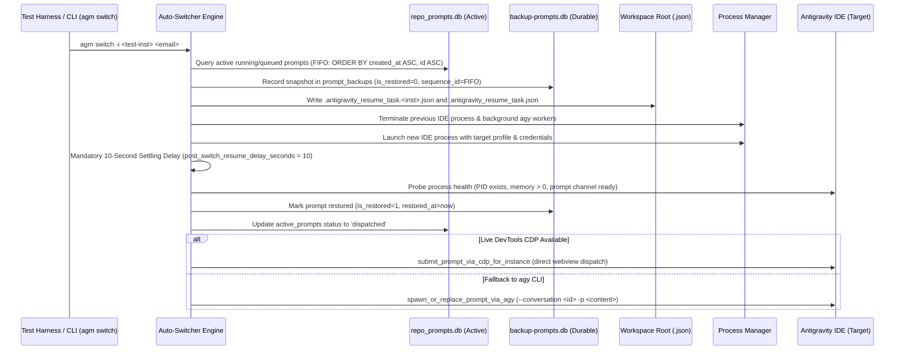

# Account Switch & Multimodal Prompt Backup Specification

## 1. Overview & Data Architecture

This document specifies the end-to-end data pipeline for capturing active prompts containing deep textual analysis and multimodal image attachments, persisting them across account rotations, and re-injecting them into the target instance after switching.

The architecture decouples the live prompt tracking engine (`repo_prompts.db`) from the durable prompt backup vault (`backup_prompts.db` / `backup-prompts.db`) and filesystem resumption manifests (`.antigravity_resume_task.json`), guaranteeing zero prompt loss and byte-identical image preservation across Antigravity IDE instances.

---

## 2. Decoupled SQLite Schemas

The prompt preservation subsystem operates across two dedicated SQLite database vaults configured in WAL journal mode with a 5000ms busy timeout:

```
[ Antigravity IDE ]
        │
        ▼ (Live Prompt Capture)
[ repo_prompts.db : active_prompts ] ──(Pre-Switch Snapshot)──► [ backup_prompts.db : prompt_backups ]
        │                                                                     │
        ▼ (Filesystem Mirror)                                                 ▼ (Post-Switch Re-injection)
[ <workspace>/.antigravity_resume_task.json ] ◄───────────────────────────────┘
```

### A. Live Prompt Engine Schema: `repo_prompts.db`

Located at `<appdata>/repo_prompts.db`, initialized via `src-tauri/src/modules/repo_db/schema.rs`.

#### 1. `running_projects` Table
Tracks active workspace projects discovered from IDE workspaceStorage:
```sql
CREATE TABLE IF NOT EXISTS running_projects (
    id TEXT PRIMARY KEY,
    instance_id TEXT NOT NULL,
    repo_name TEXT NOT NULL,
    repo_path TEXT NOT NULL,
    workspace_storage_path TEXT,
    is_running INTEGER NOT NULL DEFAULT 1,
    last_detected_at INTEGER NOT NULL,
    updated_at INTEGER NOT NULL
);
CREATE INDEX IF NOT EXISTS idx_running_projects_inst_running 
    ON running_projects(instance_id, is_running);
```

#### 2. `active_prompts` Table
Maintains current prompt execution states and live image payloads:
```sql
CREATE TABLE IF NOT EXISTS active_prompts (
    id TEXT PRIMARY KEY,
    project_id TEXT NOT NULL,
    instance_id TEXT NOT NULL,
    repo_path TEXT NOT NULL,
    prompt_content TEXT NOT NULL,
    model TEXT,
    session_id TEXT,
    status TEXT NOT NULL,
    created_at INTEGER NOT NULL,
    updated_at INTEGER NOT NULL,
    image_payload TEXT,
    FOREIGN KEY(project_id) REFERENCES running_projects(id)
);
CREATE INDEX IF NOT EXISTS idx_active_prompts_instance_status 
    ON active_prompts(instance_id, status);
```

**Field Descriptions**:
- `id`: Unique prompt identifier (e.g., `p-a1b2c3d4` or UUID).
- `project_id`: Composite project key (`<repo_name>__<instance_id>`).
- `instance_id`: Scoped instance identifier (`default`, `test-switch-test`, etc.).
- `repo_path`: Relative or normalized repository path.
- `prompt_content`: Raw textual prompt with optional inline image references.
- `model`: Target AI model name (e.g., `gemini-2.5-pro`, `gemini-3.8-flash-high`).
- `session_id`: Conversation session UUID preserving chat continuity.
- `status`: Lifecycle state machine (`queued` -> `running` -> `backed_up` -> `dispatched` -> `completed`).
- `created_at` / `updated_at`: Unix epoch seconds used for strict FIFO ordering.
- `image_payload`: Serialized image URI, JSON array of URIs, or path fallback.

---

### B. Durable Backup Vault Schema: `backup_prompts.db`

Located at `<appdata>/backup-prompts/backup-prompts.db` (or `data/backup-prompts/backup-prompts.db`), initialized via `src-tauri/src/modules/backup_prompts_db/db.rs`.

#### 1. `backup_batches` Table
Groups prompt backup snapshots generated during account rotation batches:
```sql
CREATE TABLE IF NOT EXISTS backup_batches (
    id TEXT PRIMARY KEY,
    created_at INTEGER NOT NULL,
    prompts_count INTEGER NOT NULL,
    file_path TEXT NOT NULL,
    retention_days INTEGER NOT NULL DEFAULT 1,
    is_fully_restored BOOLEAN NOT NULL DEFAULT 0
);
```

#### 2. `prompt_backups` Table
Stores immutable pre-switch prompt snapshots with multimodal payloads:
```sql
CREATE TABLE IF NOT EXISTS prompt_backups (
    id TEXT PRIMARY KEY,
    backup_batch_id TEXT NOT NULL,
    prompt_id TEXT NOT NULL,
    project_name TEXT NOT NULL,
    project_path TEXT NOT NULL,
    project_id TEXT NOT NULL,
    conversation_id TEXT NOT NULL,
    conversation_name TEXT,
    sequence_id INTEGER NOT NULL,
    prompt_text TEXT NOT NULL,
    has_images BOOLEAN NOT NULL DEFAULT 0,
    images_payload TEXT,
    status TEXT NOT NULL DEFAULT 'queued',
    created_at INTEGER NOT NULL,
    is_restored BOOLEAN NOT NULL DEFAULT 0,
    restored_at INTEGER,
    instance_id TEXT DEFAULT 'default',
    FOREIGN KEY(backup_batch_id) REFERENCES backup_batches(id) ON DELETE CASCADE
);
CREATE INDEX IF NOT EXISTS idx_prompt_backups_batch ON prompt_backups(backup_batch_id);
CREATE INDEX IF NOT EXISTS idx_prompt_backups_restored ON prompt_backups(is_restored, restored_at);
CREATE INDEX IF NOT EXISTS idx_prompt_backups_instance ON prompt_backups(instance_id);
```

---

## 3. Multimodal Image Representation & Serialization Engine

The image extraction and serialization pipeline is implemented in `src-tauri/src/modules/repo_db/detection.rs`. It handles multimodal data across 4 distinct formats:

```
[ Prompt Text Input ]
        │
        ├──► extract_image_uris_or_paths() ──► (data_uris, file_paths)
        │                                             │
        ├──► extract_screenshot_id_token()            ▼
        │         │                         serialize_image_uris()
        │         ▼                                   │
        └───────► compose_image_payload() ◄───────────┘
                        │
                        ▼
        [ Stored image_payload / images_payload ]
```

### A. Extraction Protocol (`extract_image_uris_or_paths`)
1. **Document-Order Scanning**: Scans `prompt_content` for `data:image/` substrings without regex overhead. Extracts all Base64 URIs (`data:image/{png|jpeg|webp|gif|svg|bmp};base64,<payload>`) byte-identically, preserving exact original encodings and deduplicating in document order.
2. **Local File Path Detection**: Splits content on whitespace, trims enclosing delimiters (`"`, `'`, `(`, `)`, `[`, `]`, `<`, `>`), strips `file:///` or `file://` prefixes, and detects valid image extensions (`.png`, `.jpg`, `.jpeg`, `.webp`, `.gif`, `.svg`, `.bmp`).
3. **Screenshot ID Token Parsing (`extract_screenshot_id_token`)**: Scans tokens for `SS_ID_<digits>`, `ss_id_<digits>`, `screenshot_id=<token>`, or `screenshot_id:<token>`.

### B. Serialization Rules (`serialize_image_uris`)
To maintain backwards compatibility while supporting multi-image prompts in single-`TEXT` SQLite columns:
- **0 Images**: Returns `None`.
- **1 Image**: Returns the single `data:image/...` URI verbatim as a plain string (byte-identical legacy representation).
- **2+ Images**: Serializes the `Vec<String>` into a compact JSON array string `["data:image/...;base64,...", "data:image/...;base64,..."]`.

### C. Deserialization & Reconciliation
- **`parse_image_uris(payload: &str)`**: Inspects the trimmed payload. If starting with `[`, parses JSON array to `Vec<String>`. If a plain string, returns a 1-element `vec![payload]`. If empty, returns empty vector.
- **`effective_image_uris(stored_payload, extracted_uris)`**: Stored database payload takes precedence; if empty or `None`, falls back to freshly extracted URIs.
- **`compose_image_payload(stored, extracted, paths)`**: Combines URIs and path fallbacks. If no URIs exist but local paths exist, produces semicolon-delimited joined paths (`p1.png;p2.png`) for legacy compat. Screenshot tokens are suffixed via `;screenshot_id=<token>`.

---

## 4. Atomic Resumption Manifests

Prior to terminating an instance and immediately upon re-injection, AGM writes atomic JSON resumption manifests to the workspace root directory:

1. **Global Manifest**: `<workspace>/.antigravity_resume_task.json` (canonical pointer read by Antigravity IDE and extension boots).
2. **Instance-Scoped Manifest**: `<workspace>/.antigravity_resume_task.<instance_id>.json` (sandboxed instance backup preventing collision during parallel multi-instance tests).

### Canonical Manifest Schema
```json
{
  "prompt_id": "p-c1f7a28e",
  "project_id": "switch-test__test-switch-test",
  "workspace_id": "switch-test__test-switch-test",
  "sequence_code": "[AGM:P001 | GM:#1]",
  "seq_code": "[AGM:P001 | GM:#1]",
  "instance_id": "test-switch-test",
  "repo_path": "tests/sandboxes/switch-test",
  "prompt_content": "Deep analysis: inspect neural layer latency graph and layout fidelity with attached diagram",
  "model": "gemini-2.5-pro",
  "session_id": "conv-test-8899",
  "conversation_id": "conv-test-8899",
  "image_payload": "data:image/png;base64,iVBORw0KGgoAAAANSUhEUgAAAAEAAAABCAYAAAAfFcSJAAAADUlEQVR42mNk+M9QDwADhgGAWjR9awAAAABJRU5ErkJggg==",
  "image_paths": [
    "tests/fixtures/test_diagram.png"
  ],
  "has_image": true,
  "auto_boot": true,
  "status": "dispatched",
  "backed_up_at": 1729384920
}
```

### Multi-Image Variant (`image_payload` as JSON Array)
When multiple images are attached, `image_payload` is serialized as a JSON array string or embedded array:
```json
{
  "image_payload": "[\"data:image/png;base64,iVBORw...\",\"data:image/jpeg;base64,/9j/4AAQ...\"]",
  "image_paths": [
    "assets/diagram1.png",
    "assets/diagram2.jpg"
  ],
  "has_image": true
}
```

---

## 5. Account Switch Execution Ladder & Re-injection Flow

The account switch operates through an orchestrated 7-step sequence strictly enforcing the house FIFO Invariant and Zero-Prompt-Loss protocol:



### Invariant: Strict FIFO Restore & Queue Invariant
In accordance with system guidelines, all queries reading prompt queues or restore backlogs MUST enforce strict FIFO ordering:
- **`backup_prompts.db`**: `ORDER BY created_at ASC, sequence_id ASC`
- **`repo_prompts.db`**: `ORDER BY created_at ASC, id ASC`
- Inverted LIFO queries (`ORDER BY updated_at DESC` or `ORDER BY created_at DESC`) are strictly forbidden in dispatch and restore logic.

### Re-injection Ladder: CDP Direct Submission vs. AGY CLI Fallback
1. **System Clipboard Sync**: The restored prompt text is immediately copied to the system clipboard via `copy_to_system_clipboard()` (`clip` on Windows, `pbcopy` on macOS, `wl-copy`/`xclip` on Linux) to prevent webview "Document is not focused" errors.
2. **Primary: DevTools CDP Submission**:
   - Executes `submit_prompt_via_cdp_for_instance(&instance_id, &prompt_content)`.
   - If cold-started, performs up to 3 retry attempts with a 500ms settlement buffer.
   - On success, logs `cdp_dispatch` audit event and marks status `dispatched`.
3. **Fallback: Headless AGY CLI Spawn**:
   - If CDP is unavailable, invokes `spawn_or_replace_prompt_via_agy(&prompt, true)`.
   - Spawns executable with `--dangerously-skip-permissions`, `--conversation <session_id>`, `-p <prompt_content>`.
   - Injects isolated environment variables (`USERPROFILE`, `HOME`, `JETSKI_OAUTH_TOKEN`, `GEMINI_CLI_OAUTH_TOKEN`).
   - Spawns background monitor thread to transition prompt status to `'completed'` on exit code 0.

---

## 6. Settling Delay & Process Verification Invariant

1. **Mandatory 10-Second Delay**: An uninterrupted settling duration of 10 seconds (`post_switch_resume_delay_seconds = 10`) MUST elapse after spawning the target IDE process before any prompt re-injection attempt.
2. **Process Health Validation**:
   - Refresh system process list via `sysinfo::System::refresh_processes()`.
   - Verify PID exists and memory usage is non-zero.
   - Verify prompt communication channel (`wait_for_instance_prompt_channel()`).
3. **Idempotency & Double-Dispatch Guard**:
   - `RESEND_IN_PROGRESS` thread-local RAII guard intercepts accidental nested dispatch loops.
   - Signature deduplication (`repo_path + prompt_content`) prevents re-dispatching identical prompts within the same switch cycle.

