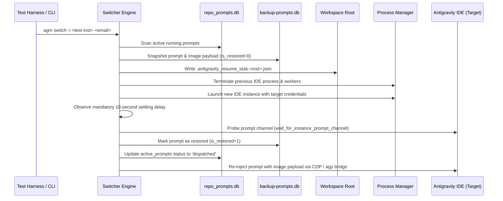

# Account Switch & Multimodal Prompt Backup Specification

## 1. Overview & Data Structures

This document specifies the end-to-end data pipeline for capturing active prompts containing deep textual analysis and image attachments, persisting them across account rotations, and re-injecting them into the target instance after switching.

---

## 2. Multimodal Payload Representation

### A. Extraction Protocol
Prompt content is extracted from two sources:
1. `transcript_full.jsonl` / `transcript.jsonl` located in `<instance_appdata>/home/.gemini/antigravity/brain/<conv_id>/.system_generated/logs/`.
2. Workspace state database `state.vscdb` (`workbench.action.chat.interactiveInputHistory`).

Images are detected via `extract_image_uris_or_paths()`:
- **Base64 Data URIs**: Formatted as `data:image/{png|jpeg|webp|gif};base64,<payload>`.
- **File System Paths**: Formatted as local paths or `file:///` URIs referencing images on disk.
- **Screenshot ID Tokens**: Formatted as `SS_ID_...` or `screenshot_id=...`.

### B. SQLite Schema: `backup_prompts.db:prompt_backups`
```sql
CREATE TABLE IF NOT EXISTS prompt_backups (
    id TEXT PRIMARY KEY,
    backup_batch_id TEXT NOT NULL,
    prompt_id TEXT NOT NULL,
    project_name TEXT NOT NULL,
    project_path TEXT NOT NULL,
    project_id TEXT NOT NULL,
    conversation_id TEXT NOT NULL,
    conversation_name TEXT,
    sequence_id INTEGER NOT NULL,
    prompt_text TEXT NOT NULL,
    has_images BOOLEAN NOT NULL DEFAULT 0,
    images_payload TEXT,
    status TEXT NOT NULL DEFAULT 'queued',
    created_at INTEGER NOT NULL,
    is_restored BOOLEAN NOT NULL DEFAULT 0,
    restored_at INTEGER,
    instance_id TEXT DEFAULT 'default',
    FOREIGN KEY(backup_batch_id) REFERENCES backup_batches(id) ON DELETE CASCADE
);
```

### C. Atomic Resume Document: `.antigravity_resume_task.<instance_id>.json`
```json
{
  "prompt_id": "c1f7a28e-5b1e-4509-9fc4-82f2fbc512de",
  "project_id": "switch-test",
  "workspace_id": "switch-test",
  "sequence_code": "[AGM:P001 | GM:#1]",
  "seq_code": "[AGM:P001 | GM:#1]",
  "instance_id": "test-switch-test",
  "repo_path": "d:/work/Antigravity-Manager",
  "prompt_content": "Deep analysis: verify layout rendering and color fidelity with attached diagram",
  "model": "gemini-2.5-pro",
  "session_id": "sess-test-8899",
  "conversation_id": "conv-test-8899",
  "image_payload": "data:image/png;base64,iVBORw0KGgoAAAANSUhEUgAAAAEAAAABCAYAAAAfFcSJAAAADUlEQVR42mNk+M9QDwADhgGAWjR9awAAAABJRU5ErkJggg==",
  "image_paths": ["assets/test_diagram.png"],
  "has_image": true,
  "auto_boot": true,
  "status": "backed_up",
  "backed_up_at": 1729384920
}
```

---

## 3. Account Switch Execution Ladder

The account switch operates through an orchestrated 7-step sequence:



---

## 4. Settling Delay & Process Verification Invariant

1. **Wait Duration**: Exact 10-second delay (`post_switch_resume_delay_seconds = 10`) must elapse after the child process is launched.
2. **Process Health Check**:
   - Check PID existence via `sysinfo::System::refresh_processes()`.
   - Verify non-zero memory footprint.
   - Verify prompt communication channel or local port availability before triggering re-injection.
