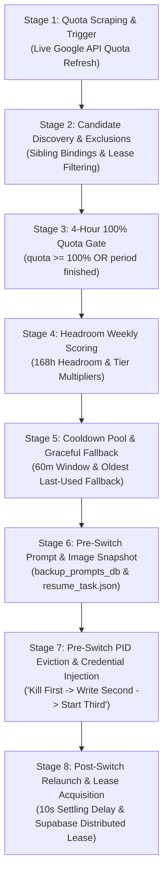

# Account Switch Verification & Audit Specification

## 1. Scope & Standards

This specification establishes the verification criteria, diagnostic checks, and audit trails required for validating manual and automatic account switching across Antigravity tools.

The verification harness guarantees zero prompt loss, multimodal image attachment preservation, strict caller IDE self-preservation, and complete audit trail visibility across transient test sandboxes.

---

## 2. Verification Checklist & Acceptance Gates

The end-to-end lifecycle follows nine mandatory quality gates (G1 through G9):

| Gate # | Phase | Verification Rule | Tool / Source | Pass Condition |
| :--- | :--- | :--- | :--- | :--- |
| **G1** | Sandbox Provisioning | Isolated instance creation | `agm instances test-create <name> --json` | Valid JSON, instance prefixed with `test-`, isolated AppData directory, zero caller IDE disruption |
| **G2** | Prompt Seeding | Multimodal prompt registration | `repo_prompts.db:active_prompts` & `backup-prompts.db` | Prompt text present, `has_images = 1`, `image_payload` populated with valid Base64 / path data |
| **G3** | Pre-Switch Snapshot | Backup creation prior to IDE exit | `backup-prompts.db` & `.antigravity_resume_task.<inst>.json` | Row created in `prompt_backups` with `is_restored = 0`, JSON resume file written to workspace root |
| **G4** | Switch Execution | Atomic credential injection | `agm switch` / `gitmap switch` | Exit code 0, target credentials injected into `state.vscdb`, caller IDE untouched |
| **G5** | Settling Period | 10-second stability delay | Process monitoring / timer | Process alive after $\ge 10$ seconds (`post_switch_resume_delay_seconds = 10`), port/channel active |
| **G6** | Prompt Re-injection | Prompt restored post-switch | `active_prompts` & `.antigravity_resume_task.<inst>.json` | Status transition to `dispatched`, image payload verified intact in target instance |
| **G7** | Audit Log Audit | Switch logged in task history | `task_index.db:hot_tasks_cache` | `action_code = 3 (SwitchAccount)`, accurate timestamp, `SwitchAuditSteps` recorded |
| **G8** | Error Diagnostics | SQLite check & error telemetry | `agm errors list` & `agm errors fix` | Zero unhandled critical runtime errors (`E1001`–`E9001`), 8/8 diagnostic self-healing checks pass |
| **G9** | Clean Teardown | Zero leftover test remnants | `agm instances test-clean <name> --json` | All `test-*` processes and folders purged, developer IDE healthy |

---

## 3. Intelligent Auto-Switching 8-Stage Execution Sequence

The auto-switcher daemon (`src-tauri/src/modules/auto_switcher/`) operates through an orchestrated 8-stage pipeline when evaluating, rotating, and restoring instance accounts:



### Stage 1: Live Quota Scraping & Threshold Evaluation (Trigger)
- The daemon periodically scans all monitored instance copies (`check_and_rotate_with_options`).
- Fetches fresh quota directly from the Google API via `fetch_quota_with_retry` prior to decision-making.
- Evaluates quota against `low_quota_threshold_percent` (default 20.0%) and `critical_threshold_percent` (default 5.0%), or triggers on HTTP 429 (`RESOURCE_EXHAUSTED`).

### Stage 2: Candidate Profile Discovery & Exclusion Filtering
- Scans all configured accounts from `accounts.json`.
- **Exclusion Ladder**:
  1. Active account currently bound to the target instance (forces rotation away).
  2. Accounts bound to actively running sibling instances on the host (`is_account_bound_to_running_sibling`).
  3. Accounts currently in rate-limit cooldown (`live_limited_models`).
  4. Accounts marked `disabled` or `validation_blocked`.
  5. Accounts actively leased by other cluster nodes via Supabase (`workspace_lease_manager::is_account_or_email_leased_by_other`).

### Stage 3: Strict 4-Hour 100% Quota Gate
- Candidate accounts are evaluated against their short-term 4-hour rolling bucket.
- **The Invariant**: Candidate accounts must have $\ge 100\%$ quota, OR their reset boundary must have elapsed (`is_period_finished == true`).
- Any candidate with $< 100\%$ 4-hour quota whose reset period has not finished is assigned a base score of `0.0` and excluded from the primary available pool.

### Stage 4: Headroom-Weighted 7-Day Weekly Allowance Scoring
- When candidates satisfy the 4-hour gate, they are ranked using their 7-day macro allocation ($168.0$ hours cycle).
- **Headroom Calculation**:
  $$\text{Remaining Headroom Hours} = \max\left(0.0, \min\left(168.0, \frac{\text{reset\_ts} - \text{now\_sec}}{3600}\right)\right)$$
- Freshly reset accounts receive maximum headroom ($168.0$ hours). Accounts nearing reset receive minimal headroom.
- **Scoring Formula**:
  $$\text{Final Score} = \frac{\text{Tier Multiplier} \times \text{Weekly Effective Score}}{100.0}$$
  - **Tier Multipliers** (user-configurable via `AutoProfileSwitcherConfig`):
    - **Ultra**: `4.0` (or `5.0` in ultra-tier profiles)
    - **Pro**: `2.0` (or `3.0`)
    - **Free / Standard**: `1.0`
  - Weekly quota below viable threshold ($< 8.0\%$) is clamped to `0.0`.
  - Non-Gemini / 3P buckets (e.g. Claude) are excluded from scoring.

### Stage 5: Cooldown Pool Evaluation & Graceful Fallback
- Accounts used within the cooldown window (`account_cooldown_minutes`, default 60 minutes) or holding active remote leases are assigned to `cooldown_pool`.
- **Sorting & Selection**:
  - If `available_pool` is non-empty, candidates are sorted in descending order by score with deterministic email tie-breaking.
  - If and only if `available_pool` is empty (all eligible accounts are in cooldown), the system triggers graceful fallback: sorts `cooldown_pool` by oldest `last_used` timestamp (ascending) so the switcher never deadlocks.

### Stage 6: Pre-Switch Multimodal Prompt & Image Snapshotting
- Prior to terminating processes, active running and queued prompts are captured via `repo_db::backup_running_prompts` and `backup_prompts_db::backup_active_running_prompts`.
- Prompts with attached images (Base64 data URIs, local image file paths, screenshot tokens) are extracted using `extract_image_uris_or_paths()`.
- Writes `.antigravity_resume_task.<instance_id>.json` and `.antigravity_resume_task.json` atomically in the workspace directory.

### Stage 7: Pre-Switch PID Eviction & Atomic Credential Injection
- Adheres to the strict invariant: **"Kill First $\rightarrow$ Write Second $\rightarrow$ Start Third"**.
- Target instance processes and child workers (`agy`) are closed cleanly via `close_instance_verified`. Lingering PIDs escalate through Win32 force termination and PowerShell fallback.
- Mandatory 200ms kernel settle delay allows NTFS file handles to close.
- Injects target account credentials into `state.vscdb` (ItemTable protobuf payload), `storage.json`, and OS keyring. Stale `*.lock` files are purged.

### Stage 8: Post-Switch Relaunch, Settling Verification & Supabase Distributed Lease
- Relaunches Antigravity IDE preserving the original executable path and bound workspace folders.
- Enforces the **mandatory 10-second settling delay** (`post_switch_resume_delay_seconds = 10`) for internal webview initialization and prompt channel binding.
- Acquires a distributed lease in the Supabase Root DB (`workspace_lease_manager::acquire_lease_with_details`) with configured TTL to prevent multi-machine collisions.
- Re-injects prompts via `schedule_prompt_restore_after_launch` and logs the completed transition into the audit subsystem.

---

## 4. Split SQLite Audit Trail Architecture

To prevent unbounded single-file growth, AGM employs a high-throughput Sharded Split-DB design located at `%APPDATA%/data/task_history/` (or `~/.antigravity_tools/data/task_history/`).

```
task_history/
├── task_index.db                  <-- Master index & fast search cache
│   ├── split_catalog              <-- Catalog of all shard files & row counts
│   └── hot_tasks_cache            <-- Synchronous fast cache (capped at 200 entries)
├── history-1a2b3c4d.db            <-- Shard 1 (capped at 500 rows)
└── history-5e6f7g8h.db            <-- Active Shard (is_current = 1, row_count < 500)
```

### A. Master Index Schema: `task_index.db`

#### Table: `split_catalog`
Tracks all shard databases across their lifecycle:
```sql
CREATE TABLE IF NOT EXISTS split_catalog (
    id TEXT PRIMARY KEY,
    kind TEXT NOT NULL,                -- 'history'
    file_path TEXT NOT NULL,           -- relative shard path
    created_at INTEGER NOT NULL,       -- Unix timestamp
    closed_at INTEGER,                 -- Timestamp when row cap reached
    row_count INTEGER NOT NULL DEFAULT 0,
    is_current INTEGER NOT NULL        -- 1 = actively receiving writes, 0 = sealed
);
```

#### Table: `hot_tasks_cache`
In-memory/fast disk table providing immediate sub-millisecond retrieval of the most recent events:
```sql
CREATE TABLE IF NOT EXISTS hot_tasks_cache (
    id TEXT PRIMARY KEY,
    action TEXT NOT NULL,              -- e.g. 'SwitchAccount'
    action_code INTEGER,               -- Numeric code (1..13)
    status TEXT NOT NULL,              -- 'running', 'success', 'failed'
    subject TEXT NOT NULL,             -- Account email or task target
    detail TEXT NOT NULL DEFAULT '',   -- Human-readable summary
    instance_id TEXT NOT NULL DEFAULT '',
    split_path TEXT NOT NULL DEFAULT '',
    created_at INTEGER NOT NULL,
    finished_at INTEGER,
    from_email TEXT NOT NULL DEFAULT '',
    to_email TEXT NOT NULL DEFAULT ''
);
```
*Hot Cache Invariant*: On every task completion, `hot_tasks_cache` is trimmed to retain at most 200 rows:
```sql
DELETE FROM hot_tasks_cache WHERE id NOT IN (
    SELECT id FROM hot_tasks_cache ORDER BY created_at DESC LIMIT 200
);
```

### B. Rotating Shard Database Schema: `history-*.db`

Each shard contains the full audit records including heavy JSON payloads:
```sql
CREATE TABLE IF NOT EXISTS tasks (
    id TEXT PRIMARY KEY,
    action TEXT NOT NULL,
    status TEXT NOT NULL,
    subject TEXT NOT NULL,
    detail TEXT NOT NULL,
    instance_id TEXT NOT NULL,
    created_at INTEGER NOT NULL,
    finished_at INTEGER,
    action_code INTEGER,
    payload_json TEXT NOT NULL DEFAULT '',
    from_email TEXT NOT NULL DEFAULT '',
    to_email TEXT NOT NULL DEFAULT ''
);
```
- **Shard Rotation Rule**: `SPLIT_ROW_CAP` is fixed at **500 rows**. When an active shard reaches 500 rows, `is_current` is updated to `0`, `closed_at` is set, and a new `history-<uuid[..8]>.db` file is initialized.
- **Lazy Payload Invariant**: List queries (`query_task_history_page`) MUST omit `payload_json`. Heavy payloads are fetched strictly on-demand via `get_task_history_detail(id)`.

### C. `AuditAction` Numeric Code Taxonomy (1..13)

Defined in `src-tauri/src/modules/audit_action.rs`:

| Code | PascalCase Name | Title Display | Description |
| :---: | :--- | :--- | :--- |
| **`1`** | `AddAccount` | Add Account | New Google OAuth account added to vault |
| **`2`** | `UpdateAccount` | Update Account | Token refresh or account metadata updated |
| **`3`** | `SwitchAccount` | Switch Account | Profile switched to new credentials on target instance |
| **`4`** | `SchedulePrompt` | Schedule Prompt | Periodic or delayed prompt queued for dispatch |
| **`5`** | `RequeueConversation` | Requeue Conversation | In-flight conversation requeued during rotation |
| **`6`** | `LaunchInstance` | Launch Instance | IDE process started (aliases: `StartInstance`, `InstanceLifecycle`) |
| **`7`** | `StopInstance` | Stop Instance | IDE process closed cleanly |
| **`8`** | `RestartInstance` | Restart Instance | IDE process stopped and relaunched |
| **`9`** | `KillInstance` | Kill Instance | Unresponsive IDE process force-terminated |
| **`10`** | `CreateInstance` | Create Instance | New instance sandbox or profile created |
| **`11`** | `DeleteInstance` | Delete Instance | Instance profile deleted from registry |
| **`12`** | `CloneInstance` | Clone Instance | Instance profile duplicated with settings |
| **`13`** | `InstanceError` | Instance Error | Fatal error encountered during instance operations |

### D. Detailed `SwitchAuditSteps` Payload Schema

Logged inside `payload_json` under the `steps` object for every `SwitchAccount` action:

```json
{
  "from_email": "prev-user@gmail.com",
  "to_email": "target-user@gmail.com",
  "reason": "Instance account switch",
  "how": "The instance IDE was closed, the new account was written into that instance, then the instance was opened again on the same conversation.",
  "prompt_id": "c1f7a28e-5b1e-4509-9fc4-82f2fbc512de",
  "prompt_text": "Deep analysis: verify layout rendering...",
  "conversation_id": "conv-test-8899",
  "prompt_reinjected": true,
  "switch_ok": true,
  "instance_id": "test-switch-test",
  "ide_type": "antigravity",
  "steps": {
    "backup": {
      "prompt_count": 1,
      "project_names": ["Antigravity-Manager"],
      "project_paths": ["."],
      "backup_batch_id": "b3e94a10-449b-4394-bb9e-108535cf2692",
      "success": true
    },
    "reset": {
      "terminated_pids": [14820],
      "auth_swapped": true,
      "credentials_injected": true,
      "success": true
    },
    "restore": {
      "method": "resume_task_json + sync_agy_prompt_restore",
      "restored_count": 1,
      "dispatched_count": 1,
      "prompt_channel_waited": true,
      "success": true
    },
    "verification": {
      "verified": true,
      "message": "Verified prompts restored and session active"
    }
  }
}
```

---

## 5. Speed Error Database (`errors.db`) & Telemetry

Located at `~/.antigravity_tools/errors.db` (or `%APPDATA%/.antigravity_tools/errors.db`), operating in SQLite 3 `WAL` mode with `NORMAL` synchronous pragma for high-throughput error telemetry without blocking worker threads.

### A. Schema: `errors`

```sql
CREATE TABLE IF NOT EXISTS errors (
    id TEXT PRIMARY KEY,               -- UUID string
    error_code TEXT NOT NULL,          -- E1001 - E9001
    severity TEXT NOT NULL,            -- 'error', 'warn', 'info'
    message TEXT NOT NULL,             -- Human-readable description
    stack_trace TEXT,                  -- Optional stack trace
    source TEXT,                       -- Origin module (e.g. 'instance::switch')
    trigger_action TEXT,               -- Initiating action
    metadata_json TEXT,                -- Context parameters JSON
    created_at INTEGER NOT NULL        -- Unix millisecond epoch
);

CREATE INDEX IF NOT EXISTS idx_errors_created_at ON errors(created_at DESC);
CREATE INDEX IF NOT EXISTS idx_errors_code ON errors(error_code);
CREATE INDEX IF NOT EXISTS idx_errors_severity ON errors(severity);
```

### B. Diagnostic Error Code Taxonomy (`E1001`–`E9001`)

| Error Code | Category | Root Cause | Automated Self-Healing / Remedy |
| :---: | :--- | :--- | :--- |
| **`E1001`** | Network / Transport | Upstream or loopback connection refused, DNS timeout | Verify proxy loopback port (8045), run `agm errors fix` |
| **`E1002`** | HTTP Gateway | Upstream returned HTTP status code (4xx, 5xx) | Inspect upstream endpoint quota, check token validity |
| **`E1003`** | Rate Limiting | HTTP 429 Too Many Requests, model cooldown active | Run `agm ff` to fast-forward to a fresh account |
| **`E2001`** | OAuth / Auth | Google OAuth token refresh failed, token revoked | Run `agm accounts` to verify tokens, re-authenticate account |
| **`E3001`** | SQLite Database | SQLite busy timeout, WAL lock, disk I/O error | Run `agm errors fix` to checkpoint WAL and clear stale locks |
| **`E4001`** | Filesystem I/O | File read/write failure, permission denied | Check folder permissions for `~/.antigravity_tools/` |
| **`E5001`** | Configuration | Malformed JSON in `accounts.json` or `gui_config.json` | Run `agm errors fix` to restore from `.bak` backup |
| **`E6001`** | Account Governance | Zero eligible accounts with positive quota remaining | Run `agm status` to check quotas, refresh accounts |
| **`E7001`** | Process Lifecycle | Antigravity IDE process spawn failure, PID mismatch | Terminate zombie processes with `agm instances stop <id>` |
| **`E7002`** | IDE Detection | Antigravity binary not found in standard filesystem paths | Configure custom executable path in settings |
| **`E8001`** | Tauri IPC | Frontend to backend serialization or handler timeout | Restart GUI application with `agm open-ui` |
| **`E8002`** | Email Watcher | SMTP or IMAP connection / authentication failure | Verify credentials with `agm test-email` |
| **`E9001`** | Unhandled Runtime | Unexpected client error or JavaScript unhandled rejection | Inspect stack trace via `agm errors list --json` |

### C. 8-Stage Self-Healing Engine (`agm errors fix`)

The self-healing command executes eight sequential diagnostic probes and applies surgical repairs automatically:

1. **Stage 1: Data Directory Permissions**: Validates read/write access to `~/.antigravity_tools/`.
2. **Stage 2: Log Directory Structure**: Verifies existence and writable permissions of `logs/` directory.
3. **Stage 3: Stale Lockfile Inspection**: Detects and purges orphan `*.lock` files (e.g. `updater.lock`).
4. **Stage 4: Account Vault Integrity**: Validates JSON syntax and required fields in `accounts.json`.
5. **Stage 5: GUI Configuration Health**: Verifies integrity of `gui_config.json`, recovering from `.bak` if corrupted.
6. **Stage 6: SQLite Database Integrity**: Runs `PRAGMA quick_check(1);` across all split and application databases (`repo_prompts.db`, `backup-prompts.db`, `task_index.db`, `errors.db`, `proxy.db`).
7. **Stage 7: Resumption Artifact Remediation**: Cleans up orphan `.antigravity_resume_task.json` artifacts from workspace directories.
8. **Stage 8: Loopback Reverse Proxy Port Probe**: Verifies local proxy port (8045) responsiveness.

---

## 6. Verification Commands & Diagnostics Playbook

```bash
# 1. Audit trail inspection (JSON output)
cargo run --bin agm -- history --limit 10 --json

# 2. Inspect active errors
cargo run --bin agm -- errors list --limit 10 --json

# 3. Check error count by severity
cargo run --bin agm -- errors count

# 4. Run automated self-healing repair ladder
cargo run --bin agm -- errors fix

# 5. Purge test sandbox completely
cargo run --bin agm -- instances test-clean switch-test --json
```
