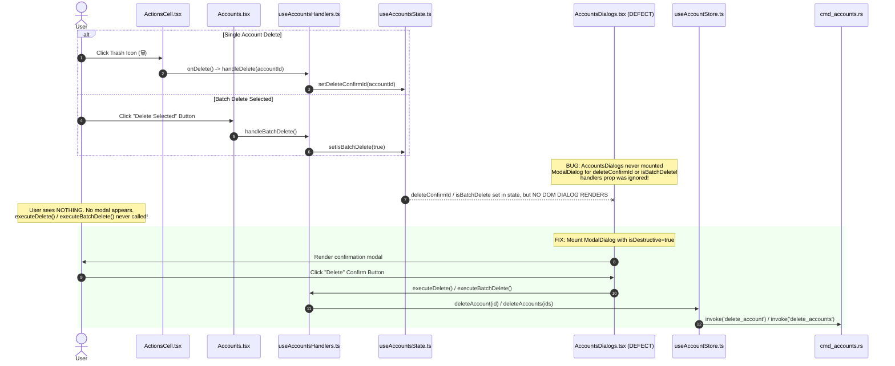
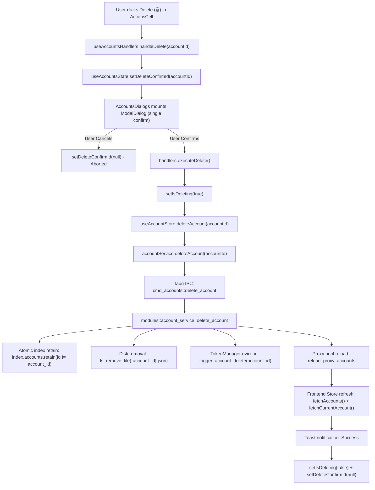

# 01-architecture-spec: Accounts Table Deletion Lifecycle, Modal Confirmation & Account Disable/Enable Subsystem

- **Spec ID:** `02-spec/21-app/accounts-table-delete-hover-and-disable-sync/01-architecture-spec.md`
- **Parent Plan:** `.ai-memory/plans/accounts-table-delete-hover-and-disable-sync.md`
- **Application:** Antigravity-Manager (`agm`, Reverse Proxy Gateway & Multi-Account Manager)
- **Status:** `APPROVED`
- **Author:** Spec Author 01 (`self`)
- **Target Subsystems:**
  - `src/pages/accounts/AccountsDialogs.tsx`
  - `src/pages/accounts/useAccountsHandlers.ts`
  - `src/pages/accounts/useAccountsState.ts`
  - `src/pages/Accounts.tsx`
  - `src/stores/useAccountStore.ts`
  - `src/services/accountService.ts`
  - `src-tauri/src/commands/cmd_accounts.rs`
  - `src-tauri/src/modules/account/crud.rs`
  - `src-tauri/src/modules/account/switch.rs`
  - `src-tauri/src/modules/auto_switcher/selection.rs`
  - `src-tauri/src/modules/auto_switcher/scoring.rs`

---

## 1. Executive Summary & Problem Scope

This specification defines the architectural root-cause remediation for the broken single and batch account deletion operations, standardizes the end-to-end deletion lifecycle through React state down to atomic SQLite/JSON storage, and establishes the complete Account Disable / Enable lifecycle.

### Key Functional Requirements:
1. **Delete Button & Batch Delete Remediation:** Resolve the missing modal dialog in `src/pages/accounts/AccountsDialogs.tsx` that previously prevented `executeDelete()` and `executeBatchDelete()` from executing.
2. **Account Deletion Lifecycle:** Define the transactional flow from user trigger through optimistic UI cleanup, background cache eviction (`trigger_account_delete`), atomic disk deletion, tray menu rebuilding, and proxy pool synchronization.
3. **Account Disable / Enable Subsystem:**
   - Allow users to disable or enable accounts individually via row context menu (`onContextMenu`) / action menu and in bulk via the selection toolbar (`Ban` toggle button).
   - Persist state cleanly in `Account` model (`disabled: bool`, `disabled_reason: Option<String>`, `disabled_at: Option<i64>`).
   - Guarantee 100% exclusion of disabled accounts from automatic daemon rotation (`selection.rs`) and enforce defensive zero-scoring (`scoring.rs`).
   - Permit manual user switching to disabled accounts while strictly blocking automated daemon switching.

---

## 2. Root Cause Analysis: Broken Delete & Batch Delete Buttons

### 2.1 The Broken Deletion Call Chain

The user reported: *"The Delete button does not work yet, and I have given several times. It also needs to be fixed by selecting. If we select and click on Delete, it does not work as well."*

Tracing the execution flow across the UI stack revealed the exact defect:



### 2.2 Root Cause in `src/pages/accounts/AccountsDialogs.tsx`

In `src/pages/Accounts.tsx` line 333:
```tsx
<AccountsDialogs state={state} handlers={handlers} />
```
Both `state` and `handlers` were passed to `AccountsDialogs`.

However, inspecting `src/pages/accounts/AccountsDialogs.tsx` revealed:
```tsx
interface AccountsDialogsProps {
  state: AccountsState;
  handlers: AccountsHandlers;
}

export function AccountsDialogs({ state }: AccountsDialogsProps) {
  const {
    detailsAccount, setDetailsAccount, errorAccountId, setErrorAccountId, isBackupModalOpen, setIsBackupModalOpen,
    backupModalTab, accounts, updateAccountPriority
  } = state;
  return (
    <>
      <AccountDetailsDialog ... />
      <AccountErrorDialog ... />
      <UnifiedBackupModal ... />
    </>
  );
}
```

1. **Unused `handlers` Parameter:** `handlers` was completely omitted from parameter destructuring.
2. **Missing State Bindings:** `deleteConfirmId`, `setDeleteConfirmId`, `isBatchDelete`, `setIsBatchDelete`, `isDeleting`, and `selectedIds` were never destructured from `state`.
3. **Missing `ModalDialog` Components:** Neither the single delete confirmation dialog nor the batch delete confirmation dialog was ever rendered into the React component tree.
4. **Outcome:** When users clicked the Delete button or the batch Delete Selected button, the state variables (`deleteConfirmId` and `isBatchDelete`) updated in memory, but because no UI modal existed in the DOM, no confirmation button existed to trigger `executeDelete()` or `executeBatchDelete()`. The operation silently dead-ended.

---

## 3. Account Deletion Architecture & Lifecycle

### 3.1 Single Account Deletion Lifecycle



### 3.2 Batch Account Deletion Lifecycle

When multiple accounts are selected via table checkboxes (`selectedIds: Set<string>`):
1. **Trigger:** User clicks "Delete Selected (`selectedIds.size`)" in the selection toolbar of `src/pages/Accounts.tsx`.
2. **Handler:** `handlers.handleBatchDelete()` validates `selectedIds.size > 0` and sets `setIsBatchDelete(true)`.
3. **Confirmation Modal:** `AccountsDialogs.tsx` renders a destructive `ModalDialog`:
   - Title: `accounts.dialog.batch_delete_title` ("Batch Delete Accounts")
   - Message: `accounts.dialog.batch_delete_message` ("Are you sure you want to delete {count} selected accounts? This action cannot be undone.")
   - Confirm button: `isDestructive={true}`, `isLoading={isDeleting}`, calling `handlers.executeBatchDelete`.
4. **Execution (`executeBatchDelete`):**
   - Sets `isDeleting = true`.
   - Gathers IDs array: `const ids = Array.from(selectedIds)`.
   - Calls `useAccountStore.getState().deleteAccounts(ids)`.
   - Clears selection: `setSelectedIds(new Set())`.
   - Emits success toast and closes dialog `setIsBatchDelete(false)`.
5. **Backend Processing (`cmd_accounts::delete_accounts` & `modules::account::delete_accounts`):**
   - Acquires `ACCOUNT_INDEX_LOCK`.
   - Retains remaining accounts in `index.accounts`.
   - Clears `current_account_id` if it was among the deleted IDs and reassigns to the first remaining account (or `None`).
   - For each account ID, removes disk file `{account_id}.json` and calls `crate::proxy::server::trigger_account_delete(account_id)`.
   - Persists `index.json` atomically via `save_account_index(&index)`.
   - Rebuilds OS tray menu: `crate::modules::tray::update_tray_menus(&app)`.
   - Reloads proxy token manager: `crate::commands::proxy::reload_proxy_accounts(proxy_state).await`.

---

## 4. Account Disable / Enable Subsystem Architecture

### 4.1 System Invariants

> [!IMPORTANT]
> **Subsystem Invariants for Account Disabling:**
> 1. **Auto-Switcher Immunity:** Disabled accounts (`acc.disabled == true`) must NEVER be selected by automated background daemons, Smart Rotator, Passport, or cron routines.
> 2. **Candidate Zero-Scoring:** Any disabled account evaluated by `scoring.rs` must immediately evaluate to `0.0` across all algorithm paths (`calculate_weekly_base_score`, `score_candidate_account`, `score_candidate_account_fallback`).
> 3. **Manual User Switching Permitted:** The user is explicitly allowed to manually switch to a disabled account in the UI ("By default, user can try to switch. That's a different story."). Manual switching must NOT be blocked by generic disabled checks in `switch.rs`.
> 4. **Model & Storage Consistency:** Toggling disabled state must atomically synchronize both `{account_id}.json` and `index.json` under `ACCOUNT_INDEX_LOCK`.

### 4.2 Data Model & Persistence

The `Account` model in `src-tauri/src/models/account.rs` and `src/types/account.ts` includes dedicated disable fields:

```rust
// src-tauri/src/models/account.rs
pub struct Account {
    pub id: String,
    pub email: String,
    // ...
    #[serde(default)]
    pub disabled: bool,
    #[serde(default, skip_serializing_if = "Option::is_none")]
    pub disabled_reason: Option<String>,
    #[serde(default, skip_serializing_if = "Option::is_none")]
    pub disabled_at: Option<i64>,
    #[serde(default)]
    pub proxy_disabled: bool,
    #[serde(default, skip_serializing_if = "Option::is_none")]
    pub proxy_disabled_reason: Option<String>,
    #[serde(default, skip_serializing_if = "Option::is_none")]
    pub proxy_disabled_at: Option<i64>,
}
```

#### Disabling States:
- **User Disabled:**
  - `disabled: true`
  - `disabled_reason: Some("user_disabled")` (or localized description)
  - `disabled_at: Some(Utc::now().timestamp())`
- **Re-enabled:**
  - `disabled: false`
  - `disabled_reason: None`
  - `disabled_at: None`

### 4.3 Backend IPC & Atomic CRUD Operations

In `src-tauri/src/modules/account/crud.rs`:
```rust
/// Toggle disabled status for an account (atomically updating account file and index summary)
pub fn toggle_account_disabled(
    account_id: &str,
    disabled: bool,
    reason: Option<&str>,
) -> Result<(), String> {
    let _lock = ACCOUNT_INDEX_LOCK
        .lock()
        .map_err(|e| format!("failed_to_acquire_lock: {}", e))?;

    let mut account = load_account(account_id)?;
    account.disabled = disabled;
    account.disabled_reason = if disabled {
        reason.map(|s| s.to_string()).or_else(|| Some("user_disabled".to_string()))
    } else {
        None
    };
    account.disabled_at = if disabled {
        Some(chrono::Utc::now().timestamp())
    } else {
        None
    };

    save_account(&account)?;

    // Atomically update index summary
    let mut index = load_account_index()?;
    if let Some(summary) = index.accounts.iter_mut().find(|a| a.id == account_id) {
        summary.disabled = disabled;
        save_account_index(&index)?;
    }

    Ok(())
}

/// Batch set disabled status for multiple accounts
pub fn set_accounts_disabled(
    account_ids: &[String],
    disabled: bool,
    reason: Option<&str>,
) -> Result<(), String> {
    let _lock = ACCOUNT_INDEX_LOCK
        .lock()
        .map_err(|e| format!("failed_to_acquire_lock: {}", e))?;

    let mut index = load_account_index()?;
    let now = chrono::Utc::now().timestamp();

    for id in account_ids {
        if let Ok(mut account) = load_account(id) {
            account.disabled = disabled;
            account.disabled_reason = if disabled {
                reason.map(|s| s.to_string()).or_else(|| Some("user_disabled".to_string()))
            } else {
                None
            };
            account.disabled_at = if disabled { Some(now) } else { None };
            // Justification: best-effort file update per account; index update is atomic
            let _ = save_account(&account);
        }

        if let Some(summary) = index.accounts.iter_mut().find(|a| &a.id == id) {
            summary.disabled = disabled;
        }
    }

    save_account_index(&index)
}
```

In `src-tauri/src/commands/cmd_accounts.rs`:
```rust
#[tauri::command]
pub async fn toggle_account_disabled(
    app: tauri::AppHandle,
    proxy_state: tauri::State<'_, crate::commands::proxy::ProxyServiceState>,
    account_id: String,
    disabled: bool,
    reason: Option<String>,
) -> Result<(), String> {
    modules::logger::log_info(&format!(
        "Toggle account disabled status: {} -> disabled={}",
        account_id, disabled
    ));

    modules::account::toggle_account_disabled(&account_id, disabled, reason.as_deref())?;

    // Reload token pool if running
    crate::error::record_ignored(
        crate::commands::proxy::reload_proxy_accounts(proxy_state).await,
        "reload proxy accounts after toggle disabled",
    );

    crate::modules::tray::update_tray_menus(&app);
    Ok(())
}

#[tauri::command]
pub async fn set_accounts_disabled(
    app: tauri::AppHandle,
    proxy_state: tauri::State<'_, crate::commands::proxy::ProxyServiceState>,
    account_ids: Vec<String>,
    disabled: bool,
    reason: Option<String>,
) -> Result<(), String> {
    modules::account::set_accounts_disabled(&account_ids, disabled, reason.as_deref())?;

    crate::error::record_ignored(
        crate::commands::proxy::reload_proxy_accounts(proxy_state).await,
        "reload proxy accounts after batch set disabled",
    );

    crate::modules::tray::update_tray_menus(&app);
    Ok(())
}
```

---

## 5. Auto-Switcher Exclusion & Defensive Zero-Scoring

### 5.1 Candidate Selection Filter (`src-tauri/src/modules/auto_switcher/selection.rs`)

In `select_candidate_profiles()`:
- **Bound Instances Loop (lines 143–145):**
  ```rust
  if acc.disabled || acc.proxy_disabled || is_account_validation_blocked(&acc, now_sec) {
      continue;
  }
  ```
- **Unbound Accounts Pool (lines 197–199):**
  ```rust
  if acc.disabled || acc.proxy_disabled || is_account_validation_blocked(acc, now_sec) {
      continue;
  }
  ```

### 5.2 Defensive Zero-Scoring (`src-tauri/src/modules/auto_switcher/scoring.rs`)

To ensure mathematical immunity even if scoring functions are called outside candidate selection:

1. **`calculate_weekly_base_score`:**
   ```rust
   pub fn calculate_weekly_base_score(acc: &Account, target_model: &str, now_sec: i64) -> f64 {
       // Defensive Guard: Disabled accounts always score 0.0
       if acc.disabled || acc.proxy_disabled {
           return 0.0;
       }
       // ... scoring calculations
   }
   ```
2. **`score_candidate_account`:**
   ```rust
   pub fn score_candidate_account(acc: &Account, target_model: &str, now_sec: i64) -> f64 {
       if acc.disabled || acc.proxy_disabled {
           return 0.0;
       }
       // ... quota gates
   }
   ```
3. **`score_candidate_account_fallback`:**
   ```rust
   pub fn score_candidate_account_fallback(acc: &Account, target_model: &str, now_sec: i64) -> f64 {
       if acc.disabled || acc.proxy_disabled {
           return 0.0;
       }
       // ... fallback calculations
   }
   ```

---

## 6. Manual User Switching Permitted vs Daemon Switching Blocked

### 6.1 Rationale

The user explicitly stated: *"So if we disable any account by selecting or by right-clicking on it, that disable item would not be selected by passport or the switching automatically. By default, user can try to switch. That's a different story."*

- **Automated switching (Auto-Switcher daemon, Smart Rotator, Passport):** Must be 100% blocked from picking disabled accounts. This is enforced by `selection.rs` and `scoring.rs`.
- **Manual user switching (User clicks Switch in UI):** The user is diagnosing, testing, or intentionally using an account they disabled from automatic rotations. The system must allow this switch to proceed.

### 6.2 Implementation in `src-tauri/src/modules/account/switch.rs`

Previously in `switch.rs` lines 42–47:
```rust
if account.disabled || account.proxy_disabled || account.validation_blocked {
    return Err(format!(
        "Cannot switch to account '{}': Account is disabled or blocked (disabled: {}, proxy_disabled: {}, validation_blocked: {})",
        account.email, account.disabled, account.proxy_disabled, account.validation_blocked
    ));
}
```

Refactored to distinguish between automated failure blocks (`invalid_grant`, `validation_blocked`) and user-level disables:
```rust
// Validation block strictly forbids all switches (anti-abuse / CAPTCHA required)
if account.validation_blocked {
    return Err(format!(
        "Cannot switch to account '{}': Account is blocked for verification (validation_blocked: true)",
        account.email
    ));
}

// If account was disabled by invalid_grant (revoked credentials), block with clear instruction
if account.disabled && account.disabled_reason.as_deref().unwrap_or("").contains("invalid_grant") {
    return Err(format!(
        "Cannot switch to account '{}': Refresh token is expired or revoked (invalid_grant). Please re-authenticate.",
        account.email
    ));
}

// User-disabled accounts are permitted for manual switch
if account.disabled {
    crate::modules::logger::log_info(&format!(
        "[Switch] Manual user switch to user-disabled account '{}' permitted.",
        account.email
    ));
}
```

In `src-tauri/src/modules/instance/switch.rs`:
`switch_account_to_instance` does not artificially block `account.disabled`; it refreshes OAuth tokens and writes credentials cleanly to `state.vscdb`.

---

## 7. UI Controls & User Interaction Specification

### 7.1 Selection Toolbar Disable Toggle Button (`src/pages/Accounts.tsx`)

When items are selected (`selectedIds.size > 0`), the selection toolbar displays:
1. **Delete Selected:** Red button with `<Trash2 />` icon.
2. **Disable Selected:** Button with `<Ban />` icon (`text-amber-600 dark:text-amber-400 hover:bg-amber-50 dark:hover:bg-amber-950/30`), calling `handlers.handleBatchToggleDisable(true)`.
3. **Enable Selected:** Button with `<CheckCircle2 />` icon (`text-teal-600 dark:text-teal-400 hover:bg-teal-50 dark:hover:bg-teal-950/30`), calling `handlers.handleBatchToggleDisable(false)`.
4. **Proxy Toggles:** `<ToggleLeft />` and `<ToggleRight />` for proxy participation.

### 7.2 Row Context Menu & Actions Menu

- **Right-Click (`onContextMenu`) on Table Row:**
  Right-clicking an account row prevents the browser default menu and opens a contextual popup menu:
  - **Switch to this Account** (calls `onSwitch`)
  - **Disable Account / Enable Account** (toggles disabled status)
  - **Toggle Proxy Status** (toggles proxy status)
  - **Refresh Quota** (calls `onRefresh`)
  - **Account Details** (calls `onViewDetails`)
  - **Delete Account** (calls `onDelete`)
- **Actions Column "More" Menu (`ActionsCell.tsx`):**
  Include a "Disable Account" / "Enable Account" item with a `<Ban />` icon.

---

## 8. Verification Matrix & Quality Gates

| Verification Gate | Validation Method | Expected Outcome |
|---|---|---|
| **Single Delete Confirmation** | Click trash icon on any account row | `ModalDialog` mounts with destructive red button, confirming deletes the account file and updates index |
| **Single Delete Cancel** | Click Cancel or Escape in delete modal | Dialog unmounts, account remains intact, `isDeleting=false` |
| **Batch Delete Confirmation** | Select 2 accounts, click "Delete Selected" in toolbar | Modal mounts showing count `2`, confirming deletes both accounts atomically and clears selection |
| **Batch Disable Toolbar** | Select accounts, click "Disable" in toolbar | Accounts marked `disabled=true`, `disabled_reason="user_disabled"`, badges update |
| **Right-Click Row Menu** | Right-click table row | Context menu opens with "Disable/Enable Account", clicking immediately toggles state |
| **Auto-Switcher Exclusion** | Run auto-switcher daemon with disabled account having 100% quota | Auto-switcher skips disabled account completely; does not switch to it |
| **Defensive Zero-Scoring** | Call `score_candidate_account` on disabled account | Returns strictly `0.0` |
| **Manual User Switch** | Click yellow Switch button on disabled account | Switch succeeds smoothly and instance binds to account |
| **Pre-flight Gates** | `cargo clippy --all-targets --all-features` & `npm run build` | Zero compilation errors or clippy warnings |
