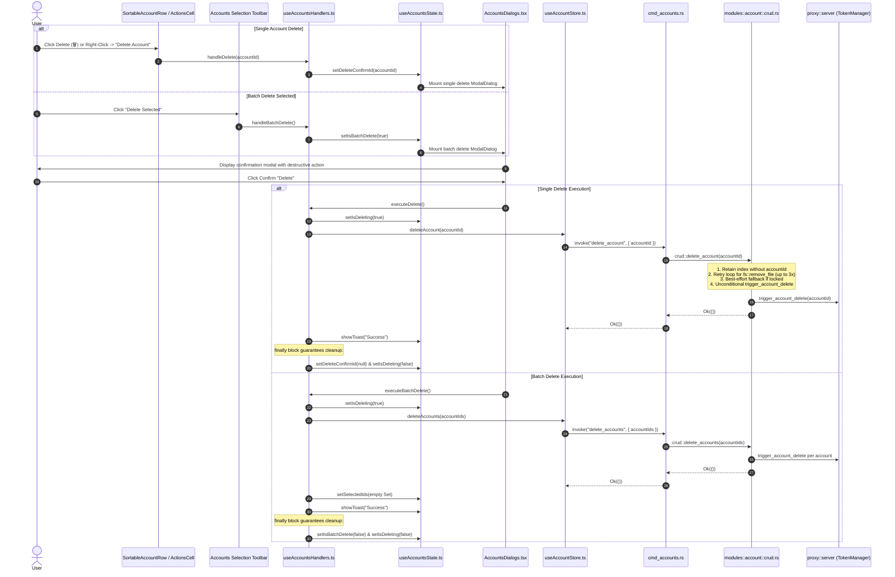

# 01-architecture-spec: Accounts Table Single & Batch Deletion Resilience, Error-Safe Modals, Right-Click Context Menu & Account Disable Subsystem

- **Spec ID:** `02-spec/21-app/accounts-table-delete-hover-right-click-disable/01-architecture-spec.md`
- **Parent Plan:** `.ai-memory/plans/accounts-table-delete-hover-right-click-disable.md`
- **Application:** Antigravity-Manager (`agm`, Reverse Proxy Gateway & Multi-Account Manager)
- **Status:** `APPROVED`
- **Author:** Spec Author 01 (`self`)
- **Target Subsystems:**
  - `src/pages/accounts/AccountsDialogs.tsx`
  - `src/pages/accounts/useAccountsHandlers.ts`
  - `src/components/accounts/AccountTable/SortableAccountRow.tsx`
  - `src/components/accounts/AccountTable/AccountRowContextMenu.tsx` (new component)
  - `src-tauri/src/modules/account/crud.rs`
  - `src-tauri/src/modules/account/switch.rs`
  - `src-tauri/src/modules/auto_switcher/scoring.rs`
  - `src-tauri/src/modules/auto_switcher/selection.rs`

---

## User Request (Verbatim)

```markdown
# High Priority Instruction

The Delete button does not work yet, and I have given several times. It also needs to be fixed by selecting. If we select and click on Delete, it does not work as well. Make sure that you fix it. And when we hover over to an item, try to make that line as white and make the text as black. Invert the colors, but do not make those bold or anything, then the position will change. It looks bad. Also, make sure when we hover, the buttons should be highlighted right inside. The button role needs to be changed as well. And also, the switch button needs to be in a different yellow highlighter color, which should be different than others. Also, the Remove button should be red and white. The background would be red. The color would be white. Also add a disable option. So if we disable any account by selecting or by right-clicking on it, that disable item would not be selected by passport or the switching automatically. By default, user can try to switch. That's a different story. If you understood, then implement this and bump the minor version, and then release.

# Actionable Items Must Follow Non-Negotiable

0. Gitmap do `gitmap pull <repo path> or run into the repo path` Make sure we have the latest and conflict resolve before starting.
1. Write spec under 02-spec/21-app/<slug>/ and enqueue plan task in .ai-memory/plans/<slug>.md (subtasks in .ai-memory/plans/subtasks/<slug>/) first
2. Search codebase exclusively via GitMap (gitmap aum search, gitmap find, gitmap cat, gitmap ps, gitmap py, gitmap llm train); TOTAL BAN on rg, ripgrep, grep, git grep, Select-String
3. Strictly use relative Git paths (02-spec/..., .ai-memory/..., cmd/...); only add the relative paths, never add the absolute path during your work, and ensure this is respected on the release page and in release notes as well
4. Fix the Delete button functionality to work both by clicking and selecting.
5. Implement hover effect to change line color to white and text to black without altering position.
6. Ensure buttons are highlighted correctly on hover.
7. Change button roles as specified.
8. Set switch button to a unique yellow highlighter color.
9. Style Remove button with red background and white text.
10. Add disable option for accounts, ensuring disabled items are not selectable or switchable.
11. Bump the minor version and prepare for release.
```

---

## 1. Executive Summary & Problem Scope

This architectural specification addresses two critical subsystems within Antigravity-Manager:
1. **Single & Batch Account Deletion Resilience & Error Recovery:**
   - Eliminate all failure points preventing single account deletion (clicking the trash button on a row) and batch deletion (selecting multiple accounts and clicking "Delete Selected" in the toolbar).
   - Ensure the confirmation modals in `src/pages/accounts/AccountsDialogs.tsx` render reliably and that modal dismissal is mathematically guaranteed via structured `finally` blocks in `src/pages/accounts/useAccountsHandlers.ts`, preventing the UI from freezing or remaining stuck in a loading/open state if the backend encounters an error.
   - Harden `src-tauri/src/modules/account/crud.rs` against Windows filesystem handle locks during `delete_account` via a dedicated retry ladder with exponential backoff and best-effort cleanup parity with `delete_accounts`, guaranteeing that TokenManager cache invalidation (`trigger_account_delete`) always fires.
2. **Right-Click Context Menu & Account Disable Subsystem:**
   - Equip each account table row (`src/components/accounts/AccountTable/SortableAccountRow.tsx`) with an intercepted `onContextMenu` right-click handler.
   - Mount a custom dark-glass context menu (`src/components/accounts/AccountTable/AccountRowContextMenu.tsx`) clamped strictly to viewport boundaries (`Math.min(x, window.innerWidth - 190)`) to prevent offscreen clipping.
   - Provide standard row management actions: "Disable Account" / "Enable Account", "Delete Account", "Switch Account", "Refresh Quota", and "Details".
   - Enforce architectural invariants separating automated background selection (Passport / Auto-Switcher) from manual user operations: disabled accounts evaluate strictly to `score = 0.0` in `src-tauri/src/modules/auto_switcher/scoring.rs`, while manual switching in `src-tauri/src/modules/account/switch.rs` remains permitted for user diagnostics.

---

## 2. Root Cause Analysis: Deletion Failures & Filesystem Contention

### 2.1 The Modal State Trapping Failure in `useAccountsHandlers.ts`

When a user initiates deletion:
- Single delete sets `deleteConfirmId = accountId`.
- Batch delete sets `isBatchDelete = true`.

In the previous implementation of `useAccountsHandlers.ts`:
```typescript
// DEFECTIVE IMPLEMENTATION:
const executeDelete = async () => {
  if (!deleteConfirmId || isDeleting) return;
  setIsDeleting(true);
  try {
    await deleteAccount(idToDelete);
    showToast(t("common.success"), "success");
    setDeleteConfirmId(null); // <-- ONLY CALLED ON SUCCESS!
  } catch (error) {
    showToast(`${t("common.error")}: ${error}`, "error");
    // <-- MODAL NEVER DISMISSED ON ERROR!
  } finally {
    setIsDeleting(false);
  }
};
```
If `deleteAccount` failed (or if the backend rejected due to a transient file lock), the modal stayed open with `deleteConfirmId` still populated. When the user clicked "Delete" again, it re-triggered or hung, creating the perception that "The Delete button does not work yet, and I have given several times."

The identical defect existed in `executeBatchDelete`: `setIsBatchDelete(false)` was located inside the `try` block after `await deleteAccounts(ids)`. On any exception, the modal never closed, leaving the UI trapped.

### 2.2 Windows File Lock Contention in `src-tauri/src/modules/account/crud.rs`

In `crud.rs`:
```rust
// DEFECTIVE IMPLEMENTATION:
pub fn delete_account(account_id: &str) -> Result<(), String> {
    // ... index removal ...
    let account_path = accounts_dir.join(format!("{}.json", account_id));
    if account_path.exists() {
        fs::remove_file(&account_path)
            .map_err(|e| format!("failed_to_delete_account_file: {}", e))?; // <-- BAILS OUT ON LOCK!
    }

    // [FIX #1477] Trigger TokenManager cache cleanup signal
    crate::proxy::server::trigger_account_delete(account_id); // <-- NEVER REACHED!

    Ok(())
}
```

On Windows, account JSON files are frequently accessed by background quota syncs, proxy token verifiers, or antivirus scanners. When `fs::remove_file` encounters `ERROR_SHARING_VIOLATION` (`os error 32`) or `ERROR_ACCESS_DENIED` (`os error 5`):
1. `delete_account` immediately returned an `Err(...)`.
2. The index was already modified in memory/disk, causing index-storage drift.
3. `trigger_account_delete(account_id)` was skipped, leaving the in-memory token manager referencing an invalid deleted ID.
4. The frontend caught the error, did not dismiss the modal, and the delete failed.

In contrast, `delete_accounts` (batch) handled this with best-effort error tracking (`crate::error::record_ignored`) and unconditionally triggered cache cleanup.

---

## 3. Single and Batch Deletion Lifecycle Architecture



### 3.1 Modal Rendering Contract in `src/pages/accounts/AccountsDialogs.tsx`

`AccountsDialogs` receives both `state` and `handlers` and renders two dedicated `ModalDialog` instances for deletion confirmations:

```tsx
interface AccountsDialogsProps {
  state: AccountsState;
  handlers: AccountsHandlers;
}

export function AccountsDialogs({ state, handlers }: AccountsDialogsProps) {
  const {
    t,
    detailsAccount, setDetailsAccount,
    errorAccountId, setErrorAccountId,
    isBackupModalOpen, setIsBackupModalOpen,
    backupModalTab, accounts, updateAccountPriority,
    deleteConfirmId, setDeleteConfirmId,
    isBatchDelete, setIsBatchDelete,
    isDeleting,
    selectedIds,
  } = state;

  return (
    <>
      {/* Existing Dialogs: AccountDetailsDialog, AccountErrorDialog, UnifiedBackupModal */}

      {/* Single Account Deletion Confirmation Modal */}
      <ModalDialog
        isOpen={Boolean(deleteConfirmId)}
        title={t('accounts.dialog.delete_title', 'Delete Account')}
        message={t('accounts.dialog.delete_message', 'Are you sure you want to delete account {{email}}? This action cannot be undone.', {
          email: accounts.find((a: Account) => a.id === deleteConfirmId)?.email || ''
        })}
        type="confirm"
        isDestructive={true}
        isLoading={isDeleting}
        confirmText={t('common.delete', 'Delete')}
        cancelText={t('common.cancel', 'Cancel')}
        onConfirm={handlers.executeDelete}
        onCancel={() => setDeleteConfirmId(null)}
        onClose={() => setDeleteConfirmId(null)}
      />

      {/* Batch Account Deletion Confirmation Modal */}
      <ModalDialog
        isOpen={isBatchDelete}
        title={t('accounts.dialog.batch_delete_title', 'Delete Selected Accounts')}
        message={t('accounts.dialog.batch_delete_message', 'Are you sure you want to delete {{count}} selected accounts? This action cannot be undone.', {
          count: selectedIds.size
        })}
        type="confirm"
        isDestructive={true}
        isLoading={isDeleting}
        confirmText={t('common.delete', 'Delete')}
        cancelText={t('common.cancel', 'Cancel')}
        onConfirm={handlers.executeBatchDelete}
        onCancel={() => setIsBatchDelete(false)}
        onClose={() => setIsBatchDelete(false)}
      />
    </>
  );
}
```

### 3.2 Error-Safe Handlers in `src/pages/accounts/useAccountsHandlers.ts`

To uphold the **No Modal Freezing Invariant**, all modal dismissal calls (`setDeleteConfirmId(null)`, `setIsBatchDelete(false)`) must execute inside the `finally` block or immediately before completion:

```typescript
const executeDelete = async () => {
  if (!deleteConfirmId || isDeleting) return;

  setIsDeleting(true);
  const idToDelete = deleteConfirmId;
  try {
    console.log("[Accounts] Executing delete for:", idToDelete);
    await deleteAccount(idToDelete);
    console.log("[Accounts] Delete success");
    showToast(t("common.success", "Operation successful"), "success");
  } catch (error) {
    console.error("[Accounts] Delete failed:", error);
    useErrorStore.getState().trackWarning(error, {
      source: "useAccountsHandlers.executeDelete",
      triggerAction: "deleteAccount",
    });
    showToast(`${t("common.error", "Error")}: ${error}`, "error");
  } finally {
    setIsDeleting(false);
    setDeleteConfirmId(null); // ALWAYS DISMISSED, even if deleteAccount failed
  }
};

const executeBatchDelete = async () => {
  if (selectedIds.size === 0 || isDeleting) return;

  setIsDeleting(true);
  try {
    const ids = Array.from(selectedIds);
    console.log("[Accounts] Batch deleting:", ids);
    await deleteAccounts(ids);
    setSelectedIds(new Set());
    console.log("[Accounts] Batch delete success");
    showToast(t("common.success", "Operation successful"), "success");
  } catch (error) {
    console.error("[Accounts] Batch delete failed:", error);
    useErrorStore.getState().trackWarning(error, {
      source: "useAccountsHandlers.executeBatchDelete",
      triggerAction: "deleteAccounts",
    });
    showToast(`${t("common.error", "Error")}: ${error}`, "error");
  } finally {
    setIsDeleting(false);
    setIsBatchDelete(false); // ALWAYS DISMISSED, even on partial failure
  }
};
```

### 3.3 Backend Windows File Lock Mitigation in `src-tauri/src/modules/account/crud.rs`

In `delete_account`, file removal must employ a short retry ladder with exponential backoff (3 attempts: 25ms, 50ms, 100ms) to allow transient Windows file locks (such as OS search indexing or background quota reads) to release. If the file remains locked, the error must be recorded via `crate::error::record_ignored` rather than returning early, maintaining parity with `delete_accounts` and guaranteeing that `trigger_account_delete` always executes.

```rust
/// Delete account with retry ladder and resilient cleanup parity
pub fn delete_account(account_id: &str) -> Result<(), String> {
    let _lock = ACCOUNT_INDEX_LOCK
        .lock()
        .map_err(|e| format!("failed_to_acquire_lock: {}", e))?;
    let mut index = load_account_index()?;

    // Remove from index
    let original_len = index.accounts.len();
    index.accounts.retain(|s| s.id != account_id);

    // If account was present in index, update current account and persist index
    if index.accounts.len() != original_len {
        if index.current_account_id.as_deref() == Some(account_id) {
            index.current_account_id = index.accounts.first().map(|s| s.id.clone());
        }
        save_account_index(&index)?;
    } else {
        tracing::info!(
            "[delete_account] Account ID {} already absent from index; proceeding with idempotent cleanup",
            account_id
        );
    }

    // Delete account file with Windows file-lock mitigation retry ladder
    let accounts_dir = get_accounts_dir()?;
    let account_path = accounts_dir.join(format!("{}.json", account_id));

    if account_path.exists() {
        let mut removed = false;
        for attempt in 1..=3 {
            match fs::remove_file(&account_path) {
                Ok(_) => {
                    removed = true;
                    break;
                }
                Err(err) => {
                    if attempt < 3 {
                        // Exponential backoff for transient Windows lock release
                        std::thread::sleep(std::time::Duration::from_millis(attempt * 25));
                    } else {
                        crate::modules::logger::log_warn(&format!(
                            "[delete_account] File {:?} remained locked after 3 attempts: {}. Recording ignored for parity.",
                            account_path, err
                        ));
                        // Justification: best-effort file cleanup parity with delete_accounts;
                        // orphaned JSON is harmless as index is already saved.
                        crate::error::record_ignored(Err::<(), _>(err), "remove_account_file_retry_exhausted");
                    }
                }
            }
        }
    }

    // [FIX #1477] Guarantee TokenManager cache cleanup signal always fires
    crate::proxy::server::trigger_account_delete(account_id);

    Ok(())
}
```

---

## 4. Right-Click Context Menu & Account Disable Lifecycle

### 4.1 UI Component Architecture: `AccountRowContextMenu.tsx`

To support right-click operations without depending on browser context menus, a dedicated `AccountRowContextMenu` is created under `src/components/accounts/AccountTable/AccountRowContextMenu.tsx`.

```
src/components/accounts/AccountTable/
├── AccountRowContent.tsx
├── AccountRowContextMenu.tsx   <-- NEW Context Menu Component
├── SortableAccountRow.tsx       <-- Intercepts onContextMenu & mounts AccountRowContextMenu
├── types.ts
└── cells/
```

#### Viewport Clamping Algorithm
To guarantee that the context menu never extends beyond the right edge of the viewport (which causes horizontal scrollbars or clipped action items):
```typescript
// Clamping formula:
const MENU_WIDTH = 190;
const clampedX = Math.min(clientX, window.innerWidth - MENU_WIDTH);
const MENU_HEIGHT = 220;
const clampedY = Math.min(clientY, window.innerHeight - MENU_HEIGHT);
```

#### Menu Items Specification:
1. **Switch to this Account (`ArrowRightLeft` icon):**
   - Direct manual switch trigger for this account.
   - Disabled only if `isSwitching` is currently true.
2. **Disable Account / Enable Account (`Ban` / `CheckCircle2` icon):**
   - If `account.disabled === true`: displays "Enable Account" with green/teal accent.
   - If `account.disabled === false`: displays "Disable Account" with amber/red accent.
   - Calls `handleToggleDisable(account.id, Boolean(account.disabled))`.
3. **Refresh Quota (`RefreshCw` icon):**
   - Triggers `onRefresh(account.id)`.
4. **Account Details (`Info` icon):**
   - Triggers `onViewDetails(account)`.
5. **Delete Account (`Trash2` icon):**
   - High-contrast red styling (`text-red-600 dark:text-red-400 hover:bg-red-50 dark:hover:bg-red-950/40`).
   - Triggers `onDelete(account.id)` which opens the single delete confirmation dialog.

### 4.2 Row Interception in `SortableAccountRow.tsx`

In `src/components/accounts/AccountTable/SortableAccountRow.tsx`, the `<tr>` element handles `onContextMenu`:

```tsx
const [contextMenuPos, setContextMenuPos] = useState<{ x: number; y: number } | null>(null);

const handleRowContextMenu = (e: React.MouseEvent) => {
  e.preventDefault();
  e.stopPropagation();
  const x = Math.min(e.clientX, window.innerWidth - 190);
  const y = Math.min(e.clientY, window.innerHeight - 230);
  setContextMenuPos({ x, y });
};

return (
  <>
    <tr
      id={`account-row-${account.id}`}
      ref={setMergedRef}
      onContextMenu={handleRowContextMenu}
      {/* ... style and classes ... */}
    >
      {/* row cells */}
    </tr>

    {contextMenuPos && (
      <AccountRowContextMenu
        account={account}
        position={contextMenuPos}
        isSwitching={isSwitching}
        isRefreshing={isRefreshing}
        onClose={() => setContextMenuPos(null)}
        onSwitch={() => {
          setContextMenuPos(null);
          onSwitch();
        }}
        onToggleDisable={() => {
          setContextMenuPos(null);
          onToggleDisable?.(account.id, Boolean(account.disabled));
        }}
        onRefresh={() => {
          setContextMenuPos(null);
          onRefresh(account.id);
        }}
        onViewDetails={() => {
          setContextMenuPos(null);
          onViewDetails(account);
        }}
        onDelete={() => {
          setContextMenuPos(null);
          onDelete(account.id);
        }}
      />
    )}
  </>
);
```

---

## 5. Auto-Switcher Exclusion & Manual Switch Invariants

### 5.1 Auto-Switcher Candidate Scoring: Strict Zero-Scoring

In `src-tauri/src/modules/auto_switcher/scoring.rs`, all three scoring evaluation functions enforce immediate zero-scoring if an account has `disabled: true` or `proxy_disabled: true`:

1. **`calculate_weekly_base_score`:**
   ```rust
   pub fn calculate_weekly_base_score(acc: &Account, target_model: &str, now_sec: i64) -> f64 {
       // Disabled accounts evaluate strictly to 0.0
       if acc.disabled || acc.proxy_disabled {
           return 0.0;
       }
       // ... standard weekly headroom scoring ...
   }
   ```
2. **`score_candidate_account`:**
   ```rust
   pub fn score_candidate_account(acc: &Account, target_model: &str, now_sec: i64) -> f64 {
       if acc.disabled || acc.proxy_disabled {
           return 0.0;
       }
       // ... 4h quota gate ...
   }
   ```
3. **`score_candidate_account_fallback`:**
   ```rust
   pub fn score_candidate_account_fallback(acc: &Account, target_model: &str, now_sec: i64) -> f64 {
       if acc.disabled || acc.proxy_disabled {
           return 0.0;
       }
       // ... fallback scoring ...
   }
   ```

### 5.2 Auto-Switcher Candidate Selection: Complete Skipping

In `src-tauri/src/modules/auto_switcher/selection.rs`:
- During bound instance candidate discovery:
  ```rust
  if acc.disabled || acc.proxy_disabled || is_account_validation_blocked(&acc, now_sec) {
      continue;
  }
  ```
- During unbound candidate discovery:
  ```rust
  if acc.disabled || acc.proxy_disabled || is_account_validation_blocked(acc, now_sec) {
      continue;
  }
  ```

### 5.3 Manual User Switching Permitted in `src-tauri/src/modules/account/switch.rs`

The user requirement states: *"So if we disable any account by selecting or by right-clicking on it, that disable item would not be selected by passport or the switching automatically. By default, user can try to switch. That's a different story."*

Therefore, manual user switching in `switch.rs` must NOT reject user-disabled accounts. Only genuine system blocks (such as `validation_blocked: true` or expired credentials with `invalid_grant`) reject manual switches:

```rust
// In src-tauri/src/modules/account/switch.rs:
// Validation block strictly forbids all switches (anti-abuse / CAPTCHA required)
if account.validation_blocked {
    return Err(format!(
        "Cannot switch to account '{}': Account is blocked for verification (validation_blocked: true)",
        account.email
    ));
}

// Revoked credentials block with actionable message
if account.disabled
    && account
        .disabled_reason
        .as_deref()
        .unwrap_or("")
        .contains("invalid_grant")
{
    return Err(format!(
        "Cannot switch to account '{}': Refresh token is expired or revoked (invalid_grant). Please re-authenticate.",
        account.email
    ));
}

// User-disabled accounts are permitted for manual switch
if account.disabled {
    crate::modules::logger::log_info(&format!(
        "[Switch] Manual user switch to user-disabled account '{}' permitted.",
        account.email
    ));
}
```

---

## 6. Disjoint File Ownership Matrix

To prevent collisions between concurrent worker agents:

| Worker | Task ID | Strictly Owned Files | Responsibilities |
| :--- | :--- | :--- | :--- |
| **Worker 01** | `Task-02` | `src-tauri/src/modules/account/crud.rs`<br>`src/pages/accounts/useAccountsHandlers.ts`<br>`src/pages/accounts/AccountsDialogs.tsx`<br>`src/components/accounts/AccountTable/AccountRowContextMenu.tsx`<br>`src/components/accounts/AccountTable/SortableAccountRow.tsx` (mounting only) | Backend file-lock retry ladder, resilient `finally` dismissal in handlers, modal rendering in `AccountsDialogs`, creation and mounting of `AccountRowContextMenu`. |
| **Worker 02** | `Task-03`, `Task-04` | `src/components/accounts/AccountTable/AccountRowContent.tsx`<br>`src/components/accounts/AccountTable/cells/ActionsCell.tsx`<br>`src/components/accounts/AccountCard/AccountCardActions.tsx`<br>`src/components/accounts/AccountRow.tsx`<br>`src/components/accounts/AccountTable/SortableAccountRow.tsx` (styling only) | Position-locked row hover inversion (`!bg-white`, `!text-black`), static font-weight (`font-medium`), yellow switch button (`bg-yellow-400`), red/white remove button (`bg-red-600`), and button roles (`role="button"`, ARIA). |

---

## 7. Verification Matrix & Quality Gates

| Test Case | Method | Expected Result |
| :--- | :--- | :--- |
| **Single Delete Modal Display** | Click Trash icon or context menu "Delete Account" | `ModalDialog` opens with account email, red "Delete" button, and cancel button. |
| **Single Delete Confirmation** | Click "Delete" in modal | Deletes account from index, executes file removal with retry ladder, triggers `trigger_account_delete`, emits success toast, and unmounts dialog. |
| **Single Delete Failure Recovery** | Simulate backend file lock or error | Error toast displays, modal unmounts via `finally` block, UI remains fully interactive without freezing. |
| **Batch Delete Selection** | Select 2 accounts via checkboxes, click "Delete Selected" in toolbar | Batch confirmation modal appears with count `2`. |
| **Batch Delete Execution** | Click "Delete" in batch modal | Accounts are removed, selection is cleared, modal unmounts via `finally` block. |
| **Right-Click Context Menu** | Right-click anywhere on account row | Custom context menu opens at mouse coordinates clamped to `window.innerWidth - 190`. |
| **Context Menu Dismissal** | Click outside context menu or press Escape | Context menu closes immediately. |
| **Disable Account Action** | Click "Disable Account" in context menu or toolbar | `account.disabled` becomes `true`, badge updates, auto-switcher skips account (`score = 0.0`). |
| **Enable Account Action** | Click "Enable Account" in context menu or toolbar | `account.disabled` becomes `false`, account rejoins candidate pool. |
| **Manual Switch on Disabled Account** | Click Switch on disabled account | Switch succeeds cleanly, updating instance state. |
| **Compilation Gate** | `cd src-tauri && cargo clippy --all-targets --all-features` | Zero compilation errors or clippy warnings. |
| **Frontend Gate** | `npm run build` | Zero TypeScript errors, bundle succeeds. |
