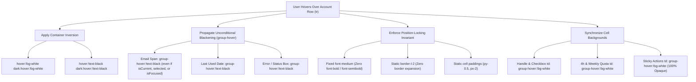
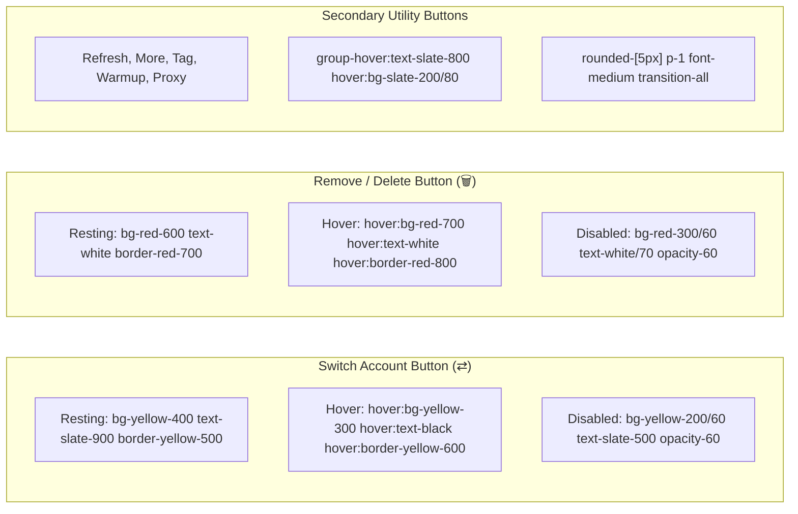

# 02-ui-component-spec: Table Row Hover Inversion, Button Styling Overhaul & Accessibility Specification

- **Spec ID:** `02-spec/21-app/accounts-table-delete-hover-right-click-disable/02-ui-component-spec.md`
- **Parent Plan:** `.ai-memory/plans/accounts-table-delete-hover-right-click-disable.md`
- **Application:** Antigravity-Manager (`agm`, Web Frontend, Account Management)
- **Status:** `APPROVED`
- **Author:** Spec Author 02 (`self`)
- **Target Components:**
  - `src/components/accounts/AccountTable/SortableAccountRow.tsx`
  - `src/components/accounts/AccountTable/AccountRowContent.tsx`
  - `src/components/accounts/AccountTable/cells/ActionsCell.tsx`
  - `src/components/accounts/AccountRow.tsx`
  - `src/components/accounts/AccountCard/AccountCardActions.tsx`

---

## 1. Executive Summary & Design Rationale

This specification defines the UI interaction, visual styling, position-locking invariants, and accessibility architecture for the Accounts Table and Card action components.

### Core Objectives:
1. **Position-Locked Row Hover Inversion:** Invert the entire table row styling on cursor hover to pure white background (`hover:!bg-white dark:hover:!bg-white`) and pure black text (`group-hover:!text-black dark:group-hover:!text-black`), ensuring maximum contrast across light and dark themes.
2. **Unconditional Text Blackening Across All Row States:** Apply blackening to all rows unconditionally on hover — including `isCurrent` (active account), `selected`, `isFocused`, error boxes, and quota text — permanently resolving amber-on-white, cyan-on-white, and light-blue-on-white illegibility in dark theme.
3. **Position-Locking Invariant (Zero Layout Shift):** Permanently lock font weight to fixed `font-medium` (eliminate `font-bold` and `font-semibold` on rows and text spans) and enforce static `border-l-2` to eliminate character metric shifts, letter-spacing expansion, and table jitter.
4. **Action Button Color Scheme Overhaul:**
   - **Switch Account Button (`⇄`):** Distinctive yellow highlighter styling (`bg-yellow-400 text-slate-900 border border-yellow-500 hover:bg-yellow-300 font-medium rounded-[5px] p-1 shadow-sm active:scale-95`).
   - **Remove / Delete Button (`🗑️`):** Solid red background with crisp white icon/text (`bg-red-600 text-white border border-red-700 hover:bg-red-700 hover:text-white rounded-[5px] p-1 shadow-sm active:scale-95`), matching design requirements and visual evidence in `assets/screenshots/accounts-table-delete-hover-right-click-disable-01.png`.
5. **Button Roles & WAI-ARIA Accessibility Compliance:** Enforce explicit `type="button"`, `role="button"`, and descriptive localized `aria-label` attributes across all interactive action triggers in `ActionsCell.tsx`, `AccountRow.tsx`, and `AccountCardActions.tsx`.
6. **Inner Button Highlighting:** Maintain crisp, high-contrast action chips inside the white row on hover without visual wash-out.
7. **Sticky Column Opacity Alignment:** Guarantee 100% opaque white background on hover (`group-hover:!bg-white`) for the sticky right-pinned actions cell (`ActionsCell.tsx`) to prevent horizontal scroll bleed-through.

---

## 2. Table Row Hover Inversion Architecture



### 2.1 Color Inversion Matrix

On row hover, the row transitions smoothly from its baseline state to a high-contrast inverted white row:

| Element | Default Baseline State (Dark / Light) | Hovered State (Inverted) | Tailwind Utility Classes |
|---|---|---|---|
| **Row Container (`<tr>`)** | `text-gray-800 dark:text-gray-200 bg-transparent` | Pure white background, pure black text | `hover:!bg-white dark:hover:!bg-white hover:!text-black dark:hover:!text-black` |
| **Email Cell Text (Default)** | `text-gray-900 dark:text-gray-100 font-medium` | Pure black text | `group-hover:!text-black dark:group-hover:!text-black font-medium` |
| **Email Cell Text (`isCurrent`)** | `text-blue-900 dark:text-amber-300 font-medium` | Pure black text (overrides amber) | `group-hover:!text-black dark:group-hover:!text-black font-medium` |
| **Email Cell Text (`selected`)** | `text-blue-950 dark:text-blue-200 font-medium` | Pure black text (overrides light blue) | `group-hover:!text-black dark:group-hover:!text-black font-medium` |
| **Email Cell Text (`isFocused`)** | `text-slate-900 dark:text-cyan-300 font-medium` | Pure black text (overrides cyan) | `group-hover:!text-black dark:group-hover:!text-black font-medium` |
| **Last Used Timestamp** | `text-gray-600 dark:text-gray-400 font-mono font-medium` | Pure black text | `group-hover:!text-black dark:group-hover:!text-black font-mono font-medium` |
| **Error / Blocked Label** | `text-amber-700/80 dark:text-amber-400 font-medium` | Pure black text on hover | `group-hover:!text-black dark:group-hover:!text-black font-medium` |
| **Grip Handle Cell (`<td>`)** | `bg-transparent` | Pure white background | `group-hover:!bg-white dark:group-hover:!bg-white` |
| **Checkbox Cell (`<td>`)** | `bg-transparent` | Pure white background | `group-hover:!bg-white dark:group-hover:!bg-white` |
| **Email Cell Container (`<td>`)** | `bg-transparent` | Pure white background | `group-hover:!bg-white dark:group-hover:!bg-white` |
| **4h Quota Cell (`<td>`)** | `bg-slate-50/50 dark:bg-slate-900/40` | Pure white opaque background | `group-hover:!bg-white dark:group-hover:!bg-white` |
| **Weekly Quota Cell (`<td>`)** | `bg-slate-50/50 dark:bg-slate-900/40` | Pure white opaque background | `group-hover:!bg-white dark:group-hover:!bg-white` |
| **Sticky Actions Cell (`<td>`)** | `bg-white dark:bg-[#081826]` | Pure white 100% opaque background | `group-hover:!bg-white dark:group-hover:!bg-white` |

---

### 2.2 Unconditional Text Blackening Across All Row States

> [!WARNING]
> **The Illegibility Trap:** In dark mode, active accounts (`isCurrent`) previously rendered text with `dark:text-amber-300`, focused accounts rendered with `dark:text-cyan-300`, and selected accounts rendered with `dark:text-blue-200`. When the row background inverted to white (`hover:!bg-white`), amber text on a white background or cyan text on a white background produced severe WCAG contrast violations (< 1.8:1), making text unreadable.

To permanently solve this:
1. All row state branches (`isCurrent`, `selected`, `isFocused`, default) must unconditionally include `group-hover:!text-black dark:group-hover:!text-black`.
2. The important modifier (`!`) ensures that Tailwind's hover state supersedes any resting dark-mode text color tokens.
3. Subordinate spans (such as custom labels, error messages, and timestamp indicators) inherit or directly apply `group-hover:!text-black`.

---

### 2.3 Position-Locking Invariant (Zero Layout Shift)

> [!IMPORTANT]
> **Strict Position-Locking Invariant:** Under no circumstances may hover states alter font weight (`font-bold`, `font-semibold`), border widths, margins, or padding. Font-weight changes alter glyph bounding boxes and character advance widths, inducing visible horizontal jitter and table column oscillation.

1. **Font Weight Immutability:**
   - **FORBIDDEN:** `hover:font-bold`, `hover:font-semibold`, `group-hover:font-bold`, `group-hover:font-semibold`, `font-bold` on conditional row states.
   - **REQUIRED:** Font weight is permanently locked to `font-medium` across all rows, cells, and email text spans.
   - **Row Container (`<tr>`):** Remove `font-bold` from `isFocused` and `font-semibold` from `selected`.
   - **Email Span:** Replace `isFocused || selected ? "font-bold" : isCurrent ? "font-bold" : ""` with permanent `font-medium`.
2. **Border Width Immutability:**
   - The indicator rail on the left must remain strictly static at `border-l-2`.
   - **FORBIDDEN:** Transitioning between `border-l-2` and `border-l-[6px]` or `border-l-4`.
   - When `isCurrent` is rendered, override any global `border-l-[6px]` tokens by explicitly specifying `border-l-2 border-l-amber-400`.
   - Resting state: `border-l-2 border-l-transparent` or theme rail.
   - Hover state: Color may change (`hover:border-l-blue-500/80`), but width remains strictly `border-l-2`.
3. **Padding & Spacing Immutability:**
   - Cell paddings (`py-0.5`, `px-2`) and flex gap tokens (`gap-1`, `gap-x-2`) remain constant between resting and hovered states.

---

### 2.4 Sticky Actions Column 100% Opacity Alignment

- **The Problem:** The Actions column in `src/components/accounts/AccountTable/cells/ActionsCell.tsx` is pinned to the right edge with `sticky right-0 z-10`. If this cell uses semi-transparent backgrounds or fails to invert synchronously with the row, horizontally scrolled content underneath bleeds through or creates a mismatched dark block in an otherwise white hovered row.
- **The Solution:** The cell must enforce 100% opaque white background on hover:
  ```tsx
  <td className={cn(
      "px-2 py-0.5 sticky right-0 z-10 w-[220px] xl:w-[280px] shadow-[-12px_0_12px_-12px_rgba(0,0,0,0.1)] dark:shadow-[-12px_0_12px_-12px_rgba(255,255,255,0.05)] text-center align-middle transition-colors border-b border-slate-200/90 dark:border-slate-800/90",
      // Resting states
      isFocused
          ? "bg-teal-50 dark:bg-[#171025]"
          : selected
          ? "bg-blue-50 dark:bg-[#171025]"
          : isCurrent
          ? "bg-blue-50 dark:bg-[#091b2c]"
          : "bg-white dark:bg-[#081826]",
      // 100% opaque white hover inversion
      "group-hover:!bg-white dark:group-hover:!bg-white"
  )}>
  ```

---

## 3. Action Buttons Color Scheme Overhaul



### 3.1 Switch Account Button (`⇄`) — Yellow Highlighter Styling

The Switch button triggers switching the active Antigravity account for the designated instance. It must stand out prominently from secondary utility actions.

- **Design Metaphor:** Yellow highlighter marker (`#FACC15` / `yellow-400`) with dark slate typography and subtle gold border.
- **Tailwind Class Specification:**
  ```tsx
  className={cn(
      "p-1 rounded-[5px] transition-all font-medium shadow-sm active:scale-95 border inline-flex items-center justify-center",
      (isSwitching || isDisabled)
          ? "bg-yellow-200/60 text-slate-500 border-yellow-300/60 cursor-not-allowed opacity-60"
          : "bg-yellow-400 text-slate-900 border-yellow-500 hover:bg-yellow-300 hover:text-black hover:border-yellow-600"
  )}
  ```
- **State Specifications:**
  - **Resting:** Vibrant yellow background (`bg-yellow-400`), high-contrast dark text (`text-slate-900`), border `border-yellow-500`.
  - **Hover:** Bright lighter yellow (`hover:bg-yellow-300`), pure black icon (`hover:text-black`), sharpened border (`hover:border-yellow-600`).
  - **Active / Pressed:** Physical press feedback (`active:scale-95`).
  - **Disabled / Switching:** Subdued pastel amber (`bg-yellow-200/60 text-slate-500 border-yellow-300/60 cursor-not-allowed opacity-60`).

---

### 3.2 Remove / Delete Account Button (`🗑️`) — Solid Red Warning Styling

The Remove button permanently removes the account configuration. It must clearly signal a destructive action matching visual design guidelines and user expectations.

- **Design Reference:** `assets/screenshots/accounts-table-delete-hover-right-click-disable-01.png`
- **Tailwind Class Specification:**
  ```tsx
  className={cn(
      "p-1 rounded-[5px] transition-all font-medium shadow-sm active:scale-95 border inline-flex items-center justify-center",
      isDisabled
          ? "bg-red-300/60 text-white/70 border-red-400/60 cursor-not-allowed opacity-60"
          : "bg-red-600 text-white border-red-700 hover:bg-red-700 hover:text-white hover:border-red-800"
  )}
  ```
- **State Specifications:**
  - **Resting:** Solid red fill (`bg-red-600`), pure white icon (`text-white`), border `border-red-700`.
  - **Hover:** Darker crimson red (`hover:bg-red-700 hover:text-white`), border `hover:border-red-800`.
  - **Active / Pressed:** Physical press feedback (`active:scale-95`).
  - **Disabled:** Subdued washed red (`bg-red-300/60 text-white/70 border-red-400/60 cursor-not-allowed opacity-60`).

---

## 4. Inner Button Highlighting & Semantic Roles

### 4.1 Inner Button Highlighting Inside Inverted Row

When the row background turns pure white on hover:
1. **Container Opacity:** Action buttons wrapper in `ActionsCell.tsx` and `AccountRow.tsx` elevates opacity from resting to full: `opacity-80 group-hover:opacity-100 transition-opacity`.
2. **Secondary Buttons Contrast Pop:** Secondary buttons (Refresh `↻`, More `···`, Edit Label `🏷️`, Warmup `✨`, Proxy `⊚`) feature elevated contrast:
   - Icon / Text color: `text-gray-600 dark:text-gray-400 group-hover:text-slate-800`
   - Background hover: `hover:bg-slate-200/80 dark:hover:bg-slate-200/80 hover:text-blue-600 dark:hover:text-cyan-400`
   - Border radius: Consistent `rounded-[5px]`.

---

### 4.2 Accessibility & WAI-ARIA Matrix

All interactive button elements across `ActionsCell.tsx`, `AccountRow.tsx`, and `AccountCardActions.tsx` must implement semantic attributes:

| Action Button | Icon | `type` | `role` | Localized `aria-label` |
|---|---|---|---|---|
| **Refresh** | `RefreshCw` | `"button"` | `"button"` | `t('common.refresh', 'Refresh')` |
| **Switch Account** | `ArrowRightLeft` | `"button"` | `"button"` | `t('accounts.switch_account', 'Switch Account')` |
| **Switch Classic (Card)** | `ArrowRightLeft` | `"button"` | `"button"` | `t('accounts.switch_to_classic', 'Switch to Antigravity (Classic)')` |
| **Switch IDE (Card)** | `Repeat2` | `"button"` | `"button"` | `t('accounts.switch_to_ide', 'Switch to Antigravity IDE')` |
| **Switch CLI (Card)** | `Terminal` | `"button"` | `"button"` | `t('accounts.switch_to_agy', 'Switch to Antigravity CLI (agy)')` |
| **More Actions** | `MoreHorizontal` | `"button"` | `"button"` | `t('common.more', 'More actions')` |
| **Account Details** | `Info` | `"button"` | `"button"` | `t('common.details', 'Details')` |
| **Device Fingerprint** | `Fingerprint` | `"button"` | `"button"` | `t('accounts.device_fingerprint', 'Device Fingerprint')` |
| **Export Account** | `Download` | `"button"` | `"button"` | `t('common.export', 'Export')` |
| **Edit Custom Label** | `Tag` | `"button"` | `"button"` | `t('accounts.edit_label', 'Edit Label')` |
| **Warmup Account** | `Sparkles` | `"button"` | `"button"` | `t('accounts.warmup_this', 'Warm up Account')` |
| **Toggle Proxy** | `ToggleLeft` / `ToggleRight` | `"button"` | `"button"` | `account.proxy_disabled ? t('accounts.enable_proxy', 'Enable Proxy') : t('accounts.disable_proxy', 'Disable Proxy')` |
| **Delete / Remove** | `Trash2` | `"button"` | `"button"` | `t('common.delete', 'Delete Account')` |
| **Save Custom Label** | `Check` | `"button"` | `"button"` | `t('common.save', 'Save')` |
| **Cancel Custom Label** | `X` | `"button"` | `"button"` | `t('common.cancel', 'Cancel')` |

---

## 5. Visual Hierarchy & Card View Parity

### 5.1 Parity Rules for `AccountCardActions.tsx`

The Accounts view supports switching between Table view and Grid/Card view. While Card view does not feature a single continuous table row hover inversion, its action buttons must strictly adhere to the identical visual palette:

- **Switch Buttons:** Yellow highlighter styling with `bg-yellow-400 text-slate-900 border border-yellow-500 hover:bg-yellow-300 hover:text-black font-medium rounded-[5px] p-1.5 shadow-sm active:scale-95`.
- **Remove Button:** Solid red background with `bg-red-600 text-white border border-red-700 hover:bg-red-700 hover:text-white rounded-[5px] p-1.5 shadow-sm active:scale-95`.
- **Accessibility:** All buttons receive explicit `type="button"`, `role="button"`, and `aria-label`.

---

## 6. Component-by-Component Implementation Checklist

### 6.1 `src/components/accounts/AccountTable/SortableAccountRow.tsx`
- [ ] Remove `font-bold` from `isFocused` and `font-semibold` from `selected`.
- [ ] Lock baseline font weight to `font-medium`.
- [ ] Ensure `border-l-2` is statically preserved (never expanded to `border-l-[6px]` or `border-l-4`).
- [ ] Ensure `hover:!bg-white dark:hover:!bg-white hover:!text-black dark:hover:!text-black` is applied to `<tr className={...}>`.
- [ ] Verify handle and checkbox cells declare `group-hover:!bg-white dark:group-hover:!bg-white`.

### 6.2 `src/components/accounts/AccountTable/AccountRowContent.tsx`
- [ ] Remove `font-bold` from email text span across `isFocused`, `selected`, and `isCurrent`. Lock to `font-medium`.
- [ ] Apply `group-hover:!text-black dark:group-hover:!text-black` unconditionally to the email text span.
- [ ] Ensure quota cells (`<td>`) declare `group-hover:!bg-white dark:group-hover:!bg-white`.
- [ ] Ensure error box text declares `group-hover:!text-black dark:group-hover:!text-black`.
- [ ] Ensure last used timestamp declares `group-hover:!text-black dark:group-hover:!text-black font-medium`.

### 6.3 `src/components/accounts/AccountTable/cells/ActionsCell.tsx`
- [ ] Guarantee sticky `<td>` declares `group-hover:!bg-white dark:group-hover:!bg-white`.
- [ ] Ensure Switch button uses yellow highlighter styling (`bg-yellow-400 text-slate-900 border-yellow-500 hover:bg-yellow-300 hover:text-black`).
- [ ] Ensure Remove button uses solid red warning styling (`bg-red-600 text-white border-red-700 hover:bg-red-700 hover:text-white`).
- [ ] Ensure 100% of interactive buttons have `type="button"`, `role="button"`, and non-empty `aria-label`.
- [ ] Verify secondary button inner highlighting (`group-hover:text-slate-800 hover:bg-slate-200/80`).

### 6.4 `src/components/accounts/AccountRow.tsx`
- [ ] Remove `font-bold` and `font-semibold` from row container and email span; lock to `font-medium`.
- [ ] Apply `group-hover:!text-black dark:group-hover:!text-black` unconditionally to email span and timestamp.
- [ ] Align Switch button with yellow highlighter styling.
- [ ] Align Remove button with solid red warning styling.
- [ ] Add `type="button"`, `role="button"`, and `aria-label` to all action buttons.

### 6.5 `src/components/accounts/AccountCard/AccountCardActions.tsx`
- [ ] Align Switch buttons (Classic, IDE, AGY) with yellow highlighter styling.
- [ ] Align Remove button with solid red warning styling.
- [ ] Add `type="button"`, `role="button"`, and `aria-label` to all card buttons (including Save and Cancel label buttons).

---

## 7. Verification Criteria & Automated Lint Gates

1. **Visual Contrast Verification:**
   - In light mode and dark mode, hovering over an account row turns the background to pure `#FFFFFF` across all cells (handle, checkbox, email, 4h quota, weekly quota, last used, sticky actions).
   - Text color transitions to pure `#000000` unconditionally, eliminating amber-on-white and cyan-on-white illegibility.
2. **Zero Layout Jitter Gate:**
   - Measuring bounding client rectangles (`getBoundingClientRect()`) before and during hover reveals exactly 0px shift in column widths, row heights, or cell horizontal offsets.
3. **Button Semantics Gate:**
   - Validating DOM output confirms that 100% of action `<button>` tags contain `type="button"`, `role="button"`, and non-empty `aria-label`.
4. **Pre-flight Quality Gates:**
   - TypeScript compilation passes: `npm run build`.
   - Linter and style checks pass cleanly.
