# Architecture Specification: AGM Codebase Review, E9001 Resolution, Throttling & UI Modernization

**Application:** Antigravity Manager (AGM)
**Version:** v4.225.0
**Target Release:** v4.226.0
**Scope:** Error E9001 root-cause elimination, loop throttling hygiene, Accounts table modern styling, terminal updater font elevation, Prompt Tree filter reset, and secure GitMap-AGM communication bridge.

---

## 1. Executive Summary & Problem Classification

| Defect ID | Subsystem | Severity | Symptom | Root Cause | Architectural Remediation |
|---|---|---|---|---|---|
| **E9001** | `auto_switcher::instances` / `selection.rs` | **CRITICAL** | `Cannot switch instance to account '...': Account is actively bound to running sibling instance 'Default' on this machine` | `is_instance_binding_stale_or_exhausted` returned `true` when quota `q_4h <= 0.0` even if `is_running == true`, dropping the account from `get_active_in_use_account_ids()` and allowing candidate selection to pick an actively running sibling instance's account. | Guard `if is_running { return false; }` in `instances.rs`. In `selection.rs` and `manual.rs`, strictly exclude any account bound to or active on ANY running sibling instance on the host machine. |
| **THROTT-01** | `repo_db::queue` / `scheduler.rs` | **HIGH** | Infinite 5s retry loop spamming logs with `workspace directory does not exist: '/nonexistent/repo'; keeping in queue` | When `repo_path` does not exist on disk, `queue.rs` aborted without updating the prompt status, leaving it in `active_prompts` to be picked up by the 5-second ticker forever. | Verify `Path::new(&prompt.repo_path).exists()`. If non-existent, update prompt status to `failed` and back off, preventing infinite retry loops. |
| **UI-HOVER-01** | `AccountTable` / `SortableAccountRow` | **MEDIUM** | Hovering an account row turns the entire background blinding stark white (`hover:!bg-white`), washing out text and badges. | Hardcoded `hover:!bg-white` and `group-hover:!bg-white` classes across `SortableAccountRow.tsx`, `AccountRowContent.tsx`, and `ActionsCell.tsx`. | Replace blinding white with subtle dark-glass/low-opacity highlight (`hover:bg-slate-100/70 dark:hover:bg-slate-800/50` or `hover:bg-white/5`), keeping badges, hours, and green quotas fully legible. |
| **UI-ACTIONS-01** | `ActionsCell.tsx` | **MEDIUM** | Action buttons are loud and un-ordered; Switch is non-3D yellow; Delete is bright red even when unhovered. | Buttons always rendered full color; button order placed more actions before delete; custom label tag cluttered the row. | Reorder: Fast-Forward (`>>`), Refresh (`↻`), Switch (Riseup yellow gradient 3D button), Delete (`🗑️`), Overflow (`···`). Flatten Delete and Switch when row is idle, highlighting on hover. Move Tag into overflow menu. |
| **FONT-01** | `delegate_updater::run` | **LOW** | CLI updater console window renders ugly bitmap/raster font on Windows. | `CONSOLE_FONT_INFOEX` omitted `font_family = 54` (`FF_MODERN`) and used small font size 16. | Set `font_family = 54`, increase size to 18-20, ensure Consolas face name with Lucida Console fallback, and support cross-platform font configuration. |
| **TREE-01** | `PromptTreeView::TreePanel` | **LOW** | Filtered prompt tree has no quick Reset button when multiple filters are active. | Missing reset action when `searchQuery`, `activeFilter`, `categoryFilter`, or `selectedProjectScope` are active. | Add sleek "Reset Filters" action in `TreePanel.tsx` that resets all filters back to `all` with one click. |
| **BRIDGE-01** | `proxy::server` / `security` | **MEDIUM** | GitMap requests email configuration without a secure token handshake. | Lack of cryptographic verification between GitMap CLI and AGM local reverse proxy. | Implement JWT-authenticated handshake token verifying caller signature before exposing email configuration. |

---

## 2. Subsystem Architecture & Invariants

```mermaid
flowchart TD
    subgraph UI_Layer ["Frontend React (Account Table & Tree)"]
        AR["SortableAccountRow<br/>(Subtle Dark-Glass Hover)"] --> AC["AccountRowContent<br/>(High-Contrast Badges)"]
        AC --> AC_Act["ActionsCell<br/>(FF >> Refresh > 3D Switch > Delete > ...)"]
        TP["TreePanel<br/>(Working Reset Filters Button)"]
    end

    subgraph Auto_Switcher ["Auto Switcher & Candidate Selection"]
        FF["fastForwardInstance / trigger_manual_rotation"]
        INST["instances.rs: is_instance_binding_stale_or_exhausted<br/>(is_running -> ALWAYS FALSE)"]
        SEL["selection.rs: select_candidate_profiles<br/>(Strict Running Sibling Exclusion)"]
        SW["switch.rs: Sibling Local Running Guard<br/>(Hard Invariant Enforced)"]
        
        FF --> INST
        INST --> SEL
        SEL --> SW
    end

    subgraph Prompt_Queue ["Repo DB & Queue Scheduler"]
        SCHED["PromptQueueScheduler<br/>(5s Active / 30s Idle Ticker)"]
        QUEUE["queue.rs: check_and_dispatch_enqueued_prompts"]
        VALID["Workspace Existence Check<br/>(!exists -> Mark Failed)"]
        
        SCHED --> QUEUE
        QUEUE --> VALID
    end

    subgraph Console_Updater ["Standalone CLI Updater"]
        RUN["delegate_updater::run"]
        FONT["win32_console::setup_dedicated_updater_console<br/>(font_family=54, Consolas 18-20pt)"]
        RUN --> FONT
    end
```



---

## 3. Detailed Technical Specifications

### 3.1 Error E9001 Elimination (`instances.rs`, `selection.rs`, `manual.rs`)
1. **`src-tauri/src/modules/auto_switcher/instances.rs`**:
   - In `is_instance_binding_stale_or_exhausted`:
     ```rust
     // If actively running, an instance's binding is NEVER stale or available for theft!
     if is_running {
         return false;
     }
     ```
2. **`src-tauri/src/modules/auto_switcher/manual.rs`**:
   - Ensure `excluded` accounts collects all accounts bound to running sibling instances:
     ```rust
     for inst in &registry.instances {
         if inst.id != inst_id && instance::is_instance_running(&inst.id, &inst.data_dir, inst.pid) {
             let active_acc_id = inst.bound_account_id.clone().or_else(|| {
                 if inst.is_default || inst.id == "default" {
                     account::get_current_account_id().ok().flatten()
                 } else {
                     None
                 }
             });
             if let Some(ref acc_id) = active_acc_id {
                 if !excluded.contains(acc_id) { excluded.push(acc_id.clone()); }
                 if let Ok(acc) = account::load_account(acc_id) {
                     if !excluded.contains(&acc.email) { excluded.push(acc.email.clone()); }
                 }
             }
             if let Some(ref email) = inst.bound_email {
                 if !excluded.contains(email) { excluded.push(email.clone()); }
             }
         }
     }
     ```
3. **`src-tauri/src/modules/auto_switcher/selection.rs`**:
   - In Section 2, check both `bound_account_id`, `bound_email`, and default active account:
     ```rust
     let is_bound_to_running_sibling = registry.instances.iter().any(|i| {
         if i.id == current_instance_id { return false; }
         if !crate::modules::instance::is_instance_running(&i.id, &i.data_dir, i.pid) { return false; }
         i.bound_account_id.as_deref() == Some(&acc.id)
             || i.bound_email.as_deref().map(|e| e.eq_ignore_ascii_case(&acc.email)).unwrap_or(false)
             || (i.is_default && account::get_current_account_id().ok().flatten().as_deref() == Some(&acc.id))
     });
     if is_bound_to_running_sibling {
         continue;
     }
     ```
   - In `select_and_verify_next_best_profile`, verify before returning candidate that it is not bound to any running sibling instance.

### 3.2 Loop Throttling & Non-Existent Workspace Handling (`queue.rs`, `quota_fetch.rs`, `fleet.rs`)
1. **`src-tauri/src/modules/repo_db/queue.rs`**:
   - Before attempting `spawn_prompt_via_agy`:
     ```rust
     let ws_dir = PathBuf::from(&prompt.repo_path);
     if !ws_dir.exists() {
         crate::modules::logger::log_warn(&format!(
             "[PromptQueueScheduler] workspace directory does not exist: '{}' for prompt '{}'; marking as failed to prevent infinite retry loop",
             prompt.repo_path, prompt.id
         ));
         crate::error::record_ignored(
             conn.execute(
                 "UPDATE active_prompts SET status = 'failed', updated_at = ?1 WHERE id = ?2",
                 rusqlite::params![now, &prompt.id],
             ),
             "mark missing workspace prompt failed",
         );
         continue;
     }
     ```
   - On `spawn_prompt_via_agy` failure, update `updated_at = now` so retry backoff applies.
2. **`src-tauri/src/modules/account/quota_fetch.rs`**:
   - Adaptive L1 Cache TTL:
     - Quota < 20%: TTL = 120s (2m)
     - Quota < 50%: TTL = 180s (3m)
     - Quota >= 50% / 100%: TTL = 300s (5m)
     - Never poll Google API faster than these thresholds.
3. **`src-tauri/src/modules/supabase_sync/fleet.rs`**:
   - On error connecting to Supabase or sending heartbeat, back off for 300 seconds (5 minutes) and log clearly.

### 3.3 Accounts Table Modern Styling (`SortableAccountRow.tsx`, `AccountRowContent.tsx`, `ActionsCell.tsx`)
1. **Hover Background**:
   - Replace `hover:!bg-white dark:hover:!bg-white hover:!text-black dark:hover:!text-black` and `group-hover:!bg-white dark:group-hover:!bg-white` with `hover:bg-slate-100/70 dark:hover:bg-slate-800/50`.
2. **Badge & Text Legibility**:
   - Maintain dark contrast for `Default Copy` badge (`border border-indigo-300 dark:border-indigo-700 font-bold`).
   - Quota hours and percentage text (`QuotaProgressBar.tsx`) remain crisp and legible against dark-glass.
3. **Buttons Order & Riseup Yellow 3D Switch**:
   - ActionsCell button order:
     1. Fast-Forward (`FastForward` `>>`)
     2. Refresh (`RefreshCw` `↻`)
     3. Switch (`ArrowRightLeft` ⇄ in 3D Riseup Yellow gradient)
     4. Delete (`Trash2` 🗑️)
     5. More (`MoreHorizontal` ···)
   - Move Tag icon into More menu.
   - Flatten Delete and Switch when row is idle:
     - Switch: `opacity-40 group-hover:opacity-100 group-hover:bg-gradient-to-b group-hover:from-[#FDE047] group-hover:via-[#FACC15] group-hover:to-[#EAB308] group-hover:border-[#CA8A04] group-hover:shadow-[0_2px_0_0_#A16207,0_3px_5px_rgba(0,0,0,0.2)] active:translate-y-0.5`
     - Delete: `opacity-40 group-hover:opacity-100 group-hover:bg-red-500/10 group-hover:text-red-500 group-hover:border-red-500/30 hover:!bg-red-600 hover:!text-white hover:!border-red-700`

### 3.4 Terminal Updater Fonts (`delegate_updater/run.rs`)
- In `win32_console::setup_dedicated_updater_console()`:
  - `font_info.font_family = 54;` (`FF_MODERN | FIXED_PITCH`)
  - `font_info.dw_font_size.y = 18;`
  - `font_info.font_weight = 600;`
  - Consolas with Lucida Console fallback.

### 3.5 Prompt Tree Filter Reset (`TreePanel.tsx`)
- Render `Reset Filters` button when `searchQuery || activeFilter !== 'all' || categoryFilter !== 'all' || selectedProjectScope !== 'all'`.

---

## 4. Verification & Quality Gates
- `cd src-tauri && cargo fmt -- --check`
- `cd src-tauri && cargo clippy --all-targets --all-features`
- `npm run build`
- Unit tests: candidate selection tests, queue missing workspace test, updater font test.
