# Architecture Specification: AGM Codebase Review, E9001 Resolution, Throttling & UI Modernization

**Application:** Antigravity Manager (AGM)  
**Task Slug:** `antigravity-manager-agm-codebase-review-and-refactoring`  
**Target Version:** v4.226.0  
**Status:** Approved & Implemented  
**Scope:** Forensic E9001 root-cause elimination, scheduler loop throttling, adaptive quota caching, Supabase resilience, mutual JWT bridge, and terminal updater typography.

---

## User Request (Verbatim)

```markdown
You are Spec Author 01 for task antigravity-manager-agm-codebase-review-and-refactoring. You have no prior chat context; this brief is your complete specification.

### Objectives:
Author the architecture specification and backend subtask plan files:
1. 02-spec/21-app/antigravity-manager-agm-codebase-review-and-refactoring/01-architecture-spec.md
2. .ai-memory/plans/antigravity-manager-agm-codebase-review-and-refactoring.md
3. .ai-memory/plans/subtasks/antigravity-manager-agm-codebase-review-and-refactoring/01-fastforward-sibling-rca-and-fix.md
4. .ai-memory/plans/subtasks/antigravity-manager-agm-codebase-review-and-refactoring/02-backend-loops-supabase-backoff-and-quota-intervals.md
5. .ai-memory/plans/subtasks/antigravity-manager-agm-codebase-review-and-refactoring/07-gitmap-agm-jwt-bridge-architecture.md
6. .ai-memory/plans/subtasks/antigravity-manager-agm-codebase-review-and-refactoring/08-updater-typography-and-terminal-fonts.md

### Core Technical Details to Capture:
- Verbatim capture of incoming prompt under ## User Request (Verbatim) in architecture spec and parent plan.
- Include relative link to uploaded screenshot: 
- Forensic RCA for Error E9001:
  - Error: "Cannot switch instance to account 'cirajayu11@gmail.com': Account is actively bound to running sibling instance 'Default' on this machine".
  - Root Cause: In `src-tauri/src/modules/auto_switcher/instances.rs` (`is_instance_binding_stale_or_exhausted`), quota exhaustion (`q_4h <= 0.0`) returned `true` without checking `if is_running { return false; }`. When `cirajayu11@gmail.com` had 0% 4h quota on running instance 'Default', it was marked stale/exhausted, omitted from `get_active_in_use_account_ids()`, and offered as a fallback candidate to another instance. The OS check in `switch.rs:59` then halted the switch with E9001.
  - Solution: In `is_instance_binding_stale_or_exhausted`, immediately return `false` if `is_running`. Exclude accounts bound to all running siblings in candidate selection and manual rotation.
- Loop & Scheduler Optimization:
  - Strict >= 30s floor on all background poller loops in `src-tauri/src/bin/agm/green_cmds.rs` (`fpug`, `sug`).
  - Eliminate 5s infinite spin in `repo_db/queue.rs` when workspace directory is missing.
  - Supabase error handling: log warning and enforce 5-minute (300s) backoff before re-checking.
  - Account quota refresh rate limiting: 100% quota -> 5m, <50% -> 3m, <20% -> 2m, untouched accounts -> 5-10m.
- GitMap <-> AGM Secure JWT Bridge:
  - Mutual HMAC-SHA256 JWT authentication over localhost HTTP (`:18188`), short-lived tokens (60s exp), replay nonce cache, scoped permissions (`email:read`, `cluster:sync`).
- Updater Typography:
  - Windows: Consolas 18pt font. Linux: Ubuntu Mono. macOS: SF Mono / Apple system font.

### Invariants:
- Strict relative Git paths ONLY (e.g. `02-spec/...`, `.ai-memory/...`). Ban on absolute paths (`C:\...`) and `file:///` URIs.
- Total ban on git commands.
- Total ban on raw grep. Search exclusively via GitMap.
- Positive booleans only.

Send a completion message with summary when finished.
```

---

## Visual Ground Truth


*Figure 1: Antigravity-Manager visual inspection captured in `assets/screenshots/antigravity-manager-agm-codebase-review-and-refactoring-01.png`.*

---

## 1. Executive Summary & Defect Classification

| Defect ID | Subsystem | Severity | Symptom | Forensic Root Cause | Architectural Remediation |
|---|---|---|---|---|---|
| **E9001** | `auto_switcher::instances` / `selection.rs` / `manual.rs` | **CRITICAL** | `Cannot switch instance to account 'cirajayu11@gmail.com': Account is actively bound to running sibling instance 'Default' on this machine` | `is_instance_binding_stale_or_exhausted` returned `true` when quota `q_4h <= 0.0` without checking `if is_running { return false; }`. Account was omitted from `get_active_in_use_account_ids()` and selected as candidate, crashing at `switch.rs:59`. | Guard `if is_running { return false; }` at line 35 of `instances.rs`. In `selection.rs` and `manual.rs`, strictly exclude any account bound to or active on ANY running sibling instance. |
| **THROTT-01** | `repo_db::queue` | **HIGH** | Infinite 5s retry loop spamming logs with missing workspace warnings | When `repo_path` does not exist on disk, `queue.rs` aborted dispatch without transitioning status, leaving row in `active_prompts` to be picked up by the 5-second ticker indefinitely. | Verify `PathBuf::from(&prompt.repo_path).exists()`. If non-existent, update prompt status to `'failed'`, log warning, and update memory cache. |
| **LOOP-01** | `bin::agm::green_cmds` | **MEDIUM** | Poller loops spinning every 5s on low-CPU sleep | Both `cmd_finish_prompts_until_green` (`fpug`) and `cmd_shutdown_until_green` (`sug`) clamped interval with `interval_sec.max(5)`. | Enforce strict `>= 30s` floor on all background poller loops with `interval_sec.max(30)`. |
| **SUPA-01** | `supabase_sync::fleet` | **MEDIUM** | Supabase endpoint network failures retrying with insufficient delay | Background sync worker failed to back off adequately when endpoint was unreachable or returned errors. | Enforce 300-second (5-minute) backoff on Supabase errors and heartbeat failures, logging clear warnings. |
| **QUOTA-01** | `account::quota_fetch` | **MEDIUM** | High-frequency quota polling hammering Google OAuth endpoints | Static or under-throttled quota fetching caused rate limits across accounts. | Adaptive L1 cache TTL: 100% quota -> 5m (300s), <50% -> 3m (180s), <20% -> 2m (120s), untouched accounts -> 5-10m. |
| **BRIDGE-01** | `proxy::server` / `security` | **HIGH** | Unauthenticated local HTTP access between GitMap and AGM | GitMap requests to AGM proxy on port 18188 lacked mutual cryptographic verification. | Implement mutual HMAC-SHA256 JWT auth over HTTP (`:18188`), short-lived tokens (60s exp), replay nonce cache, and scoped permissions (`email:read`, `cluster:sync`). |
| **FONT-01** | `delegate_updater::run` | **LOW** | CLI updater console window rendered jagged raster bitmap fonts | `CONSOLE_FONT_INFOEX` omitted modern font family flag (`font_family = 54`) and used small font size. | Configure `font_family = 54` (`FF_MODERN`), `dw_font_size.y = 18`, Consolas font with Lucida Console fallback on Windows; specify Ubuntu Mono for Linux and SF Mono for macOS. |

---

## 2. End-to-End Architectural Data Flow

```mermaid
flowchart TD
    subgraph UI_Accounts ["Frontend Accounts & Prompt Tree"]
        AR["SortableAccountRow<br/>(Dark-Glass Hover)"] --> AC["AccountRowContent<br/>(Crisp Badges & Green Quota)"]
        AC --> AC_Act["ActionsCell<br/>(FF >> Refresh > 3D Switch > Delete > ...)"]
        TP["TreePanel<br/>(One-Click Reset Filters Button)"]
    end

    subgraph Auto_Switcher ["Auto Switcher & Candidate Scoring"]
        FF["fastForwardInstance / trigger_manual_rotation"]
        INST["instances.rs: is_instance_binding_stale_or_exhausted<br/>(is_running -> ALWAYS FALSE)"]
        SEL["selection.rs: select_candidate_profiles<br/>(Strict Running Sibling Filter)"]
        MAN["manual.rs: trigger_manual_rotation<br/>(Gather All Running Sibling Accounts)"]
        SW["switch.rs: Sibling Local Running Guard<br/>(Hard Invariant Enforced)"]
        
        FF --> INST
        INST --> SEL
        FF --> MAN
        MAN --> SEL
        SEL --> SW
    end

    subgraph Scheduler_Queue ["Repo DB & Queue Scheduler"]
        SCHED["PromptQueueScheduler<br/>(5s Active / 30s Idle Ticker)"]
        QUEUE["queue.rs: check_and_dispatch_enqueued_prompts"]
        WS_CHECK{"Workspace Exists On Disk?"}
        DISPATCH["spawn_prompt_via_agy"]
        FAIL["Update status='failed'<br/>(Eliminates 5s Loop)"]
        
        SCHED --> QUEUE
        QUEUE --> WS_CHECK
        WS_CHECK -- "Yes" --> DISPATCH
        WS_CHECK -- "No" --> FAIL
    end

    subgraph Poller_Loops ["AGM CLI Background Pollers (green_cmds.rs)"]
        FPUG["cmd_finish_prompts_until_green (fpug)"]
        SUG["cmd_shutdown_until_green (sug)"]
        FLOOR["Strict Sleep Floor: interval_sec.max(30)"]
        
        FPUG --> FLOOR
        SUG --> FLOOR
    end

    subgraph JWT_Bridge ["GitMap <-> AGM Secure Bridge (:18188)"]
        GM["GitMap CLI Client"]
        JWT["HMAC-SHA256 Token (60s Exp, Replay Nonce)"]
        PROXY["AGM Proxy Gateway (:18188)"]
        SCOPE{"Scoped Permissions Check<br/>(email:read, cluster:sync)"}
        
        GM --> JWT
        JWT --> PROXY
        PROXY --> SCOPE
    end
```



---

## 3. Subsystem Detailed Specifications

### 3.1 Forensic RCA & Resolution for Error E9001

#### 3.1.1 Root Cause Forensic Analysis
1. **Symptom:** During profile rotation or fast-forward on an instance (e.g. `Instance-02`), switching failed with:
   `"Cannot switch instance to account 'cirajayu11@gmail.com': Account is actively bound to running sibling instance 'Default' on this machine"`.
2. **Execution Path:**
   - Account `cirajayu11@gmail.com` was actively bound to the running `Default` instance.
   - Its 4-hour window quota reached 0% (`q_4h <= 0.0`).
   - `src-tauri/src/modules/auto_switcher/instances.rs::is_instance_binding_stale_or_exhausted` evaluated the binding.
   - Because `q_4h <= 0.0`, the function returned `true` (exhausted) without checking `if is_running { return false; }`.
   - Consequently, `get_active_in_use_account_ids()` did **not** include `cirajayu11@gmail.com` in the list of accounts currently in use.
   - Candidate selection in `selection.rs` considered `cirajayu11@gmail.com` an available, unassigned account and selected it as a rotation candidate for `Instance-02`.
   - When `src-tauri/src/modules/instance/switch.rs` executed line 59:
     ```rust
     if inst.id != target_id && is_instance_running(&inst.id, &inst.data_dir, inst.pid) {
         return Err(format!("Cannot switch instance to account '{}': Account is actively bound to running sibling instance '{}' on this machine", ...));
     }
     ```
     The OS-level sibling guard intercepted the switch and returned Error E9001.

#### 3.1.2 Permanent Architectural Remediation
1. **Running Instance Invariant in `instances.rs`:**
   In `is_instance_binding_stale_or_exhausted`:
   ```rust
   // If actively running, an instance's binding is NEVER stale or available for theft!
   if is_running {
       return false;
   }
   ```
   Even if an account's quota is 0%, as long as its host instance is running, that account is actively in use and must NEVER be stolen or offered to another instance.

2. **Exclusion in `manual.rs`:**
   In `trigger_manual_rotation`, build an exhaustive `excluded` list containing every account bound to or actively logged in on any running sibling instance:
   ```rust
   for inst in &registry.instances {
       if inst.id != inst_id && instance::is_instance_running(&inst.id, &inst.data_dir, inst.pid) {
           let active_acc_id = inst.bound_account_id.clone().or_else(|| {
               if inst.is_default || inst.id == "default" {
                   account::get_current_account_id().ok().flatten()
               } else {
                   None
               }
           });
           if let Some(ref acc_id) = active_acc_id {
               if !excluded.contains(acc_id) { excluded.push(acc_id.clone()); }
               if let Ok(acc) = account::load_account(acc_id) {
                   if !excluded.contains(&acc.email) { excluded.push(acc.email.clone()); }
               }
           }
           if let Some(ref email) = inst.bound_email {
               if !excluded.contains(email) { excluded.push(email.clone()); }
           }
       }
   }
   ```

3. **Exclusion in `selection.rs`:**
   In `select_candidate_profiles` (Section 1 and Section 2), verify candidate accounts against running sibling instances:
   ```rust
   let is_bound_to_running_sibling = registry.instances.iter().any(|i| {
       if i.id == current_instance_id { return false; }
       if !crate::modules::instance::is_instance_running(&i.id, &i.data_dir, i.pid) { return false; }
       i.bound_account_id.as_deref() == Some(&acc.id)
           || i.bound_email.as_deref().map(|e| e.eq_ignore_ascii_case(&acc.email)).unwrap_or(false)
           || (i.is_default && account::get_current_account_id().ok().flatten().as_deref() == Some(&acc.id))
   });
   if is_bound_to_running_sibling {
       continue;
   }
   ```
   Furthermore, in `select_and_verify_next_best_profile`, assert that the final selected candidate is not bound to any running sibling instance before returning.

---

### 3.2 Loop Throttling & Scheduler Hygiene

#### 3.2.1 Strict >= 30s Poller Floor (`green_cmds.rs`)
In `src-tauri/src/bin/agm/green_cmds.rs`:
- Function `cmd_finish_prompts_until_green` (`fpug`):
  Replace `std::thread::sleep(Duration::from_secs(interval_sec.max(5)));` with:
  ```rust
  std::thread::sleep(Duration::from_secs(interval_sec.max(30)));
  ```
- Function `cmd_shutdown_until_green` (`sug`):
  Replace `std::thread::sleep(Duration::from_secs(interval_sec.max(5)));` with:
  ```rust
  std::thread::sleep(Duration::from_secs(interval_sec.max(30)));
  ```
- Ensures background pollers never spin faster than once every 30 seconds, preventing CPU spikes on long-running worker machines.

#### 3.2.2 Missing Workspace Directory Handling (`repo_db/queue.rs`)
In `src-tauri/src/modules/repo_db/queue.rs::check_and_dispatch_enqueued_prompts`:
- Check workspace existence before attempting dispatch:
  ```rust
  let ws_dir = PathBuf::from(&prompt.repo_path);
  if !ws_dir.exists() {
      crate::modules::logger::log_warn(&format!(
          "[PromptQueueScheduler] workspace directory does not exist: '{}' for prompt '{}'; marking as failed to prevent infinite retry loop",
          prompt.repo_path, prompt.id
      ));
      // Mark missing workspace prompt failed to break infinite retry loop
      crate::error::record_ignored(
          conn.execute(
              "UPDATE active_prompts SET status = 'failed', updated_at = ?1 WHERE id = ?2",
              rusqlite::params![now, &prompt.id],
          ),
          "mark missing workspace prompt failed",
      );
      if let Ok(mut map) = get_memory_prompts_map().lock() {
          if let Some(p) = map.get_mut(&prompt.id) {
              p.status = "failed".to_string();
              p.updated_at = now;
          }
      }
      continue;
  }
  ```
- Additionally, if `spawn_prompt_via_agy` encounters an error, update `updated_at = now` so retry backoff applies.

#### 3.2.3 Supabase Sync Error Backoff (`supabase_sync/fleet.rs`)
In `src-tauri/src/modules/supabase_sync/fleet.rs`:
- When loading configuration fails in `start_sync_worker`:
  Log warning and sleep for 300 seconds (5 minutes).
- When `send_heartbeat` fails:
  ```rust
  if let Err(e) = send_heartbeat(ep, &config.node_alias).await {
      tracing::warn!(
          target: "supabase_sync",
          "Failed to send heartbeat to Supabase endpoint '{}': {e}; backing off for 300 seconds",
          ep.url
      );
      tokio::time::sleep(tokio::time::Duration::from_secs(300)).await;
  }
  ```

#### 3.2.4 Adaptive Account Quota Caching (`account/quota_fetch.rs`)
In `src-tauri/src/modules/account/quota_fetch.rs::store_l1_quota_cache`:
- Calculate remaining quota percentage across target model buckets.
- Adaptive L1 Cache TTL rules:
  - Quota percentage `>= 50.0%` (or 100%): `ttl_seconds = 300` (5 minutes).
  - Quota percentage `>= 20.0%` and `< 50.0%`: `ttl_seconds = 180` (3 minutes).
  - Quota percentage `< 20.0%`: `ttl_seconds = 120` (2 minutes).
  - Untouched / inactive accounts: 300s to 600s (5-10m) TTL.
- Check L1 cache before making any outbound OAuth network call to Google.

---

### 3.3 GitMap <-> AGM Secure JWT Bridge Architecture

#### 3.3.1 Transport & Port Specification
- Protocol: HTTP/1.1 over loopback interface `127.0.0.1:18188`.
- Bound to localhost only — non-routable externally.
- Endpoints:
  - `POST /api/v1/bridge/token`: Handshake and token issuance.
  - `GET /api/v1/bridge/email`: Query active email configurations (requires `email:read` scope).
  - `POST /api/v1/bridge/cluster/sync`: Synchronize node cluster state (requires `cluster:sync` scope).

#### 3.3.2 Cryptographic Token Specification
- Algorithm: HMAC-SHA256 (`HS256`).
- Secret: 256-bit entropy derived from local secure key vault (`.antigravity/security/jwt_secret.bin`) with `0600` file permissions.
- Claims Structure:
  ```json
  {
    "iss": "gitmap-client",
    "sub": "local-cli",
    "aud": "antigravity-manager",
    "exp": 1729210000,
    "iat": 1729209940,
    "jti": "nonce-a8b2c4e6-7f8a-4c2e-9d3a-1e5b7c9f0a2d",
    "scopes": ["email:read", "cluster:sync"]
  }
  ```
- Expiration: Short-lived tokens with 60-second expiration (`exp = now + 60`).
- Replay Prevention: In-memory sliding replay nonce cache (`HashMap<String, i64>`) with 120-second TTL. If a `jti` is seen more than once within its validity window, request is rejected with `409 Conflict / Replay Detected`.

#### 3.3.3 RBAC Permissions & Error Codes
- `401 Unauthorized`: Missing, expired, or invalid HMAC signature.
- `403 Forbidden`: Token valid, but requested scope (e.g. `email:read`) is missing from `scopes` claim.
- `409 Conflict`: Nonce collision / replayed token.

---

### 3.4 Terminal Updater Typography & Consolas Font Configuration

#### 3.4.1 Win32 Console Font Settings (`delegate_updater/run.rs`)
In `src-tauri/src/modules/delegate_updater/run.rs::win32_console::setup_dedicated_updater_console`:
- Font Family: `font_info.font_family = 54;` (`FF_MODERN = 0x30` | `FIXED_PITCH = 0x06`).
- Font Size: `font_info.dw_font_size.y = 18;` (18pt height for crisp readability on high-DPI displays).
- Font Weight: `font_info.font_weight = 600;` (Semi-Bold).
- Face Name: `Consolas` primary, with automatic fallback to `Lucida Console` if Consolas is unavailable.
- Console Dimensions: 120 columns width by 35 lines height, buffer size 120 x 400.
- Codepage: UTF-8 (CodePage 65001) for clean ANSI box-drawing and glyphs.
- Clean Newline Mode: VT processing enabled (`ENABLE_VIRTUAL_TERMINAL_PROCESSING`), with `DISABLE_NEWLINE_AUTO_RETURN` (0x0008) explicitly masked out to ensure proper CRLF line breaks.

#### 3.4.2 Cross-Platform Terminal Font Parity
- **Linux:** Monospace terminal font set to `Ubuntu Mono` (14-16pt) via ANSI terminal capability queries.
- **macOS:** Monospace font set to `SF Mono` or Apple system monospace font.

---

## 4. Requirements Traceability Matrix

| Requirement | Spec Section | Target Files | Primary Subtask | Verification Command |
|---|---|---|---|---|
| Forensic RCA & Sibling Local Running Guard | §3.1 | `src-tauri/src/modules/auto_switcher/instances.rs`, `selection.rs`, `manual.rs` | `01-fastforward-sibling-rca-and-fix.md` | `cargo test -p antigravity-tools-lib auto_switcher` |
| Poller Loop Floor (>= 30s) | §3.2.1 | `src-tauri/src/bin/agm/green_cmds.rs` | `02-backend-loops-supabase-backoff-and-quota-intervals.md` | `cargo check --bin agm` |
| Missing Workspace Handling | §3.2.2 | `src-tauri/src/modules/repo_db/queue.rs` | `02-backend-loops-supabase-backoff-and-quota-intervals.md` | `cargo test -p antigravity-tools-lib repo_db` |
| Supabase 300s Backoff | §3.2.3 | `src-tauri/src/modules/supabase_sync/fleet.rs` | `02-backend-loops-supabase-backoff-and-quota-intervals.md` | `cargo test -p antigravity-tools-lib supabase_sync` |
| Adaptive Quota L1 Cache | §3.2.4 | `src-tauri/src/modules/account/quota_fetch.rs` | `02-backend-loops-supabase-backoff-and-quota-intervals.md` | `cargo test -p antigravity-tools-lib account::quota_fetch` |
| GitMap-AGM JWT Bridge | §3.3 | `src-tauri/src/proxy/`, `src-tauri/src/modules/security_db/` | `07-gitmap-agm-jwt-bridge-architecture.md` | `cargo test -p antigravity-tools-lib proxy` |
| Updater Typography (Consolas 18pt) | §3.4 | `src-tauri/src/modules/delegate_updater/run.rs` | `08-updater-typography-and-terminal-fonts.md` | `cargo check --lib` |

---

## 5. Architectural Invariants

1. **Sibling Local Running Guard Invariant:** No account that is currently bound to or actively in use on a running sibling instance on the host machine may be selected as a rotation or fast-forward candidate.
2. **Positive Booleans Only Invariant:** All conditional flags, struct fields, and function returns must use positive polarity (e.g. `is_running`, `is_valid`, `is_bound_to_running_sibling`, `is_sync_enabled`).
3. **Queue Liveness & Workspace Existence Invariant:** Enqueued prompts whose workspace path does not exist on disk must be transitioned to `'failed'` immediately rather than retained in retry loops.
4. **Poller Floor Invariant:** Background polling loops in CLI utilities must never sleep for less than 30 seconds (`interval_sec.max(30)`).
5. **Strict Relative Git Paths:** All documentation, plans, and cross-references must use relative paths within the git repository. Absolute system drive paths and URI schemes are strictly forbidden.
