# Component & UI Specification: AGM Codebase Review, Card Toolbars, 3D Riseup Yellow & UI Modernization

**Application:** Antigravity Manager (AGM)  
**Task ID:** `antigravity-manager-agm-codebase-review-and-refactoring`  
**Version:** v4.225.0  
**Target Release:** v4.226.0  
**Status:** Canonical Component & UI Specification  

---

## User Request (Verbatim)

```text
You are Spec Author 02 for task antigravity-manager-agm-codebase-review-and-refactoring. You have no prior chat context; this brief is your complete specification.

### Objectives:
Author the component/UI specification and frontend subtask plan files:
1. 02-spec/21-app/antigravity-manager-agm-codebase-review-and-refactoring/02-component-and-ui-spec.md
2. .ai-memory/plans/subtasks/antigravity-manager-agm-codebase-review-and-refactoring/03-instance-card-toolbar-and-riseup-yellow-3d.md
3. .ai-memory/plans/subtasks/antigravity-manager-agm-codebase-review-and-refactoring/04-ui-hover-contrast-and-green-quota-readability.md
4. .ai-memory/plans/subtasks/antigravity-manager-agm-codebase-review-and-refactoring/05-boolean-modernization-and-dry-enums.md
5. .ai-memory/plans/subtasks/antigravity-manager-agm-codebase-review-and-refactoring/06-prompt-parameter-context-menu-and-reset-filters.md

### Core Technical Details to Capture:
- Verbatim capture of incoming prompt in component spec.
- Reference relative link to screenshot: 
- Instance Card & Account Card Toolbar Redesign:
  - In `AccountCardActions.tsx` and `InstanceCardActions.tsx`:
    - Replace the 4th icon (Tag icon) with the Fast-Forward button.
    - Relocate the Tag icon into the dropdown (`...` menu) under `MoreMenuPortal`.
    - Flatten Remove (red) and Switch (yellow) buttons when idle: transparent background, low opacity, colored only on group-hover.
    - Apply authoritative Riseup Yellow 3D gradient to Switch button on hover:
      - Gradient: `from-[#FDE047] via-[#FACC15] to-[#EAB308]`
      - Border: `#CA8A04`
      - 3D depth shadow: `shadow-[0_2px_0_0_#A16207,0_3px_5px_rgba(0,0,0,0.2)]`
      - Active press state: `active:translate-y-0.5 active:shadow-[0_0_0_0_#A16207]`
      - Text: `text-slate-950 font-bold`
- UI Hover Contrast & Readability:
  - Table hover: replace `hover:bg-slate-50` with balanced dark styling with opacity (`hover:bg-slate-100/80` in light, `dark:hover:bg-slate-800/60`), removing opaque backgrounds from inner `td` cells so no white flashing occurs.
  - Instance level badges: upgrade `default-copy` badge (after Pro badge) to high-contrast `bg-indigo-100 text-indigo-950 border-indigo-300 font-black` in light mode, `dark:bg-indigo-950 dark:text-indigo-200 dark:border-indigo-500` in dark mode.
  - Green duration text: replace low-contrast `#1af18d` plain text with high-contrast micro-pill badge (`bg-emerald-500/15 text-emerald-950 dark:text-emerald-200 border-emerald-500/30 font-bold`).
- Boolean Modernization & DRY Enums:
  - Flatten nested JSX ternary operators and multi-condition ifs across `InstanceCard.tsx`, `instanceCardData.ts`, and `audit-helpers.tsx`.
  - Centralize magic strings into shared enums (`InstanceRunState`, `RotationCondition`, `AuditActionCode`).
- Prompt Tree Right-Click & Reset Filter Controls:
  - Add `onContextMenu` handler to prompt parameter badges (Sequence, Tier, Context) in `DetailHeader.tsx`.
  - Add 1-click Reset / Clear button (`✕`) in `InstancesFilterBar` and `InstancesNoResultsState`.
  - Add "Reset to Local" in remote SSH prompt dispatcher.

### Invariants:
- Strict relative Git paths ONLY (e.g. `02-spec/...`, `.ai-memory/...`). Ban on absolute paths (`C:\...`) and `file:///` URIs.
- Total ban on git commands.
- Total ban on raw grep. Search exclusively via GitMap.
- Positive booleans only.

Send a completion message with summary when finished.
```

---

## Visual Ground Truth


*Figure 1: Visual ground truth verifying card toolbars, table hover contrast, green duration typography, and prompt parameter badge layouts.*

---

## 1. Architectural Scope & Subsystem Map

```mermaid
flowchart TD
    subgraph Card_Toolbars ["1. Card Toolbars & 3D Riseup Yellow"]
        ACA["AccountCardActions.tsx<br/>(4th Icon -> FastForward)"]
        ICA["InstanceCardActions.tsx<br/>(4th Icon -> FastForward)"]
        MMP["MoreMenuPortal / Dropdown<br/>(Tag / Custom Label Relocation)"]
        RY3D["Riseup Yellow 3D Button<br/>(from-#FDE047 via-#FACC15 to-#EAB308)"]
        FLAT["Idle Flattening<br/>(Transparent bg, opacity-40 -> group-hover:100%)"]
        
        ACA --> MMP
        ICA --> MMP
        ACA --> RY3D
        ICA --> RY3D
        ACA --> FLAT
        ICA --> FLAT
    end

    subgraph Hover_Contrast ["2. UI Hover Contrast & Readability"]
        TAB_H["Account Table & Row Hover<br/>(hover:bg-slate-100/80 dark:hover:bg-slate-800/60)"]
        NO_FLASH["Remove Inner td Opaque White<br/>(Eliminates Blinding White Flashing)"]
        DC_BADGE["Default Copy Badge<br/>(bg-indigo-100 text-indigo-950 border-indigo-300 font-black)"]
        MICRO_PILL["Green Duration Micro-Pill<br/>(bg-emerald-500/15 text-emerald-950 dark:text-emerald-200)"]
        
        TAB_H --> NO_FLASH
        TAB_H --> DC_BADGE
        TAB_H --> MICRO_PILL
    end

    subgraph Boolean_DRY ["3. Boolean Modernization & DRY Enums"]
        TER_FLAT["Flatten Nested JSX Ternaries<br/>(InstanceCard.tsx, instanceCardData.ts, audit-helpers.tsx)"]
        SHARED_ENUMS["Centralize Enums<br/>(InstanceRunState, RotationCondition, AuditActionCode)"]
        POS_BOOL["Positive Booleans Only<br/>(isRunning, hasActiveTask, isEmailRevealed)"]
        
        TER_FLAT --> SHARED_ENUMS
        SHARED_ENUMS --> POS_BOOL
    end

    subgraph Tree_And_Filters ["4. Prompt Tree Right-Click & Filter Controls"]
        DH_CM["DetailHeader.tsx: onContextMenu<br/>(Sequence, Tier, Context Badges)"]
        IFB_RESET["InstancesFilterBar: 1-Click Clear ✕<br/>(Instant Search Input Reset)"]
        INRS_RESET["InstancesNoResultsState: Reset Action<br/>(1-Click Query Reset)"]
        SSH_RESET["Remote SSH Prompt Dispatcher<br/>(Reset to Local 1-Click Button)"]
        
        DH_CM --> IFB_RESET
        IFB_RESET --> INRS_RESET
        INRS_RESET --> SSH_RESET
    end
```



---

## 2. Detailed Technical Specifications

### 2.1 Instance Card & Account Card Toolbar Redesign

#### Target Components
- `src/components/accounts/AccountCard/AccountCardActions.tsx`
- `src/pages/instances/InstanceCardActions.tsx`
- `src/components/accounts/AccountTable/cells/ActionsCell.tsx` (parity alignment)

#### 1. Icon Reordering & Tag Relocation
- **Existing Issue:** The 4th action icon is currently the `Tag` (`Tag` icon) button for editing custom labels, taking valuable primary capsule real estate. Fast-Forward was buried or inconsistently positioned.
- **Specification:**
  - Replace the 4th action icon with the **Fast-Forward** (`FastForward` `>>`) button.
  - Relocate the `Tag` button into the overflow popover dropdown (`...` menu) under `MoreMenuPortal` or the card popover menu.
  - Clicking `Tag` in the dropdown initiates custom label editing inline.

#### 2. Idle State Button Flattening
- **Remove Button (`Trash2` 🗑️):**
  - **Idle State:** Transparent background, `opacity-40`, muted border/text.
  - **Group Hover (`group-hover`):** Transitions to `opacity-100`, `bg-red-500/10 text-red-600 dark:text-red-400 border border-red-500/30`.
  - **Direct Hover (`hover`):** Solid high-contrast red fill: `hover:!bg-red-600 hover:!text-white hover:!border-red-700 shadow-xs`.
- **Switch Button (`ArrowRightLeft` ⇄):**
  - **Idle State:** Transparent background, `opacity-40`, muted border/text.
  - **Group Hover (`group-hover`):** Transitions to full visibility with the 3D Riseup Yellow gradient.

#### 3. Authoritative Riseup Yellow 3D Gradient Specification
When the Switch button is hovered or active on group hover, apply the following design tokens:
- **Gradient Fill:** `bg-gradient-to-b from-[#FDE047] via-[#FACC15] to-[#EAB308]`
- **Border:** `border border-[#CA8A04]`
- **3D Depth Shadow:** `shadow-[0_2px_0_0_#A16207,0_3px_5px_rgba(0,0,0,0.2)]`
- **Active Press State:** `active:translate-y-0.5 active:shadow-[0_0_0_0_#A16207]`
- **Text & Icon Styling:** `text-slate-950 font-bold font-mono`

```tsx
// Authoritative 3D Riseup Yellow Styling Token
export const RISEUP_YELLOW_3D_CLASSES = cn(
    "relative inline-flex items-center justify-center transition-all duration-150 ease-out font-bold text-slate-950",
    "bg-gradient-to-b from-[#FDE047] via-[#FACC15] to-[#EAB308]",
    "border border-[#CA8A04]",
    "shadow-[0_2px_0_0_#A16207,0_3px_5px_rgba(0,0,0,0.2)]",
    "hover:brightness-105 active:translate-y-0.5 active:shadow-[0_0_0_0_#A16207]"
);
```

---

### 2.2 UI Hover Contrast & Readability Enhancements

#### Target Components
- `src/components/accounts/AccountTable/SortableAccountRow.tsx`
- `src/components/accounts/AccountTable/AccountRowContent.tsx`
- `src/pages/instances/InstanceCard.tsx`
- `src/components/instances/PromptTreeView/DetailHeader.tsx`
- `src/components/accounts/QuotaProgressBar.tsx`

#### 1. Table Row Hover Styling & Flash Elimination
- **Problem:** Existing table rows applied `hover:!bg-white dark:hover:!bg-white` and child `td` cells carried opaque white backgrounds, resulting in blinding white flashes when moving the cursor across the table, washing out yellow and emerald badges.
- **Specification:**
  - Remove all `hover:!bg-white`, `dark:hover:!bg-white`, `hover:!text-black`, and `dark:hover:!text-black` overrides.
  - Apply balanced, translucent dark-glass hover styling:
    - Light Mode: `hover:bg-slate-100/80`
    - Dark Mode: `dark:hover:bg-slate-800/60`
  - Ensure child `td` elements inherit transparent backgrounds (`bg-transparent`) so that the row's background shines through seamlessly without cell borders flashing white.
  - Sticky columns (such as Actions) preserve opaque solid backgrounds exclusively during horizontal scroll when detached, matching the dark-glass theme.

#### 2. Instance Level Default Copy Badge Upgrade
- **Location:** `InstanceCard.tsx`, `AccountRowContent.tsx` (rendered alongside or following the Pro subscription badge).
- **Light Mode Styling:** `bg-indigo-100 text-indigo-950 border border-indigo-300 font-black`
- **Dark Mode Styling:** `dark:bg-indigo-950 dark:text-indigo-200 dark:border-indigo-500 font-black`
- **Typography:** Uppercase, tight tracking, 9px to 10px micro-badge font.

#### 3. High-Contrast Green Duration Micro-Pill Badge
- **Problem:** Low-contrast plain text in `#1af18d` against light or semi-light backgrounds is difficult to read and fails WCAG AA contrast standards.
- **Specification:**
  - Replace bare `#1af18d` text with a structured micro-pill badge:
    - Container: `inline-flex items-center gap-1 px-1.5 py-0.5 rounded-full text-[9.5px] font-mono font-bold`
    - Color ramp: `bg-emerald-500/15 text-emerald-950 dark:text-emerald-200 border border-emerald-500/30`
    - Pulse dot: `w-1.5 h-1.5 rounded-full bg-emerald-500 animate-pulse`

---

### 2.3 Boolean Modernization & DRY Enums Architecture

#### Target Components & Modules
- `src/pages/instances/InstanceCard.tsx`
- `src/pages/instances/instanceCardData.ts`
- `src/pages/audit/audit-helpers.tsx`
- `src/types/audit.ts`
- `src/types/instance.ts`

#### 1. Nested JSX Ternary & Multi-Condition If Flattening
- **Existing Defect in `InstanceCard.tsx`:**
  ```tsx
  // FORBIDDEN: Deeply nested ternary operator
  {geminiModel || weeklyQuota ? (
      <div>...</div>
  ) : boundAccount ? (
      <div>...</div>
  ) : (
      <div>...</div>
  )}
  ```
- **Refactored Architecture:**
  Extract dedicated helper sub-renderers or guard clauses:
  - `renderQuotaSection(data: InstanceCardData)`
  - `renderAccountBindingBadge(data: InstanceCardData)`
  - Flatten compound conditions into early returns and discrete positive boolean flags.

#### 2. Centralized Shared Enums
Replace raw numeric literals and magic strings across instance lifecycle, auto-switch selection, and audit tracking with typed enums:

```typescript
// src/types/instance.ts
export enum InstanceRunState {
    Running = 'RUNNING',
    Idle = 'IDLE',
    Queued = 'QUEUED',
    Starting = 'STARTING',
    Stopping = 'STOPPING',
}

export enum RotationCondition {
    QuotaExhausted = 'QUOTA_EXHAUSTED',
    SiblingRunningConflict = 'SIBLING_RUNNING_CONFLICT',
    ManualTrigger = 'MANUAL_TRIGGER',
    ScheduledCron = 'SCHEDULED_CRON',
    FastForward = 'FAST_FORWARD',
}

// src/types/audit.ts
export enum AuditActionCode {
    AddAccount = 1,
    UpdateAccount = 2,
    SwitchAccount = 3,
    SchedulePrompt = 4,
    RequeueConversation = 5,
    FastForwardInstance = 6,
    DeleteAccount = 7,
}
```

#### 3. Positive Boolean Invariant
- Enforce positive boolean naming throughout:
  - `isRunning` (never `notStopped`)
  - `hasActiveTask` (never `noIdleTask`)
  - `isEmailRevealed` (never `notMasked`)
  - `isDefaultInstance` (never `nonCustom`)
  - `isProxyEnabled` (never `proxyDisabled` in boolean expressions without positive adapter)

---

### 2.4 Prompt Tree Right-Click & Filter Controls

#### Target Components
- `src/components/instances/PromptTreeView/DetailHeader.tsx`
- `src/pages/instances/InstancesStates.tsx` (`InstancesFilterBar`, `InstancesNoResultsState`)
- `src/components/settings/EmailNotifications/SshGitmapSection.tsx`

#### 1. Prompt Parameter Badges Context Menu (`DetailHeader.tsx`)
- In `DetailHeader.tsx`, attach `onContextMenu={(e) => handleParameterBadgeContextMenu(e, badgeType, badgeValue)}` to:
  - **Sequence Badge:** `rawSeq` (`C001`, `P001`) -> Right-click menu options:
    - *Copy Sequence Code* (e.g. `C001`)
    - *Copy Canonical Dual Badge* (e.g. `[AGM:C001 | GM:<cid>]`)
    - *Filter Tree to this Sequence*
  - **Tier Badge:** `tierInfo.tier` (`USER_PROMPT`, `SUBAGENT_INSTRUCTION`, etc.) -> Right-click menu options:
    - *Filter by this Origin Tier*
    - *Copy Tier Signature*
  - **Instance Context Badge:** `#{instanceSeqNum} · {instanceNameDisplay}` -> Right-click menu options:
    - *Copy Instance Identifier*
    - *Jump to Instance Card*
- Provide seamless right-click experience preventing native browser context menu and showing clean dark-glass contextual menu.

#### 2. 1-Click Search Filter Reset Controls (`InstancesStates.tsx`)
- **In `InstancesFilterBar`:**
  - Inside the search input wrapper, render an interactive `✕` button when `searchQuery.length > 0`:
    ```tsx
    {searchQuery.length > 0 && (
        <button
            type="button"
            onClick={() => setSearchQuery('')}
            className="p-1 text-slate-400 hover:text-slate-600 dark:hover:text-slate-200 transition-colors cursor-pointer"
            title="Clear search query"
        >
            ✕
        </button>
    )}
    ```
- **In `InstancesNoResultsState`:**
  - Add an interactive button:
    ```tsx
    <button
        type="button"
        onClick={() => setSearchQuery('')}
        className="btn btn-sm btn-outline gap-1.5 mt-3 rounded-[5px]"
    >
        <span>Clear Search</span>
    </button>
    ```

#### 3. Remote SSH Prompt Dispatcher Reset to Local (`SshGitmapSection.tsx`)
- In `SshGitmapSection.tsx`, next to the Machine and Instance selection controls, render a dedicated **"Reset to Local"** button:
  ```tsx
  <button
      type="button"
      onClick={() => {
          setTargetMachine('local');
          setTargetInstance('default');
          showToast('Reset dispatch target to local default instance', 'info');
      }}
      className="px-2 py-0.5 rounded-full text-[10px] font-mono text-slate-600 dark:text-slate-300 bg-slate-100 dark:bg-slate-800 hover:bg-slate-200 dark:hover:bg-slate-700 border border-slate-200 dark:border-slate-700 transition-colors cursor-pointer"
      title="Reset remote dispatch target back to local machine"
  >
      Reset to Local
  </button>
  ```

---

## 3. Subtask File Map & Plan References

| Subtask ID | Plan File Path | Focus Subsystem | Target Files |
|---|---|---|---|
| **Subtask 03** | `.ai-memory/plans/subtasks/antigravity-manager-agm-codebase-review-and-refactoring/03-instance-card-toolbar-and-riseup-yellow-3d.md` | Card Toolbar & 3D Riseup Yellow | `AccountCardActions.tsx`, `InstanceCardActions.tsx` |
| **Subtask 04** | `.ai-memory/plans/subtasks/antigravity-manager-agm-codebase-review-and-refactoring/04-ui-hover-contrast-and-green-quota-readability.md` | Table Hover & Quota Readability | `SortableAccountRow.tsx`, `AccountRowContent.tsx`, `InstanceCard.tsx`, `DetailHeader.tsx` |
| **Subtask 05** | `.ai-memory/plans/subtasks/antigravity-manager-agm-codebase-review-and-refactoring/05-boolean-modernization-and-dry-enums.md` | Ternary Flattening & Shared Enums | `InstanceCard.tsx`, `instanceCardData.ts`, `audit-helpers.tsx`, `src/types/` |
| **Subtask 06** | `.ai-memory/plans/subtasks/antigravity-manager-agm-codebase-review-and-refactoring/06-prompt-parameter-context-menu-and-reset-filters.md` | Right-Click Menu & Reset Filters | `DetailHeader.tsx`, `InstancesStates.tsx`, `SshGitmapSection.tsx` |

---

## 4. Acceptance Criteria & Quality Gates

1. **Card Toolbar Layout:**
   - 4th action icon in `AccountCardActions` and `InstanceCardActions` renders `FastForward` (`>>`).
   - `Tag` custom label editing is accessible from the More menu dropdown.
   - Delete (red) and Switch (yellow) buttons remain visually flat and low opacity when row is idle, highlighting cleanly on group hover.
2. **Riseup Yellow 3D Button:**
   - Hovering Switch button activates `from-[#FDE047] via-[#FACC15] to-[#EAB308]` with `#CA8A04` border and `shadow-[0_2px_0_0_#A16207,0_3px_5px_rgba(0,0,0,0.2)]`.
   - Pressing Switch translates down by `0.5` with collapsed shadow.
3. **Hover Contrast:**
   - Account Table row hover renders `hover:bg-slate-100/80` (light) / `dark:hover:bg-slate-800/60` (dark).
   - Inner `td` cells do not flash stark opaque white.
   - Default Copy badge renders high-contrast indigo styling with bold/black font weight.
   - Running duration displays in high-contrast emerald micro-pill badge.
4. **Boolean & Enum Hygiene:**
   - Zero nested JSX ternaries in `InstanceCard.tsx`.
   - `AuditActionCode`, `InstanceRunState`, and `RotationCondition` enums replace magic strings.
   - All boolean variables use positive phrasing.
5. **Prompt Tree & Filter Controls:**
   - Right-clicking Sequence, Tier, or Context badges in `DetailHeader.tsx` opens custom context options.
   - Search inputs in `InstancesFilterBar` and `InstancesNoResultsState` feature 1-click `✕` / "Clear Search".
   - SshGitmapSection prompt dispatcher features a dedicated "Reset to Local" button.
6. **Pre-flight Checks:**
   - `npm run build` passes with zero TypeScript compile errors.
   - `cd src-tauri && cargo fmt -- --check` passes.
   - `cd src-tauri && cargo clippy --all-targets --all-features` passes.
