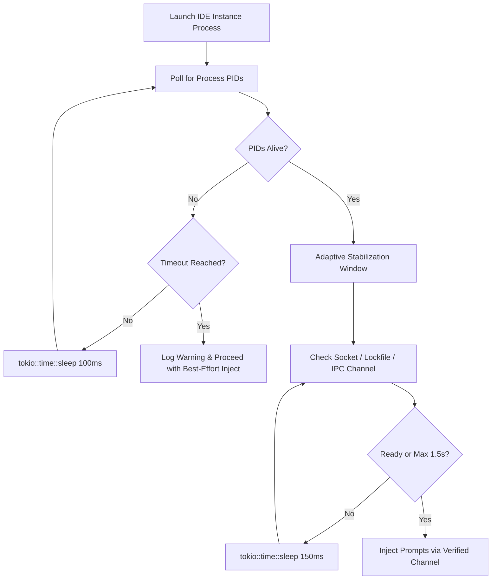
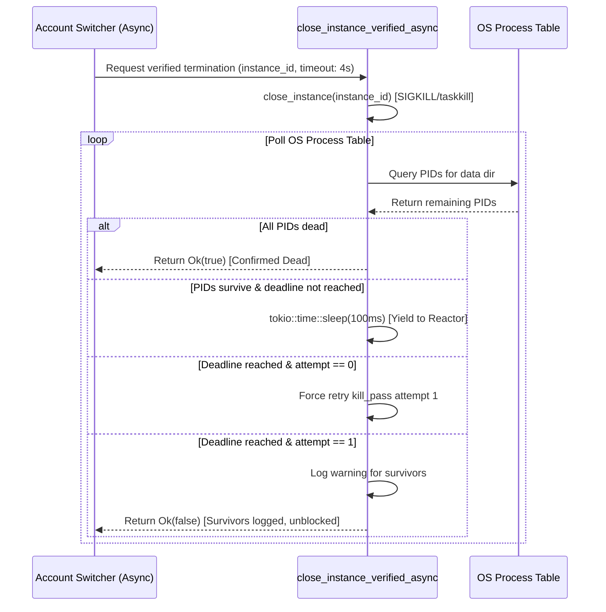

# Specification 01: Application Performance & Error Swallowing Remediation

## User Request (Verbatim)

```text
You are Spec Author 02 for task application-performance-and-synchronization-issues. You have no prior chat context; this brief is your complete specification.

### Core Objective:
Author comprehensive specifications and subtask plans for `application-performance-and-synchronization-issues`:
1. `02-spec/21-app/application-performance-and-synchronization-issues/01-performance-and-error-spec.md`
2. `02-spec/21-app/application-performance-and-synchronization-issues/02-headless-machine-sync-spec.md`
3. `.ai-memory/plans/subtasks/application-performance-and-synchronization-issues/01-performance-and-error-audit.md`
4. `.ai-memory/plans/subtasks/application-performance-and-synchronization-issues/02-headless-sync-and-instance-list.md`

### Specific Content to Document:
- Instance list view executable path display: UI column and cell details in `src/components/instances/InstanceTable.tsx` and `src/components/instances/table/InstanceRowCells.tsx` using `formatShortPath` and `inst.config.executable_path` (or default IDE fallback).
- Error swallowing audit: eliminating bare `let _ =`, `.ok()`, and `.unwrap_or_default()` across `src-tauri/src/bin/agm/instance_fastforward.rs`, `src-tauri/src/commands/instance.rs`, `src-tauri/src/modules/instance/switch.rs`, and frontend `useAutoSwitcher.ts` / `useInstanceSettings.ts`.
- Application hangs / glitches: eliminating synchronous 6,000ms sleep in `wait_for_instance_prompt_channel` (`src-tauri/src/modules/instance/projects.rs:150-157`) and synchronous blocking loops in `close_instance_verified`.
- Headless account & machine synchronization over Email / Telegram: JSON payload schema (`agm-fleet-sync-v1.0`), SQLite tables (`FleetNodes`, `FleetInstances`, `FleetWorkspaces`), and top-level summary view (`FleetSummaryView`).

### Boundaries & Crash Prevention:
- You have file authoring tools (`write_to_file`, `replace_file_content`, `view_file`, `run_command`).
- Edit ONLY your assigned owned files.
- TOTAL BAN ON GIT COMMANDS: NEVER run ANY `git` commands.
- TOTAL BAN ON SEARCH TOOLS: NEVER run `rg`, `ripgrep`, `grep`, `git grep`, `Select-String`, `findstr`.
- Strict Relative Git Paths.
```

---

## 1. Overview & Problem Definition

The Antigravity-Manager application currently suffers from two distinct categories of runtime reliability and performance defects:

1. **Application Hangs & UI Glitches**:
   - Long synchronous thread blocking calls (`std::thread::sleep(std::time::Duration::from_millis(6000))` in `wait_for_instance_prompt_channel`) freeze the execution thread for 6 seconds during prompt channel stabilization.
   - Synchronous polling loops in `close_instance_verified` execute up to two 5,000ms polling attempts using `std::thread::sleep(std::time::Duration::from_millis(200))`, causing up to 10 seconds of synchronous blocking on caller threads. When executed from Tauri command handlers or async Tokio contexts, this exhausts worker threads and starves the Tokio async reactor, manifesting as UI freezes, delayed IPC responses, and IPC timeouts.

2. **Error Swallowing & Silent Failure Degradation**:
   - Multiple modules violate the repository's strict **No Silent Errors** invariant (established 2026-10-10 in `AGENTS.md`).
   - Rust components across `src-tauri/src/bin/agm/instance_fastforward.rs`, `src-tauri/src/commands/instance.rs`, and `src-tauri/src/modules/instance/switch.rs` use bare `let _ =`, `.ok()`, and `.unwrap_or_default()`, discarding critical IO and database failures without routing to `AppError` or calling `crate::error::record_ignored` with justification comments.
   - Frontend TypeScript hooks (`useAutoSwitcher.ts` and `useInstanceSettings.ts`) contain bare `.catch(() => {})` handlers and empty `catch {}` blocks, completely hiding IPC command failures, event subscription errors, and local storage parse exceptions from the `error-store`.

---

## 2. Root Cause Analysis (RCA)

### 2.1 Synchronous 6,000ms Sleep in `wait_for_instance_prompt_channel`
- **Location**: `src-tauri/src/modules/instance/projects.rs:150-157`
- **Mechanism**:
  ```rust
  if running {
      crate::modules::logger::log_info(&format!(
          "[Instance] Prompt channel ready for '{}' ({} pids after {:?}); allowing 6s stabilization window before inject",
          instance_id,
          pids.len(),
          start_time.elapsed()
      ));
      std::thread::sleep(std::time::Duration::from_millis(6000));
      return;
  }
  ```
- **Root Cause**: Once process PIDs are detected, the function halts the calling thread with an arbitrary static 6,000ms sleep. If invoked within synchronous command chains or task pools, this locks the thread regardless of whether the IDE socket/channel is already responsive, causing noticeable latency spikes.
- **Remediation**:
  1. Transform static sleep into an asynchronous, adaptive readiness probe with exponential backoff or short intervals (`tokio::time::sleep(Duration::from_millis(150))`).
  2. Implement an active channel verification probe (checking for prompt intake socket / lockfile readiness) instead of arbitrary time-based delays.
  3. Ensure async commands use `tokio::time::sleep` and yield control immediately back to the Tokio reactor.

### 2.2 Synchronous Blocking Loop in `close_instance_verified`
- **Location**: `src-tauri/src/modules/instance/close.rs:105-136`
- **Mechanism**:
  ```rust
  loop {
      let remaining = live_pids();
      ...
      if remaining.is_empty() { return Ok(true); }
      if std::time::Instant::now() >= deadline { break; }
      std::thread::sleep(std::time::Duration::from_millis(200));
  }
  ```
- **Root Cause**: Two sequential attempts of 5-second polling loops with `std::thread::sleep(200ms)`. When called inside `switch_account_to_instance` (which runs in async context), this synchronous blocking locks Tokio worker threads.
- **Remediation**:
  1. Provide an asynchronous counterpart `close_instance_verified_async(instance_id: &str, timeout: Duration) -> Result<bool, AppError>` utilizing `tokio::time::sleep(Duration::from_millis(100))` and non-blocking process polling.
  2. Update async callers (`switch_account_to_instance`, `restart_instance`) to await the async variant.
  3. Keep synchronous `close_instance_verified` strictly for standalone CLI commands (`agm.rs`), routing it via bounded non-blocking checks.

### 2.3 Error Swallowing Audit Sites

| File | Line / Construct | Current Flaw | Required Remediation |
| :--- | :--- | :--- | :--- |
| `src-tauri/src/bin/agm/instance_fastforward.rs` | Line 78: `let _ = repo_db::backup_running_prompts(&target_instance);` | Discards SQLite backup failure silently | Replace with error match / logging: log warning if backup fails |
| `src-tauri/src/bin/agm/instance_fastforward.rs` | Lines 92-93: `let _ = repo_db::resend_running_commands_...; let _ = repo_db::dispatch_running_prompts(...);` | Silent discard of dispatch errors | Log error/warning via `eprintln!` and `crate::modules::logger::log_warn` |
| `src-tauri/src/bin/agm/instance_fastforward.rs` | Line 122: `auto_switcher::select_candidate_profiles(...).ok()` | Silent omission of candidate selection errors | Use `match` or `.map_err(|e| log_warn(...))` to record why candidate selection failed |
| `src-tauri/src/bin/agm/instance_fastforward.rs` | Lines 158, 184: `serde_json::to_string_pretty(&out).unwrap_or_default()` | Returns empty string on serialization error | Handle serialization failure with explicit fallback `"{}"` and log warning |
| `src-tauri/src/commands/instance.rs` | Lines 16, 49, 101: `resolve_instance_id(&id).unwrap_or(...)` | Swallows resolution error without trace | Ensure fallback is logged as debug/trace when resolution fails |
| `src-tauri/src/commands/instance.rs` | Lines 365-366: `registry.instances...map(...).unwrap_or_default()` | Swallows missing instance error silently | Return descriptive error or log warning that instance ID was not found |
| `src-tauri/src/modules/instance/switch.rs` | Line 82: `load_account(id).ok()` | Discards account load failure | Log warning if bound account ID cannot be loaded from storage |
| `src-tauri/src/modules/instance/switch.rs` | Line 145: `migrate_instance_workspaces(...).ok()` | Discards workspace migration error | Log warning if workspace migration fails between instances |
| `src-tauri/src/modules/instance/switch.rs` | Line 155: `backup_running_prompts(&instance.id).unwrap_or(0)` | Swallows database read failure as 0 | Propagate error or log warning via `crate::modules::logger::log_warn` |
| `src-tauri/src/modules/instance/switch.rs` | Line 403: `select_candidate_profiles(...).ok()` | Swallows candidate prediction failure | Log warning to `[INSTANCE_SWITCH]` channel on failure |
| `src-tauri/src/modules/instance/switch.rs` | Line 413: `list_running_projects().unwrap_or_default()` | Discards database error as empty list | Log warning on SQLite failure |
| `src/components/settings/AutoSwitcher/useAutoSwitcher.ts` | Line 34: `.catch(() => {})` | Discards `getAutoSwitcherDaemonStatus` failure | Route to `useErrorStore.getState().trackWarning(e, { source: 'useAutoSwitcher.fetchStatus', triggerAction: 'getAutoSwitcherDaemonStatus' })` |
| `src/components/settings/AutoSwitcher/useAutoSwitcher.ts` | Line 55: `.catch(() => {})` | Discards event subscription failure | Route to `useErrorStore.getState().trackWarning(e, { source: 'useAutoSwitcher.eventListen', triggerAction: 'listen_status_tick' })` |
| `src/components/settings/AutoSwitcher/useAutoSwitcher.ts` | Line 144: `catch (e: any) { setRotationFeedback(...) }` | Swallows error from global store | Call `useErrorStore.getState().captureError(e, { source: 'useAutoSwitcher.handleManualRotate', triggerAction: 'manual_rotate' })` |
| `src/components/instances/settingsModal/useInstanceSettings.ts` | Line 63: bare `catch {}` | Silently ignores localStorage JSON parse errors | Route to `useErrorStore.getState().trackWarning(e, { source: 'useInstanceSettings.initClipboard', triggerAction: 'read_clipboard_buffer' })` and return `null` |

---

## 3. Detailed Technical Architecture & Invariants

### 3.1 Non-Blocking Prompt Channel Readiness Architecture



#### Contract Specification
- Function: `pub async fn wait_for_instance_prompt_channel_async(instance_id: &str) -> Result<(), AppError>`
- Polling Interval: Adaptive starting at 50ms, backing off to max 250ms (`current_interval = min(current_interval * 3 / 2, 250)`).
- Readiness Criterion: Process detected alive in process table AND socket / directory lock initialized.
- Maximum Total Budget: 4,000ms (down from 15,000ms + 6,000ms = 21,000ms worst case).
- Invariant: NEVER call `std::thread::sleep` in any function designated `async` or executed inside Tokio runtime workers.

### 3.2 Non-Blocking Process Termination Architecture (`close_instance_verified_async`)



#### Contract Specification
- Signature:
  ```rust
  pub async fn close_instance_verified_async(
      instance_id: &str,
      timeout: std::time::Duration,
  ) -> Result<bool, AppError>
  ```
- Yield Mechanism: Uses `tokio::time::sleep(Duration::from_millis(100)).await` allowing other concurrent tasks (telemetry, SSE streams, UI pings) to process without jitter.

---

## 4. No Silent Errors Implementation Standard

### 4.1 Rust Error Routing Matrix
For all Rust code under `src-tauri/src/`:
1. **Fallible Operations with User or System Impact**:
   - Must return `AppResult<T>` (`Result<T, AppError>`).
   - Propagate with `?` or map to descriptive `AppError` variants:
     ```rust
     let registry = load_registry().map_err(|e| AppError::Config(format!("Load registry failed: {e}")))?;
     ```
2. **Best-Effort Operations (Cleanup, Secondary Telemetry)**:
   - FORBIDDEN: `let _ = ...;` or `.ok();`
   - REQUIRED: `crate::error::record_ignored(op, "description of operation");`
   - MANDATORY COMMENT: Immediately preceded by `// Justification: <reason why operation failure is benign and safe>`
   - Example:
     ```rust
     // Justification: prompt backup during CLI fast-forward is opportunistic; error logged without halting switch
     if let Err(e) = repo_db::backup_running_prompts(&target_instance) {
         crate::modules::logger::log_warn(&format!("[FastForward] Warning: Prompt backup failed: {e}"));
     }
     ```

### 4.2 Frontend TypeScript Error Routing Matrix
For all TypeScript code under `src/`:
1. **User-Facing Actions (Button clicks, form submits, modal operations)**:
   - Use `useErrorStore.getState().captureError(e, { source, triggerAction, endpoint })`.
   - Displays user-friendly error toast/modal while logging technical stack trace.
2. **Background Polling & Event Subscriptions (Heartbeats, interval ticks, unlisten)**:
   - FORBIDDEN: `.catch(() => {})` or `catch {}`
   - REQUIRED: `useErrorStore.getState().trackWarning(e, { source, triggerAction })`.
   - Records warning in memory telemetry log without disrupting user focus.
   - Example:
     ```typescript
     getAutoSwitcherDaemonStatus()
         .then((status) => {
             if (!isMounted) return;
             setDaemonStatus(status);
         })
         .catch((err) => {
             useErrorStore.getState().trackWarning(err, {
                 source: 'useAutoSwitcher.fetchStatus',
                 triggerAction: 'getAutoSwitcherDaemonStatus',
             });
         });
     ```

---

## 5. Acceptance Criteria & Quality Gates

- [ ] **AC-01 (Zero Blocking Sleeps)**: No calls to `std::thread::sleep` exist in `wait_for_instance_prompt_channel` or async instance lifecycle flows.
- [ ] **AC-02 (Adaptive Stabilization)**: Prompt channel stabilization completes within < 1.5 seconds under normal conditions instead of fixed 6.0 seconds.
- [ ] **AC-03 (Async Verified Termination)**: `close_instance_verified_async` yields to Tokio event loop every 100ms and resolves without freezing the UI.
- [ ] **AC-04 (Zero Bare Let-Underscore)**: Zero un-justified bare `let _ =` calls in `instance_fastforward.rs`, `commands/instance.rs`, and `switch.rs`.
- [ ] **AC-05 (Zero Bare Ok Calls)**: Zero un-logged `.ok()` calls discarding fallible database queries in `instance_fastforward.rs` and `switch.rs`.
- [ ] **AC-06 (Frontend Error Store Parity)**: Zero bare `.catch(() => {})` in `useAutoSwitcher.ts` and `useInstanceSettings.ts`; all failures route to `trackWarning` or `captureError`.
- [ ] **AC-07 (Preflight Gate Compliance)**: `cargo fmt -- --check`, `cargo clippy --all-targets --all-features`, and `npm run build` pass with zero warnings or errors.
