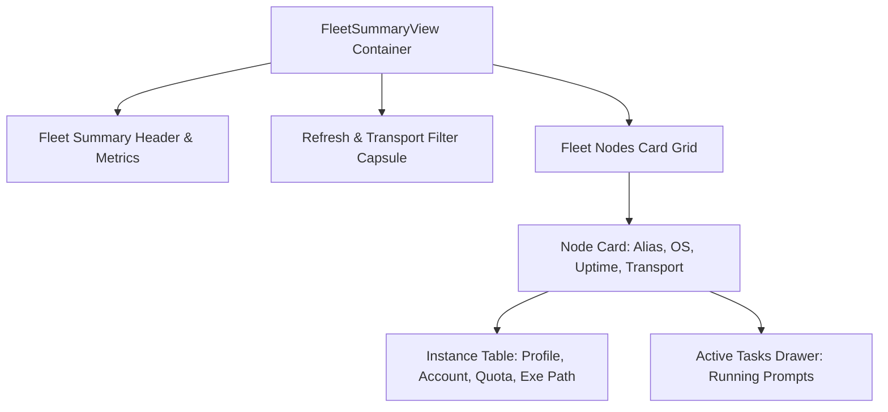

# Specification 02: Headless Machine Sync & Instance Executable Path Specification

## User Request (Verbatim)

```text
You are Spec Author 02 for task application-performance-and-synchronization-issues. You have no prior chat context; this brief is your complete specification.

### Core Objective:
Author comprehensive specifications and subtask plans for `application-performance-and-synchronization-issues`:
1. `02-spec/21-app/application-performance-and-synchronization-issues/01-performance-and-error-spec.md`
2. `02-spec/21-app/application-performance-and-synchronization-issues/02-headless-machine-sync-spec.md`
3. `.ai-memory/plans/subtasks/application-performance-and-synchronization-issues/01-performance-and-error-audit.md`
4. `.ai-memory/plans/subtasks/application-performance-and-synchronization-issues/02-headless-sync-and-instance-list.md`

### Specific Content to Document:
- Instance list view executable path display: UI column and cell details in `src/components/instances/InstanceTable.tsx` and `src/components/instances/table/InstanceRowCells.tsx` using `formatShortPath` and `inst.config.executable_path` (or default IDE fallback).
- Error swallowing audit: eliminating bare `let _ =`, `.ok()`, and `.unwrap_or_default()` across `src-tauri/src/bin/agm/instance_fastforward.rs`, `src-tauri/src/commands/instance.rs`, `src-tauri/src/modules/instance/switch.rs`, and frontend `useAutoSwitcher.ts` / `useInstanceSettings.ts`.
- Application hangs / glitches: eliminating synchronous 6,000ms sleep in `wait_for_instance_prompt_channel` (`src-tauri/src/modules/instance/projects.rs:150-157`) and synchronous blocking loops in `close_instance_verified`.
- Headless account & machine synchronization over Email / Telegram: JSON payload schema (`agm-fleet-sync-v1.0`), SQLite tables (`FleetNodes`, `FleetInstances`, `FleetWorkspaces`), and top-level summary view (`FleetSummaryView`).

### Boundaries & Crash Prevention:
- You have file authoring tools (`write_to_file`, `replace_file_content`, `view_file`, `run_command`).
- Edit ONLY your assigned owned files.
- TOTAL BAN ON GIT COMMANDS: NEVER run ANY `git` commands.
- TOTAL BAN ON SEARCH TOOLS: NEVER run `rg`, `ripgrep`, `grep`, `git grep`, `Select-String`, `findstr`.
- Strict Relative Git Paths.
```

---

## 1. Overview & System Requirements

This specification defines two interconnected capabilities for Antigravity-Manager:

1. **Instance List Executable Path Display**:
   - Enhancing the instance table view (`InstanceTable.tsx` and `InstanceRowCells.tsx`) to surface the exact binary executable used by each instance profile (`inst.config.executable_path` or detected system IDE fallback).
   - Providing visual transparency between instances running standard binaries vs cloned/sandboxed executables (`antigravity-clone-*.exe`).

2. **Headless Machine & Account Fleet Synchronization**:
   - Enabling multi-machine fleet state synchronization across headless environments (Linux servers, cloud VMs, headless build runners) without requiring direct open inbound network ports or complex VPN mesh setups.
   - Using asynchronous message transports (IMAP/SMTP Email and Telegram Bot) carrying structured, signed JSON envelopes (`agm-fleet-sync-v1.0`).
   - Maintaining persistent local cluster state in dedicated SQLite tables (`FleetNodes`, `FleetInstances`, `FleetWorkspaces`).
   - Rendering aggregated fleet health, node status, and active workloads via the `FleetSummaryView` component.

---

## 2. Instance List Executable Path UI Architecture

### 2.1 Table Structure & Column Configuration
In `src/components/instances/InstanceTable.tsx`, the table header and body rows are enhanced to present both the data directory path and the IDE executable path.

```html
<!-- Table Header Layout -->
<tr className="border-b border-slate-200/90 dark:border-slate-800/90 bg-slate-50/80 dark:bg-[#071a27] text-[11px] font-semibold uppercase tracking-wider text-slate-500 dark:text-slate-400">
    <th className="px-2 py-1.5 min-w-[140px] max-w-[180px]">Profile & Account</th>
    <th className="px-2 py-1.5 min-w-[150px] max-w-[190px]">Model & Weekly Quota</th>
    <th className="px-2 py-1.5 min-w-[85px] max-w-[105px]">Status & PID</th>
    <th className="px-2 py-1.5 min-w-[110px] max-w-[130px]">File / Data Path</th>
    <th className="px-2 py-1.5 min-w-[110px] max-w-[130px]">IDE Executable</th>
    <th className="px-2 py-1.5 text-right w-[130px]">Actions</th>
</tr>
```

### 2.2 Executable Cell Component (`ExecutableCell`)
In `src/components/instances/table/InstanceRowCells.tsx`, the `ExecutableCell` component displays the short formatted path and provides quick copy functionality:

```tsx
interface ExecutableCellProps {
    inst: InstanceStatus;
    isCopied: boolean;
    onCopy: () => void;
}

export function ExecutableCell({ inst, isCopied, onCopy }: ExecutableCellProps) {
    const rawExePath = inst.config.executable_path || '';
    const fullExePath = rawExePath || 'Default IDE (Auto-detected)';
    const shortExePath = rawExePath ? formatShortPath(rawExePath) : 'Default IDE';
    const isCustom = Boolean(rawExePath);

    return (
        <td className="px-2 py-1 whitespace-nowrap min-w-[110px] max-w-[130px]" title={fullExePath}>
            <div className="flex items-center justify-between gap-1 text-[11px] font-mono text-slate-500 dark:text-slate-400">
                <div className="flex items-center gap-1 min-w-0 truncate" title={fullExePath}>
                    <Terminal className="w-3.5 h-3.5 text-slate-400 shrink-0" />
                    <span className="truncate">{shortExePath}</span>
                    {isCustom && (
                        <span className="px-1 py-0.2 rounded-[3px] text-[8px] font-bold bg-amber-500/10 text-amber-600 dark:text-amber-400 border border-amber-500/20 shrink-0">
                            CUSTOM
                        </span>
                    )}
                </div>
                {rawExePath && (
                    <button
                        type="button"
                        onClick={onCopy}
                        className="p-1 rounded-[5px] text-slate-400 hover:text-slate-700 dark:hover:text-slate-200 hover:bg-slate-200 dark:hover:bg-[#15334d] transition-colors cursor-pointer shrink-0"
                        title={isCopied ? 'Copied!' : 'Copy full executable path'}
                    >
                        {isCopied ? <Check className="w-3 h-3 text-teal-500" /> : <Copy className="w-3 h-3" />}
                    </button>
                )}
            </div>
        </td>
    );
}
```

### 2.3 Integrated Path Toggle (Alternative Compact Mode)
When horizontal viewport width is constrained, the table supports a compact dual-path toggle inside `PathCell`:
- Header label: `File / Data / Exe Path`
- Shows primary data path with a subtle switcher badge (`[DATA | EXE]`) to toggle inline without widening table bounds.

---

## 3. Headless Machine & Account Sync Architecture

### 3.1 Distributed Message Transport Protocol
Headless nodes publish and consume node telemetry through asynchronous mailboxes and chat gateways:

```mermaid
flowchart LR
    subgraph HeadlessWorkerA [Headless Worker Node A]
        NodeA_Daemon[AGM Headless Daemon]
        NodeA_DB[(Local SQLite)]
    end

    subgraph TransportRelays [Zero-Port Transport Relays]
        EmailTransport[IMAP / SMTP Mailbox<br/>Subject: [AGM-FLEET-SYNC]]
        TelegramTransport[Telegram Bot Gateway<br/>Channel: /fleet_sync]
    end

    subgraph CentralHost [Central Host / GUI Client]
        Host_Daemon[Fleet Sync Receiver]
        Host_DB[(FleetNodes / FleetInstances DB)]
        Host_UI[FleetSummaryView GUI]
    end

    NodeA_Daemon -- 1. Publish State JSON --> EmailTransport
    NodeA_Daemon -- 2. Publish State JSON --> TelegramTransport
    EmailTransport -- 3. Inbound Polling --> Host_Daemon
    TelegramTransport -- 4. Long-Poll / Hook --> Host_Daemon
    Host_Daemon --> Host_DB
    Host_DB --> Host_UI
```

### 3.2 JSON Payload Schema (`agm-fleet-sync-v1.0`)

```json
{
  "$schema": "agm-fleet-sync-v1.0",
  "version": "1.0",
  "msg_id": "9b1deb4d-3b7d-4bad-9bdd-2b0d7b3dcb6d",
  "msg_type": "HEARTBEAT",
  "node_id": "node-8a3f91bc-0042",
  "node_alias": "cloud-worker-fra-01",
  "timestamp": 1728658800,
  "transport_channel": "email",
  "node_telemetry": {
    "os_info": "Linux 6.8.0-45-generic #45-Ubuntu SMP x86_64",
    "ip_address": "192.168.1.120",
    "public_ip": "203.0.113.45",
    "uptime_seconds": 345600,
    "tool_version": "v4.162.0",
    "cpu_usage_percent": 14.2,
    "memory_used_mb": 2048,
    "memory_total_mb": 8192
  },
  "instances": [
    {
      "instance_id": "default",
      "name": "Default Worker",
      "is_running": true,
      "pid": 41289,
      "executable_path": "/opt/antigravity/bin/antigravity",
      "data_dir": "/home/ubuntu/.config/antigravity",
      "bound_account_email": "runner-01@gmail.com",
      "quota_percent": 88.5,
      "quota_weekly_percent": 94.0,
      "last_used": 1728658790
    },
    {
      "instance_id": "sandbox-02",
      "name": "Testing Sandbox",
      "is_running": false,
      "pid": null,
      "executable_path": null,
      "data_dir": "/home/ubuntu/.antigravity_tools/instances/sandbox-02",
      "bound_account_email": "runner-02@gmail.com",
      "quota_percent": 100.0,
      "quota_weekly_percent": 100.0,
      "last_used": 1728651200
    }
  ],
  "workspaces": [
    {
      "instance_id": "default",
      "workspace_path": "/home/ubuntu/repos/antigravity-service",
      "workspace_name": "antigravity-service",
      "has_running_prompt": true,
      "prompt_preview": "Refactor token rotation handlers for Google OAuth",
      "turn_status": "running"
    }
  ],
  "auth_signature": "e3b0c44298fc1c149afbf4c8996fb92427ae41e4649b934ca495991b7852b855"
}
```

---

## 4. SQLite Split-DB Architecture & Schema Migrations

Fleet state is maintained within a dedicated SQLite storage database (`fleet.db` or managed table partition).

### 4.1 Schema DDL Definitions

```sql
-- 1. FleetNodes Table
CREATE TABLE IF NOT EXISTS FleetNodes (
    node_id TEXT PRIMARY KEY,
    alias TEXT NOT NULL,
    ip_address TEXT NOT NULL,
    public_ip TEXT,
    os_info TEXT NOT NULL,
    transport_channel TEXT NOT NULL, -- 'email' | 'telegram' | 'supabase'
    last_heartbeat_at INTEGER NOT NULL,
    uptime_seconds INTEGER NOT NULL,
    status TEXT NOT NULL,            -- 'online' | 'degraded' | 'offline'
    tool_version TEXT NOT NULL,
    raw_telemetry JSON,
    created_at INTEGER NOT NULL,
    updated_at INTEGER NOT NULL
);

CREATE INDEX IF NOT EXISTS idx_fleet_nodes_status ON FleetNodes(status, last_heartbeat_at);
CREATE INDEX IF NOT EXISTS idx_fleet_nodes_alias ON FleetNodes(alias);

-- 2. FleetInstances Table
CREATE TABLE IF NOT EXISTS FleetInstances (
    id TEXT PRIMARY KEY,             -- composite: node_id || '__' || instance_id
    node_id TEXT NOT NULL REFERENCES FleetNodes(node_id) ON DELETE CASCADE,
    instance_id TEXT NOT NULL,
    name TEXT NOT NULL,
    is_running INTEGER NOT NULL DEFAULT 0,
    pid INTEGER,
    executable_path TEXT,
    data_dir TEXT NOT NULL,
    bound_account_email TEXT,
    quota_percent REAL,
    quota_weekly_percent REAL,
    last_used INTEGER,
    updated_at INTEGER NOT NULL
);

CREATE INDEX IF NOT EXISTS idx_fleet_instances_node ON FleetInstances(node_id);
CREATE INDEX IF NOT EXISTS idx_fleet_instances_email ON FleetInstances(bound_account_email);
CREATE INDEX IF NOT EXISTS idx_fleet_instances_running ON FleetInstances(is_running);

-- 3. FleetWorkspaces Table
CREATE TABLE IF NOT EXISTS FleetWorkspaces (
    id TEXT PRIMARY KEY,             -- composite: node_id || '__' || instance_id || '__' || substr(md5(workspace_path), 1, 8)
    node_id TEXT NOT NULL REFERENCES FleetNodes(node_id) ON DELETE CASCADE,
    instance_id TEXT NOT NULL,
    workspace_path TEXT NOT NULL,
    workspace_name TEXT NOT NULL,
    has_running_prompt INTEGER NOT NULL DEFAULT 0,
    prompt_preview TEXT,
    turn_status TEXT,
    updated_at INTEGER NOT NULL
);

CREATE INDEX IF NOT EXISTS idx_fleet_workspaces_node ON FleetWorkspaces(node_id);
CREATE INDEX IF NOT EXISTS idx_fleet_workspaces_running ON FleetWorkspaces(has_running_prompt);
```

### 4.2 Inbound Message Ingestion Invariant
When a message arrives via Email or Telegram:
1. Verify payload signature (`auth_signature`) matches HMAC of payload body using shared secret.
2. Upsert `FleetNodes` row updating `last_heartbeat_at`, `status = 'online'`, and telemetry.
3. Replace/upsert corresponding child records in `FleetInstances` and `FleetWorkspaces`.
4. Stale evaluation: If a node has not published a heartbeat within 180 seconds, mark status as `'offline'`.

---

## 5. UI Architecture: `FleetSummaryView`

### 5.1 Component Overview
The `FleetSummaryView` component lives in `src/components/instances/fleet/FleetSummaryView.tsx` and provides a bird's-eye view of all cluster machines, accounts, and tasks.



### 5.2 Visual Wireframe & Tokens

```text
+---------------------------------------------------------------------------------------------------+
|  [Server] Cluster Fleet Overview               [3 Nodes Online] [6 Active Instances] [2 Running]  |
|  Real-time headless synchronization across Email & Telegram relays                               |
+---------------------------------------------------------------------------------------------------+
|  [ Filter: All Transports (3) | Email (2) | Telegram (1) ]        [↻ Sync Fleet Now] [⚡ Export]  |
+---------------------------------------------------------------------------------------------------+
| +-----------------------------------------------------------------------------------------------+ |
| | [● ONLINE] cloud-worker-fra-01 · 192.168.1.120 · Linux 6.8 · Uptime: 4d · Via: 📧 Email       | |
| |                                                                                               | |
| | Instances:                                                                                    | |
| |   #1 Default Worker  [● Running · 41289]  runner-01@gmail.com (88%)  .../antigravity          | |
| |      ↳ Prompt: "Refactor token rotation handlers..." [RUNNING]                                | |
| |   #2 Test Sandbox    [○ Idle]            runner-02@gmail.com (100%) Default IDE               | |
| +-----------------------------------------------------------------------------------------------+ |
| +-----------------------------------------------------------------------------------------------+ |
| | [● ONLINE] mac-mini-m2-runner · 10.0.0.15 · Darwin 23.4 · Uptime: 12d · Via: 📱 Telegram      | |
| |                                                                                               | |
| | Instances:                                                                                    | |
| |   #1 Main Agent      [● Running · 18902]  runner-03@gmail.com (72%)  .../Antigravity.app      | |
| |      ↳ Prompt: "Execute CI test matrix..." [RUNNING]                                          | |
| +-----------------------------------------------------------------------------------------------+ |
+---------------------------------------------------------------------------------------------------+
```

### 5.3 Technical State Interface

```typescript
export interface FleetSummaryState {
    nodes: FleetNodeRecord[];
    instances: FleetInstanceRecord[];
    workspaces: FleetWorkspaceRecord[];
    isLoading: boolean;
    isSyncing: boolean;
    lastSyncedAt: number | null;
    selectedTransport: 'all' | 'email' | 'telegram';
}
```

---

## 6. Acceptance Criteria & Quality Gates

- [ ] **AC-01 (Executable Path Display)**: `InstanceTable` and `InstanceRowCells` render executable path column with `formatShortPath`, copy button, and custom badge.
- [ ] **AC-02 (Fallback Resolution)**: If `executable_path` is null, the UI gracefully renders `Default IDE` without breaking layout or throwing runtime exceptions.
- [ ] **AC-03 (JSON Schema Conformance)**: Payloads conform strictly to `agm-fleet-sync-v1.0` schema with UUIDv4 `msg_id`, epoch timestamp, and HMAC signature.
- [ ] **AC-04 (SQLite Table Migrations)**: Tables `FleetNodes`, `FleetInstances`, and `FleetWorkspaces` are automatically created on startup with idempotent `IF NOT EXISTS` DDL.
- [ ] **AC-05 (Multi-Transport Ingestion)**: Email watcher (`email_inbound`) and Telegram bot (`telegram_inbound`) parse inbound `[AGM-FLEET-SYNC]` messages and upsert fleet records.
- [ ] **AC-06 (FleetSummaryView Rendering)**: `FleetSummaryView` displays node badges, uptime, instance cards, and running prompt summaries in responsive dark-glass styling.
- [ ] **AC-07 (Quality & Preflight Gate)**: All frontend TypeScript compiles clean under `npm run build`; all Rust code passes `cargo fmt -- --check` and `cargo clippy`.
