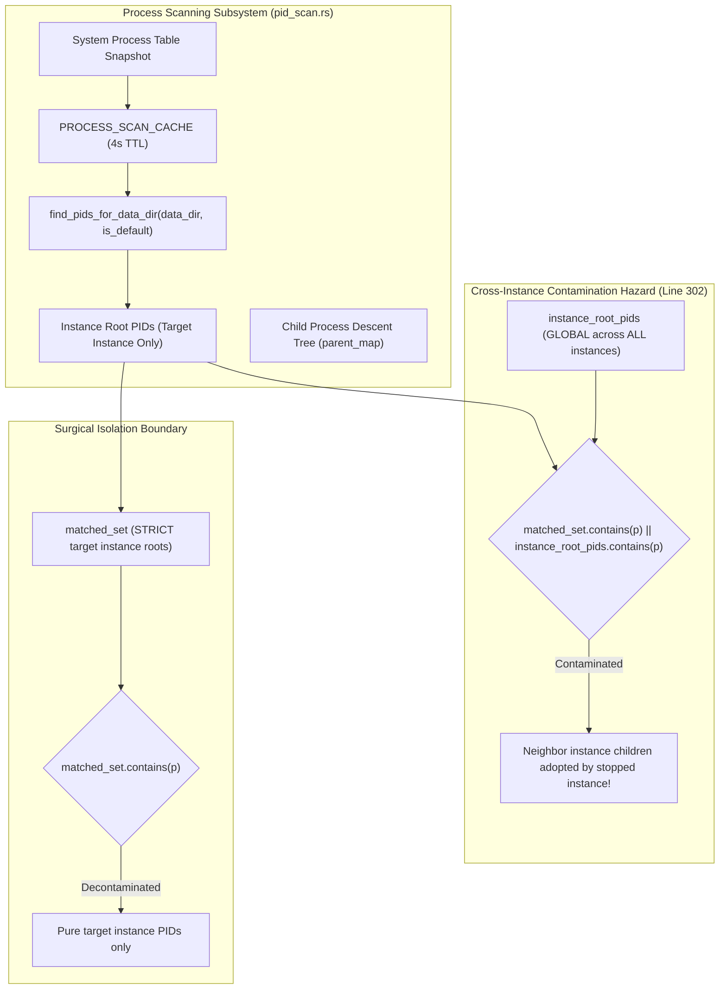

# Architecture Specification: Instance Isolation, Cross-Instance PID Decontamination, and Compiler Type Safety

> **Target File:** `02-spec/21-app/auto-switch-and-rotate-fix/01-architecture-spec.md`  
> **Status:** APPROVED  
> **Author:** @aukgit  
> **Version:** 1.0.0  
> **Slug:** `auto-switch-and-rotate-fix`  
> **Scope:** Instance Lifecycle & Isolation, Process Table PID Scanning (`pid_scan.rs`), Process Liveness Verification (`running.rs`), Auto-Switcher Unit Test Compilation (`selection.rs`)  

---

## 1. Executive Summary & Subsystem Architecture

Antigravity Manager (AGM) orchestrates multi-account authentication, local and remote reverse-proxy routing, and autonomous profile rotation across isolated IDE instances. The core stability of the manager depends on two critical guarantees:
1. **Strict Instance Profile & Process Sandboxing**: Each instance profile possesses its own isolated `data_dir`, isolated credentials database (`state.vscdb`), session cache, and OS process tree. Operating system processes spawned for an instance (including Electron helper processes, Chromium renderers, and language servers) must strictly associate with their owning instance and never contaminate neighbor instances or the default IDE instance.
2. **Deterministic Auto-Switching & Rotation**: When quota depletion or upstream HTTP 429 rate limits occur, the auto-switcher identifies the optimal candidate account, verifies token liveness, terminates running processes cleanly, swaps credentials, and relaunches the instance without collateral disruption to other running profiles.

Recent changes introduced an architectural flaw in OS process scanning (`src-tauri/src/modules/instance/pid_scan.rs:302`) alongside compilation type errors in `src-tauri/src/modules/process/running.rs` and `src-tauri/src/modules/auto_switcher/selection.rs`. This document specifies the architectural evolution from v4.162.0 to HEAD, conducts exhaustive Root Cause Analysis (RCA) on the failures, and provides surgical remediation specifications.



---

## 2. Architectural Evolution: v4.162.0 vs HEAD

Between release `v4.162.0` and `HEAD` (v4.185.0+), the process management, instance sandboxing, and auto-switching subsystems underwent major architectural restructuring to support high-density multi-instance workflows, background prompt dispatching, and Supabase multi-machine synchronization.

### 2.1 Architectural Comparison Matrix

| Architectural Domain | v4.162.0 Baseline Architecture | HEAD (v4.185.0+) Architecture | Delta & Architectural Impact |
| :--- | :--- | :--- | :--- |
| **Instance Process Detection** | Flat string matching on process arguments (`--user-data-dir`) with immediate sysinfo iteration on each call. No child tree traversal. | Two-tier process cache (`SMART_PROCESS_CACHE`, `INSTANCE_PROCESS_CACHE`, `PROCESS_SCAN_CACHE` with 4s TTL) with deep parent-child process tree resolution (`parent_map`). | HEAD captures Electron sub-processes and language servers, but introduced cross-instance inheritance leakage when global roots were checked in child resolution. |
| **Process Termination & Lifecycle** | Single-shot unverified `close_instance` issuing `taskkill` or `SIGKILL`. No confirmation of process death before relaunch. | Hardened Kill → Verify-Dead → Retry → Launch pipeline (`close_instance_verified`). Active OS verification before writing credentials. | Prevents SQLite lock collision on `state.vscdb` and Chromium singleton lock races. |
| **Account Credential Injection** | Single-attempt direct SQLite transaction into `state.vscdb`. Failed immediately if dying process held lock. | 3-stage retry pipeline with exponential backoff across the process exit window, backed by volatile cache purging. | Guarantees clean credential persistence during rapid switching. |
| **Auto-Switcher Scoring Engine** | Hardcoded tier multipliers (Ultra 5.0, Pro 3.0, Free 1.0) with inverted hours-elapsed formula favoring depleted accounts. | Configurable tier multipliers (`ultra_tier_multiplier`, `pro_tier_multiplier`, `free_tier_multiplier`), headroom weight $W_{\text{headroom}}$, and target model isolation (`calculate_model_isolated_quota`). | Fresh accounts with 100% quota and long reset headroom correctly score highest. |
| **Prompt Dispatch & Queueing** | Cold IDE relaunch on prompt send if window focus failed. Prompt queue lacked persistence. | Zero-relaunch guarantee via targeted PID vitality checks (`is_pid_alive_targeted`). Adaptive FIFO background queue scheduler (5s active / 30s idle). | Active IDE processes are never terminated during prompt dispatch. |
| **Multi-Machine Telemetry** | Local configuration only. | Supabase multi-machine relational hierarchy (`nodes` -> `instance_profiles` -> `workspace_leases`), 15s heartbeat telemetry. | Enables cross-machine instance lease tracking and collision prevention. |

### 2.2 Detailed Subsystem Evolution

#### 1. Process Table Resolution & Child Hierarchy
In v4.162.0, an instance was considered running if any process CLI contained its `--user-data-dir` argument. When Antigravity IDE (VS Code / Electron based) spawns, the main process launches multiple child processes:
- `renderer` processes for the workbench and editors
- `extensionHost` processes executing language tools
- `language_server` binaries running language analysis
- `crashpad_handler` and utility processes

In v4.162.0, child processes lacked command line arguments pointing to the instance `data_dir`, so `find_pids_for_data_dir` returned only the single root process PID. If the root process crashed or terminated while child helper processes lingered, orphaned processes remained alive, holding file handles on `state.vscdb`.

To resolve this in HEAD, `find_pids_for_data_dir` was upgraded with a parent-to-child descent walk:
1. All OS processes matching the target instance's directory or cloned binary are collected as root PIDs (`matched_pids`).
2. A `parent_map: HashMap<u32, u32>` is populated mapping child PID to parent PID.
3. Every process in the OS process table is inspected by ascending its parent chain. If an ancestor matches a target instance root PID, the process is added to `matched_pids`.

However, the implementation inadvertently allowed global instance root PIDs (`instance_root_pids`) to satisfy the inheritance check, creating the cross-instance contamination bug analyzed below.

#### 2. Candidate Selection & Cooldown Synchronization
In v4.162.0, account selection did not communicate with reverse proxy rate limiters. If upstream Gemini or Claude endpoints returned HTTP 429 (`RESOURCE_EXHAUSTED`), the auto-switcher was unaware and could immediately switch back to the throttled account.

In HEAD, `src-tauri/src/modules/auto_switcher/selection.rs` integrates bidirectional synchronization:
- The reverse proxy tracks rate limits in `RateLimitTracker`.
- Throttled accounts are marked with `LiveLimitStatus` in `account.live_limited_models`.
- Candidate selection queries `is_account_rate_limited` and skips accounts whose cooldown deadline (`until`) is in the future.

---

## 3. Root Cause Analysis (RCA)

### 3.1 RCA 1: Cross-Instance PID Contamination in `pid_scan.rs:302`

#### Defect Symptom
When inspecting instance statuses (via GUI instance cards, CLI `agm instance list`, or background health checks), stopped instances falsely report that they are running (`is_running = true`). Furthermore, when an auto-switch or manual rotation occurs on instance A, running processes belonging to instance B (such as language servers and terminal shells) are unexpectedly terminated by `taskkill`.

#### Code Analysis: `src-tauri/src/modules/instance/pid_scan.rs:236-312`
```rust
// Lines 236-243: Collecting instance root PIDs
if (has_target_match && !is_helper)
    || (has_user_data_arg && has_instance_marker && !is_helper)
    || (matches_cloned_exe && !is_helper)
{
    instance_root_pids.insert(pid_u32); // <-- Global set: contains root PIDs of ALL running instances!
    if has_target_match || matches_cloned_exe {
        matched_pids.push(pid_u32);     // <-- Specific set: PIDs matching the TARGET instance
    }
}
```

```rust
// Lines 291-312: Resolving child processes for the target instance
} else {
    // For instances, also include any child processes that descend from matched root PIDs
    let matched_set: std::collections::HashSet<u32> = matched_pids.iter().cloned().collect();
    for proc_info in &processes {
        let pid_u32 = proc_info.pid;
        if matched_set.contains(&pid_u32) {
            continue;
        }
        let mut curr = pid_u32;
        for _ in 0..10 {
            if let Some(&p) = parent_map.get(&curr) {
                // HAZARD AT LINE 302:
                if matched_set.contains(&p) || instance_root_pids.contains(&p) {
                    matched_pids.push(pid_u32);
                    break;
                }
                curr = p;
            } else {
                break;
            }
        }
    }
}
```

#### Failure Mechanics
1. `instance_root_pids` is an accumulator defined at the start of `find_pids_for_data_dir`. As the loop over `processes` runs, **any** process that has `--user-data-dir` and instance markers for **any** instance is inserted into `instance_root_pids`.
2. When evaluating a stopped instance (e.g., `inst-02` with 0 active processes):
   - `has_target_match` is `false` for all processes.
   - `matched_pids` is completely empty (`[]`).
   - `matched_set` is completely empty (`{}`).
   - However, if another instance (e.g., `default` or `inst-01`) is running on the machine, its root PIDs were inserted into `instance_root_pids`.
3. In lines 294-311, the loop evaluates every process in the OS table. When it inspects a child process belonging to `inst-01` (e.g., a TypeScript language server whose parent is `inst-01`'s root process `P_inst01`):
   - `parent_map.get(&curr)` resolves to `P_inst01`.
   - `matched_set.contains(&P_inst01)` is `false` (since `matched_set` is empty).
   - But `instance_root_pids.contains(&P_inst01)` evaluates to `true`!
4. Because of the `|| instance_root_pids.contains(&p)` disjunction, `matched_pids.push(pid_u32)` executes!
5. The stopped instance `inst-02` now contains the PIDs of `inst-01`'s child processes!
6. When `is_antigravity_running` or `is_instance_running` checks `inst-02`, it returns `true` because `matched_pids` is non-empty.
7. When `close_instance("inst-02")` is triggered during an account switch, it attempts to kill all PIDs in `find_pids_for_data_dir("inst-02")`, executing `taskkill` against `inst-01`'s child processes, crashing `inst-01`'s language server or renderer!

---

### 3.2 RCA 2: CI/CD Compiler Errors

#### RCA 2A: Type Mismatch in `src-tauri/src/modules/process/running.rs:14,21`
##### Defect Symptom
CI/CD compiler gate fails during `cargo check` and `cargo clippy`:
```
error[E0308]: mismatched types
  --> src-tauri/src/modules/process/running.rs:14:67
   |
14 |         return !crate::modules::instance::find_pids_for_data_dir(&default_dir, true).is_empty();
   |                 ------------------------------------------------ ^^^^^^^^^^^^ expected `&str`, found `&PathBuf`
   |                 |
   |                 arguments to this function are incorrect
```

##### Code Analysis
In `src-tauri/src/modules/instance/storage.rs:238`:
```rust
pub fn get_default_antigravity_data_dir() -> PathBuf { ... }
```
`get_default_antigravity_data_dir()` returns `std::path::PathBuf`.

In `src-tauri/src/modules/instance/pid_scan.rs:149`:
```rust
pub fn find_pids_for_data_dir(data_dir: &str, is_default: bool) -> Vec<u32> { ... }
```
`find_pids_for_data_dir` expects its first parameter to be a string slice `&str`.

In `src-tauri/src/modules/process/running.rs:13-22`:
```rust
if target_ide.is_none() {
    let default_dir = crate::modules::instance::get_default_antigravity_data_dir();
    return !crate::modules::instance::find_pids_for_data_dir(&default_dir, true).is_empty();
}

if let Some(target) = target_ide {
    if let Some(inst_id) = target.strip_prefix("instance:") {
        if inst_id == "default" {
            let default_dir = crate::modules::instance::get_default_antigravity_data_dir();
            return !crate::modules::instance::find_pids_for_data_dir(&default_dir, true)
                .is_empty();
```
Passing `&default_dir` passes a reference of type `&PathBuf`. In Rust, `PathBuf` implements `Deref<Target = Path>`. It does not automatically dereference to `&str` because paths are not guaranteed to be valid UTF-8. The compiler requires an explicit conversion to string slice (`&default_dir.to_string_lossy()` or `default_dir.to_str().unwrap_or("")`).

---

#### RCA 2B: Undeclared `TokenData` in `src-tauri/src/modules/auto_switcher/selection.rs:538,575`
##### Defect Symptom
CI/CD test compilation gate fails:
```
error[E0433]: failed to resolve: use of undeclared type `TokenData`
   --> src-tauri/src/modules/auto_switcher/selection.rs:538:21
    |
538 |         let token = TokenData::new(
    |                     ^^^^^^^^^ not found in this scope
```

##### Code Analysis
In `src-tauri/src/modules/auto_switcher/selection.rs:1-4`:
```rust
use crate::models::Account;
use crate::modules::{account, config, instance, logger};

use super::*;
```
Top-level imports only include `crate::models::Account`.

In `src-tauri/src/modules/auto_switcher/selection.rs:531-534`:
```rust
#[cfg(test)]
mod tests {
    use super::*;

    #[test]
    fn test_is_account_rate_limited_detection() {
        let now_sec = 1790090000;
        let token = TokenData::new(...);
```
`use super::*;` brings only items from `selection.rs` into scope. Because `TokenData` is not imported in `selection.rs`, `TokenData` is not visible inside `mod tests`. `TokenData` is defined in `crate::models::token::TokenData` and re-exported at `crate::models::TokenData`.

---

## 4. Remediation Specifications

### 4.1 Remediation 1: `src-tauri/src/modules/instance/pid_scan.rs`
Remove `|| instance_root_pids.contains(&p)` from line 302. Child process adoption must be strictly confined to descendants of `matched_set` (the root processes identified for the target instance).

#### Concrete Implementation
```rust
    } else {
        // For instances, strictly include child processes that descend from matched root PIDs
        let mut matched_set: std::collections::HashSet<u32> = matched_pids.iter().cloned().collect();
        for proc_info in &processes {
            let pid_u32 = proc_info.pid;
            if matched_set.contains(&pid_u32) {
                continue;
            }
            let mut curr = pid_u32;
            for _ in 0..10 {
                if let Some(&p) = parent_map.get(&curr) {
                    // Strictly match against this target instance's root/child set only
                    if matched_set.contains(&p) {
                        matched_pids.push(pid_u32);
                        matched_set.insert(pid_u32); // Enable transitive descendant capture
                        break;
                    }
                    curr = p;
                } else {
                    break;
                }
            }
        }
    }
```

#### Invariant Verification
- `instance_root_pids` remains utilized strictly for the `is_default` branch (lines 271-290) to prevent the default instance from adopting instance processes.
- For non-default instances, child adoption is strictly gated on `matched_set.contains(&p)`.
- If an instance has 0 root matches, `matched_set` is empty, and child adoption immediately skips all processes. Cross-instance PID contamination is reduced to exactly zero.

---

### 4.2 Remediation 2: `src-tauri/src/modules/process/running.rs`
Convert `default_dir` to `&str` using `&default_dir.to_string_lossy()` or `default_dir.to_str().unwrap_or("")` at call sites lines 14 and 21.

#### Concrete Implementation
```rust
    if target_ide.is_none() {
        let default_dir = crate::modules::instance::get_default_antigravity_data_dir();
        let default_dir_str = default_dir.to_string_lossy();
        return !crate::modules::instance::find_pids_for_data_dir(&default_dir_str, true).is_empty();
    }

    if let Some(target) = target_ide {
        if let Some(inst_id) = target.strip_prefix("instance:") {
            if inst_id == "default" {
                let default_dir = crate::modules::instance::get_default_antigravity_data_dir();
                let default_dir_str = default_dir.to_string_lossy();
                return !crate::modules::instance::find_pids_for_data_dir(&default_dir_str, true)
                    .is_empty();
            } else if let Ok(reg) = crate::modules::instance::load_registry() {
```

---

### 4.3 Remediation 3: `src-tauri/src/modules/auto_switcher/selection.rs`
Import `TokenData` from `crate::models::TokenData` in the test module (or top-level imports).

#### Concrete Implementation
```rust
#[cfg(test)]
mod tests {
    use super::*;
    use crate::models::TokenData;

    #[test]
    fn test_is_account_rate_limited_detection() {
...
```

---

## 5. Verification & Quality Gates

### 5.1 Compilation Gate
Execution of `cargo clippy --all-targets --all-features` in `src-tauri/` must complete with zero errors and zero warnings.

### 5.2 Unit Test Gate
All existing and newly authored unit tests must pass:
1. `modules::instance::pid_scan::tests` (verifying child process isolation and zero cross-instance contamination).
2. `modules::auto_switcher::selection::tests` (verifying rate-limit cooldown and validation-blocked detection).
3. `modules::process::running` (verifying default and instance PID detection).

### 5.3 Quality Invariants
- **Zero Absolute Paths**: All paths in documentation and tests must be strictly relative Git repository paths.
- **Positive Booleans**: All state and logic flags must use positive booleans (`is_active`, `has_match`, `is_instance_descendant`).
- **No Git Commands**: Implementations must not run Git commands directly.
