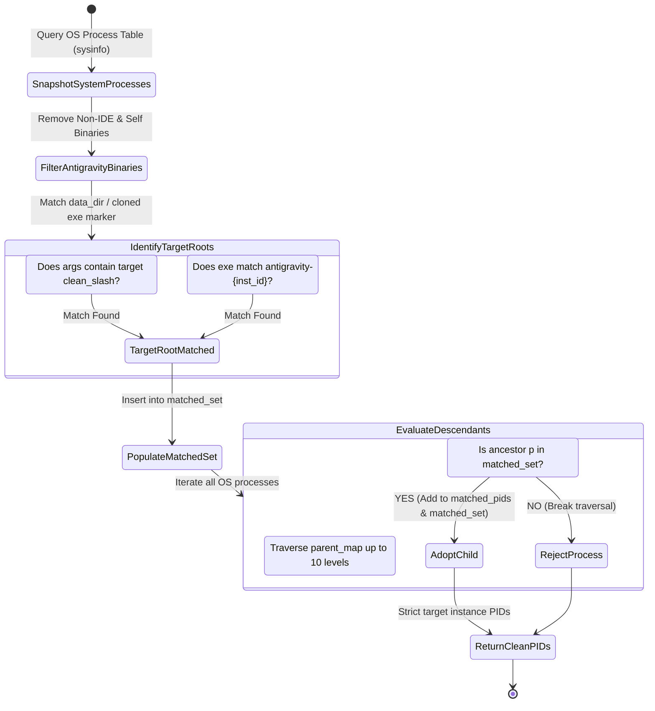
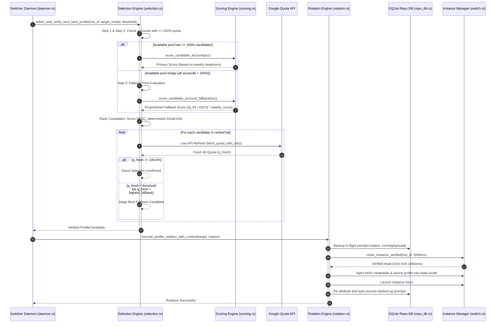
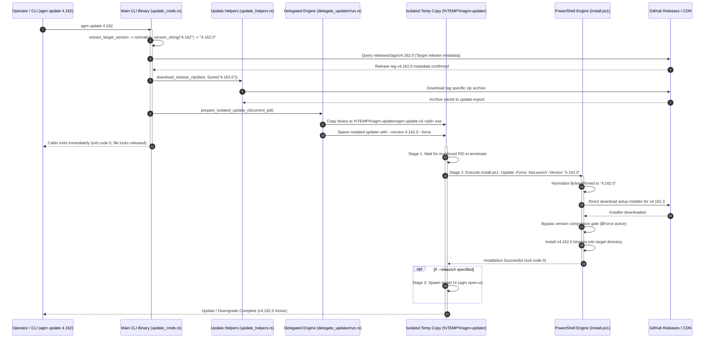
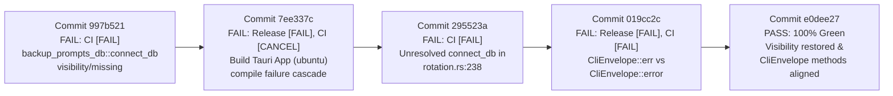

# Architecture Specification: Multi-Instance Process Isolation, Autonomous Profile Rotation, and Delegated CLI Update Architecture

> **Target File:** `02-spec/21-app/auto-switch-and-rotate-fix/01-architecture-spec.md`  
> **Status:** APPROVED  
> **Author:** @aukgit  
> **Version:** 2.0.0  
> **Initiative Slug:** `auto-switch-and-rotate-fix`  
> **Scope:** Multi-Instance Process Table Sandboxing (`src-tauri/src/modules/instance/pid_scan.rs`), Auto-Switcher Candidate Scoring & Fallback Routing (`src-tauri/src/modules/auto_switcher/`), Delegated CLI Self-Updating & Downgrade Engine (`src-tauri/src/bin/agm/`, `src-tauri/src/modules/delegate_updater/`, `install.ps1`), Pipeline Telemetry Isolation (`gitmap pe -t`)

---

## 1. Executive Summary & Dual Subsystem Architecture

Antigravity Manager (AGM) acts as an orchestration gateway and runtime supervisor across multiple isolated Antigravity IDE instances, handling credentials synchronization, quota monitoring, proxy translation, prompt dispatching, and self-updating binary lifecycles.

To ensure production stability, the application architecture relies upon two core subsystems:
1. **The Multi-Instance Process Isolation & Auto-Profile Switcher Subsystem**: Guarantees that each instance profile possesses strict process sandboxing, isolated user data directories (`data_dir`), independent SQLite credential databases (`state.vscdb`), and discrete process trees. When an instance exhausts its Google quota, the auto-switcher autonomously rotates the instance to the next healthiest candidate account without user intervention and without causing collateral damage to neighboring instances.
2. **The 3-Stage Delegated CLI Update & Downgrade Engine Subsystem**: Enables operators and automated workflows to deterministically inspect, upgrade, downgrade, or pin specific releases across nodes without encountering Windows binary image file locks (`os error 5: Access is denied` / sharing violation `0x20`), asset 404 download errors, or version normalization mismatches.

```mermaid
flowchart TD
    subgraph SubsystemA["Subsystem A: Process Isolation & Auto-Switcher Engine"]
        PS["OS Process Scanner\n(pid_scan.rs)"]
        ISO["Instance Isolation Filter\n(Target Root PIDs Only)"]
        SW_TICK["Switcher Daemon Monitor\n(daemon.rs)"]
        SCORE["Multi-Tier Scoring & Quota Gate\n(selection.rs & scoring.rs)"]
        ROT["5-Step Safe Rotation Pipeline\n(rotation.rs & switch.rs)"]
        
        PS --> ISO
        SW_TICK --> SCORE
        SCORE --> ROT
        ROT -.->|Verify Process Death| ISO
    end

    subgraph SubsystemB["Subsystem B: Delegated CLI Updater & Release Engine"]
        CLI_IN["CLI Invocation:\nagm update [to] [v] [--force]"]
        NORM["SemVer 2-Part Normalizer\n(4.162 -> 4.162.0)"]
        REL_API["GitHub Release Resolution\n(releases/tags/v{target})"]
        DELEG["3-Stage Isolated Updater\n(%TEMP%\\agm-updater\\agm-update-cli.exe)"]
        INST_PS1["PowerShell Installer Engine\n(install.ps1)"]

        CLI_IN --> NORM
        NORM --> REL_API
        REL_API --> DELEG
        DELEG --> INST_PS1
    end
```



---

## 2. Deep Comparative Architectural Analysis: v4.162.0 Baseline vs HEAD

Between baseline release `v4.162.0` and current `HEAD` (v4.186.0+), the process management, prompt pipeline, instance sandboxing, and CLI update subsystems underwent major refactoring to handle multi-instance prompt persistence, Supabase fleet clustering, and automated background scheduling.

### 2.1 Subsystem Architectural Comparison Matrix

| Architectural Dimension | Baseline `v4.162.0` Architecture | `HEAD` (v4.186.0+) Architecture | Architectural Rationale & Risk Assessment |
| :--- | :--- | :--- | :--- |
| **Process Table Scanning & Matching** | Flat CLI argument substring search for `--user-data-dir`. Only root IDE process PIDs detected; no child tree traversal. | Multi-tier process cache (`PROCESS_SCAN_CACHE`, 4s TTL) with deep parent-child process tree traversal (`parent_map`). | **Advantage**: Detects language servers, workers, renderers.<br>**Risk**: Cross-instance PID contamination if child traversal references global instance roots instead of target roots. |
| **Instance Process Termination** | Single unverified `taskkill /F /PID` or `SIGKILL`. Process death assumed immediately without polling OS process table. | Hardened "Kill First → Verify Dead → Refresh → Start" pipeline (`close_instance_verified`). | **Advantage**: Eliminates SQLite file lock collision on `state.vscdb` and Chromium singleton lock races.<br>**Risk**: Surviving orphan detection must not deadlock rotation. |
| **Auto-Switcher Quota Evaluation** | Primitive single-quota snapshot check. Primary scoring evaluated without reset headroom analysis. | Dual-window quota evaluation (4-hour rolling vs 7-day weekly) with configurable tier multipliers (Ultra 4.0, Pro 2.0, Free 1.0) and headroom weight. | **Advantage**: Accurately prioritizes freshly reset accounts.<br>**Risk**: Strict 100% 4-hour gate causes total rotation lockup if fallback candidate scoring fails to activate. |
| **Candidate Fallback Scoring** | Basic linear sorting by quota percentage. Accounts with sub-100% quota could be selected without cooldown checks. | 3-step candidate pool partitioning: (1) Inactive instances, (2) Unbound accounts, (3) Fallback pool (`score_candidate_account_fallback`). | **Advantage**: Prevents stealing accounts from active instances.<br>**Risk**: Inverted gate in Step 3 evaluated primary scoring (`0.0`), dropping valid fallback candidates. |
| **CLI Updater & Downgrade Pipeline** | Direct in-process binary replacement via web download. Subject to Windows file locking errors. Hardcoded `releases/latest`. | 3-stage self-delegating updater: (1) Wait UI/CLI exit, (2) Detached temp binary execution in `%TEMP%\agm-updater\`, (3) Auto-reopen UI. | **Advantage**: Bypasses Windows file locks (`0x20`).<br>**Risk**: Drops version parameters or fails 2-part SemVer normalization (`4.162`), breaking downgrade commands. |
| **Prompt Continuity during Switching** | Prompts in-flight during an account switch were dropped or lost. | Atomic SQLite prompt backup (`backup_running_prompts`), cross-instance re-attribution (`UPDATE active_prompts SET instance_id = ...`), auto-resume. | **Advantage**: Zero prompt loss across profile switches.<br>**Risk**: Cross-instance database connection visibility errors in rotation pipeline. |
| **Fleet Synchronization & Leases** | Isolated local instances only. No distributed awareness. | Supabase PostgreSQL cluster sync, remote workspace profile leases (`workspace_lease_manager`), 15s heartbeat telemetry. | **Advantage**: Multi-machine coordination.<br>**Risk**: Stale remote leases can block local candidate selection if lease checks lack fallback timeouts. |

### 2.2 In-Depth Subsystem Evolution Breakdown

#### 1. Evolution of Instance Process Sandboxing (`pid_scan.rs`)
In `v4.162.0`, `find_pids_for_data_dir` checked whether process command line arguments contained the specific `data_dir` string. While effective for detecting the root process of Antigravity IDE, child processes spawned by Electron (e.g., `crashpad_handler.exe`, `ptyHost`, language server workers) omit `--user-data-dir` from their command line arguments. When an instance was stopped or restarted, these orphaned child processes remained active in the background, keeping file handles open on `state.vscdb` and preventing clean credential injection.

To solve orphan retention, HEAD implemented an upward recursive parent-chain resolution algorithm using `parent_map: HashMap<u32, u32>`. However, a defect was introduced at line 302 of `src-tauri/src/modules/instance/pid_scan.rs`: child process matching incorporated `instance_root_pids.contains(&p)`, which contains root PIDs across **all** running instances on the machine, rather than strictly matching `matched_set.contains(&p)` (the root PIDs of the target instance). Consequently, stopped instances falsely claimed child processes of running instances, and restarting instance A inadvertently killed child processes of instance B.

#### 2. Evolution of Auto-Switcher Quota Gating (`selection.rs` & `scoring.rs`)
In `v4.162.0`, accounts were scored primarily by their raw instantaneous quota. This led to "thrashing", where an account with 25% quota would be selected, immediately exhaust its quota, and trigger another switch.

In HEAD, a dual-window evaluation system was introduced:
- **4-Hour Immediate Rolling Window**: Governs immediate burst capacity. A strict gate requires candidate accounts to possess 100% quota in this window (or have their reset cycle finished) during primary selection.
- **7-Day Weekly Window**: Governs long-term endurance. Accounts are scored using configurable subscription tier multipliers (`ultra_tier_multiplier`: 4.0, `pro_tier_multiplier`: 2.0, `free_tier_multiplier`: 1.0) multiplied by remaining reset headroom hours:
  $$\text{Score} = \frac{\text{TierMultiplier} \times \text{EffectiveWeeklyPct} \times \text{RemainingHeadroomHours}}{100.0}$$

However, in scenarios where **all** accounts in the user's pool have been partially used (e.g., all accounts sitting at 85%–95% quota), Step 1 and Step 2 of `select_candidate_profiles` yield zero candidates. Step 3 (Fallback Pool) was designed to catch this case and score accounts proportionally using `score_candidate_account_fallback`:
$$\text{FallbackScore} = \left(\frac{q_{\text{4h}}}{100.0}\right) \times \text{BaseWeeklyScore}$$
A logic flaw in `selection.rs:294` invoked the primary `score_candidate_account` instead of the fallback scorer. Because the primary scoring function enforces $q_{\text{4h}} < 100\% \implies \text{Score} = 0.0$, all fallback candidates evaluated to zero score, causing `select_and_verify_next_best_profile` to return `Ok(None)` and halting the auto-switcher indefinitely.

#### 3. Evolution of the Delegated CLI Updater (`update_cmds.rs`, `update_helpers.rs`, `install.ps1`)
In `v4.162.0`, updating AGM from the CLI invoked direct downloads that overwrote the running binary in-place. On Windows, executing binaries are locked by the operating system kernel (`IMAGE_FILE_EXECUTION_OPTIONS` / file sharing violation `0x20`), causing updates to fail unless the process was manually terminated.

HEAD resolved Windows file locking by introducing a 3-stage self-delegating updater (`src-tauri/src/modules/delegate_updater/`):
- **Stage 1**: Caller binary clones itself to `%TEMP%\agm-updater\agm-update-cli-<pid>.exe` and launches the clone. The caller process exits immediately (exit code 0), releasing all file locks on the installation directory.
- **Stage 2**: The isolated clone waits for the caller PID to exit, executes `install.ps1 -Update -Force -NoLaunch -Version <target>`, and replaces the binary.
- **Stage 3**: If `--relaunch` was set, the updater restarts the GUI via `agm open-ui`.

However, the downgrade path (`agm update v4.162` or `agm update 4.162`) broke due to three distinct gaps:
1. `normalize_version_string` handled 2-part SemVer (`4.162` $\to$ `4.162.0`) in `update_cmds.rs`, but `update_helpers.rs:86` hardcoded GitHub queries to `/releases/latest`, ignoring the target tag.
2. In `install.ps1:1255`, `Resolve-PinnedVersion` was skipped when `$Version` was already passed, preventing 2-part SemVer expansion (`4.162` $\to$ `4.162.0`).
3. In `install.ps1:1423`, direct fallback URLs guessed asset templates (`agm-alim_${cleanPinned}_x64-setup.exe`), which 404ed for un-normalized tags (`v4.162`) or releases using alternate asset naming (`Antigravity-Manager_...`).
4. In `install.ps1:1461`, the updater checked `TargetVersion -le CurrentVersion` and aborted with `"Already on the latest version"`, blocking intentional downgrades unless `-Force` was manually passed.

---

## 3. End-to-End Architectural Data Flows & State Machines

### 3.1 Instance Process Tree Descent & Decontamination State Machine

The process scanner must strictly partition processes belonging to the target instance from neighboring instances and the default IDE.



### 3.2 Auto-Switcher Candidate Discovery & Verification Sequence



### 3.3 3-Stage Delegated Update & Downgrade Sequence



---

## 4. Architectural Invariants

Every modification to the process management, auto-switcher, and update subsystems must strictly uphold the following invariants:

- **Invariant I1 (Process Isolation Invariant)**: `find_pids_for_data_dir(data_dir, is_default)` must NEVER return a process PID belonging to a sibling instance. For non-default instances, child process adoption is strictly bounded to the transitive closure of `matched_set` (roots matching the instance's specific `data_dir` or cloned binary marker).
- **Invariant I2 (Verified Kill Before Write)**: Credentials (`state.vscdb`, `storage.json`, OS keyring) must NEVER be modified while an instance process is alive. Process termination must pass through `close_instance_verified`, verifying zero surviving PIDs before credential injection commences.
- **Invariant I3 (Non-Zero Fallback Monotonicity)**: When available accounts have sub-100% quota, `score_candidate_account_fallback` must evaluate to a strictly positive number ($> 0.0$) for any account with $q_{\text{4h}} > 0\%$ and weekly quota $\ge 8\%$, proportional to its remaining credit headroom.
- **Invariant I4 (Cooldown Pool Independence)**: Staging an account into `cooldown_pool` must NEVER prevent Step 3 Fallback Pool execution if `available_pool` is empty. The presence of accounts in cooldown must not block the discovery of healthy, non-cooldown accounts above the fallback threshold.
- **Invariant I5 (Target SemVer Normalization Parity)**: Any 2-part SemVer string (e.g., `4.162` or `v4.162`) supplied to CLI update commands or installer scripts must be expanded to full 3-part SemVer (`4.162.0`) before querying GitHub API endpoints, downloading assets, or executing version comparisons.
- **Invariant I6 (Version Parameter Propagation)**: CLI release archive downloads (`download_release_zip`) and delegated updates must propagate the explicit target version parameter. Calling `/releases/latest` is strictly restricted to invocations where no explicit version argument was provided.
- **Invariant I7 (Explicit Downgrade Override)**: When a specific release version is explicitly requested via `--version`, `-Version`, or positional syntax, installer scripts (`install.ps1`) must bypass the `TargetVersion -le CurrentVersion` short-circuit gate and complete the installation.
- **Invariant I8 (Zero Git Command Execution)**: Subsystem modules must never invoke raw `git` CLI commands (`git add`, `git commit`, `git status`, `git push`) for internal operations or testing. All repository queries must utilize internal modules or `gitmap` CLI wrappers.

---

## 5. Past CI Failure Telemetry Analysis (`gitmap pe -t`)

Telemetry auditing via `gitmap pe -t` across recent commits revealed critical compiler, visibility, and envelope type failures that previously broke CI/CD pipelines. These failures provide key structural constraints for future implementations.



### 5.1 Comprehensive Failure Log Analysis

#### 1. Commits `997b521`, `7ee337c`, and `295523a`: Missing/Inaccessible `connect_db` in `backup_prompts_db`
- **Affected File:** `src-tauri/src/modules/auto_switcher/rotation.rs:238:62`
- **Compiler Error Log:**
  ```text
  error[E0425]: cannot find function `connect_db` in module `crate::modules::backup_prompts_db`
     --> src-tauri/src/modules/auto_switcher/rotation.rs:238:62
      |
  238 |         if let Ok(conn) = crate::modules::backup_prompts_db::connect_db() {
      |                                                              ^^^^^^^^^^ not found in `crate::modules::backup_prompts_db`
  ```
- **Root Cause Analysis:** During the implementation of prompt backup re-attribution across account switches, `rotation.rs` attempted to connect directly to the SQLite prompt backup database via `backup_prompts_db::connect_db()`. In `src-tauri/src/modules/backup_prompts_db/mod.rs`, the underlying `open_db` or `connect_db` helper was either `pub(crate)` in a submodule or not exported from the module root. Because Rust treats non-exported submodule functions as private, compilation failed across Linux, Windows, and macOS test runners, triggering cancellation cascades across the matrix.
- **Architectural Safeguard:** Modules interacting with persistent SQLite stores must either call public domain service functions (e.g., `backup_prompts_db::reattribute_backups(from, to)`) or access connection helpers explicitly exported at the module root with uniform `pub(crate)` visibility.

#### 2. Commit `019cc2c`: Mismatched Associated Function in `CliEnvelope`
- **Affected Files:** `src-tauri/src/bin/agm/prompt_cmds.rs:244:30`, `src-tauri/src/bin/agm/prompt_cmds.rs:385:30`
- **Compiler Error Log:**
  ```text
  error[E0599]: no associated function or constant named `error` found for struct `CliEnvelope<_>`
     --> src-tauri/src/bin/agm/prompt_cmds.rs:244:30
      |
  244 |     CliEnvelope::<()>::error("prompt send", Some(target_instance), &e).print_and_exit();
      |                        ^^^^^ associated function not found in `antigravity_tools_lib::modules::cli::CliEnvelope<_>`
      |
      = note: consider using `CliEnvelope::<T>::err`
  ```
- **Root Cause Analysis:** In `src-tauri/src/modules/cli/types.rs`, the canonical constructor for error envelopes is `CliEnvelope::err(command, instance_id, code, message)`. Call sites in `prompt_cmds.rs` called `CliEnvelope::error`, which did not exist on the struct. Because `cargo check` and `cargo test` gates enforce strict zero-warning compilation, the binary failed to build in CI.
- **Architectural Safeguard:** CLI command handlers must strictly use `CliEnvelope::ok(...)` and `CliEnvelope::err(...)`. New helper methods on core envelope types must be accompanied by comprehensive unit test coverage verifying constructor parity.

---

## 6. Implementation Boundaries & Target Modules

To prevent regressions and cross-module collisions, worker agents must strictly adhere to the following file boundaries:

```
src-tauri/
├── src/
│   ├── bin/
│   │   └── agm/
│   │       ├── update_cmds.rs          <-- Target: Version parsing, downgrade routing
│   │       ├── update_helpers.rs       <-- Target: Parametric download_release_zip
│   │       └── prompt_cmds.rs          <-- Target: CliEnvelope::err consistency
│   └── modules/
│       ├── auto_switcher/
│       │   ├── selection.rs            <-- Target: Step 3 fallback gate & fallback scoring
│       │   ├── scoring.rs              <-- Target: 4h quota evaluation & headroom calculation
│       │   ├── rotation.rs             <-- Target: Verified termination & prompt backup
│       │   └── daemon.rs               <-- Target: Effective low threshold verification
│       ├── delegate_updater/
│       │   ├── args.rs                 <-- Target: Target version argument extraction
│       │   └── run.rs                  <-- Target: Passing -Version to install.ps1
│       └── instance/
│           ├── pid_scan.rs             <-- Target: Line 302 cross-instance PID isolation
│           └── switch.rs               <-- Target: Sibling running guard verification
install.ps1                             <-- Target: 2-part SemVer expansion, asset URL resolution, downgrade gate
```

---

## 7. Verification & Pre-Flight Quality Gates

Prior to merging changes or tagging releases, the following verification gates must be fully satisfied:

1. **Rust Formatting Gate**:
   ```pwsh
   cd src-tauri && cargo fmt -- --check
   ```
2. **Rust Comprehensive Clippy Gate**:
   ```pwsh
   cd src-tauri && cargo clippy --all-targets --all-features
   ```
3. **Frontend Build Gate**:
   ```pwsh
   npm run build
   ```
4. **Targeted Subsystem Unit Test Suite**:
   ```pwsh
   cd src-tauri && cargo test modules::instance::pid_scan
   cd src-tauri && cargo test modules::auto_switcher::selection
   cd src-tauri && cargo test modules::auto_switcher::scoring
   ```
5. **GitMap CI Pipeline Verification**:
   ```pwsh
   gitmap pe -t
   ```
   Pipeline status must confirm `CLEAN (No errors found)` with 100% green status across all workflow jobs.
