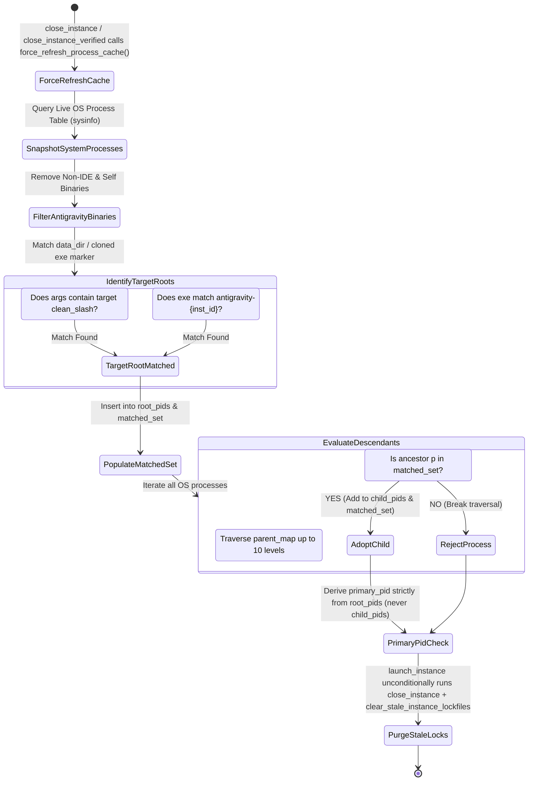
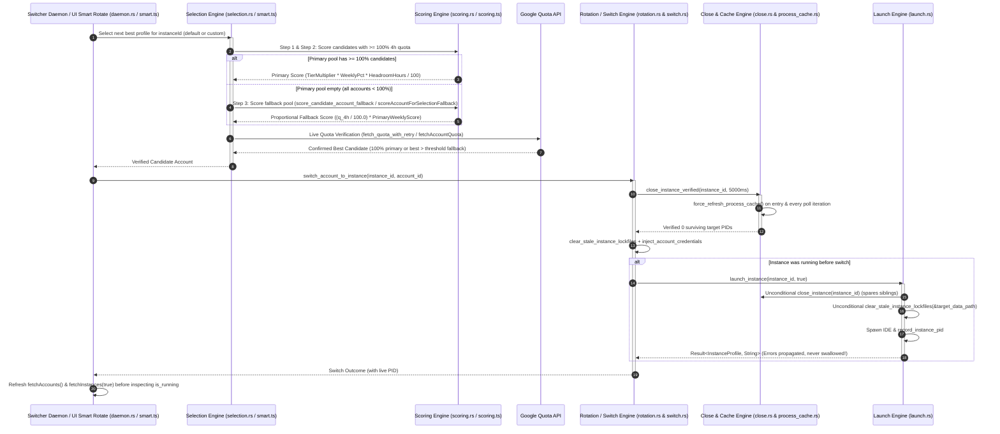

# Architecture Specification: Multi-Instance Process Isolation, Autonomous Profile Rotation, and Delegated CLI Update Architecture

> **Target File:** `02-spec/21-app/auto-switch-and-rotate-fix/01-architecture-spec.md`  
> **Status:** APPROVED  
> **Author:** @aukgit  
> **Version:** 3.0.0  
> **Initiative Slug:** `auto-switch-and-rotate-fix`  
> **Scope:** Multi-Instance Process Table Sandboxing & Lifecycle (`src-tauri/src/modules/instance/pid_scan.rs`, `launch.rs`, `close.rs`, `process_cache.rs`, `switch.rs`), Auto-Switcher Candidate Scoring & Fallback Routing (`src-tauri/src/modules/auto_switcher/selection.rs`, `scoring.rs`, `rotation.rs`), Frontend Smart Rotation & Quota Scoring Parity (`src/services/instanceService/scoring.ts`, `src/stores/useInstanceStore/smart.ts`, `src/stores/useAccountStore.ts`), Delegated CLI Self-Updating & Downgrade Engine (`src-tauri/src/bin/agm/`, `src-tauri/src/modules/delegate_updater/`, `install.ps1`), Pipeline Telemetry Isolation (`gitmap pe -t`)

---

## 1. Executive Summary & Dual Subsystem Architecture

Antigravity Manager (AGM) acts as an orchestration gateway and runtime supervisor across multiple isolated Antigravity IDE instances, handling credentials synchronization, quota monitoring, proxy translation, prompt dispatching, and self-updating binary lifecycles.

To ensure production stability, the application architecture relies upon two core subsystems:
1. **The Multi-Instance Process Isolation, Lifecycle & Auto-Profile Switcher Subsystem**: Guarantees that each instance profile possesses strict process sandboxing, fresh process table cache invalidation on close/relaunch, unconditional stale lockfile purging before credential injection, isolated user data directories (`data_dir`), independent SQLite credential databases (`state.vscdb`), and full backend-frontend parity in sub-100% fallback candidate scoring. When an instance exhausts its Google quota or triggers manual/shortcut rotation, the switcher rotates the instance to the healthiest candidate account without user intervention, duplicate process collisions, or collateral damage to neighboring instances.
2. **The 3-Stage Delegated CLI Update & Downgrade Engine Subsystem**: Enables operators and automated workflows to deterministically inspect, upgrade, downgrade, or pin specific releases across nodes without encountering Windows binary image file locks (`os error 5: Access is denied` / sharing violation `0x20`), asset 404 download errors, or version normalization mismatches.

```mermaid
flowchart TD
    subgraph SubsystemA["Subsystem A: Process Isolation, Lifecycle & Auto-Switcher Engine"]
        PS["OS Process Scanner & Cache\n(pid_scan.rs & process_cache.rs)"]
        ISO["Instance Isolation & Root-Only Primary PID\n(Target Root PIDs Only)"]
        CLOSE["Cache-Refreshed Verified Close\n(close.rs -> force_refresh_process_cache)"]
        LAUNCH["Unconditional Close & Lockfile Purge\n(launch.rs)"]
        SW_TICK["Switcher Daemon & UI Smart Rotate\n(daemon.rs & smart.ts)"]
        SCORE["Multi-Tier Scoring & Sub-100% Fallback\n(selection.rs, scoring.rs & scoring.ts)"]
        ROT["Unified Verified Rotation Pipeline\n(rotation.rs & switch.rs)"]
        
        PS --> ISO
        SW_TICK --> SCORE
        SCORE --> ROT
        ROT --> CLOSE
        CLOSE --> LAUNCH
        LAUNCH -.->|Verify Process Death & Purge Locks| ISO
    end

    subgraph SubsystemB["Subsystem B: Delegated CLI Updater & Release Engine"]
        CLI_IN["CLI Invocation:\nagm update [to] [v] [--force]"]
        NORM["SemVer 2-Part Normalizer\n(4.162 -> 4.162.0)"]
        REL_API["GitHub Release Resolution\n(releases/tags/v{target})"]
        DELEG["3-Stage Isolated Updater\n(<TEMP>/agm-updater/agm-update-cli.exe)"]
        INST_PS1["PowerShell Installer Engine\n(install.ps1)"]

        CLI_IN --> NORM
        NORM --> REL_API
        REL_API --> DELEG
        DELEG --> INST_PS1
    end
```



---

## 2. Deep Comparative Architectural Analysis: v4.162.0 Baseline vs HEAD

Between baseline release `v4.162.0` and current `HEAD` (v4.186.0+ after commit `8873a197`), the process management, instance lifecycle (`launch.rs`, `close.rs`, `process_cache.rs`, `switch.rs`), prompt pipeline, auto-switcher rotation (`rotation.rs`), frontend smart rotation (`scoring.ts`, `smart.ts`, `useAccountStore.ts`), and CLI update subsystems underwent major refactoring. Comparing `v4.162.0` (`src-tauri/src/modules/instance.rs`) line-by-line against `HEAD` exposes both the initial regressions addressed in commit `8873a197` and **4 additional architectural defects (Defects A1–A4)** that break multi-instance switching, restart reliability, and UI Fast-Forward rotation.

### 2.1 Subsystem Architectural Comparison Matrix (`v4.162.0` vs `HEAD`)

| Architectural Dimension | Baseline `v4.162.0` Architecture | `HEAD` Architecture (Pre-Remediation) | Architectural Rationale & Defect Assessment |
| :--- | :--- | :--- | :--- |
| **Pre-Launch Termination & Lockfile Purge (`launch.rs:53-76`)** | `launch_instance` (`instance.rs:3199-3225`) **unconditionally** called `close_instance(instance_id)` and **unconditionally** purged stale lockfiles (`lockfile`, `code.lock`, `Singleton*`, `*.lock`) prior to credential injection and IDE spawn. | `close_instance` and `clear_stale_instance_lockfiles` are gated behind `if !is_already_running`, and `close_instance` is further gated behind `if !has_other_alive`. | **Defect A1**: When any sibling instance is running (`has_other_alive == true`), `launch_instance` skips `close_instance` (despite `close_instance` already protecting sibling PIDs via `should_spare_pid`). When `is_already_running == true` due to a surviving helper or stale cache, `launch_instance` skips `clear_stale_instance_lockfiles` and injects into a locked `state.vscdb` while spawning a duplicate process. |
| **Process Cache Freshness & Child Promotion (`close.rs:71-225`, `process_cache.rs:30-56`)** | Direct process scan without stale 4000ms cache interference during close; instance running status relied on primary IDE process existence. | `find_pids_for_data_dir` reads `get_cached_antigravity_processes()` (4000ms TTL) without `close_instance` or `close_instance_verified` calling `force_refresh_process_cache()`. `get_cached_instance_process_state` promotes any surviving `child_pids` entry to `primary_pid`. | **Defect A2**: `close_instance_verified` polls a stale 4s process cache instead of live OS state. Furthermore, when the main window exits, `process_cache.rs:30-56` promotes surviving utility/crashpad child PIDs to `primary_pid`, falsely reporting `running = true`. |
| **Switch Error Propagation & Default Instance Rotation (`switch.rs:321-340`, `rotation.rs:298-309`)** | `switch_account_to_instance` propagated `launch_instance` errors directly (`?`). Account rotation used uniform close + lockfile cleanup + credential injection. | `switch_account_to_instance` swallows relaunch errors (`if let Err(launch_err)` logs warning and returns `Ok(())` with `switch_ok: true`). `default` instance in `rotation.rs:298-309` routes through `DesktopIntegration::on_account_switch`. | **Defect A3**: Swallowing relaunch failures violates the No Silent Errors invariant and reports fake `switch_ok: true`. Routing `default` rotation through `DesktopIntegration::on_account_switch` bypasses `close_instance_verified`, full lockfile cleanup, and `record_instance_pid`. |
| **Frontend Quota Scoring & Store Refresh (`scoring.ts`, `smart.ts`, `useAccountStore.ts`)** | Frontend account switching did not enforce an unrecoverable hard 100% 4-hour quota gate or fire duplicate unrefreshed launches. | `scoring.ts` and `smart.ts` enforce a hard `fourHourQuotaPercent >= 100` gate with zero sub-100% fallback. `smart.ts:262-267` checks `is_running` before `fetchInstances(true)`. `useAccountStore.ts:107-117` omits `fetchInstances(true)` and `fetchAccounts()`. | **Defect A4**: UI Fast-Forward and `smartRotateProfileAccount` throw `'No accounts verified with 100% 4-hour quota in pool'` whenever all accounts are `< 100%`. Reading stale `is_running === false` after `switchAccount` triggers a colliding duplicate `launchInstance` call. |
| **Process Table Child Descent (`pid_scan.rs:302`)** | Flat CLI argument substring search for `--user-data-dir`. | Upward parent-chain walk using `parent_map` (fixed in `8873a197` to check `matched_set.contains(&p)` only). | Prevents cross-instance PID contamination while capturing genuine instance child workers. |
| **Backend Candidate Fallback Scoring (`selection.rs:294`)** | Basic linear sorting by quota percentage. | 3-step candidate pool partitioning using `score_candidate_account_fallback` in Step 3 (fixed in `8873a197`). | Prevents stealing accounts from active instances while allowing proportional sub-100% fallback on the backend. |
| **CLI Updater & Downgrade Pipeline (`update_cmds.rs`, `install.ps1`)** | Direct in-process binary replacement; hardcoded `releases/latest`. | 3-stage self-delegating updater in `<TEMP>/agm-updater/` with 2-part SemVer normalization and explicit tag resolution. | Bypasses Windows file locks (`0x20`) and supports deterministic downgrades (`agm update 4.162`). |

---

### 2.2 Detailed Root Cause Analysis of the 4 Additional Post-`8873a197` Defects (Defects A1–A4)

#### 1. DEFECT A1: Gated Pre-Launch Cleanup & Lockfile Purge Bypass (`src-tauri/src/modules/instance/launch.rs:53-76`)
- **v4.162.0 Baseline Behavior (`src-tauri/src/modules/instance.rs:3199-3225`)**:
  In `v4.162.0`, `launch_instance` unconditionally executed `close_instance(instance_id)` followed by unconditional lockfile purging (`lockfile`, `code.lock`, `Singleton*`, `*.lock`) on `target_data_path` before calling `inject_account_credentials` and spawning the IDE binary.
- **HEAD Regression (`src-tauri/src/modules/instance/launch.rs:53-76`)**:
  In `HEAD`, pre-launch process cleanup and lockfile removal were wrapped inside nested conditional guards:
  ```rust
  if !is_already_running {
      if !has_other_alive {
          let _ = close_instance(instance_id);
      }
      clear_stale_instance_lockfiles(&target_data_path);
  }
  ```
- **Failure Mechanism**:
  1. **Sibling Instance Blockade (`!has_other_alive`)**: Whenever any other Antigravity instance is running on the host (`has_other_alive == true`), `launch_instance` skips `close_instance(instance_id)`. This guard is completely redundant and harmful because `close_instance` already computes `other_instance_pids` and protects all sibling processes via `should_spare_pid`. Skipping `close_instance` leaves lingering target-instance processes alive during relaunch.
  2. **Stale Running State / Orphan Bypass (`!is_already_running`)**: During `restart_instance` or `switch_account_to_instance`, if `is_already_running` evaluates to `true` due to a surviving helper process or a stale 4000ms process cache entry, `launch_instance` skips both `close_instance` and `clear_stale_instance_lockfiles(&target_data_path)`. It then immediately attempts to inject credentials into a locked `state.vscdb` and spawns a colliding duplicate IDE process against locked Chromium singleton files.
- **Architectural Fix**:
  In `src-tauri/src/modules/instance/launch.rs:53-76`, restore the `v4.162.0` pre-launch invariant: unconditionally invoke `close_instance(instance_id)` (which safely spares sibling instance PIDs via `should_spare_pid`) and unconditionally invoke `clear_stale_instance_lockfiles(&target_data_path)` prior to `inject_account_credentials` whenever launching/relaunching an instance (or when `is_already_running` is false / after terminating residual target processes).

#### 2. DEFECT A2: Stale 4000ms Process Cache on Close & Orphan Child Promotion (`src-tauri/src/modules/instance/close.rs:71-225` & `src-tauri/src/modules/instance/process_cache.rs:30-56`)
- **HEAD Regression (`close.rs:71-225` & `process_cache.rs:30-56`)**:
  1. `find_pids_for_data_dir` queries `get_cached_antigravity_processes()`, which caches the OS process snapshot for `4000ms` (`PROCESS_CACHE_TTL_MS = 4000`). Neither `close_instance` nor `close_instance_verified` calls `force_refresh_process_cache()` before scanning or inside the post-kill verification polling loop. As a result, `close_instance_verified` either misses newly spawned processes or repeatedly observes already-terminated PIDs for up to 4 seconds, causing false timeout warnings or premature exit.
  2. In `src-tauri/src/modules/instance/process_cache.rs:30-56`, `get_cached_instance_process_state` computes `primary_pid` as:
     ```rust
     let primary_pid = matched_entry
         .and_then(|e| e.root_pids.first().copied())
         .or_else(|| matched_entry.and_then(|e| e.child_pids.first().copied()));
     ```
     When the user closes the main IDE window or `close_instance` kills the root process, a lingering child process (e.g., `crashpad_handler.exe` or a utility worker) in `child_pids` is promoted to `primary_pid`, causing `get_cached_instance_process_state` to return `running = true` for a dead instance.
- **Architectural Fix**:
  1. In `src-tauri/src/modules/instance/close.rs`: Call `crate::modules::instance::process_cache::force_refresh_process_cache()` at the start of `close_instance`, inside each verification poll iteration of `close_instance_verified`, and after termination completes.
  2. In `src-tauri/src/modules/instance/process_cache.rs:30-56`: Derive `primary_pid` and `running` status strictly from `root_pids` (and validated `hint_pid` in `root_pids`), never promoting orphaned `child_pids` to `primary_pid` when `root_pids` is empty.

#### 3. DEFECT A3: Swallowed Relaunch Errors & Unverified Default Instance Switch (`src-tauri/src/modules/instance/switch.rs:321-340` & `src-tauri/src/modules/auto_switcher/rotation.rs:298-309`)
- **HEAD Regression (`switch.rs:321-340` & `rotation.rs:298-309`)**:
  1. In `src-tauri/src/modules/instance/switch.rs:321-340`, when `was_running` is true and `launch_instance(target_id, true)` returns `Err(launch_err)`, `switch_account_to_instance` logs a warning (`tracing::warn!`) and still returns `Ok(InstanceSwitchOutcome { switch_ok: true, ... })`. In `v4.162.0`, relaunch failure propagated as an error (`?`). Returning `Ok` with `switch_ok: true` when the instance failed to relaunch violates the No Silent Errors invariant and misleads both the auto-switcher and frontend stores into believing the instance is running with the new account.
  2. In `src-tauri/src/modules/auto_switcher/rotation.rs:298-309`, when `target_instance == "default"`, `execute_profile_rotation_with_context` branches away from `switch_account_to_instance` and instead calls `DesktopIntegration::on_account_switch(&best_account)`. `DesktopIntegration::on_account_switch` performs an unverified close and partial lockfile cleanup, completely bypassing `close_instance_verified`, `clear_stale_instance_lockfiles`, and `record_instance_pid`.
- **Architectural Fix**:
  1. In `src-tauri/src/modules/instance/switch.rs:321-340`: Propagate `launch_instance` errors via `Err(format!("Failed to relaunch instance '{}' after account switch: {}", target_id, launch_err))` (and record via `AppError` / tracing) instead of returning fake success.
  2. In `src-tauri/src/modules/auto_switcher/rotation.rs:298-309`: Unify `default` instance rotation with named instances by routing `"default"` through `crate::modules::instance::switch_account_to_instance("default", &best_account.id)` (which already supports `"default"` across `close_instance_verified`, `clear_stale_instance_lockfiles`, `inject_account_credentials`, and relaunch), followed by any desktop tray/shortcut state sync if needed.

#### 4. DEFECT A4: Frontend Hard 100% Quota Gate, Duplicate Relaunch Race & Missing Store Sync (`src/services/instanceService/scoring.ts`, `src/stores/useInstanceStore/smart.ts`, `src/stores/useAccountStore.ts`)
- **HEAD Regression**:
  1. **Hard 100% Quota Gate in Frontend (`scoring.ts` & `smart.ts`)**: `scoreAccountForSelection` in `src/services/instanceService/scoring.ts:76-78` returns `0` whenever `fourHourQuotaPercent < 100 && !isResetFinished`. Unlike backend `selection.rs` Step 3 (`score_candidate_account_fallback`), `scoring.ts` and `src/stores/useInstanceStore/smart.ts` have zero sub-100% fallback logic. When all accounts in the pool have `< 100%` 4-hour quota (e.g., 85%–95%), UI Fast-Forward (`InstanceSelector.tsx`, `useFastForwardShortcut.ts`) and `smartRotateProfileAccount` (`smart.ts:183-199`) throw `'No accounts verified with 100% 4-hour quota in pool'`.
  2. **Stale `is_running` Check & Colliding Duplicate Launch (`smart.ts:262-267`)**: After calling `await accountStore.switchAccount(selectedAccount.email, { instanceId })` (which already relaunches the instance on the backend if it was running), `smart.ts:262-267` immediately reads `const instAfter = get().instances.find((i) => i.id === instanceId)` **before** calling `fetchInstances(true)`. If `instAfter?.is_running` was `false` in the stale pre-switch store snapshot, `smart.ts` invokes `await get().launchInstance(instanceId)`, triggering a second concurrent `launch_instance` call that collides with the relaunch already performed by `switch_account_to_instance`.
  3. **Missing Post-Switch Store Refresh (`useAccountStore.ts:107-117`)**: `useAccountStore.switchAccount` invokes `accountService.switchAccount(email, options)` and only updates `currentAccount` locally without refreshing `await get().fetchAccounts()` or `await useInstanceStore.getState().fetchInstances(true)`, leaving bound instance PIDs, `is_running` flags, and account bindings stale in the React UI.
- **Architectural Fix**:
  1. In `src/services/instanceService/scoring.ts`: Export `scoreAccountForSelectionFallback(account: Account, modelName?: string): number` (and update candidate ranking helpers) so accounts with `fourHourQuotaPercent > 0` and `weeklyQuotaPercent >= 8` receive a proportional score `(fourHourQuotaPercent / 100) * weeklyScore` when no 100% candidate exists.
  2. In `src/stores/useInstanceStore/smart.ts`:
     - Add a two-tier verification fallback matching backend `selection.rs`: if no candidate verifies at `>= 100%` 4-hour quota, select the highest-scoring fallback candidate with fresh 4-hour quota `> 0%` (and weekly `>= 8%`).
     - In `smart.ts:260-272`, call `await get().fetchInstances(true)` **before** inspecting `instAfter?.is_running` so `smart.ts` observes the live post-switch running state and only calls `launchInstance` if the instance is genuinely not running after refresh.
  3. In `src/stores/useAccountStore.ts:107-117`: After `await accountService.switchAccount(email, options)`, refresh `await get().fetchAccounts()` and `await useInstanceStore.getState().fetchInstances(true)` (routing any best-effort refresh error through `useErrorStore.getState().trackWarning`).

---

## 3. End-to-End Architectural Data Flows & State Machines

### 3.1 Instance Process Tree Descent, Cache Refresh & Unconditional Pre-Launch Cleanup



### 3.2 Unified Backend & Frontend Candidate Discovery & Verified Rotation Sequence



---

## 4. Architectural Invariants

Every modification to the process management, instance lifecycle, auto-switcher, frontend stores, and update subsystems must strictly uphold the following invariants:

- **Invariant I1 (Process Isolation & Root-Only Primary PID Invariant)**: `find_pids_for_data_dir(data_dir, is_default)` must NEVER return a process PID belonging to a sibling instance (`matched_set.contains(&p)` only). Furthermore, `get_cached_instance_process_state` in `process_cache.rs` must derive `primary_pid` and `running = true` strictly from `root_pids` (or a verified root `hint_pid`), never promoting orphaned `child_pids` (such as `crashpad_handler`) to `primary_pid` when the main window has exited.
- **Invariant I2 (Cache-Refreshed Verified Kill & Unconditional Pre-Launch Purge)**:
  1. `close_instance` and `close_instance_verified` must call `force_refresh_process_cache()` prior to scanning PIDs and inside verification polling loops so termination checks never read stale 4000ms cache state.
  2. `launch_instance` (`launch.rs:53-76`) must unconditionally invoke `close_instance(instance_id)` (which internally spares sibling PIDs via `should_spare_pid`) and unconditionally call `clear_stale_instance_lockfiles(&target_data_path)` before injecting credentials into `state.vscdb`.
- **Invariant I3 (No Silent Relaunch Errors & Unified Default Rotation)**:
  1. `switch_account_to_instance` (`switch.rs:321-340`) must propagate `launch_instance` errors as `Err(...)` rather than logging a warning and returning `Ok` with `switch_ok: true`.
  2. `execute_profile_rotation_with_context` (`rotation.rs:298-309`) must route `"default"` instance rotation through `switch_account_to_instance("default", &best_account.id)` so default instances receive identical `close_instance_verified`, lockfile cleanup, and PID tracking guarantees.
- **Invariant I4 (Backend & Frontend Sub-100% Fallback Parity)**: When all candidate accounts have sub-100% 4-hour quota, both backend (`selection.rs` + `scoring.rs`) and frontend (`scoring.ts` + `smart.ts`) must evaluate candidates using proportional fallback scoring (`(q_4h / 100.0) * weekly_score`) rather than failing with a hard 100% gate error.
- **Invariant I5 (Frontend Store Synchronization Before Launch Decision)**: `useAccountStore.switchAccount` and `useInstanceStore/smart.ts` must refresh `fetchInstances(true)` and `fetchAccounts()` immediately after `switchAccount` and **before** checking `is_running`, preventing duplicate `launchInstance` calls against an already-relaunched instance.
- **Invariant I6 (Target SemVer Normalization & Downgrade Override)**: Any 2-part SemVer string (`4.162` or `v4.162`) supplied to CLI update commands or `install.ps1` must expand to 3-part SemVer (`4.162.0`), propagate to release zip downloads, and bypass the `TargetVersion -le CurrentVersion` gate when explicitly requested.
- **Invariant I7 (Zero Git & Raw Search Command Execution)**: Subsystem modules and worker agents must never invoke raw `git` CLI commands or raw search binaries (`rg`, `grep`, `Select-String`, `findstr`).

---

## 5. Past CI Failure Telemetry Analysis (`gitmap pe -t`)

Telemetry auditing via `gitmap pe -t` across recent commits revealed critical compiler, visibility, and envelope type failures that previously broke CI/CD pipelines:

1. **Commits `997b521`, `7ee337c`, and `295523a`**: `error[E0425]: cannot find function connect_db in module crate::modules::backup_prompts_db` at `src-tauri/src/modules/auto_switcher/rotation.rs:238:62`. Ensure any cross-module helper called by `rotation.rs` or `instance/` submodules has explicit `pub` or `pub(crate)` visibility at the module root.
2. **Commit `019cc2c`**: `error[E0599]: no associated function or constant named error found for struct CliEnvelope<_>` at `src-tauri/src/bin/agm/prompt_cmds.rs:244:30`. Always use `CliEnvelope::ok(...)` and `CliEnvelope::err(...)`.

---

## 6. Implementation Boundaries & Worker Ownership Matrix

To prevent regressions and cross-module collisions, worker agents must strictly adhere to the following file boundaries:

```text
Worker 01 (Backend Instance Lifecycle, Auto-Switcher Rotation & Frontend Smart Scoring):
├── src-tauri/src/modules/instance/
│   ├── launch.rs                       <-- Defect A1: Unconditional close_instance & clear_stale_instance_lockfiles
│   ├── close.rs                        <-- Defect A2: Call force_refresh_process_cache() in close_instance & close_instance_verified
│   ├── process_cache.rs                <-- Defect A2: Do not promote orphan child_pids to primary_pid when root_pids is empty
│   └── switch.rs                       <-- Defect A3: Propagate launch_instance error in switch_account_to_instance
├── src-tauri/src/modules/auto_switcher/
│   └── rotation.rs                     <-- Defect A3: Route "default" instance through switch_account_to_instance("default", ...)
└── src/
    ├── services/instanceService/
    │   └── scoring.ts                  <-- Defect A4: Add scoreAccountForSelectionFallback for sub-100% 4h quota accounts
    └── stores/
        ├── useInstanceStore/smart.ts   <-- Defect A4: Sub-100% fallback pool + await fetchInstances(true) before is_running check
        └── useAccountStore.ts          <-- Defect A4: Refresh fetchAccounts() & fetchInstances(true) after switchAccount

Worker 02 (CLI Updater, Downgrade Engine & Regression Tests):
├── src-tauri/src/bin/agm/
│   ├── update_cmds.rs                  <-- Version parsing, downgrade routing
│   └── update_helpers.rs               <-- Parametric download_release_zip
├── src-tauri/src/modules/delegate_updater/
│   ├── args.rs                         <-- Target version argument extraction
│   └── run.rs                          <-- Passing -Version to install.ps1
└── install.ps1                         <-- 2-part SemVer expansion, asset URL resolution, downgrade gate
```

---

## 7. Verification & Pre-Flight Quality Gates

Prior to merging changes or tagging releases, the following verification gates must be fully satisfied:

1. **Rust Formatting Gate**:
   ```pwsh
   cd src-tauri && cargo fmt -- --check
   ```
2. **Rust Comprehensive Clippy Gate**:
   ```pwsh
   cd src-tauri && cargo clippy --all-targets --all-features
   ```
3. **Frontend Build Gate**:
   ```pwsh
   npm run build
   ```
4. **Targeted Subsystem Unit Test Suite**:
   ```pwsh
   cd src-tauri && cargo test modules::instance
   cd src-tauri && cargo test modules::auto_switcher
   ```
5. **GitMap CI Pipeline Verification**:
   ```pwsh
   gitmap pe -t
   ```
   Pipeline status must confirm `CLEAN (No errors found)` with 100% green status across all workflow jobs.
