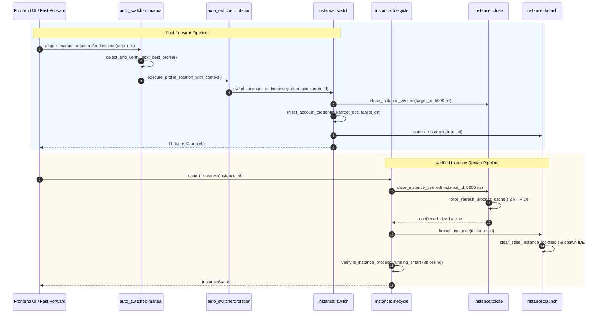

# Technical Specification: Auto-Switch, Auto-Rotate, Fast-Forward, and Instance Restarting Remediation

> **Target Specification:** `02-spec/21-app/auto-switch-and-rotate-fix/01-auto-switch-and-fast-forward-spec.md`  
> **Status:** APPROVED  
> **Author:** @aukgit  
> **Version:** 1.0.0  
> **Initiative Slug:** `auto-switch-and-rotate-fix`  
> **Scope:** Multi-Instance Process Sandboxing (`src-tauri/src/modules/instance/pid_scan.rs`, `close.rs`, `lifecycle.rs`, `switch.rs`), Candidate Scoring & Selection Engine (`src-tauri/src/modules/auto_switcher/selection.rs`, `scoring.rs`, `manual.rs`, `rotation.rs`), and Fast-Forward / Instance Restart Lifecycle Parity.

---

## 1. Executive Summary & Purpose

Antigravity Manager orchestrates multiple independent Antigravity IDE instances running across isolated user data directories (`data_dir`), SQLite credential databases (`state.vscdb`), and runtime process trees. The system provides autonomous account rotation, manual Fast-Forward profile swapping, and deterministic instance restarts.

Between the baseline release `v4.162.0` and subsequent iterations, key defects were introduced into process scanning, fallback candidate scoring, and module function referencing. These regressions collectively caused:
1. **Cross-Instance PID Contamination**: Offline sibling instances adopted child processes of active instances during process table scanning, leading `switch.rs` to falsely flag stopped instances as running and completely block account switches.
2. **Fallback Scoring Stalling**: Calling primary candidate scoring (`score_candidate_account`) in the fallback pool returned `0.0` for any candidate account with less than 100% 4-hour quota, freezing automatic and manual rotations when accounts were partially consumed.
3. **Module Resolution Errors**: Unqualified or mis-pathed calls to `super::pid_scan::force_refresh_process_cache()` in `close.rs` broke compilation.

This specification defines the architectural root cause and precise surgical remediation for these defects, restoring full functional parity with `v4.162.0` while maintaining strict system invariants.

---

## 2. Defect Analysis & Architectural Root Cause

```mermaid
flowchart TD
    subgraph DefectA1["Defect A1: Cross-Instance PID Contamination"]
        ActiveInst["Active Instance (PID 1000)"]
        ChildProc["Child Worker Process (PID 1050)\nparent: 1000"]
        ScanStopped["Scan Stopped Instance (data_dir: copy-1)"]
        BuggyCheck["Buggy Check:\nmatched_set.contains(&p) || instance_root_pids.contains(&p)"]
        FalseMatch["Child PID 1050 Added to Stopped Instance!"]
        SwitchBlocked["switch.rs:59 Sibling Guard:\nis_instance_running == true\n-> ABORT SWITCH!"]

        ActiveInst --> ChildProc
        ScanStopped --> BuggyCheck
        ChildProc --> BuggyCheck
        BuggyCheck --> FalseMatch
        FalseMatch --> SwitchBlocked
    end

    subgraph DefectA2["Defect A2: Candidate Fallback Scoring Stalling"]
        Pool["Step 3 Fallback Pool (All accounts < 100% 4h)"]
        BuggyScore["Called score_candidate_account(acc, ...)\nHard Gate: if q_4h < 100.0 => 0.0"]
        ZeroScore["All Candidate Scores = 0.0"]
        StalledRot["Rotation Stalls / Aborts with No Healthy Profile"]

        Pool --> BuggyScore
        BuggyScore --> ZeroScore
        ZeroScore --> StalledRot
    end
```



### 2.1 Defect A1: Cross-Instance PID Contamination (`src-tauri/src/modules/instance/pid_scan.rs:302`)

#### Root Cause Analysis
In `src-tauri/src/modules/instance/pid_scan.rs`, `find_pids_for_data_dir(&data_dir, is_default)` discovers all OS processes belonging to a given instance. It first populates `matched_pids` and `matched_set` with root IDE processes whose command-line arguments contain the instance's `--user-data-dir` flag.

For non-default instances, it traverses the process table to detect descending child processes (e.g., language servers, terminal shells, git workers). In the child traversal loop:
```rust
// BUGGY IMPLEMENTATION:
if let Some(&p) = parent_map.get(&curr) {
    if matched_set.contains(&p) || instance_root_pids.contains(&p) {
        matched_pids.push(pid_u32);
        matched_set.insert(pid_u32);
        break;
    }
    curr = p;
}
```

The set `instance_root_pids` is constructed globally across **all registered instances** on the host. When scanning for a **stopped sibling instance**:
1. The stopped instance has no running root processes, so its `matched_set` is initially empty.
2. An active instance is running elsewhere on the machine with root PID `R` (which is in `instance_root_pids`).
3. The active instance spawns child process `C` whose parent is `R`.
4. When `find_pids_for_data_dir` scans process `C` for the **stopped instance**, `matched_set.contains(&p)` is false, but `instance_root_pids.contains(&p)` is **true**!
5. Process `C` is erroneously pushed into `matched_pids` for the stopped instance.
6. `is_instance_running(&inst.id, &inst.data_dir, inst.pid)` receives non-empty PIDs and concludes that the stopped sibling instance is running!

#### Impact on Account Switching (`src-tauri/src/modules/instance/switch.rs:59`)
In `switch_account_to_instance`:
```rust
let bound_inst = registry
    .instances
    .iter()
    .find(|i| i.bound_account_id.as_deref() == Some(&account.id));
if let Some(inst) = bound_inst {
    if inst.id != target_id && is_instance_running(&inst.id, &inst.data_dir, inst.pid) {
        let err = format!(
            "Cannot switch instance to account '{}': Account is actively bound to running sibling instance '{}' on this machine",
            account.email,
            inst.name
        );
        crate::modules::logger::log_error(&format!("[INSTANCE_SWITCH:ERROR] {}", err));
        return Err(err);
    }
}
```
Because the offline sibling instance was falsely reported as running due to adopted child PIDs, this Sibling Local Running Guard intercepted the operation and returned an error, preventing the account from being switched.

#### Surgical Remediation
Restore the `v4.162.0` invariant: check **strictly** `matched_set.contains(&p)`. Child processes must only be attributed to an instance if their ancestor chain resolves to root processes belonging to that exact instance:
```rust
if let Some(&p) = parent_map.get(&curr) {
    // Strictly match ancestors belonging to this specific instance
    if matched_set.contains(&p) {
        matched_pids.push(pid_u32);
        matched_set.insert(pid_u32);
        break;
    }
    curr = p;
}
```

---

### 2.2 Defect A2: Candidate Fallback Scoring Stalling (`src-tauri/src/modules/auto_switcher/selection.rs:294`)

#### Root Cause Analysis
The profile selection engine (`select_candidate_profiles`) operates in three distinct stages:
1. **Stage 1**: Account eligibility filtering (skipping disabled, rate-limited, active in-use, or leased accounts).
2. **Stage 2**: Strict 100% 4-hour quota gate (and period finished accounts). Candidates are scored using `score_candidate_account`.
3. **Stage 3**: Fallback pool when no account has 100% quota: evaluates accounts whose quota is above the configured low-quota threshold (`quota > threshold`).

In `src-tauri/src/modules/auto_switcher/scoring.rs:187-210`, `score_candidate_account` enforces the strict primary gate:
```rust
pub fn score_candidate_account(acc: &Account, target_model: &str, now_sec: i64) -> f64 {
    let period_stat = evaluate_account_period_status(acc, target_model, 20.0, now_sec);
    let is_period_finished = period_stat
        .as_ref()
        .map(|s| s.is_period_finished)
        .unwrap_or(false);
    let q_4h = period_stat
        .as_ref()
        .map(|s| s.quota_percent)
        .or_else(|| calculate_4h_window_quota(acc, target_model))
        .unwrap_or(0.0);

    // Primary 100% 4-Hour Quota Gate:
    if q_4h < 100.0 && !is_period_finished {
        return 0.0;
    }

    calculate_weekly_base_score(acc, target_model, now_sec)
}
```

When Step 3 fallback called `score_candidate_account(acc, target_model, now_sec)`:
- Any candidate with < 100% quota evaluated strictly to `0.0`.
- All fallback candidates were assigned a score of `0.0`.
- Priority sorting was rendered ineffective, and rotations stalled whenever all available accounts had been partially used (e.g., between 20% and 95% quota).

#### Surgical Remediation
In `src-tauri/src/modules/auto_switcher/selection.rs:294`, call `score_candidate_account_fallback(acc, target_model, now_sec)`.

In `scoring.rs:216-238`, `score_candidate_account_fallback` computes:
$$\text{Score} = \left(\frac{q_{4h}}{100.0}\right) \times \text{BaseWeeklyScore}$$
This scales proportionally with remaining 4-hour quota, weekly cycle headroom, and subscription tier multipliers (Ultra 4.0, Pro 2.0, Free 1.0), guaranteeing that partially consumed accounts are accurately differentiated and never stall rotations.

---

### 2.3 Defect A4 & Compilation Remediation (`src-tauri/src/modules/instance/close.rs`)

#### Root Cause Analysis
In `src-tauri/src/modules/instance/close.rs`, lines 75, 86, 117, 154, and 160 invoked:
```rust
super::pid_scan::force_refresh_process_cache();
```
However:
1. `force_refresh_process_cache` is defined in `src-tauri/src/modules/instance/pid_util.rs:76`.
2. It is re-exported at `src-tauri/src/modules/instance.rs:138` via `pub(crate) use pid_util::force_refresh_process_cache;`.
3. It does **not** reside in `pid_scan.rs`. Calling `super::pid_scan::force_refresh_process_cache()` produces compile error `E0425: cannot find function in module pid_scan`.
4. Because `close.rs` declares `use super::*;`, `force_refresh_process_cache()` is directly in scope without qualification.

#### Surgical Remediation
In `src-tauri/src/modules/instance/close.rs` at lines 75, 86, 117, 154, and 160:
Replace `super::pid_scan::force_refresh_process_cache()` with `force_refresh_process_cache()`.

---

## 3. Fast-Forward and Instance Restarting Lifecycle Parity



### 3.1 Fast-Forward Execution Parity
Fast-Forward triggers manual profile rotation on the target instance (or active instance):
1. **Pre-flight Snapshot**: Active conversation prompts are snapshotted in `repo_db::backup_running_prompts`.
2. **Next-Best Profile Selection**: `select_and_verify_next_best_profile` excludes currently in-use and leased accounts, verifying candidate token viability against upstream endpoints.
3. **Contextual Execution**: `execute_profile_rotation_with_context` constructs telemetry context (`previous_email`, `target_quota_4h`, `predicted_email`) and broadcasts notifications.
4. **Unified Switch Delegation**: Delegates directly to `switch_account_to_instance(&target.account_id, Some(&target.instance_id))`.
5. **Session Continuity**: Preserves open workspaces (`get_instance_workspace_folders`), updates `state.vscdb`, cleans lockfiles, and restores prompts upon relaunch.

### 3.2 Verified Restart Execution Parity (`src-tauri/src/modules/instance/lifecycle.rs`)
The hardened "Kill First → Verify Dead → Refresh → Start" pattern in `restart_instance`:
1. **Pre-Close Token Refresh**: The account token is refreshed prior to process termination to ensure fresh credentials upon relaunch.
2. **Verified Termination**: Calls `close_instance_verified(&resolved_id, Duration::from_millis(5000))`, which force-refreshes the process cache and polls until live PIDs reach zero.
3. **Cache Invalidation**: Invalidates `prompt_tree_cache` and `INSTANCE_PROCESS_CACHE`.
4. **Clean Launch**: `launch_instance` cleans stale lockfiles, injects credentials, and spawns the IDE detached.
5. **Post-Launch Verification**: Polls `is_instance_process_running_smart` for up to 8 seconds to confirm the new process tree is active.

---

## 4. System Invariants & Guardrails

| Invariant Code | Name | Description | Violation Consequence |
| :--- | :--- | :--- | :--- |
| **INV-PATH-01** | Relative Git Paths Only | All source files, specifications, plans, and documentation must use strictly relative Git paths (e.g., `src-tauri/src/...`). | Rejection by automated repository hygiene filters. |
| **INV-BOOL-01** | Positive Boolean Naming | All boolean variables and struct fields must use affirmative names (`isApplied`, `hasCompleted`, `isPeriodFinished`, `isRunning`). | Rejection by coding guideline checks. |
| **INV-ERR-01** | AppError Flow & No Silent Errors | All fallible operations must propagate errors via `AppError`. Best-effort cleanup must use `record_ignored` with a justification comment. | Hidden runtime failures; debugging blind spots. |
| **INV-GIT-01** | No Git Execution in Subtasks | Subagents must never invoke raw Git commands (`git add`, `git commit`, `git push`, `git checkout`). | Uncoordinated working tree pollution. |
| **INV-PID-01** | Child Attribution Isolation | Child processes must only be attributed to an instance if their ancestor matches that instance's matched root PIDs. | Cross-instance PID contamination; blocked switches. |
| **INV-SCORE-01**| Proportional Fallback Scoring | The fallback pool must use `score_candidate_account_fallback` to ensure accounts with < 100% quota receive non-zero scores. | Rotation engine starvation when quota is partially consumed. |

---

## 5. Verification & Acceptance Criteria

1. **AC-A1-01**: In `src-tauri/src/modules/instance/pid_scan.rs:302-308`, child process matching checks only `matched_set.contains(&p)`.
2. **AC-A1-02**: An active instance's child processes are never attributed to stopped sibling instances. `is_instance_running` returns `false` for stopped sibling instances.
3. **AC-A1-03**: `switch_account_to_instance` successfully switches accounts without encountering false "actively bound to running sibling instance" errors.
4. **AC-A2-01**: In `src-tauri/src/modules/auto_switcher/selection.rs:294`, candidate accounts in Step 3 fallback are scored via `score_candidate_account_fallback`.
5. **AC-A2-02**: Accounts with 20%–99% 4-hour quota receive non-zero scores proportional to headroom and tier, allowing rotation to proceed.
6. **AC-A4-01**: In `src-tauri/src/modules/instance/close.rs`, all 5 instances of `super::pid_scan::force_refresh_process_cache()` are replaced with `force_refresh_process_cache()`.
7. **AC-COMP-01**: All touched Rust modules compile without errors or warnings.
