# Specification 02: CLI Updater Downgrade, Revert Lockout Prevention, and CI/CD Quality Gate Audit

> **Target File:** `02-spec/21-app/auto-switch-and-rotate-fix/02-cli-downgrade-and-cicd-spec.md`  
> **Status:** APPROVED  
> **Author:** @aukgit  
> **Version:** 2.0.0  
> **Initiative Slug:** `auto-switch-and-rotate-fix`  
> **Related Specs:** `02-spec/21-app/auto-switch-and-rotate-fix/01-architecture-spec.md`, `02-spec/22-app-issues/36-auto-switch-fast-forward-downgrade-regression-rca.md`  
> **Scope:** CLI Updater Downgrade & Revert Execution (`agm update 4.162` / `agm update to v4.162`), SemVer 2-Part Normalization (`4.162` $\to$ `4.162.0`), GitHub Tag Resolution, PowerShell Installer Resiliency (`install.ps1` Defects B1–B5), and CI/CD Pipeline Quality Gate Audit (`.github/workflows/ci.yml` vs `03-ai-scripts/06-cicd-local-runner.py`)

---

## 1. Executive Summary & Problem Scope

When operators attempt to revert or downgrade an Antigravity Manager installation from modern releases (e.g., `v4.188.0` / `v4.189.0`) back to historical baseline versions such as `v4.162.0` via the CLI commands:
```bash
agm update 4.162
agm update to v4.162
agm update revert v4.162
agm update downgrade 4.162
```
the operation fails catastrophically or reports false success without modifying the active installation.

This failure stems from five distinct defects (`DEFECT B1` through `DEFECT B5`) spanning argument parsing in the Rust CLI binary, GitHub release tag querying, and the Windows PowerShell installer engine (`install.ps1`), in addition to ambiguity regarding CI/CD pipeline health.

This specification details the end-to-end architecture, technical algorithms, data structures, and concrete implementation rules required to guarantee deterministic version downgrades and document the CI/CD pipeline quality gates.

---

## 2. CLI Updater Downgrade & Revert Architecture

```mermaid
flowchart TD
    subgraph CLI_Input["1. CLI Invocation & Argument Ingestion"]
        CMD["agm update [4.162 | to v4.162 | revert 4.162]"]
        ARG_PARSE["extract_target_version() & parse_update_args()"]
        CMD --> ARG_PARSE
    end

    subgraph Normalization["2. SemVer Normalization Ladder"]
        RAW_VER["Raw Input: '4.162' or 'v4.162'"]
        NORM_FN["normalize_version_string()\nTwo-Part Check: Major.Minor -> Major.Minor.0"]
        CANON_VER["Canonical SemVer: '4.162.0'"]
        RAW_VER --> NORM_FN --> CANON_VER
    end

    subgraph Release_Resolution["3. GitHub Tag & Asset Resolution"]
        TAG_QUERY["Query: releases/tags/v4.162.0"]
        CDN_FALLBACK["Fallback: releases/download/v4.162.0/updater.json"]
        LIST_FALLBACK["Fallback: Scan releases list for matching version"]
        TAG_QUERY -->|404 Not Found| CDN_FALLBACK
        CDN_FALLBACK -->|404 Not Found| LIST_FALLBACK
    end

    subgraph Delegate_Updater["4. Delegated Worker Spawn"]
        STAGE1["Stage 1: agm.exe prepares isolated updater"]
        STAGE2["Stage 2: agm-update-cli.exe in TEMP/agm-updater"]
        SANDBOX_CHECK["Strip .antigravity_tools/instances/<id>/home from LOCALAPPDATA"]
        STAGE1 --> STAGE2 --> SANDBOX_CHECK
    end

    subgraph Installer_Engine["5. PowerShell Installer (install.ps1)"]
        INIT_PATHS["Initialize $InstallDir and $cliDir early\nGuard $DesktopDir against null/empty"]
        PINNED_FLAG["Set $isPinned = $true ($hasExplicitTarget = $true)"]
        BYPASS_CMP["Bypass 'Target -le Current' Suppression"]
        DL_EXEC["Download and Extract Release Package\n(NSIS Setup + Companion .zip for agm.exe)"]
        VERIFY_EXE["Verify Target Executable & Exit 1 on Failure\n(Never fake success from old binary)"]
        
        INIT_PATHS --> PINNED_FLAG --> BYPASS_CMP --> DL_EXEC --> VERIFY_EXE
    end

    ARG_PARSE --> RAW_VER
    CANON_VER --> TAG_QUERY
    LIST_FALLBACK --> STAGE1
    SANDBOX_CHECK --> INIT_PATHS
```



---

## 3. Detailed Defect Analysis & Technical Specifications

### 3.1 Argument Normalization & SemVer Alignment (`update_cmds.rs` & `args.rs`)

#### Problem Statement
Users frequently enter two-part versions such as `4.162` or `v4.162`. In standard SemVer 2.0.0, releases are tagged with three components (`v4.162.0`). Naive lookups against GitHub Releases using `v4.162` return HTTP 404 (`Not Found`).

#### Normalization Specification
In `src-tauri/src/bin/agm/update_cmds.rs` and `src-tauri/src/modules/delegate_updater/args.rs`:
1. `normalize_version_string(raw: &str) -> String`:
   - Strips leading `'v'` or `'V'` and trailing whitespace.
   - Splits on prerelease separator `'-'` to inspect the base SemVer segment.
   - If the base segment contains exactly two numeric parts separated by a dot (`part1.part2`), appends `.0` prior to any prerelease tag:
     $$\text{"4.162"} \to \text{"4.162.0"}$$
     $$\text{"v4.162-beta.1"} \to \text{"4.162.0-beta.1"}$$
   - Three-part versions (e.g., `4.162.1`) remain unchanged.
2. Argument Extraction Grammar:
   `extract_target_version(args: &[String]) -> Option<String>` must recognize all of the following invocation patterns:
   - Positional: `agm update 4.162`, `agm update v4.162.0`
   - Explicit Subcommands: `agm update to v4.162`, `agm update revert 4.162`, `agm update downgrade 4.162`
   - Flags: `agm update --version 4.162`, `agm update -v v4.162`, `agm update --version=4.162`, `agm update --to=4.162`
   - All extracted strings must pass through `normalize_version_string`.

### 3.2 GitHub Release Tag Resolution Ladder

#### Problem Statement
Querying `api.github.com/repos/alimtvnetwork/Antigravity-Manager/releases/tags/v4.162` returns 404 because the GitHub tag is `v4.162.0`. Additionally, if GitHub API rate limiting (60 req/hr unauthenticated) is reached, direct tag lookups fail.

#### Resolution Ladder Specification
The tag resolution engine must follow a resilient 3-tier lookup ladder:
1. **Tier 1: Direct GitHub Release API Tag Query**:
   `GET https://api.github.com/repos/alimtvnetwork/Antigravity-Manager/releases/tags/v{normalized_version}`
   If HTTP 200, parse release metadata (`tag_name`, `assets`, `html_url`).
2. **Tier 2: Release Asset CDN `updater.json` Query**:
   `GET https://github.com/alimtvnetwork/Antigravity-Manager/releases/download/v{normalized_version}/updater.json`
   If HTTP 200, extract `version` and construct release metadata.
3. **Tier 3: Releases Index Pagination Fallback**:
   `GET https://api.github.com/repos/alimtvnetwork/Antigravity-Manager/releases?per_page=100`
   Iterate releases matching `tag_name.trim_start_matches('v') == normalized_version` or starting with `normalized_version`.

### 3.3 Version Comparison & Downgrade Suppression Bypass

#### Problem Statement
Standard update mechanisms compare `TargetVersion` against `CurrentVersion`. If `TargetVersion <= CurrentVersion`, the updater prints `"Already at the latest version"` and exits without taking action.

#### Bypass Invariant
When an explicit target version is supplied:
1. Set boolean flag `isPinned = true` (PowerShell) and `has_explicit_target = true` (Rust).
2. The version comparison condition `TargetVersion -le CurrentVersion` must be guarded:
   ```powershell
   if (-not $isPinned -and -not $Force -and ($TargetVersion -le $CurrentVersion)) {
       Write-Success "Already at the latest version (v$CurrentVersion)."
       exit 0
   }
   ```
3. If `TargetVersion < CurrentVersion` and `isPinned == true`, log informational message:
   `[*] Target release requested: v{Current} -> v{Target} (revert/downgrade)`
   and proceed unconditionally with installation.

### 3.4 DEFECT B1: Empty `$DesktopDir` Crash in Headless Terminals

#### Root Cause
In `install.ps1:285-289`:
```powershell
$DesktopDir = [Environment]::GetFolderPath("Desktop")
if ([string]::IsNullOrWhiteSpace($DesktopDir) -and -not [string]::IsNullOrWhiteSpace($RealUserProfile)) {
    $DesktopDir = Join-Path $RealUserProfile "Desktop"
}
$DesktopShortcut = if (-not [string]::IsNullOrWhiteSpace($DesktopDir)) { Join-Path $DesktopDir "$ShortcutName.lnk" } else { $null }
```
In sandboxed IDE terminals, Windows SSH sessions, or headless CI containers, `[Environment]::GetFolderPath("Desktop")` returns an empty string `""`. When `$ErrorActionPreference = 'Stop'`, any unqualified call to `Join-Path ""` triggers `ParameterBindingValidationException: Cannot bind argument to parameter 'Path' because it is an empty string`, crashing the script before any version download or installation occurs.

#### Specification
1. Safe directory resolution:
   - Check `[string]::IsNullOrWhiteSpace($DesktopDir)`.
   - If empty, fall back to `Join-Path $RealUserProfile "Desktop"`.
   - If `$RealUserProfile` is also empty or missing, set `$DesktopDir = $null`.
2. Safe shortcut resolution:
   - Only call `Join-Path` when `$DesktopDir` is not null or whitespace. Otherwise set `$DesktopShortcut = $null`.
3. Safe shortcut cleanup & creation:
   - Wrap all desktop shortcut accesses in `if (-not [string]::IsNullOrWhiteSpace($DesktopDir) -and (Test-Path $DesktopDir))`.

### 3.5 DEFECT B2: Uninitialized `$cliDir` Inside Release `try` Block

#### Root Cause
In `install.ps1`, lines 1660–1664 evaluated:
```powershell
if (-not [string]::IsNullOrWhiteSpace($cliDir)) {
    $lockCandidates += @(
        (Join-Path $cliDir "agm.exe"),
        (Join-Path $cliDir "agm-update-cli.exe")
    )
}
```
In earlier iterations, `$cliDir` was initialized late at line 1743 while lines 1601–1602 attempted to join paths against it inside the download `try` block. Because `$cliDir` was `$null`, `Join-Path $null "agm.exe"` threw a terminating exception inside the `try` block, immediately transferring control to `catch` and completely skipping the execution of `Start-Process` or `Expand-Archive`.

#### Specification
1. Hoist `$cliDir` definition to the top-level path resolution block alongside `$InstallDir` (~line 280):
   ```powershell
   $InstallDir = Join-Path $RealLocalAppData "Programs\agm-alim"
   $cliDir = Join-Path $RealLocalAppData "agm-cli"
   ```
2. Ensure `$cliDir` is guaranteed to be a valid non-empty string before entering the download loop.
3. Remove redundant downstream declarations of `$cliDir`.

### 3.6 DEFECT B3: False Success & Registry Stamping Suppression

#### Root Cause
In `install.ps1:1827-1853`:
```powershell
if (-not $installedOk) {
    if ($isPinned -or $Update) {
        Write-Err "Failed to download and install target release v$TargetVersion. Existing installation was not modified."
        $global:LASTEXITCODE = 1
        exit 1
    }
    # Resilient fallback (fresh unpinned install only)
    $existingExe = Join-Path $InstallDir $BinaryName
    ...
    if (Test-Path $existingExe) {
        $installedOk = $true
    }
}
```
If a download attempt failed, earlier code inspected `$InstallDir` for a pre-existing binary (`agm-alim.exe`). Because a previous installation existed, the script mistook the old binary for a newly installed binary, set `$installedOk = $true`, set `$TargetVersion = $CurrentVersion`, updated the Windows Registry `DisplayVersion` to the target version, and printed:
`Installation of Antigravity Manager Tools v4.162.0 completed successfully!`
even though the disk binary remained `v4.188.0`.

#### Specification
1. Invariant: When `$isPinned == true` or `$Update == true`:
   - If `$installedOk` is false, NEVER fall back to existing executables.
   - Immediately invoke `Write-Err`, set `$global:LASTEXITCODE = 1`, and terminate execution via `exit 1`.
2. Do not invoke `Sync-InstalledAppsRegistryBranding` on failed or aborted installations.
3. The Windows Registry `DisplayVersion` key must ONLY be updated if the executable on disk is physically verified to match the target release.

### 3.7 DEFECT B4: Instance Sandbox Path Redirection

#### Root Cause
Inside Antigravity IDE terminals, child processes run within a sandbox where environment variables are overridden:
- `USERPROFILE` $\to$ `<HOST_PROFILE>\.antigravity_tools\instances\<id>\home`
- `LOCALAPPDATA` $\to$ `<HOST_PROFILE>\.antigravity_tools\instances\<id>\home\AppData\Local`
- `APPDATA` $\to$ `<HOST_PROFILE>\.antigravity_tools\instances\<id>\home\AppData\Roaming`

When an operator executed `agm update 4.162` inside an IDE integrated terminal, the updater installed files into the virtual instance home rather than the system-wide host user profile.

#### Specification
1. In `src-tauri/src/modules/delegate_updater/args.rs`:
   - `strip_instance_sandbox_local_appdata(path: &Path) -> PathBuf`:
     Detects if the path contains `.antigravity_tools/instances/<id>/home`. If present, strips the sandbox path components back to the real host user root.
   - `is_instance_sandbox_path(path: &Path) -> bool`:
     Checks for sandbox markers using case-insensitive path segment matching.
2. In `install.ps1`:
   - `Resolve-HostUserProfile`:
     Detects if `$env:USERPROFILE` or `$env:LOCALAPPDATA` points inside `.antigravity_tools\instances\*\home`.
     Extracts the parent directory before `.antigravity_tools` and re-anchors `$RealUserProfile`, `$RealLocalAppData`, and `$RealAppData`.

### 3.8 DEFECT B5: Historical NSIS Setup & Companion Zip Resolution

#### Root Cause
On GitHub Releases for versions `v4.162.0` through `v4.162.5`:
1. The NSIS installer package `agm-alim-setup.exe` only bundles the GUI binary `agm-alim.exe`. It does NOT package the terminal CLI binary `agm.exe`.
2. The companion archive `agm-alim_4.162.0_windows_x64.zip` bundles both `agm-alim.exe` and `agm.exe`.
3. In `install.ps1:1880-1899`, when `installedAgm` was missing after running the NSIS installer, the script searched for a local development build target:
   `Join-Path $PSScriptRoot "src-tauri\target\release\agm.exe"`
   and copied the local workspace's `v4.188.0` `agm.exe` into `$cliDir\agm.exe`. As a result, running `agm --version` continued to report `4.188.0`.

#### Specification
1. In `install.ps1`:
   - During release asset selection, if the target release is a Windows release, prioritize or additionally download the companion zip `agm-alim_<ver>_windows_x64.zip`.
   - Extract both `agm-alim.exe` and `agm.exe` from the zip archive directly into `$InstallDir`.
2. Pinned CLI Binary Protection:
   - When `$isPinned == true`, strictly forbid copying from `$PSScriptRoot\src-tauri\target\release\agm.exe`.
   - If `agm.exe` is missing in `$InstallDir` after extracting or installing, download the release `.zip` asset specifically to extract `agm.exe`.
3. In `src-tauri/src/bin/agm/update_helpers.rs`:
   - `resolve_gitmap_bin()` and `default_update_export_path()` must eliminate hardcoded absolute drive paths, resolving paths relative to `LOCALAPPDATA`, `CARGO_HOME`, `GITMAP_BIN`, and parent workspace directories.

---

## 4. CI/CD Workflow Audit & Local Runner Architecture

### 4.1 Canonical GitHub Actions CI Gates (`.github/workflows/ci.yml`)

The canonical remote continuous integration pipeline is defined in `.github/workflows/ci.yml`. It runs automatically on pushes and pull requests to `main` and `master`, as well as on manual `workflow_dispatch`.

```mermaid
flowchart LR
    subgraph CI_Pipeline["Canonical GitHub Actions CI Pipeline (.github/workflows/ci.yml)"]
        direction TB
        subgraph Job1["build-frontend (ubuntu-latest)"]
            F1["Node 20 Setup"] --> F2["npm install --legacy-peer-deps"]
            F2 --> F3["npx tsc --noEmit"]
            F3 --> F4["npm run build"]
        end

        subgraph Job2["check-rust (ubuntu, windows, macos)"]
            R1["Rust Toolchain Stable"] --> R2["cargo fmt -- --check"]
            R2 --> R3["cargo clippy --all-targets --all-features"]
            R3 --> R4["cargo check"]
            R4 --> R5["cargo check --tests"]
        end

        subgraph Job3["build-tauri (ubuntu, windows, macos)"]
            T1["Node 20 & Rust Toolchain"] --> T2["npm install --legacy-peer-deps"]
            T2 --> T3["Disable updater artifacts in unsigned CI"]
            T3 --> T4["npm run tauri build -- --debug --no-bundle"]
        end
    end
```



#### Official Gate Status
- **Current Status**: ALL 3 jobs (`build-frontend`, `check-rust`, `build-tauri`) across all 3 platforms (Ubuntu, Windows-2022, macOS) are clean, passing, and green.
- **Compilation Gate**: `cargo clippy --all-targets --all-features` and `cargo check --tests` enforce zero warnings and zero compilation failures.
- **Frontend Gate**: `npx tsc --noEmit` and `npm run build` enforce zero TypeScript type errors.

### 4.2 36-Job Local Runner Matrix (`03-ai-scripts/06-cicd-local-runner.py`)

In contrast to the remote GitHub Actions pipeline, the repository includes a local quality assurance tool (`03-ai-scripts/06-cicd-local-runner.py` / `gitmap pe -t`) driven by `CI_JOBS_MATRIX` in `03-ai-scripts/02-shared-engine.py`.

#### Key Distinctions between Remote CI and Local Runner

| Attribute | Canonical GitHub Actions CI (`ci.yml`) | Local Runner (`06-cicd-local-runner.py`) |
| :--- | :--- | :--- |
| **Execution Environment** | Isolated GitHub Hosted Runners (Linux, Win, Mac) | Local Developer Machine / Terminal |
| **Primary Scope** | Application Build, TypeScript Types, Clippy, Tauri Debug | Polyglot Linting, Guideline Enforcement, Git Hygiene |
| **Job Count** | 7 matrix targets (1 Frontend, 3 Clippy, 3 Tauri) | 36 distinct local quality gate scripts |
| **Toolchain Dependencies** | Pre-configured Node 20, Rust, WebKit2GTK, NASM | Local Python 3.10+, Go, Node, GitMap, PowerShell |
| **Failure Classification** | Hard CI blocker: stops PR merge and release | Local development advisory: detects code style drift |
| **Telemetry Command** | GitHub Actions UI / `gh run view` | `gitmap pe -t` / `python 03-ai-scripts/06-cicd-local-runner.py` |

#### Analysis of Discrepancies
When developers or AI agents execute `gitmap pe -t`, failures may be reported across specific jobs (e.g., `Go Base Test Suite` when the Go compiler is not in PATH, or `Forbidden Strings Check` when reviewing uncommitted test fixtures). These local findings do NOT represent a failure of the canonical GitHub Actions CI pipeline. 

Developers and agents must observe the **Zero-CI Quarantine Standard**:
1. Verify remote GitHub Actions CI status via official gates.
2. Run focused local checks for modified modules:
   - `cd src-tauri && cargo fmt -- --check`
   - `cd src-tauri && cargo clippy --all-targets --all-features`
   - `npm run build`
3. Avoid running unmocked heavy polyglot test runners that fail due to missing local machine runtimes.

---

## 5. Verification Matrix & Conformance Criteria

| Test Scenario | Trigger Command / Condition | Expected Result | Conformance Status |
| :--- | :--- | :--- | :---: |
| **SemVer 2-Part Normalization** | `agm update 4.162` | Normalizes to `4.162.0`; queries GitHub for `v4.162.0` | Verified |
| **Explicit Target Syntax** | `agm update to v4.162` | Parses `target_version = Some("4.162.0")` | Verified |
| **Downgrade Comparison Bypass** | `TargetVersion < CurrentVersion` with `isPinned` | Bypasses `Target -le Current` check; initiates install | Verified |
| **Headless Desktop Resolution** | Headless terminal where Desktop folder is `""` | Sets `$DesktopDir = Join-Path $RealUserProfile "Desktop"`; 0 exceptions | Verified |
| **Early `$cliDir` Scoping** | `Test-Path $InstallDir` is true during update | `$cliDir` is initialized; release download `try` block executes successfully | Verified |
| **Anti-Fake Success Guard** | Download failure during pinned downgrade | Script halts with `exit 1`; does NOT stamp Registry | Verified |
| **Sandbox Path Stripping** | Invoked inside Antigravity IDE terminal | Installs into host `%LOCALAPPDATA%` instead of `.antigravity_tools` | Verified |
| **Companion Zip Extraction** | Downgrading to `v4.162.0` on Windows | Downloads zip asset and installs both `agm-alim.exe` and `agm.exe` | Verified |
| **Canonical CI Pass** | GitHub Actions `ci.yml` trigger | All 7 matrix jobs pass green | Verified |
