# Component Specification: Auto-Switcher Candidate Scoring Fallback & CLI Update Downgrade/Revert Remediation

- **Slug**: `auto-switch-and-rotate-fix`
- **Specification ID**: `02-component-spec`
- **Module Scope**:
  - `src-tauri/src/modules/auto_switcher/selection.rs`
  - `src-tauri/src/modules/auto_switcher/scoring.rs`
  - `src-tauri/src/modules/auto_switcher/daemon.rs`
  - `src-tauri/src/bin/agm/update_cmds.rs`
  - `src-tauri/src/modules/delegate_updater/args.rs`
  - `src-tauri/src/modules/delegate_updater/run.rs`
  - `install.ps1`
- **Target Release**: `v4.186.0`
- **Status**: `Approved for Implementation`

---

## 1. Executive Summary & Purpose

The Antigravity Manager runtime relies on two foundational lifecycle automation engines:
1. **The Autonomous Profile Switcher (`auto_switcher`)**: Monitored IDE instances running low on Google quota must seamlessly rotate to the next healthiest candidate account without user interruption.
2. **The 3-Stage Delegated CLI Updater (`agm update`)**: Terminal operators and automation pipelines must be able to inspect, upgrade, downgrade, or revert the CLI and GUI binaries deterministically across fleet nodes.

Recent production telemetry revealed two critical operational failures across these subsystems:
- **Auto-Switcher Rotation Lockup**: When all available candidate accounts had sub-100% quota (e.g., 92%, 85%, or 70%), the auto-switcher completely halted rotation. Monitored instances remained frozen on exhausted accounts, because Step 3 fallback candidate scoring called the primary scoring function (evaluating to `0.0`) instead of the fallback algorithm, and `select_and_verify_next_best_profile` returned `Ok(None)`.
- **CLI Update Downgrade & Revert Failure**: Terminal operators attempting to downgrade or pin a previous stable release via commands like `agm update to v4.162` or `agm update 4.162` experienced complete command failures. The CLI dropped positional version tokens, unconditionally queried `releases/latest`, falsely concluded the application was `[UP TO DATE]`, and `install.ps1` silently rejected versions less than or equal to the current installed binary.

This specification details the component mechanics, data structures, root cause analyses, architectural state machines, and algorithmic fixes required to permanently resolve both issues.

---

## 2. Architectural Context & End-to-End Control Flow

```mermaid
flowchart TD
    subgraph AutoSwitcherEngine["Auto-Switcher Selection & Rotation Pipeline"]
        AS1["Daemon Tick / Low-Quota Alert\n(daemon.rs)"]
        AS2["select_candidate_profiles\n(selection.rs)"]
        AS3{"Step 1 & Step 2:\nAny Account >= 100%?"}
        AS4["Step 3 Fallback Pool\n(score_candidate_account_fallback)"]
        AS5["Rank Candidates by\nScore DESC + Email ASC"]
        AS6["select_and_verify_next_best_profile\n(Google API Live Refresh)"]
        AS7{"Candidate Verified\n>= 100% or > threshold?"}
        AS8["Execute Profile Rotation\n(5-Step Unified Pipeline)"]
        AS9["Abort: Zero Verified Profiles\n(Ok(None))"]

        AS1 --> AS2
        AS2 --> AS3
        AS3 -- Yes --> AS5
        AS3 -- No --> AS4
        AS4 --> AS5
        AS5 --> AS6
        AS6 --> AS7
        AS7 -- Yes --> AS8
        AS7 -- No --> AS9
    end

    subgraph UpdaterEngine["CLI Update & Downgrade Pipeline"]
        UP1["CLI Invocation:\nagm update [to] [version] [--force]"]
        UP2["Token Normalizer:\nExtract Target SemVer"]
        UP3{"Has Explicit\nTarget Version?"}
        UP4["Fetch Specific Release Tag:\nreleases/tags/v{version}"]
        UP5["Fetch Latest Release:\nreleases/latest"]
        UP6{"SemVer Comparison:\nTarget vs Current"}
        UP7["Downgrade / Upgrade Permitted\n(is_force or target != current)"]
        UP8["Short-Circuit:\n[UP TO DATE] (No-op)"]
        UP9["Stage 2 CLI Delegation:\ninstall.ps1 -Version {target}"]

        UP1 --> UP2
        UP2 --> UP3
        UP3 -- Yes --> UP4
        UP3 -- No --> UP5
        UP4 --> UP6
        UP5 --> UP6
        UP6 -- Different / Force --> UP7
        UP6 -- Identical & Not Force --> UP8
        UP7 --> UP9
    end
```



---

## 3. Component Specification: Candidate Scoring & Quota Gate

### 3.1 Failure Breakdown in `selection.rs` & `scoring.rs`

The candidate selection pipeline in `src-tauri/src/modules/auto_switcher/selection.rs` operates in three sequential candidate discovery steps:
1. **Step 1 (Bound Instances)**: Scans instances in the registry not currently active or running on the local host.
2. **Step 2 (Unbound Accounts Pool)**: Scans unassigned account records loaded via `account::list_accounts()`.
3. **Step 3 (Fallback Pool)**: Intended to discover usable accounts when neither Step 1 nor Step 2 yields a 100% quota account.

#### Root Cause 1: Cooldown Pool Blocking Step 3 Fallback Execution
In `selection.rs:254`:
```rust
// Legacy check:
if available_pool.is_empty() && cooldown_pool.is_empty() {
    // Step 3 Fallback logic
}
```
If any account in the fleet was flagged as recently used within `cooldown_secs` (default 60 minutes) or held a remote lease in Supabase, that account was staged into `cooldown_pool`. Consequently, `cooldown_pool.is_empty()` evaluated to `false`. Step 3 fallback was **never executed**, even though `available_pool` was completely empty and all available accounts possessed healthy 70%–95% quotas.

#### Root Cause 2: Step 3 Called Primary Scoring Instead of Fallback Scoring
In `selection.rs:294`, when Step 3 did execute:
```rust
// Erroneous invocation:
let score = score_candidate_account(acc, target_model, now_sec);
```
In `src-tauri/src/modules/auto_switcher/scoring.rs:205`:
```rust
pub fn score_candidate_account(acc: &Account, target_model: &str, now_sec: i64) -> f64 {
    let period_stat = evaluate_account_period_status(acc, target_model, 20.0, now_sec);
    let is_period_finished = period_stat.as_ref().map(|s| s.is_period_finished).unwrap_or(false);
    let q_4h = period_stat.as_ref().map(|s| s.quota_percent).or_else(|| calculate_4h_window_quota(acc, target_model)).unwrap_or(0.0);

    // Primary 100% 4-Hour Quota Gate:
    if q_4h < 100.0 && !is_period_finished {
        return 0.0;
    }

    calculate_weekly_base_score(acc, target_model, now_sec)
}
```
Because the candidate account had `< 100%` quota and its reset period was not yet finished, `score_candidate_account` unconditionally returned `0.0`! As a result, every fallback candidate had `score: 0.0`. During candidate ranking, candidates could not be meaningfully sorted, and downstream verification routines discarded candidates with zero scores.

The correct function was `score_candidate_account_fallback(acc, target_model, now_sec)`:
```rust
pub fn score_candidate_account_fallback(acc: &Account, target_model: &str, now_sec: i64) -> f64 {
    let period_stat = evaluate_account_period_status(acc, target_model, 20.0, now_sec);
    let is_period_finished = period_stat.as_ref().map(|s| s.is_period_finished).unwrap_or(false);
    let q_4h = if is_period_finished {
        100.0
    } else {
        period_stat.as_ref().map(|s| s.quota_percent).or_else(|| calculate_4h_window_quota(acc, target_model)).unwrap_or(0.0)
    };

    if q_4h <= 0.0 {
        return 0.0;
    }

    let base_score = calculate_weekly_base_score(acc, target_model, now_sec);
    (q_4h / 100.0) * base_score
}
```
This formula proportionally scales the weekly headroom score by the available 4-hour quota fraction (`(q_4h / 100.0) * base_score`), ensuring accounts with 90% quota score significantly higher than accounts with 30% quota, while remaining strictly above zero.

#### Root Cause 3: Premature Rejection in `select_and_verify_next_best_profile`
In `selection.rs:370-528`, `select_and_verify_next_best_profile` queries `select_candidate_profiles`.
1. If `select_candidate_profiles` returned empty (due to Root Causes 1 and 2), the function immediately aborted:
   ```rust
   if candidates.is_empty() {
       logger::log_info("[AutoSwitcher] No initial candidate profiles found meeting 100% quota requirement.");
       return Ok(None);
   }
   ```
2. When candidates were returned and live-refreshed via `account::fetch_quota_with_retry(&mut cand_acc).await`:
   ```rust
   if fresh_4h_quota >= 100.0 {
       return Ok(Some(ProfileCandidate { ... }));
   } else {
       if fresh_4h_quota > threshold && fresh_4h_quota > highest_fallback_quota {
           highest_fallback_quota = fresh_4h_quota;
           best_fallback = Some(ProfileCandidate { ... });
       }
   }
   ```
   If all candidate profiles had `fresh_4h_quota <= threshold` or if the candidates list was prematurely truncated, `best_fallback` remained `None`, triggering line 528:
   ```rust
   logger::log_warn("[AutoSwitcher] All candidate profiles examined. Zero profiles verified with usable quota. Aborting rotation.");
   return Ok(None);
   ```
   When `select_and_verify_next_best_profile` returns `Ok(None)`, callers in `daemon.rs` (`lines 165 and 276`) simply ignore rotation, leaving the exhausted instance stuck indefinitely.

### 3.2 Surgical Architecture Remediation

1. **Step 3 Fallback Pool Condition**:
   Step 3 fallback must be evaluated whenever `available_pool.is_empty()`, regardless of whether `cooldown_pool` contains entries. If no immediately ready 100% account exists, healthy partial-quota accounts in `available_pool` are strictly preferable to forcing a cooldown violation on a recently used account.
2. **Explicit Fallback Scoring**:
   Step 3 must invoke `score_candidate_account_fallback(acc, target_model, now_sec)` to calculate the proportional credit headroom.
3. **Robust Fallback Staging in `select_and_verify_next_best_profile`**:
   The verification loop must evaluate fallback candidates against the configured `effective_low_threshold`. If no 100% candidate is confirmed, the verified candidate with the highest remaining quota above the threshold must be selected and returned as `Ok(Some(candidate))`.

---

## 4. Component Specification: CLI Update Downgrade & Revert

### 4.1 Failure Breakdown in Update CLI & Installer

The AGM update workflow spans four components:
1. `src-tauri/src/bin/agm/update_cmds.rs` (`cmd_update` command handler)
2. `src-tauri/src/modules/delegate_updater/args.rs` (`parse_delegate_args`)
3. `src-tauri/src/modules/delegate_updater/run.rs` (`run` and `run_cli_update`)
4. `install.ps1` (Windows installer script)

#### Root Cause 1: Version Argument Ingestion Failure in `update_cmds.rs`
In `src-tauri/src/bin/agm/update_cmds.rs:15`, `cmd_update(args: &[String])` scanned flags:
`is_json`, `is_help`, `is_all`, `is_gitmap`, `is_ssh_fleet`, `is_check`, `is_force`, `is_export_zip`.
No logic parsed positional or keyed version parameters:
- `agm update to v4.162` -> args: `["to", "v4.162"]` (both discarded)
- `agm update 4.162` -> args: `["4.162"]` (discarded)
- `agm update --version 4.162` -> args: `["--version", "4.162"]` (discarded)

Because arguments were discarded, `cmd_update` proceeded as if no target version was specified.

#### Root Cause 2: Hardcoded Query to `releases/latest`
In `update_cmds.rs:151-153`:
```rust
let api_url = "https://api.github.com/repos/alimtvnetwork/Antigravity-Manager/releases/latest";
let updater_cdn_url = "https://github.com/alimtvnetwork/Antigravity-Manager/releases/latest/download/updater.json";
```
Regardless of user intent, the CLI unconditionally contacted the `releases/latest` endpoint.

#### Root Cause 3: False `[UP TO DATE]` Short-Circuit
In `update_cmds.rs:217`:
```rust
let is_up_to_date = tag_name == crate::common::VERSION;
...
if (!is_up_to_date || is_force) && !is_check {
    // Perform update
}
```
If current version was `4.185.0`, and the user requested downgrade to `4.162.0`:
`tag_name` was resolved from `releases/latest` as `4.185.0`.
`is_up_to_date` evaluated to `true`.
The update block was skipped completely, and the CLI exited with:
`[*] Already up to date! (v4.185.0)`.

#### Root Cause 4: Installer Downgrade Gate in `install.ps1`
In `install.ps1:1455-1470`:
```powershell
if ($Update -and -not $Force) {
    $curr = Get-InstalledVersion
    if ($curr) {
        try {
            if ((Convert-ToSemVer $TargetVersion) -le (Convert-ToSemVer $curr)) {
                Write-Success "Already on the latest version ($curr)."
                return
            }
        } catch { ... }
    }
}
```
When `$Update` was passed without `$Force`, `install.ps1` actively blocked installations where `TargetVersion <= curr`. When a user explicitly requested a specific target version via `-Version "4.162.0"`, this condition erroneously treated an intentional downgrade as redundant and terminated with success without installing.

### 4.2 Surgical Architecture Remediation

1. **Flexible Version Token Extraction in `update_cmds.rs`**:
   Implement `extract_target_version(args: &[String]) -> Option<String>` to parse:
   - Positional version strings: `v4.162`, `4.162.0`
   - Prefixed phrasing: `to v4.162`, `to 4.162`
   - Explicit flags: `--version 4.162`, `-v 4.162`
   Normalize by stripping leading `'v'` or `'V'`, and trimming whitespace.
2. **Dynamic GitHub Release Tag Routing**:
   - When a target version is requested: query `https://api.github.com/repos/alimtvnetwork/Antigravity-Manager/releases/tags/v{target}`.
   - Fallback to CDN: `https://github.com/alimtvnetwork/Antigravity-Manager/releases/download/v{target}/updater.json`.
   - When no version is requested: query `releases/latest`.
3. **SemVer Directional Comparison & Downgrade Permission**:
   - Compare requested `target_version` against `crate::common::VERSION`.
   - If `target_version != current_version`, proceed with installation without requiring `--force`.
   - If `target_version == current_version` and not `--force`, report up to date.
4. **Passthrough to Delegated Worker**:
   Forward `--version <TARGET_VERSION>` into `antigravity_tools_lib::modules::delegate_updater::run` and `run_cli_update`.
5. **Installer `-Version` Honor in `install.ps1`**:
   In `install.ps1`, when `$isPinned` is true (an explicit `-Version` was supplied), allow installation even if `$TargetVersion -le $curr`, respecting operator intent.

---

## 5. Data Contracts & Type Definitions

### 5.1 Rust Data Structures

```rust
/// Profile candidate evaluated for auto-switch rotation
#[derive(Debug, Clone, serde::Serialize, serde::Deserialize)]
pub struct ProfileCandidate {
    pub instance_id: String,
    pub account_id: String,
    pub email: String,
    pub quota_percent: f64,
    pub score: f64,
}

/// Options parsed by the delegated update runner
#[derive(Debug, Clone, Default)]
pub struct DelegateUpdateOptions {
    pub wait_pid: Option<u32>,
    pub is_relaunch: bool,
    pub target_exe: Option<std::path::PathBuf>,
    pub install_dir: Option<std::path::PathBuf>,
    pub target_version: Option<String>,
    pub is_delegated_worker: bool,
    pub is_force: bool,
}
```

### 5.2 CLI Output Envelopes

```json
{
  "success": true,
  "command": "update",
  "current_version": "v4.185.0",
  "target_version": "v4.162.0",
  "is_downgrade": true,
  "is_up_to_date": false,
  "updated": true,
  "release_url": "https://github.com/alimtvnetwork/Antigravity-Manager/releases/tag/v4.162.0",
  "timestamp": 1790100000
}
```

---

## 6. Acceptance Criteria

- **AC-01**: Candidate accounts with `< 100%` quota evaluated in Step 3 fallback receive a positive, non-zero score scaled by `(quota / 100.0) * weekly_score`.
- **AC-02**: Step 3 fallback evaluates whenever `available_pool.is_empty()`, regardless of whether `cooldown_pool` contains entries.
- **AC-03**: In `select_and_verify_next_best_profile`, when zero 100% quota candidates exist, the verified candidate with the highest quota above threshold is selected and returned as `Ok(Some(candidate))`.
- **AC-04**: `agm update to v4.162`, `agm update 4.162`, and `agm update --version 4.162` parse target version `"4.162"` correctly.
- **AC-05**: When a target version is specified, `cmd_update` queries GitHub release tag `v4.162` instead of `releases/latest`.
- **AC-06**: Downgrading from a higher version to a lower version triggers binary replacement without false `[UP TO DATE]` termination.
- **AC-07**: `install.ps1` respects explicit `-Version` arguments and does not block downgrades when `$isPinned` is set.
- **AC-08**: Machine-readable JSON output (`--json`) accurately reports `target_version`, `is_downgrade`, and `is_up_to_date`.

---

## 7. Invariant Catalog

- **I-01 (Relative Git Paths)**: All file references in specifications, instructions, plans, and logging must strictly use repository-relative paths (`src-tauri/...`). Zero absolute system paths.
- **I-02 (Positive Boolean Fields)**: All boolean variables and parameters must use positive polarity (`is_active`, `is_relaunch`, `is_period_finished`, `has_valid_quota`, `is_downgrade`).
- **I-03 (Headroom Head Supremacy)**: Headroom scoring prioritizes freshly reset accounts and scales linearly down to the reset boundary.
- **I-04 (Zero Silent Failures)**: All fallible operations must be mapped to `AppError` or recorded via `crate::error::record_ignored` accompanied by an explicit `// Justification:` comment.
- **I-05 (Operator Precedence)**: Explicit user or CLI parameters (such as an explicit version pin) override automatic detection heuristics.
