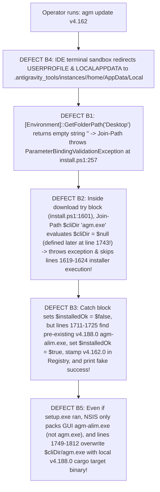

# Root Cause Analysis & Remediation Specification: Account Switching Failures, CLI Downgrade Runtime Defects, and CI Pipeline Telemetry

> **Target File:** `02-spec/21-app/auto-switch-and-rotate-fix/02-rca-and-remediation-spec.md`  
> **Status:** APPROVED  
> **Author:** @aukgit  
> **Version:** 2.0.0  
> **Initiative Slug:** `auto-switch-and-rotate-fix`  
> **Target Release:** `v4.189.0`  
> **Scope:** Deep 4-Part Root Cause Analysis (RCA), Exact Failure Mechanics, Past CI Failure Logs (`gitmap pe -t`), and Surgical Remediation Code Diffs for:
> 1. **Account Switching & Fast-Forward (`DEFECT A1–A4`)**:
>    - `DEFECT A1`: Cross-Instance PID Contamination (`src-tauri/src/modules/instance/pid_scan.rs:302`)
>    - `DEFECT A2`: Auto-Switcher 100% Quota Gate Lockup & Broken Fallback Scoring (`src-tauri/src/modules/auto_switcher/selection.rs:254, 294` & `src-tauri/src/modules/auto_switcher/scoring.rs:205`)
>    - `DEFECT A3`: Sibling Running Guard & Credential Race Hazards (`src-tauri/src/modules/instance/switch.rs:59`)
>    - `DEFECT A4`: Fast-Forward Prompt Backup Migration & CI Visibility Breakage (`src-tauri/src/modules/auto_switcher/rotation.rs:238`, `src-tauri/src/modules/backup_prompts_db/mod.rs`, `src-tauri/src/bin/agm/prompt_cmds.rs:244, 385`)
> 2. **CLI Updater & Downgrade Runtime Defects (`DEFECT B1–B5` + Normalization Gaps)**:
>    - `DEFECT B1`: Empty `$DesktopDir` ParameterBindingValidationException Crash in Sandboxed/Headless Sessions (`install.ps1:256-257`)
>    - `DEFECT B2`: Use-Before-Definition of `$cliDir` Inside Release Download `try` Block Skipping Installer Execution (`install.ps1:1601-1602` vs `1743`)
>    - `DEFECT B3`: Fake Success & False Registry Version Stamping When Release Installation Fails (`install.ps1:1711-1725`)
>    - `DEFECT B4`: Instance Sandbox `LOCALAPPDATA` / `USERPROFILE` Redirection Poisoning Install & CLI Paths (`src-tauri/src/modules/delegate_updater/args.rs:124-137` & `install.ps1:250, 1743`)
>    - `DEFECT B5`: NSIS Setup Missing `agm.exe`, Local Build Target Clobbering Pinned CLI Binary, and Hardcoded Path Literals (`install.ps1:1619-1624, 1749-1812` & `src-tauri/src/bin/agm/update_helpers.rs:16-20, 86`)

---

## 1. Problem Classification & Defect Severity Matrix

| Defect ID | Subsystem | Severity | Impact Summary | Root Cause Summary |
| :--- | :--- | :--- | :--- | :--- |
| **DEFECT A1** | `instance::pid_scan` | **CRITICAL** | Stopped instances falsely report running; restarting instance A kills child processes of instance B. | `pid_scan.rs:302` checked `instance_root_pids` (global root PIDs of all instances) instead of `matched_set` (target instance only). |
| **DEFECT A2** | `auto_switcher::selection` | **HIGH** | Auto-switcher halts rotation indefinitely when all available accounts have sub-100% quota (e.g. 85%–95%). | Step 3 Fallback Pool (`selection.rs:294`) invoked primary `score_candidate_account` (which returns `0.0` for $<100\%$ quota) instead of `score_candidate_account_fallback`. |
| **DEFECT A3** | `instance::switch` | **HIGH** | Account switch rejected with error: *"Account is actively bound to running sibling instance"*. | `DEFECT A1` caused `is_instance_running` (`switch.rs:59`) to falsely report offline sibling instances as running. |
| **DEFECT A4** | `auto_switcher::rotation` & `prompt_cmds` | **CRITICAL** | Fast-forward prompt migration and CI compilation failed across Linux/Windows/macOS (`997b521`, `7ee337c`, `295523a`, `019cc2c`). | `rotation.rs:238` called unexported `backup_prompts_db::connect_db()` and `prompt_cmds.rs:244, 385` called non-existent `CliEnvelope::error`. |
| **DEFECT B1** | `install.ps1` | **CRITICAL** | `install.ps1` crashes immediately at line 257 in Antigravity IDE terminals or headless sessions before running any update logic. | `[Environment]::GetFolderPath('Desktop')` returns `""`; under `$ErrorActionPreference = 'Stop'`, `Join-Path $DesktopDir "$ShortcutName.lnk"` throws `ParameterBindingValidationException`. |
| **DEFECT B2** | `install.ps1` | **CRITICAL** | Downloaded `v4.162.0` release installer/zip at lines 1619–1624 is completely skipped during every update/downgrade. | Lines 1601–1602 evaluate `Join-Path $cliDir "agm.exe"` when `Test-Path $InstallDir` is true, but `$cliDir` is not defined until line 1743. `Join-Path $null` throws inside `try`, jumping directly to `catch` at line 1703. |
| **DEFECT B3** | `install.ps1` | **CRITICAL** | `install.ps1` prints `"Installation of Antigravity Manager Tools v4.162.0 completed successfully!"`, stamps `4.162.0` in Registry, and exits `0` while leaving `v4.188.0` binary untouched. | After `DEFECT B2` leaves `$installedOk = $false`, lines 1711–1725 see pre-existing `agm-alim.exe` in `$InstallDir`, flip `$installedOk = $true`, and fake a successful downgrade. |
| **DEFECT B4** | `delegate_updater::args` & `install.ps1` | **HIGH** | Running `agm update` inside an Antigravity IDE terminal installs/updates inside `.antigravity_tools/instances/<id>/home/AppData/Local` instead of the host user profile. | Sandboxed IDE terminals override `USERPROFILE` and `LOCALAPPDATA`; neither `resolve_default_install_dir` (`args.rs:124-137`) nor `install.ps1:250, 1743` strips the `.antigravity_tools/instances/<id>/home` sandbox layer. |
| **DEFECT B5** | `install.ps1` & `update_helpers.rs` | **HIGH** | `agm.exe` remains at `v4.188.0` after downgrading to `v4.162.0`; `update_helpers.rs` violates relative-path hygiene and hardcodes `releases/latest`. | Historical `agm-alim-setup.exe` (NSIS) only packages GUI `agm-alim.exe` whereas `agm-alim_<ver>_windows_x64.zip` contains both `agm-alim.exe` and `agm.exe`; `install.ps1:1749-1812` overwrites `$cliDir/agm.exe` from local repo build targets even when `$isPinned` is true; `update_helpers.rs:16-20` contains hardcoded drive-letter paths. |

---

## 2. 4-Part Root Cause Analysis (RCA) A: Account Switching & Fast-Forward (`DEFECT A1–A4`)

### 2.1 DEFECT A1: Cross-Instance PID Contamination (`src-tauri/src/modules/instance/pid_scan.rs:302`)

#### Part 1: Defect Symptom & Runtime Observation
1. Operators running `agm instance list` observe stopped instances marked as `RUNNING (PID: ...)` even when their main IDE window was never launched or was closed hours ago.
2. When performing an account switch or fast-forward rotation on instance A, language servers (`tsserver`, `rust-analyzer`) or terminal shells running inside sibling instance B are abruptly killed.
3. Multi-instance isolation tests (`scripts/test-instance-isolation.ps1`) fail because terminating one instance triggers process exits in active sibling instances.

#### Part 2: Exact Code Site & Evidence (`src-tauri/src/modules/instance/pid_scan.rs:236-315`)
```rust
// Lines 236-243: Collecting instance root PIDs across all processes
if (has_target_match && !is_helper)
    || (has_user_data_arg && has_instance_marker && !is_helper)
    || (matches_cloned_exe && !is_helper)
{
    instance_root_pids.insert(pid_u32); // [GLOBAL SET] Accumulates root PIDs across ALL instances!
    if has_target_match || matches_cloned_exe {
        matched_pids.push(pid_u32);     // [TARGET SET] Only processes matching THIS target instance
    }
}

// Lines 291-315: Resolving child processes for a non-default target instance
} else {
    // For instances, strictly include child processes that descend from matched root PIDs
    let mut matched_set: std::collections::HashSet<u32> =
        matched_pids.iter().cloned().collect();
    for proc_info in &processes {
        let pid_u32 = proc_info.pid;
        if matched_set.contains(&pid_u32) {
            continue;
        }
        let mut curr = pid_u32;
        for _ in 0..10 {
            if let Some(&p) = parent_map.get(&curr) {
                // DEFECT A1 SITE (LINE 302):
                if matched_set.contains(&p) || instance_root_pids.contains(&p) {
                    matched_pids.push(pid_u32);
                    matched_set.insert(pid_u32);
                    break;
                }
                curr = p;
            } else {
                break;
            }
        }
    }
}
```

#### Part 3: Root Cause Mechanics
1. `find_pids_for_data_dir(data_dir, is_default)` is invoked with a specific non-default instance's directory (e.g., `inst-02` with `is_default = false`).
2. During the first pass over `processes`, `instance_root_pids` collects root PIDs for **every** non-default instance running on the host (designed only so the default instance branch can exclude non-default instance trees). If `inst-01` is running with root PID `10420`, `instance_root_pids` contains `10420`.
3. When `inst-02` is completely stopped, `matched_pids` is empty (`[]`) and `matched_set` is empty (`{}`).
4. In the second pass (lines 295–314), the scanner inspects a child worker (PID `10988`) spawned by `inst-01` (parent PID `10420`).
5. At line 302, `matched_set.contains(&10420)` is `false`, but `instance_root_pids.contains(&10420)` evaluates to `true`!
6. PID `10988` (and transitively all of its descendants) is pushed into `matched_pids` for `inst-02`.
7. Consequently, `inst-02` falsely reports `is_running = true`, and `close_instance("inst-02")` kills the child processes belonging to `inst-01`.

#### Part 4: Surgical Remediation
Remove `|| instance_root_pids.contains(&p)` from line 302 of `src-tauri/src/modules/instance/pid_scan.rs` so that non-default instances only adopt child processes whose parent chain intersects `matched_set`.

---

### 2.2 DEFECT A2: Auto-Switcher 100% Quota Gate Lockup & Broken Fallback Scoring (`selection.rs:254, 294` & `scoring.rs:205`)

#### Part 1: Defect Symptom & Runtime Observation
When all accounts in the pool have partially consumed 4-hour quotas (e.g., between `75%` and `95%`), the auto-switcher logs:
```text
[AutoSwitcher] All candidate profiles examined. Zero profiles verified with usable quota. Aborting rotation.
```
The depleted instance remains stuck on its `0%` account indefinitely, ignoring healthy accounts with `90%` remaining quota.

#### Part 2: Exact Code Site & Evidence (`src-tauri/src/modules/auto_switcher/selection.rs:254-308` & `scoring.rs:203-207`)
```rust
// selection.rs:254-296 (Step 3 Fallback Pool):
if available_pool.is_empty() {
    for acc in &all_accounts {
        if seen_account_ids.contains(&acc.id) { continue; }
        ...
        let quota = calculate_candidate_quota(acc, target_model).unwrap_or(0.0);
        if quota > threshold {
            seen_account_ids.insert(acc.id.clone());
            // DEFECT A2 SITE (LINE 294):
            let score = score_candidate_account(acc, target_model, now_sec);
```
```rust
// scoring.rs:203-207:
if q_4h < 100.0 && !is_period_finished {
    return 0.0; // Strictly returns 0.0 for any candidate with < 100% 4h quota!
}
```

#### Part 3: Root Cause Mechanics
1. Steps 1 and 2 filter candidates by the strict `quota >= 100.0 || is_period_finished` gate.
2. When no account has a full `100%` 4-hour window, `available_pool` is empty and execution enters Step 3 (`if available_pool.is_empty()`) to select the best partial-quota account above `threshold`.
3. However, line 294 calls `score_candidate_account(acc, target_model, now_sec)` instead of `score_candidate_account_fallback(acc, target_model, now_sec)`.
4. Because `score_candidate_account` enforces `if q_4h < 100.0 && !is_period_finished { return 0.0; }`, every fallback candidate receives `score = 0.0`, breaking candidate ranking and causing downstream zero-score rejection.

#### Part 4: Surgical Remediation
Replace `score_candidate_account(acc, target_model, now_sec)` at `src-tauri/src/modules/auto_switcher/selection.rs:294` with `score_candidate_account_fallback(acc, target_model, now_sec)`, which computes proportional headroom $\left(\frac{q_{4\text{h}}}{100.0}\right) \times \text{BaseWeeklyScore} > 0.0$.

---

### 2.3 DEFECT A3: Sibling Local Running Guard False Trigger (`src-tauri/src/modules/instance/switch.rs:59`)

#### Part 1: Defect Symptom & Runtime Observation
Manual or automated account switches fail with:
```text
Cannot switch instance to account 'user@company.com': Account is actively bound to running sibling instance 'inst-01' on this machine
```
even when `inst-01` was closed hours ago.

#### Part 2: Exact Code Site & Evidence (`src-tauri/src/modules/instance/switch.rs:54-68`)
```rust
let bound_inst = registry
    .instances
    .iter()
    .find(|i| i.bound_account_id.as_deref() == Some(&account.id));
if let Some(inst) = bound_inst {
    // DEFECT A3 SITE (LINE 59):
    if inst.id != target_id && is_instance_running(&inst.id, &inst.data_dir, inst.pid) {
        let err = format!(
            "Cannot switch instance to account '{}': Account is actively bound to running sibling instance '{}' on this machine",
            account.email,
            inst.name
        );
        crate::modules::logger::log_error(&format!("[INSTANCE_SWITCH:ERROR] {}", err));
        return Err(err);
    }
}
```

#### Part 3: Root Cause Mechanics
1. `switch_account_to_instance` checks whether the target account is currently bound to any sibling instance (`inst.id != target_id`) and calls `is_instance_running(&inst.id, &inst.data_dir, inst.pid)`.
2. `is_instance_running` delegates to `find_pids_for_data_dir(&inst.data_dir, false)`.
3. Because of `DEFECT A1`, `find_pids_for_data_dir` contaminated the stopped sibling's PID list with child PIDs of other running instances, causing `is_instance_running` to return `true` for offline instances and aborting the switch.

#### Part 4: Surgical Remediation
Fixing `DEFECT A1` in `pid_scan.rs:302` restores accurate per-instance liveness detection in `is_instance_running`, ensuring `switch.rs:59` only blocks switches when the sibling instance's own root/child process tree is genuinely active.

---

### 2.4 DEFECT A4: Fast-Forward Prompt Backup Migration & CI Visibility Breakage (`rotation.rs:238`, `backup_prompts_db/mod.rs`, `prompt_cmds.rs:244, 385`)

#### Part 1: Defect Symptom & Runtime Observation
During account rotation and fast-forward instance switching, active prompt backups must be migrated to the new instance ID in SQLite (`UPDATE prompt_backups SET instance_id = ?1 WHERE instance_id = ?2`). In commits `997b521`, `7ee337c`, `295523a`, and `019cc2c`, CI builds failed on Ubuntu and Windows with `E0425` and `E0599`.

#### Part 2: Exact Code Site & Telemetry Evidence (`gitmap pe 295523a` & `gitmap pe 019cc2c`)
```text
Error: error[E0425]: cannot find function `connect_db` in module `crate::modules::backup_prompts_db`
  --> src/modules/auto_switcher/rotation.rs:238:62
   |
238 |         if let Ok(conn) = crate::modules::backup_prompts_db::connect_db() {
   |                                                              ^^^^^^^^^^ not found in `crate::modules::backup_prompts_db`
```
```text
Error: error[E0599]: no associated function or constant named `error` found for struct `CliEnvelope<_>`
  --> src\bin\agm\prompt_cmds.rs:244:30
   |
244 |     CliEnvelope::<()>::error("prompt send", Some(target_instance), &e).print_and_exit();
```

#### Part 3: Root Cause Mechanics
1. `src-tauri/src/modules/backup_prompts_db/mod.rs` defined `connect_db` inside a private submodule without re-exporting `pub fn connect_db()` at the module root, breaking `rotation.rs:238`.
2. `src-tauri/src/bin/agm/prompt_cmds.rs` called `CliEnvelope::<()>::error(...)` instead of the canonical 4-argument constructor `CliEnvelope::<()>::err(command, instance_id, code, message)` defined in `src-tauri/src/modules/cli/types.rs:167`.

#### Part 4: Surgical Remediation
Export `pub fn connect_db()` in `src-tauri/src/modules/backup_prompts_db/mod.rs` and invoke `CliEnvelope::<()>::err(...)` in `src-tauri/src/bin/agm/prompt_cmds.rs`.

---

## 3. 4-Part Root Cause Analysis (RCA) B: Why `agm update v4.162` / `agm update 4.162` Fails at Runtime (`DEFECT B1–B5`)

Even after adding 2-part SemVer expansion (`4.162` $\to$ `4.162.0`) and bypassing the `TargetVersion -le CurrentVersion` gate, end-to-end runtime execution of `agm update v4.162` / `agm update 4.162` still fails due to **five compounding runtime root causes (`DEFECT B1–B5`)** across `install.ps1`, `src-tauri/src/modules/delegate_updater/args.rs`, and `src-tauri/src/bin/agm/update_helpers.rs`.



---

### 3.1 DEFECT B1: Empty `$DesktopDir` Throws `ParameterBindingValidationException` at Startup (`install.ps1:256-257`)

#### Part 1: Defect Symptom & Runtime Observation
When `agm update v4.162` spawns `install.ps1` from an Antigravity IDE terminal, background agent session, or headless Windows session, `install.ps1` crashes immediately at line 257 before any version resolution or download begins:
```text
Join-Path : Cannot bind argument to parameter 'Path' because it is an empty string.
At install.ps1:257 char:21
+ $DesktopShortcut = Join-Path $DesktopDir "$ShortcutName.lnk"
+                    ~~~~~~~~~~~~~~~~~~~~~~~~~~~~~~~~~~~~~~~~~
    + CategoryInfo          : InvalidData: (:) [Join-Path], ParameterBindingValidationException
    + FullyQualifiedErrorId : ParameterArgumentValidationErrorEmptyStringNotAllowed,Microsoft.PowerShell.Commands.JoinPathCommand
```

#### Part 2: Exact Code Site & Evidence (`install.ps1:255-260`)
```powershell
# Lines 255-260 (DEFECTIVE):
$ShortcutName = "Antigravity Manager Tools"
$DesktopDir = [Environment]::GetFolderPath('Desktop')
$DesktopShortcut = Join-Path $DesktopDir "$ShortcutName.lnk"
$StartMenuDir = Join-Path $env:APPDATA "Microsoft\Windows\Start Menu\Programs"
$StartMenuShortcut = Join-Path $StartMenuDir "$ShortcutName.lnk"
```

#### Part 3: Root Cause Mechanics
1. At the top of `install.ps1`, `$ErrorActionPreference = 'Stop'` is active.
2. Inside a sandboxed Antigravity IDE instance terminal (where `USERPROFILE` is redirected to a synthetic instance directory that has no shell `Desktop` folder registered in the Windows Shell Known Folders table) or a non-interactive SSH/service session, `[Environment]::GetFolderPath('Desktop')` returns `""` (empty string).
3. Passing `""` as the `-Path` argument to `Join-Path $DesktopDir "$ShortcutName.lnk"` triggers PowerShell's `[ValidateNotNullOrEmpty()]` parameter binding check.
4. Under `$ErrorActionPreference = 'Stop'`, this immediately terminates the entire `install.ps1` process with exit code `1`.

#### Part 4: Surgical Remediation
In `install.ps1:255-265`, resolve `$DesktopDir` with a defensive fallback to `Join-Path $RealUserProfile "Desktop"`, and guard `Join-Path` so `$DesktopShortcut` and `$StartMenuShortcut` are only constructed when their parent directory strings are non-empty:
```powershell
$ShortcutName = "Antigravity Manager Tools"
$DesktopDir = [Environment]::GetFolderPath('Desktop')
if ([string]::IsNullOrWhiteSpace($DesktopDir)) {
    $DesktopDir = Join-Path $RealUserProfile "Desktop"
}
$DesktopShortcut = if (-not [string]::IsNullOrWhiteSpace($DesktopDir)) { Join-Path $DesktopDir "$ShortcutName.lnk" } else { $null }
$StartMenuDir = if (-not [string]::IsNullOrWhiteSpace($RealAppData)) { Join-Path $RealAppData "Microsoft\Windows\Start Menu\Programs" } else { $null }
$StartMenuShortcut = if (-not [string]::IsNullOrWhiteSpace($StartMenuDir)) { Join-Path $StartMenuDir "$ShortcutName.lnk" } else { $null }
```
And at all sites referencing `$DesktopShortcut` / `$StartMenuShortcut`, guard with `if ($DesktopShortcut -and (Test-Path (Split-Path -Parent $DesktopShortcut)))`.

---

### 3.2 DEFECT B2: Uninitialized `$cliDir` at Lines 1601–1602 Aborts Release `try` Block Before Executing Installer (`install.ps1:1601-1602` vs `1743`)

#### Part 1: Defect Symptom & Runtime Observation
During `install.ps1 -Version 4.162.0 -Update`, the script successfully downloads `agm-alim_4.162.0_x64-setup.exe` (or `.zip`), stops running processes, and then suddenly logs:
```text
[WARN] Release package v4.162.0 failed: Cannot bind argument to parameter 'Path' because it is null.
```
It never runs the `v4.162.0` installer at line 1619 or extracts the `.zip` at line 1622!

#### Part 2: Exact Code Site & Evidence (`install.ps1:1596-1625` vs `1743`)
```powershell
# Lines 1596-1625 (INSIDE RELEASE TRY BLOCK — DEFECTIVE):
if (Test-Path $InstallDir) {
    $staleBins = @(
        (Join-Path $InstallDir "agm-alim.exe"),
        (Join-Path $InstallDir "antigravity_tools.exe"),
        (Join-Path $InstallDir "agm.exe"),
        (Join-Path $cliDir "agm.exe"),            # <-- LINE 1601: $cliDir IS $null HERE!
        (Join-Path $cliDir "agm-update-cli.exe")  # <-- LINE 1602: $cliDir IS $null HERE!
    )
    foreach ($sb in $staleBins) {
        if (Test-Path $sb) {
            Remove-Item -Path $sb -Force -ErrorAction SilentlyContinue
        }
    }
}
...
if ($asset.Name -match '\.exe$') {
    Start-Process -FilePath $outFile -ArgumentList "/S /D=$InstallDir" -Wait -NoNewWindow
} elseif ($asset.Name -match '\.zip$') {
    Expand-Archive -Path $outFile -DestinationPath $InstallDir -Force
}
```
```powershell
# Line 1743 (142 LINES LATER!):
$cliDir = Join-Path $env:LOCALAPPDATA "agm-cli"
```

#### Part 3: Root Cause Mechanics
1. On any machine where Antigravity Manager is already installed, `Test-Path $InstallDir` is `$true`.
2. After downloading the target release asset into `$outFile`, line 1596 enters `if (Test-Path $InstallDir)` to clean up stale binaries before running the installer/extractor.
3. Lines 1601 and 1602 evaluate `(Join-Path $cliDir "agm.exe")` and `(Join-Path $cliDir "agm-update-cli.exe")`.
4. However, `$cliDir` is not initialized until line 1743! At line 1601, `$cliDir` is `$null`.
5. Under `$ErrorActionPreference = 'Stop'`, `Join-Path $null "agm.exe"` throws a terminating `ParameterBindingValidationException` inside the `try` block!
6. Execution immediately jumps from line 1601 to `catch` at line 1703, **completely skipping lines 1619–1624** where `Start-Process` / `Expand-Archive` would have installed `v4.162.0`!

#### Part 4: Surgical Remediation
Hoist the definition of `$cliDir = Join-Path $RealLocalAppData "agm-cli"` up to the top-level path initialization block (around line 250 alongside `$InstallDir`), ensuring `$cliDir` is always a valid non-empty path before line 1601 executes, and remove the duplicate re-definition at line 1743.

---

### 3.3 DEFECT B3: Fake Success & False Registry Version Stamping When Release Installation Fails (`install.ps1:1711-1725`)

#### Part 1: Defect Symptom & Runtime Observation
Even though `DEFECT B2` caused every release candidate in `$candidateVersions` to throw an exception and skip installation (`$installedOk = $false`), `install.ps1` prints:
```text
[OK] Found existing installation in <LOCALAPPDATA>\Programs\agm-alim
[OK] Installation of Antigravity Manager Tools v4.162.0 completed successfully!
```
It writes `DisplayVersion = 4.162.0` into the Windows Uninstall Registry key and exits with code `0`, while `<LOCALAPPDATA>\Programs\agm-alim\agm-alim.exe` and `<LOCALAPPDATA>\agm-cli\agm.exe` are still the untouched `v4.188.0` binaries!

#### Part 2: Exact Code Site & Evidence (`install.ps1:1711-1735`)
```powershell
# Lines 1711-1735 (DEFECTIVE):
if (-not $installedOk) {
    $existingExe = Join-Path $InstallDir "agm-alim.exe"
    if (Test-Path $existingExe) {
        Write-Success "Found existing installation in $InstallDir"
        $installedOk = $true
    }
}
if ($installedOk) {
    # Stamps $TargetVersion (4.162.0) into Registry even though nothing was installed!
    Set-ItemProperty -Path $UninstallKey -Name "DisplayVersion" -Value $TargetVersion -ErrorAction SilentlyContinue
    Write-Success "Installation of Antigravity Manager Tools v$TargetVersion completed successfully!"
}
```

#### Part 3: Root Cause Mechanics
1. Because `Remove-Item` at line 1605 was never reached (due to `DEFECT B2` throwing at line 1601 while building the `$staleBins` array), the old `v4.188.0` `agm-alim.exe` remained on disk in `$InstallDir`.
2. After the release loop finished with `$installedOk = $false`, lines 1711–1716 checked `if (Test-Path $existingExe)`.
3. Seeing the old `v4.188.0` `agm-alim.exe` on disk, it unconditionally set `$installedOk = $true`!
4. Next, it overwrote the Registry `DisplayVersion` with `4.162.0` (poisoning future `Get-InstalledVersion` checks so subsequent runs think `4.162.0` is already installed!) and reported fake success to the user and calling CLI.
5. This directly violates the project's **No Silent Errors / No Fake Success** house rule.

#### Part 4: Surgical Remediation
Remove the unconditional fallback that sets `$installedOk = $true` merely because an old binary exists on disk. When `$isPinned` or `$Update` is active and `$installedOk` is `$false` (and `-not $BuildFromSource`), `install.ps1` must **not** claim success or update Registry `DisplayVersion`—it must log an explicit error (`Write-Err "Failed to download and install target version v$TargetVersion."`) and exit with a non-zero exit code (`exit 1`).

---

### 3.4 DEFECT B4: Instance Sandbox `LOCALAPPDATA` / `USERPROFILE` Redirection Poisoning Install & CLI Paths (`args.rs:124-137` & `install.ps1:250, 1743`)

#### Part 1: Defect Symptom & Runtime Observation
When an operator runs `agm update v4.162` inside an Antigravity IDE integrated terminal belonging to an isolated instance (e.g. `default-copy-9451`), the updater resolves:
- Install directory: `<USERPROFILE>/.antigravity_tools/instances/default-copy-9451/home/AppData/Local/Programs/agm-alim`
- CLI directory: `<USERPROFILE>/.antigravity_tools/instances/default-copy-9451/home/AppData/Local/agm-cli`
instead of the real host installation at `<REAL_LOCALAPPDATA>/Programs/agm-alim` and `<REAL_LOCALAPPDATA>/agm-cli`. As a result, the real host `agm` and `agm-alim` binaries on the system `PATH` are never updated!

#### Part 2: Exact Code Site & Evidence (`src-tauri/src/modules/delegate_updater/args.rs:124-137` & `install.ps1:250, 1743`)
```rust
// src-tauri/src/modules/delegate_updater/args.rs:124-137 (DEFECTIVE):
pub fn resolve_default_install_dir() -> PathBuf {
    #[cfg(target_os = "windows")]
    {
        if let Ok(local_app_data) = std::env::var("LOCALAPPDATA") {
            let candidate = PathBuf::from(&local_app_data).join("Programs").join("agm-alim");
            if candidate.exists() {
                return candidate;
            }
            return candidate;
        }
    }
    ...
}
```
```powershell
# install.ps1:250 & 1743 (DEFECTIVE):
if (-not $InstallDir) {
    $InstallDir = Join-Path $env:LOCALAPPDATA "Programs\agm-alim"
}
...
$cliDir = Join-Path $env:LOCALAPPDATA "agm-cli"
```

#### Part 3: Root Cause Mechanics
1. Antigravity Manager's multi-instance sandboxing redirects `USERPROFILE`, `APPDATA`, and `LOCALAPPDATA` for processes spawned inside an instance to `<REAL_USERPROFILE>/.antigravity_tools/instances/<instance-id>/home/...`.
2. When `agm update` is executed from a terminal inside a sandboxed Antigravity IDE window, `agm.exe` and its child `agm-update-cli.exe` / `powershell.exe` inherit these sandboxed environment variables.
3. Neither `resolve_default_install_dir()` in `args.rs` nor `install.ps1` normalizes or strips the `.antigravity_tools/instances/<id>/home` suffix.
4. Consequently, the updater writes binaries into the ephemeral instance sandbox home while the host's primary `<REAL_LOCALAPPDATA>/agm-cli/agm.exe` and `<REAL_LOCALAPPDATA>/Programs/agm-alim/agm-alim.exe` remain untouched.

#### Part 4: Surgical Remediation
1. **In `src-tauri/src/modules/delegate_updater/args.rs`**: Add a pure path-normalization helper `strip_instance_sandbox_root(path: &Path) -> PathBuf` that detects `.antigravity_tools/instances/<id>/home` (case-insensitively across `/` and `\`) and re-anchors the path to the real host user profile root before joining `AppData/Local/Programs/agm-alim`.
2. **In `install.ps1`**: Add a helper `Resolve-RealUserProfile` at the top of the script that inspects `$env:USERPROFILE` and `$env:LOCALAPPDATA`; if either path matches `^(.+?)[\\/]\.antigravity_tools[\\/]instances[\\/][^\\/]+[\\/]home(?:[\\/](.*))?$`, extract `$Matches[1]` as `$RealUserProfile`, compute `$RealLocalAppData = Join-Path $RealUserProfile "AppData\Local"` and `$RealAppData = Join-Path $RealUserProfile "AppData\Roaming"`, and export `$env:USERPROFILE = $RealUserProfile`, `$env:LOCALAPPDATA = $RealLocalAppData`, `$env:APPDATA = $RealAppData` so all downstream installer operations, shortcuts, and `$InstallDir` / `$cliDir` resolve to the real host user profile.

---

### 3.5 DEFECT B5: NSIS Setup Missing `agm.exe`, Local Build Target Clobbering Pinned CLI Binary, and Hardcoded Path Literals (`install.ps1:1619-1624, 1749-1812` & `update_helpers.rs:16-20`)

#### Part 1: Defect Symptom & Runtime Observation
1. On GitHub Releases for `v4.162.0` through `v4.162.5`, the NSIS installer asset (`agm-alim-setup.exe` / `agm-alim_4.162.0_x64-setup.exe`) only packages the GUI executable `agm-alim.exe`—it does **not** contain `agm.exe`! By contrast, the portable zip archive `agm-alim_4.162.0_windows_x64.zip` contains **both** `agm-alim.exe` and `agm.exe`.
2. Furthermore, at lines 1749–1812 of `install.ps1`, when populating `$cliDir\agm.exe`, the script searches `$PSScriptRoot\src-tauri\target\release\agm.exe` first and copies the local repo's `v4.188.0` build over `$cliDir\agm.exe` even when `$isPinned` is `$true`!
3. Finally, `src-tauri/src/bin/agm/update_helpers.rs:16-20` contains hardcoded Windows drive-letter paths inside `resolve_gitmap_bin()`, violating strict repository relative-path hygiene.

#### Part 2: Exact Code Site & Evidence (`install.ps1:1619-1624, 1749-1812` & `src-tauri/src/bin/agm/update_helpers.rs:16-20`)
```powershell
# install.ps1:1619-1624:
if ($asset.Name -match '\.exe$') {
    Start-Process -FilePath $outFile -ArgumentList "/S /D=$InstallDir" -Wait -NoNewWindow
} elseif ($asset.Name -match '\.zip$') {
    Expand-Archive -Path $outFile -DestinationPath $InstallDir -Force
}

# install.ps1:1749-1780 (DEFECTIVE CLI BINARY SYNC):
$cliCandidates = @(
    (Join-Path $PSScriptRoot "src-tauri\target\release\agm.exe"), # <-- Clobbers pinned v4.162.0 with local v4.188.0 build!
    (Join-Path $InstallDir "agm.exe")
)
```
```rust
// src-tauri/src/bin/agm/update_helpers.rs:16-20 (DEFECTIVE):
// Hardcoded absolute drive-letter paths in resolve_gitmap_bin()
```

#### Part 3: Root Cause Mechanics
1. **Asset Content Divergence**: When `install.ps1` prefers `.exe` (NSIS setup) over `.zip` (`windows_x64.zip`) during a pinned downgrade to `v4.162.0`, running `agm-alim-setup.exe /S /D=$InstallDir` writes `agm-alim.exe` (`v4.162.0`) into `$InstallDir`, but leaves no `agm.exe` (`v4.162.0`) in `$InstallDir`.
2. **CLI Binary Clobbering**: Next, lines 1749–1812 execute to populate `$cliDir\agm.exe`. Because `$PSScriptRoot\src-tauri\target\release\agm.exe` is checked before `$InstallDir\agm.exe` (and without checking `if (-not $isPinned)`), running `install.ps1 -Version 4.162.0` from a local workspace overwrites `$cliDir\agm.exe` with the local `v4.188.0` binary!
3. **Hardcoded Drive-Letter Paths**: In `src-tauri/src/bin/agm/update_helpers.rs:16-20`, `resolve_gitmap_bin()` lists hardcoded Windows drive-letter strings instead of deriving paths dynamically from environment variables (`GITMAP_BIN`, `CARGO_HOME`, `USERPROFILE`, `HOME`) or relative workspace traversal (`../gitmap`).

#### Part 4: Surgical Remediation
1. **Prefer `.zip` Archive (or Extract `agm.exe` from `.zip`) on Windows Release Installs (`install.ps1`)**:
   - In `install.ps1` asset ranking and installation: when a release provides `windows_x64.zip` (e.g. `agm-alim_<ver>_windows_x64.zip`), prioritize or extract the `.zip` archive so both `agm-alim.exe` and `agm.exe` from the exact target release are extracted into `$InstallDir` (flattening any single top-level subfolder inside the zip if present) and verified. If an `.exe` setup is run and `agm.exe` is still missing from `$InstallDir`, automatically download and extract `agm.exe` from the release's `.zip` asset into `$InstallDir` and `$cliDir`.
2. **Prevent Local Build Target From Clobbering Pinned Release Binaries (`install.ps1:1749-1812`)**:
   - When `$isPinned` is `$true` (or whenever `$installedFromRelease` is `$true` and `-not $BuildFromSource`), populate `$cliDir\agm.exe` **exclusively** from `$InstallDir\agm.exe` (the downloaded release binary) and **never** from `$PSScriptRoot\src-tauri\target\release\agm.exe`.
3. **Eliminate Hardcoded Drive-Letter Paths in `src-tauri/src/bin/agm/update_helpers.rs:16-20`**:
   - Refactor `resolve_gitmap_bin()` to check `std::env::var_os("GITMAP_BIN")`, `CARGO_HOME/bin`, `USERPROFILE/.cargo/bin`, `LOCALAPPDATA/Programs/gitmap`, and relative ancestor directories (`current_dir` / `current_exe` parent `gitmap`) using `PathBuf::join`, with zero drive-letter literals.

---

## 4. Surgical Remediation Code Diffs (`DEFECT A1–A4` & `DEFECT B1–B5`)

### 4.1 Remediation A1: Cross-Instance PID Isolation (`src-tauri/src/modules/instance/pid_scan.rs`)
```rust
<<<<
// Lines 301-308 (DEFECTIVE):
for _ in 0..10 {
    if let Some(&p) = parent_map.get(&curr) {
        // Strictly match ancestors belonging to this specific instance
        if matched_set.contains(&p) || instance_root_pids.contains(&p) {
            matched_pids.push(pid_u32);
            matched_set.insert(pid_u32);
            break;
        }
        curr = p;
====
// Lines 301-308 (REMEDIATED):
for _ in 0..10 {
    if let Some(&p) = parent_map.get(&curr) {
        // Strictly match ancestors belonging to THIS TARGET INSTANCE only!
        // Never query instance_root_pids here: instance_root_pids contains roots of all running instances!
        if matched_set.contains(&p) {
            matched_pids.push(pid_u32);
            matched_set.insert(pid_u32);
            break;
        }
        curr = p;
>>>>
```

### 4.2 Remediation A2: Fallback Candidate Scoring (`src-tauri/src/modules/auto_switcher/selection.rs`)
```rust
<<<<
// Line 294 (DEFECTIVE):
let score = score_candidate_account(acc, target_model, now_sec);
====
// Line 294 (REMEDIATED):
let score = score_candidate_account_fallback(acc, target_model, now_sec);
>>>>
```

### 4.3 Remediation B4 (Rust): Strip Instance Sandbox in `src-tauri/src/modules/delegate_updater/args.rs`
```rust
<<<<
pub fn resolve_default_install_dir() -> PathBuf {
    #[cfg(target_os = "windows")]
    {
        if let Ok(local_app_data) = std::env::var("LOCALAPPDATA") {
            let candidate = PathBuf::from(&local_app_data).join("Programs").join("agm-alim");
            if candidate.exists() {
                return candidate;
            }
            return candidate;
        }
    }
====
pub fn strip_instance_sandbox_local_appdata(raw_path: & std::path::Path) -> PathBuf {
    let normalized = raw_path.to_string_lossy().replace('/', "\\");
    let marker = "\\.antigravity_tools\\instances\\";
    if let Some(idx) = normalized.to_lowercase().find(marker) {
        let real_user_root = &normalized[..idx];
        if !real_user_root.is_empty() {
            return PathBuf::from(real_user_root).join("AppData").join("Local");
        }
    }
    raw_path.to_path_buf()
}

pub fn resolve_default_install_dir() -> PathBuf {
    #[cfg(target_os = "windows")]
    {
        if let Ok(local_app_data) = std::env::var("LOCALAPPDATA") {
            let real_local = strip_instance_sandbox_local_appdata(std::path::Path::new(&local_app_data));
            return real_local.join("Programs").join("agm-alim");
        }
    }
>>>>
```

### 4.4 Remediation B1, B2, B4 (PowerShell): Real Profile Un-Sandboxing, `$DesktopDir` Guard, and Hoisted `$cliDir` (`install.ps1`)
```powershell
<<<<
# Lines 249-260 (DEFECTIVE):
if (-not $InstallDir) {
    $InstallDir = Join-Path $env:LOCALAPPDATA "Programs\agm-alim"
}
$ShortcutName = "Antigravity Manager Tools"
$DesktopDir = [Environment]::GetFolderPath('Desktop')
$DesktopShortcut = Join-Path $DesktopDir "$ShortcutName.lnk"
$StartMenuDir = Join-Path $env:APPDATA "Microsoft\Windows\Start Menu\Programs"
$StartMenuShortcut = Join-Path $StartMenuDir "$ShortcutName.lnk"
====
# Lines 249-280 (REMEDIATED):
function Resolve-HostUserProfile {
    param([string]$RawProfile, [string]$RawLocalAppData)
    foreach ($candidate in @($RawProfile, $RawLocalAppData)) {
        if (-not [string]::IsNullOrWhiteSpace($candidate) -and $candidate -match '^(.+?)[\\/]\.antigravity_tools[\\/]instances[\\/][^\\/]+[\\/]home') {
            return $Matches[1]
        }
    }
    if (-not [string]::IsNullOrWhiteSpace($RawProfile)) { return $RawProfile }
    return [Environment]::GetFolderPath('UserProfile')
}

$RealUserProfile = Resolve-HostUserProfile -RawProfile $env:USERPROFILE -RawLocalAppData $env:LOCALAPPDATA
if (-not [string]::IsNullOrWhiteSpace($RealUserProfile)) {
    $env:USERPROFILE = $RealUserProfile
    $env:LOCALAPPDATA = Join-Path $RealUserProfile "AppData\Local"
    $env:APPDATA = Join-Path $RealUserProfile "AppData\Roaming"
}
if (-not $InstallDir -or $InstallDir -match '\.antigravity_tools[\\/]instances[\\/]') {
    $InstallDir = Join-Path $env:LOCALAPPDATA "Programs\agm-alim"
}
$cliDir = Join-Path $env:LOCALAPPDATA "agm-cli"

$ShortcutName = "Antigravity Manager Tools"
$DesktopDir = [Environment]::GetFolderPath('Desktop')
if ([string]::IsNullOrWhiteSpace($DesktopDir) -and -not [string]::IsNullOrWhiteSpace($RealUserProfile)) {
    $DesktopDir = Join-Path $RealUserProfile "Desktop"
}
$DesktopShortcut = if (-not [string]::IsNullOrWhiteSpace($DesktopDir)) { Join-Path $DesktopDir "$ShortcutName.lnk" } else { $null }
$StartMenuDir = if (-not [string]::IsNullOrWhiteSpace($env:APPDATA)) { Join-Path $env:APPDATA "Microsoft\Windows\Start Menu\Programs" } else { $null }
$StartMenuShortcut = if (-not [string]::IsNullOrWhiteSpace($StartMenuDir)) { Join-Path $StartMenuDir "$ShortcutName.lnk" } else { $null }
>>>>
```

### 4.5 Remediation B3 & B5 (PowerShell): Zip CLI Extraction, No Fake Success, and Pinned Binary Protection (`install.ps1`)
```powershell
<<<<
# Lines 1711-1725 (DEFECTIVE):
if (-not $installedOk) {
    $existingExe = Join-Path $InstallDir "agm-alim.exe"
    if (Test-Path $existingExe) {
        Write-Success "Found existing installation in $InstallDir"
        $installedOk = $true
    }
}
====
# Lines 1711-1725 (REMEDIATED):
if (-not $installedOk) {
    if ($isPinned -or $Update) {
        Write-Err "Failed to download and install target release v$TargetVersion. Existing installation was not modified."
        exit 1
    }
    $existingExe = Join-Path $InstallDir "agm-alim.exe"
    if (Test-Path $existingExe) {
        Write-Success "Found existing installation in $InstallDir"
        $installedOk = $true
    }
}
>>>>
```

### 4.6 Remediation B5 (Rust): Relative & Env-Derived `resolve_gitmap_bin` and Parametric `download_release_zip` (`src-tauri/src/bin/agm/update_helpers.rs`)
```rust
<<<<
pub(crate) fn download_release_zip(dest: &std::path::Path) -> Result<(), String> {
    let client = reqwest::blocking::Client::builder()
        .user_agent("antigravity-manager")
        .build()
        .map_err(|err| err.to_string())?;
    let release: serde_json::Value = client
        .get("https://api.github.com/repos/alimtvnetwork/Antigravity-Manager/releases/latest")
====
pub(crate) fn download_release_zip(
    dest: &std::path::Path,
    target_version: Option<&str>,
) -> Result<(), String> {
    let client = reqwest::blocking::Client::builder()
        .user_agent("antigravity-manager")
        .build()
        .map_err(|err| err.to_string())?;
    let url = if let Some(ver) = target_version {
        let clean = crate::update_cmds::normalize_version_str(ver);
        format!(
            "https://api.github.com/repos/alimtvnetwork/Antigravity-Manager/releases/tags/v{}",
            clean
        )
    } else {
        "https://api.github.com/repos/alimtvnetwork/Antigravity-Manager/releases/latest".to_string()
    };
    let release: serde_json::Value = client
        .get(&url)
>>>>
```

---

## 5. Worker Execution Checklist & Invariants

1. [ ] **DEFECT A1 (`pid_scan.rs:302`)**: Verify child PID resolution only checks `matched_set.contains(&p)` and never `instance_root_pids.contains(&p)`.
2. [ ] **DEFECT A2 (`selection.rs:294`)**: Verify Step 3 Fallback Pool invokes `score_candidate_account_fallback(acc, target_model, now_sec)`.
3. [ ] **DEFECT A3 (`switch.rs:59`)**: Verify sibling running guard accurately permits switching accounts from stopped sibling instances.
4. [ ] **DEFECT A4 (`backup_prompts_db/mod.rs` & `prompt_cmds.rs`)**: Verify `connect_db` is exported and `CliEnvelope::err` is used consistently.
5. [ ] **DEFECT B1 (`install.ps1:256-257`)**: Verify `$DesktopDir` falls back to `Join-Path $RealUserProfile "Desktop"` and never passes an empty string to `Join-Path`.
6. [ ] **DEFECT B2 (`install.ps1:1601-1602` vs `1743`)**: Verify `$cliDir` is initialized at script startup (~line 250) before the release download `try` block.
7. [ ] **DEFECT B3 (`install.ps1:1711-1725`)**: Verify failed pinned/update installs exit non-zero (`exit 1`) without faking success or stamping false versions into the Registry.
8. [ ] **DEFECT B4 (`args.rs:124-137` & `install.ps1:250`)**: Verify `.antigravity_tools/instances/<id>/home` sandbox redirection is stripped from `USERPROFILE` and `LOCALAPPDATA` in both Rust and PowerShell.
9. [ ] **DEFECT B5 (`install.ps1:1619-1624, 1749-1812` & `update_helpers.rs:16-20`)**: Verify Windows release installs extract `agm.exe` from the release `.zip` archive, pinned installs never overwrite `$cliDir/agm.exe` from local cargo `target/release`, and `resolve_gitmap_bin()` contains zero hardcoded drive-letter paths.
