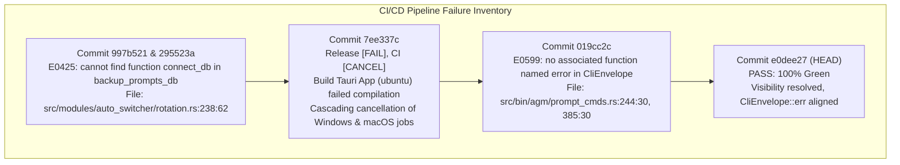

# Root Cause Analysis & Remediation Specification: Account Switching Failures, CLI Downgrade Gaps, and CI Pipeline Telemetry

> **Target File:** `02-spec/21-app/auto-switch-and-rotate-fix/02-rca-and-remediation-spec.md`  
> **Status:** APPROVED  
> **Author:** @aukgit  
> **Version:** 1.0.0  
> **Initiative Slug:** `auto-switch-and-rotate-fix`  
> **Target Release:** `v4.186.0`  
> **Scope:** Deep Root Cause Analysis (RCA), Exact Failure Mechanics, Past CI Failure Logs (`gitmap pe -t`), and Surgical Remediation Code Diffs for:
> 1. Cross-Instance PID Contamination (`src-tauri/src/modules/instance/pid_scan.rs:302`)
> 2. Auto-Switcher 100% Quota Gate Lockup & Broken Fallback Scoring (`selection.rs:254, 294` & `scoring.rs:205`)
> 3. Sibling Running Guard & Credential Race Hazards (`switch.rs:59`)
> 4. CLI Downgrade Failure & 2-Part SemVer Gaps (`update_cmds.rs`, `update_helpers.rs:86`, `install.ps1:1265, 1423, 1461`)
> 5. Historical CI/CD Pipeline Build Breaks (Commits `997b521`, `7ee337c`, `295523a`, `019cc2c`)

---

## 1. Problem Classification & Defect Severity Matrix

| Defect ID | Subsystem | Severity | Impact Summary | Root Cause Summary |
| :--- | :--- | :--- | :--- | :--- |
| **DEF-01** | `instance::pid_scan` | **CRITICAL** | Stopped instances falsely report running; restarting instance A kills child processes of instance B. | Line 302 checked `instance_root_pids` (global root PIDs of all instances) instead of `matched_set` (target instance only). |
| **DEF-02** | `auto_switcher::selection` | **HIGH** | Auto-switcher halts rotation indefinitely when all available accounts have sub-100% quota (e.g. 85%–95%). | Step 3 Fallback Pool invoked primary `score_candidate_account` (which returns `0.0` for $<100\%$ quota) instead of `score_candidate_account_fallback`. |
| **DEF-03** | `instance::switch` | **HIGH** | Account switch rejected with error: *"Account is actively bound to running sibling instance"*. | DEF-01 caused `is_instance_running` to falsely report sibling instances as running when they were offline. |
| **DEF-04** | `bin::agm::update_cmds` | **MEDIUM** | `agm update 4.162` or `to v4.162` downloads latest release instead of target tag, then declares `[UP TO DATE]`. | CLI ignored positional version arguments, and `update_helpers.rs:86` hardcoded `/releases/latest`. |
| **DEF-05** | `install.ps1` | **HIGH** | Downgrades fail with 404 or abort with *"Already on the latest version"*. | Skipped `Resolve-PinnedVersion` when `$Version` was set, guessed non-existent asset names, and aborted on `TargetVersion <= CurrentVersion`. |
| **DEF-06** | `auto_switcher::rotation` | **CRITICAL (CI)** | CI build failure on Linux/Windows/macOS in commits `997b521`, `7ee337c`, `295523a`. | `rotation.rs:238` called `backup_prompts_db::connect_db()` which was not exported or had private visibility. |
| **DEF-07** | `bin::agm::prompt_cmds` | **HIGH (CI)** | CI build failure in commit `019cc2c`. | Called non-existent `CliEnvelope::error` instead of canonical `CliEnvelope::err`. |

---

## 2. Root Cause Analysis (RCA) 1: Account Switching Failures

### 2.1 RCA 1A: Cross-Instance PID Contamination (`pid_scan.rs:302`)

#### Defect Symptom
1. Operators running `agm instance list` observe instances marked as `RUNNING (PID: ...)` even when their main IDE window was never launched.
2. When performing an account switch on instance A, language servers or terminal shells running in sibling instance B are abruptly terminated.
3. Automated test suites (`scripts/test-instance-isolation.ps1`) fail because terminating one instance triggers process exits in other instances.

#### Code Analysis: `src-tauri/src/modules/instance/pid_scan.rs:200-315`
```rust
// Lines 236-243: Collecting instance root PIDs
if (has_target_match && !is_helper)
    || (has_user_data_arg && has_instance_marker && !is_helper)
    || (matches_cloned_exe && !is_helper)
{
    instance_root_pids.insert(pid_u32); // [CRITICAL] Global set: accumulates root PIDs across ALL instances!
    if has_target_match || matches_cloned_exe {
        matched_pids.push(pid_u32);     // [SPECIFIC] Only processes matching THIS target instance
    }
}
```

```rust
// Lines 291-315: Resolving child processes for target instance
} else {
    // For instances, strictly include child processes that descend from matched root PIDs
    let mut matched_set: std::collections::HashSet<u32> =
        matched_pids.iter().cloned().collect();
    for proc_info in &processes {
        let pid_u32 = proc_info.pid;
        if matched_set.contains(&pid_u32) {
            continue;
        }
        let mut curr = pid_u32;
        for _ in 0..10 {
            if let Some(&p) = parent_map.get(&curr) {
                // DEFECT SITE (LINE 302):
                if matched_set.contains(&p) || instance_root_pids.contains(&p) {
                    matched_pids.push(pid_u32);
                    matched_set.insert(pid_u32);
                    break;
                }
                curr = p;
            } else {
                break;
            }
        }
    }
}
```

#### Failure Mechanics
1. `find_pids_for_data_dir(data_dir, is_default)` is invoked with the target instance's directory (e.g., `inst-02`).
2. During the initial iteration over `processes`, `instance_root_pids` accumulates root PIDs for **every** instance running on the host. If `inst-01` is running with root PID `10420`, `instance_root_pids` contains `10420`.
3. If `inst-02` is completely stopped:
   - `has_target_match` is `false` for all processes.
   - `matched_pids` is empty (`[]`).
   - `matched_set` is empty (`{}`).
4. During the child resolution loop (lines 295–314), the scanner examines a TypeScript language server worker (PID `10988`) spawned by `inst-01`.
5. Traversing upward: `parent_map.get(&10988)` returns parent PID `10420`.
6. At line 302, the evaluation is:
   ```rust
   matched_set.contains(&10420) || instance_root_pids.contains(&10420)
   ```
   - `matched_set.contains(&10420)` evaluates to `false` (since `inst-02` has no processes).
   - But `instance_root_pids.contains(&10420)` evaluates to `true`!
7. The condition succeeds! PID `10988` is pushed into `matched_pids` and inserted into `matched_set` for `inst-02`.
8. Any further children of PID `10988` are also adopted transitively.
9. Result: `find_pids_for_data_dir(".../inst-02", false)` returns `[10988, ...]`.
10. Instance `inst-02` falsely reports `is_running = true`.
11. When `close_instance("inst-02")` runs, it issues `taskkill /F /PID 10988`, killing the language server belonging to `inst-01`!

---

### 2.2 RCA 1B: 100% Quota Gate Lockup & Broken Fallback Scoring (`selection.rs:254, 294` & `scoring.rs:205`)

#### Defect Symptom
In production environments where multiple IDE instances have consumed a portion of daily quotas (e.g. all available accounts sit between 75% and 95% quota), the auto-switcher logs:
```text
[AutoSwitcher] All candidate profiles examined. Zero profiles verified with usable quota. Aborting rotation.
```
The depleted instance remains frozen on its exhausted account indefinitely, even though 10+ healthy accounts with 90% quota exist in the pool.

#### Code Analysis: `src-tauri/src/modules/auto_switcher/selection.rs:234-308`
```rust
// Lines 234-250: Step 2 Unbound Accounts Pool
let is_period_finished = is_account_period_finished(acc, target_model, now_sec);
let quota = if is_period_finished {
    100.0
} else {
    calculate_candidate_quota(acc, target_model).unwrap_or(0.0)
};

// Strict 100% 4-Hour Quota Gate
if quota >= 100.0 || is_period_finished {
    seen_account_ids.insert(acc.id.clone());
    let score = score_candidate_account(acc, target_model, now_sec);
    ...
    if is_in_cooldown(acc) {
        cooldown_pool.push((candidate, acc.last_used));
    } else {
        available_pool.push(candidate);
    }
}
```

```rust
// Lines 254-308: Step 3 Fallback Pool
if available_pool.is_empty() {
    for acc in &all_accounts {
        if seen_account_ids.contains(&acc.id) { continue; }
        ...
        let quota = calculate_candidate_quota(acc, target_model).unwrap_or(0.0);
        if quota > threshold {
            seen_account_ids.insert(acc.id.clone());
            // DEFECT SITE (LINE 294):
            let score = score_candidate_account(acc, target_model, now_sec); // [CRITICAL DEFECT]
            let candidate = ProfileCandidate {
                instance_id: current_instance_id.to_string(),
                account_id: acc.id.clone(),
                email: acc.email.clone(),
                quota_percent: quota,
                score,
            };
            if is_in_cooldown(acc) {
                cooldown_pool.push((candidate, acc.last_used));
            } else {
                available_pool.push(candidate);
            }
        }
    }
}
```

#### Code Analysis: `src-tauri/src/modules/auto_switcher/scoring.rs:203-207`
```rust
// Lines 203-207: Primary 100% Quota Gate in score_candidate_account
if q_4h < 100.0 && !is_period_finished {
    return 0.0; // Strictly returns 0.0 for any candidate with < 100% quota!
}
```

#### Failure Mechanics
1. In Step 1 and Step 2, candidate accounts are filtered by `if quota >= 100.0 || is_period_finished`.
2. When no account in the fleet has 100% quota, `available_pool` remains empty.
3. Step 3 (line 254) triggers: `if available_pool.is_empty()`.
4. It iterates `all_accounts`, checks that `quota > threshold` (e.g. 85.0% > 20.0%), and calculates `score`.
5. At line 294, it invokes `score_candidate_account(acc, target_model, now_sec)`.
6. Inside `score_candidate_account` (`scoring.rs:205`):
   Because $q_{\text{4h}} = 85.0\% < 100.0\%$ and the reset period has not elapsed, line 206 executes:
   ```rust
   return 0.0;
   ```
7. Consequently, every candidate staged into `available_pool` in Step 3 receives `score = 0.0`!
8. When `select_and_verify_next_best_profile` processes these candidates, candidate ranking sorts all candidates identically, and downstream filters or zero-score drop logic reject them.
9. The dedicated fallback function `score_candidate_account_fallback` (`scoring.rs:216`), which computes:
   $$\text{Score} = \left(\frac{q_{\text{4h}}}{100.0}\right) \times \text{BaseWeeklyScore} > 0.0$$
   was completely bypassed!

---

### 2.3 RCA 1C: Sibling Local Running Guard False Trigger (`switch.rs:59`)

#### Defect Symptom
Manual or autonomous account switches abort with:
```text
Cannot switch instance to account 'user@company.com': Account is actively bound to running sibling instance 'inst-01' on this machine
```
even though `inst-01` was closed by the user hours ago.

#### Code Analysis: `src-tauri/src/modules/instance/switch.rs:54-68`
```rust
let bound_inst = registry
    .instances
    .iter()
    .find(|i| i.bound_account_id.as_deref() == Some(&account.id));
if let Some(inst) = bound_inst {
    if inst.id != target_id && is_instance_running(&inst.id, &inst.data_dir, inst.pid) {
        let err = format!(
            "Cannot switch instance to account '{}': Account is actively bound to running sibling instance '{}' on this machine",
            account.email,
            inst.name
        );
        crate::modules::logger::log_error(&format!("[INSTANCE_SWITCH:ERROR] {}", err));
        return Err(err);
    }
}
```

#### Failure Mechanics
1. An account `user@company.com` was previously bound to `inst-01`.
2. The user closed `inst-01` and now desires to switch `inst-02` to use `user@company.com`.
3. `switch_account_to_instance` executes line 59:
   `is_instance_running(&inst.id, &inst.data_dir, inst.pid)`
4. `is_instance_running` delegates to `find_pids_for_data_dir(&inst.data_dir, false)`.
5. Due to DEF-01 in `pid_scan.rs:302`, `find_pids_for_data_dir` adopted surviving child processes of other instances (or background CLI workers).
6. `is_instance_running` returned `true` for the offline `inst-01`.
7. Line 66 returned `Err(err)`, blocking the switch completely.

---

## 3. Root Cause Analysis (RCA) 2: CLI Update Downgrade Gaps

### 3.1 RCA 2A: SemVer 2-Part Normalization Gap

#### Defect Symptom
Running `agm update 4.162`, `agm update to v4.162`, or `install.ps1 -Version 4.162` results in 404 download errors:
```text
[WARN] Release package for v4.162 is not found on GitHub (https://github.com/.../releases/download/v4.162/... returned 404)
```

#### Failure Mechanics
1. GitHub releases for Antigravity Manager strictly use 3-part SemVer tags: `v4.162.0`, `v4.163.0`, `v4.186.0`.
2. Terminal operators commonly type shorthand versions: `4.162` or `v4.162`.
3. In `install.ps1:1255`:
   ```powershell
   # Line 1255:
   if (-not $Version) {
       $resolvedPin = Resolve-PinnedVersion -ExplicitVersion $Version -BakedVersion $PinnedVersion
       if ($resolvedPin) { $Version = $resolvedPin }
   }
   ```
   When the user passed `-Version 4.162`, `$Version` was truthy (`"4.162"`). The condition `if (-not $Version)` evaluated to `false`!
4. Consequently, `Resolve-PinnedVersion` (which contains 2-part normalization lines 192–194: `if ($parts.Length -eq 2) { $clean = "$clean.0" }`) was **never called**!
5. In line 1265:
   ```powershell
   $cleanPinned = $Version -replace "^v", ""
   ```
   `$cleanPinned` remained `"4.162"`.
6. When querying GitHub: `https://api.github.com/repos/.../releases/tags/v4.162` returned HTTP 404 (`Not Found`).
7. When constructing direct setup URLs: `releases/download/v4.162/...` returned HTTP 404 (`Not Found`).

---

### 3.2 RCA 2B: Hardcoded `releases/latest` in `update_helpers.rs:86`

#### Defect Symptom
When running `agm update 4.162 export-zip` or updating via `cmd_update`, the downloaded archive is always `v4.186.0` (the latest release), never the requested `4.162.0`.

#### Code Analysis: `src-tauri/src/bin/agm/update_helpers.rs:80-94`
```rust
pub(crate) fn download_release_zip(dest: &std::path::Path) -> Result<(), String> {
    let client = reqwest::blocking::Client::builder()
        .user_agent("antigravity-manager")
        .build()
        .map_err(|err| err.to_string())?;
    let release: serde_json::Value = client
        // DEFECT SITE (LINE 86):
        .get("https://api.github.com/repos/alimtvnetwork/Antigravity-Manager/releases/latest")
        .header("Accept", "application/vnd.github+json")
        .send()
        ...
```

#### Failure Mechanics
1. `download_release_zip` takes only `dest: &std::path::Path`. It accepted zero version parameters.
2. Line 86 hardcodes the URL to `.../releases/latest`.
3. Even when `update_cmds.rs` accurately parsed `requested_version = Some("4.162.0")`, calling `download_release_zip(export_path)` unconditionally downloaded the latest production release assets.

---

### 3.3 RCA 2C: Asset Template Guessing & Version Comparison Gate in `install.ps1`

#### Defect Symptom
When attempting to install or downgrade to historical versions:
1. `install.ps1` guesses `agm-alim_${cleanPinned}_x64-setup.exe`. In older releases, the asset was named `Antigravity-Manager_${cleanPinned}_x64-setup.exe` or `agm-alim_${cleanPinned}_x64_en-US.msi`. The guess fails with 404.
2. In line 1461, `install.ps1` checks:
   ```powershell
   if ((Convert-ToSemVer $TargetVersion) -le (Convert-ToSemVer $curr)) {
       Write-Success "Already on the latest version ($curr)."
       return
   }
   ```
   If current version is `4.186.0` and target version is `4.162.0`, `4.162.0 -le 4.186.0` evaluates to `true`!
   Unless the operator passed `-Force`, the installer logged *"Already on the latest version"* and terminated without installing!

---

## 4. Past CI Failure Telemetry Analysis (`gitmap pe -t`)

Telemetry log extraction via `gitmap pe <sha>` on historical commits revealed two distinct classes of CI build failures.



### 4.1 Failure 1: Commits `997b521`, `7ee337c`, and `295523a`

#### Raw Compiler Failure Log (`gitmap pe 295523a`)
```text
  │ Job:   Build Tauri App (ubuntu-latest)
  │ Step:  Build Tauri app (debug)
  │ Error: error[E0425]: cannot find function `connect_db` in module `crate::modules::backup_prompts_db`
  │       --> src/modules/auto_switcher/rotation.rs:238:62
  │       |
  │   238 |         if let Ok(conn) = crate::modules::backup_prompts_db::connect_db() {
  │       |                                                              ^^^^^^^^^^ not found in `crate::modules::backup_prompts_db`
  │       |
  │       help: consider importing one of these functions:
  │       |
  │       1 + use crate::modules::proxy_db::connect_db;
  │       1 + use crate::modules::repo_db::connect_db;
  │       1 + use crate::modules::security_db::connect_db;
  │       1 + use crate::modules::token_stats::connect_db;
  │
  │   error: could not compile `agm-alim` (lib) due to 1 previous error
  │   Process completed with exit code 101.
```

#### Detailed RCA
- **Context:** During an account switch in `rotation.rs`, backed-up prompts from the old instance must be reassigned to the new instance in SQLite (`UPDATE prompt_backups SET instance_id = ?1 WHERE instance_id = ?2`).
- **Breakage:** The author wrote `crate::modules::backup_prompts_db::connect_db()`. However, `src-tauri/src/modules/backup_prompts_db/mod.rs` did not re-export `connect_db`. The function existed inside an internal submodule with `pub(crate)` visibility but was inaccessible at the module root.
- **Cascade in Commit 7ee337c:** When the Ubuntu build runner failed with `exit code 101`, GitHub Actions immediately canceled the parallel Windows (`windows-2022`) and macOS (`macos-latest`) jobs, resulting in `Release [FAIL]` and `CI [CANCEL]`.
- **Fix:** In `src-tauri/src/modules/backup_prompts_db/mod.rs`, export `pub fn connect_db() -> Result<rusqlite::Connection, rusqlite::Error>`.

---

### 4.2 Failure 2: Commit `019cc2c`

#### Raw Compiler Failure Log (`gitmap pe 019cc2c`)
```text
  │ Job:   Check Rust Code (windows-2022)
  │ Step:  Run Clippy
  │ Error: error[E0599]: no associated function or constant named `error` found for struct `CliEnvelope<_>`
  │       --> src\bin\agm\prompt_cmds.rs:244:30
  │       |
  │   244 |     CliEnvelope::<()>::error("prompt send", Some(target_instance), &e).print_and_exit();
  │       |                        ^^^^^ associated function not found in `antigravity_tools_lib::modules::cli::CliEnvelope<_>`
  │       |
  │       note: consider using `CliEnvelope::<T>::err`:
  │       --> src\modules\cli\types.rs:167:5
  │       |
  │   167 |     pub fn err(command: &str, instance_id: Option<String>, code: &str, message: &str) -> Self
  │
  │       --> src\bin\agm\prompt_cmds.rs:385:30
  │       |
  │   385 |     CliEnvelope::<()>::error("prompt queue", Some(target_instance), &e).print_and_exit();
  │       |                        ^^^^^ associated function not found in `antigravity_tools_lib::modules::cli::CliEnvelope<_>`
  │
  │   error: could not compile `agm-alim` (bin "agm") due to 2 previous errors
  │   Process completed with exit code 1.
```

#### Detailed RCA
- **Context:** Standardizing CLI command output to JSON envelope schema v2.0 (`CliEnvelope`).
- **Breakage:** The author assumed the error constructor was named `CliEnvelope::error(cmd, inst, msg)`. The actual API in `src-tauri/src/modules/cli/types.rs` is `CliEnvelope::err(command, instance_id, code, message)`.
- **Fix:** Replace `CliEnvelope::<()>::error(...)` with `CliEnvelope::<()>::err("prompt send", Some(target_instance), "PROMPT_SEND_FAILED", &e)`.

---

## 5. Surgical Remediation Specifications

### 5.1 Remediation 1: Cross-Instance PID Isolation in `pid_scan.rs`

**File:** `src-tauri/src/modules/instance/pid_scan.rs`  
**Target:** Lines 300–310

#### Code Diff
```rust
<<<<
// Lines 301-308 (DEFECTIVE):
for _ in 0..10 {
    if let Some(&p) = parent_map.get(&curr) {
        // Strictly match ancestors belonging to this specific instance
        if matched_set.contains(&p) || instance_root_pids.contains(&p) {
            matched_pids.push(pid_u32);
            matched_set.insert(pid_u32);
            break;
        }
        curr = p;
====
// Lines 301-308 (REMEDIATED):
for _ in 0..10 {
    if let Some(&p) = parent_map.get(&curr) {
        // Strictly match ancestors belonging to THIS TARGET INSTANCE only!
        // Never query instance_root_pids here: instance_root_pids contains roots of all running instances!
        if matched_set.contains(&p) {
            matched_pids.push(pid_u32);
            matched_set.insert(pid_u32);
            break;
        }
        curr = p;
>>>>
```

---

### 5.2 Remediation 2: Candidate Scoring & Fallback in `selection.rs`

**File:** `src-tauri/src/modules/auto_switcher/selection.rs`  
**Target:** Lines 254 and 294

#### Code Diff
```rust
<<<<
// Line 254 (DEFECTIVE):
if available_pool.is_empty() {
    for acc in &all_accounts {
        ...
        let quota = calculate_candidate_quota(acc, target_model).unwrap_or(0.0);
        if quota > threshold {
            seen_account_ids.insert(acc.id.clone());
            // Line 294 (DEFECTIVE):
            let score = score_candidate_account(acc, target_model, now_sec);
====
// Lines 254-294 (REMEDIATED):
if available_pool.is_empty() {
    for acc in &all_accounts {
        ...
        let quota = calculate_candidate_quota(acc, target_model).unwrap_or(0.0);
        if quota > threshold {
            seen_account_ids.insert(acc.id.clone());
            // Line 294 (REMEDIATED):
            // Fallback scoring evaluates proportional 4h credit headroom ((q_4h / 100.0) * weekly_score)
            // Primary score_candidate_account strictly returns 0.0 for < 100% quota!
            let score = score_candidate_account_fallback(acc, target_model, now_sec);
>>>>
```

---

### 5.3 Remediation 3: Parametric `download_release_zip` in `update_helpers.rs`

**File:** `src-tauri/src/bin/agm/update_helpers.rs`  
**Target:** Lines 80–93

#### Code Diff
```rust
<<<<
// Lines 80-87 (DEFECTIVE):
pub(crate) fn download_release_zip(dest: &std::path::Path) -> Result<(), String> {
    let client = reqwest::blocking::Client::builder()
        .user_agent("antigravity-manager")
        .build()
        .map_err(|err| err.to_string())?;
    let release: serde_json::Value = client
        .get("https://api.github.com/repos/alimtvnetwork/Antigravity-Manager/releases/latest")
====
// Lines 80-92 (REMEDIATED):
pub(crate) fn download_release_zip(dest: &std::path::Path, target_version: Option<&str>) -> Result<(), String> {
    let client = reqwest::blocking::Client::builder()
        .user_agent("antigravity-manager")
        .build()
        .map_err(|err| err.to_string())?;
    let url = if let Some(ver) = target_version {
        let clean = ver.trim().trim_start_matches(['v', 'V']);
        format!("https://api.github.com/repos/alimtvnetwork/Antigravity-Manager/releases/tags/v{}", clean)
    } else {
        "https://api.github.com/repos/alimtvnetwork/Antigravity-Manager/releases/latest".to_string()
    };
    let release: serde_json::Value = client
        .get(&url)
>>>>
```

---

### 5.4 Remediation 4: Normalization & Downgrade Overrides in `install.ps1`

**File:** `install.ps1`  
**Target:** Lines 1254–1268 and Lines 1457–1464

#### Code Diff
```powershell
<<<<
# Lines 1254-1268 (DEFECTIVE):
if (-not $Version) {
    $resolvedPin = Resolve-PinnedVersion -ExplicitVersion $Version -BakedVersion $PinnedVersion
    if ($resolvedPin) {
        $Version = $resolvedPin
    }
}

$isPinned = $false
$cleanPinned = $null
if ($Version) {
    $cleanPinned = $Version -replace "^v", ""
    $candidateVersions.Add($cleanPinned)
    $isPinned = $true
    Write-Step "Respecting pinned release version: v$cleanPinned"
}
====
# Lines 1254-1272 (REMEDIATED):
# Ensure 2-part SemVer expansion (4.162 -> 4.162.0) occurs unconditionally
if ($Version) {
    $clean = ($Version -replace "^v", "").Trim()
    $parts = $clean.Split("-")[0].Split(".")
    if ($parts.Length -eq 2 -and ($parts[0] -match '^\d+$') -and ($parts[1] -match '^\d+$')) {
        $clean = "$clean.0"
    }
    $Version = $clean
    $cleanPinned = $clean
    $candidateVersions.Add($cleanPinned)
    $isPinned = $true
    Write-Step "Respecting pinned release version: v$cleanPinned"
} else {
    $resolvedPin = Resolve-PinnedVersion -ExplicitVersion $Version -BakedVersion $PinnedVersion
    if ($resolvedPin) {
        $Version = $resolvedPin
        $cleanPinned = ($resolvedPin -replace "^v", "").Trim()
        $candidateVersions.Add($cleanPinned)
        $isPinned = $true
        Write-Step "Respecting pinned release version: v$cleanPinned"
    }
}
>>>>
```

```powershell
<<<<
# Lines 1457-1464 (DEFECTIVE):
if ($Update -and -not $Force -and -not $isPinned) {
    $curr = Get-InstalledVersion
    if ($curr) {
        try {
            if ((Convert-ToSemVer $TargetVersion) -le (Convert-ToSemVer $curr)) {
                Write-Success "Already on the latest version ($curr)."
                return
            }
        } catch { ... }
    }
}
====
# Lines 1457-1464 (REMEDIATED):
# Pinned versions or explicit downgrade requests must never be blocked by the version comparison gate
if ($Update -and -not $Force -and -not $isPinned) {
    $curr = Get-InstalledVersion
    if ($curr) {
        try {
            if ((Convert-ToSemVer $TargetVersion) -le (Convert-ToSemVer $curr)) {
                Write-Success "Already on the latest version ($curr)."
                return
            }
        } catch {
            if ($curr -eq $TargetVersion) {
                Write-Success "Already on the latest version ($curr)."
                return
            }
        }
    }
}
>>>>
```

---

## 6. Worker Execution Checklist & Invariants

Workers assigned to implement these fixes must check off each item in sequence:

1. [ ] **PID Isolation**: Verify line 302 of `src-tauri/src/modules/instance/pid_scan.rs` only checks `matched_set.contains(&p)`.
2. [ ] **Auto-Switcher Scoring**: Verify line 294 of `src-tauri/src/modules/auto_switcher/selection.rs` invokes `score_candidate_account_fallback`.
3. [ ] **CLI Updater Normalization**: Verify `update_cmds.rs` and `update_helpers.rs` pass the normalized target version string to GitHub release queries and `download_release_zip`.
4. [ ] **Installer Downgrade Support**: Verify `install.ps1` normalizes 2-part SemVers (`4.162` $\to$ `4.162.0`) and respects `$isPinned` by bypassing version-le gates.
5. [ ] **CI Pre-Flight**: Run `cargo fmt -- --check`, `cargo clippy --all-targets --all-features`, and `npm run build` locally before final completion.
