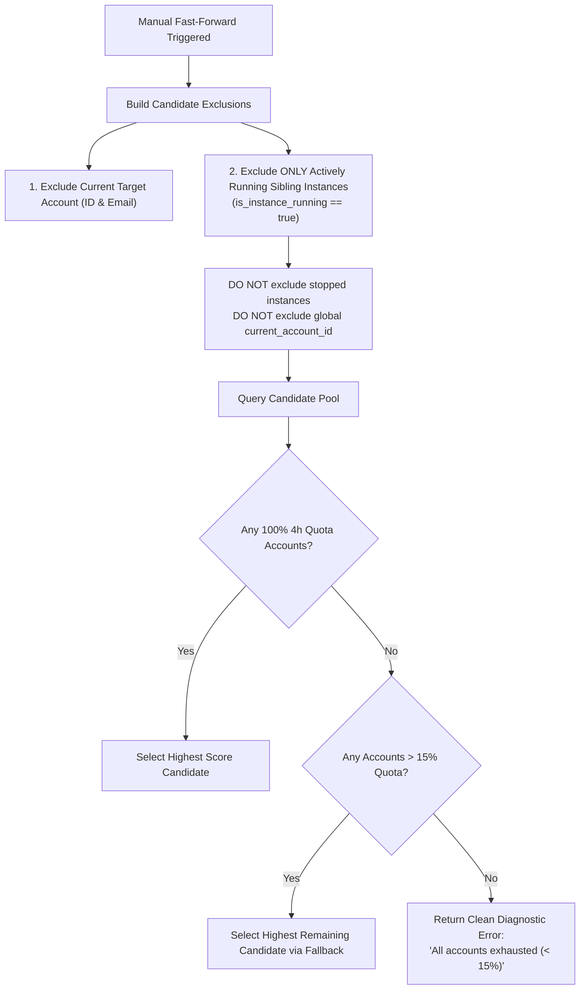

# 01 — Architectural Specification: Quota Synchronization, Auto-Switch Hardening, Fast-Forward Unblocking, and Prompt Backup Retention

- **Slug**: `auto-switch-and-ui-functionality-issues`
- **Module**: `Quota Synchronization, Auto-Profile Switcher, Fast-Forward Pipeline, Backup Prompts Store`
- **Target Release**: `v4.208.0` (Minor Bump)
- **Status**: `PROPOSED / ARCHITECTURAL SPECIFICATION`
- **Related Specs**:
  - [00-master-audit-ledger.md](file:///02-spec/21-app/auto-switch-and-ui-functionality-issues/00-master-audit-ledger.md)
  - [01-unified-switch-fast-forward-autoswitch-spec.md](file:///02-spec/21-app/01-unified-switch-fast-forward-autoswitch-spec.md)
  - [04-modules-storage-and-persistence.md](file:///02-spec/21-app/04-modules-storage-and-persistence.md)
- **Target Files**:
  - `src-tauri/src/modules/quota/fetch_more.rs`
  - `src-tauri/src/modules/quota/fetch_cached.rs`
  - `src-tauri/src/modules/auto_switcher/daemon.rs`
  - `src-tauri/src/modules/auto_switcher/status.rs`
  - `src-tauri/src/modules/auto_switcher/manual.rs`
  - `src-tauri/src/modules/auto_switcher/selection.rs`
  - `src-tauri/src/modules/auto_switcher/instances.rs`
  - `src-tauri/src/modules/instance/switch.rs`
  - `src-tauri/src/modules/backup_prompts_db/backup.rs`
  - `src-tauri/src/models/config.rs`
  - `src/pages/instances/useInstancePage.ts`
  - `src/components/settings/AdvancedMaintenanceSection.tsx`

---

## 1. System Vision & Problem Classification

In Antigravity-Manager v4.207.0, two catastrophic synchronization and execution failures occurred simultaneously:
1. **Quota Desynchronization & False 100% Display**:
   - The user's IDE reported `5-Hour Limit Remaining: 0% (Resets in 1h 18m)`.
   - Antigravity-Manager UI displayed `Gemini 2.5 Pro (4H): 100%`.
   - Because the system falsely believed the account was at 100%, the Auto-Switcher daemon never recognized that the account had dropped below the low quota threshold (< 15%), and no rotation occurred.
2. **Fast-Forward Manual Trigger Paralysis & Candidate Pool Depletion**:
   - When the user manually clicked Fast-Forward (`⏩`), the system failed to rotate, displaying false-positive errors indicating that no healthy alternative profiles existed in the pool.
   - The invocation suffered from multi-stage synchronous timeouts (blocking 5s on instance termination, 15s on relaunch verification, and 15s on CDP dialog dismissal), freezing the UI for 35+ seconds before aborting.
3. **Unbounded Prompt Backup Accumulation**:
   - Rapid restarts and auto-switch evaluations deposited redundant prompt records into `backup_prompts.db`, lacking a FIFO retention cap (target: 100 records max by default, configurable via Settings).

```mermaid
flowchart TD
    subgraph Defect["Defect State (v4.207.0)"]
        IDE_0["IDE Real Quota: 0%"]
        API_403["retrieveUserQuotaSummary<br/>with project_id -> 403 Forbidden"]
        DROP_QUOTA["fetch_quota_summary fails<br/>Returns None"]
        FAKE_100["fetch_cached falls back to<br/>fetchAvailableModels (100%)"]
        STALL["Auto-Switcher Dormant<br/>Daemon thinks Quota = 100%"]
        FF_FAIL["Manual FF Clicked -> Excludes all accounts<br/>+ 35s blocking timeouts -> Aborts"]
        
        IDE_0 -.-> API_403 --> DROP_QUOTA --> FAKE_100 --> STALL
        STALL -.-> FF_FAIL
    end

    subgraph Fixed["Remediated State (v4.208.0)"]
        API_FALLBACK["403 Received? -> Strip project_id<br/>Retry with empty JSON payload {}"]
        REAL_BUCKETS["Returns True 5h Quota (0%)<br/>Fuse into ModelQuota"]
        POLL_30S["Daemon 30s-50s Active Loop<br/>Refreshes Live Quota"]
        EMIT_REFRESH["Emit accounts://refreshed<br/>Frontend Zustand store updates"]
        THRESHOLD_EVAL["Evaluate Quota < 15%<br/>Triggers Auto-Switcher"]
        CLEAN_SELECTION["Manual FF: Non-blocking async<br/>Only exclude active running sibling accounts"]
        CAP_BACKUP["Enforce FIFO 100 Prompt Cap<br/>in backup_prompts.db"]

        API_FALLBACK --> REAL_BUCKETS --> POLL_30S --> EMIT_REFRESH --> THRESHOLD_EVAL
        THRESHOLD_EVAL --> CLEAN_SELECTION --> CAP_BACKUP
    end
```



---

## 2. Quota Synchronization Root Cause & Fix

### 2.1 4-Part Root Cause Analysis (RCA)

1. **Symptom**:
   The IDE shows `5-Hour Limit Remaining: 0%` while Antigravity-Manager displays `Gemini 2.5 Pro (4H): 100%`.
2. **Direct Cause**:
   - In [`fetch_more.rs`](file:///src-tauri/src/modules/quota/fetch_more.rs#L17-L21), `fetch_quota_summary` builds a JSON payload containing `{ "project": pid }` whenever `project_id` is passed.
   - When Google CloudCode's upstream endpoint `retrieveUserQuotaSummary` receives an invalid, stale, or permission-restricted `project_id`, it responds with HTTP `403 Forbidden`.
   - `fetch_more.rs` checks only for `VALIDATION_REQUIRED`. For standard 403 Forbidden errors, it logs a warning and proceeds to the next endpoint. However, all endpoints are queried with the exact same rejected `project_id` payload, causing all attempts to fail and returning `None`.
   - In [`fetch_cached.rs`](file:///src-tauri/src/modules/quota/fetch_cached.rs#L198-L212), when `quota_groups` is `None`, bucket quota fusion (`[FIX #3426] Fuse real bucket quotas into models`) is skipped entirely.
   - `quota_data.models` retains the response from `fetchAvailableModels`, which does not provide 5-hour window usage and defaults to `1.0` (100%).
3. **Propagation Path**:
   - `fetch_quota_with_cache` -> `fetch_quota_summary(..., project_id, ...)` -> 403 -> returns `None`.
   - `quota_data.quota_groups = None` -> Model percentages remain 100%.
   - `evaluate_account_period_status` in [`quota.rs`](file:///src-tauri/src/modules/auto_switcher/quota.rs#L227-L254) calculates `quota_percent = 100.0`.
   - `below_threshold` evaluates to `false`. Auto-Switcher does not rotate.
   - `calculate_next_interval_seconds(Some(100.0))` sets the check interval to 120 seconds.
   - During background rotation checks in [`daemon.rs`](file:///src-tauri/src/modules/auto_switcher/daemon.rs#L93-L97), `bound_acc.quota` is refreshed and saved, but **no event is emitted to Tauri**.
   - In [`useInstancePage.ts`](file:///src/pages/instances/useInstancePage.ts#L164-L180), periodic polling calls `fetchInstances`, `fetchSwitcherStatus`, `fetchRunningTasks`, and `fetchDaemonTelemetry`, but **never calls `fetchAccounts()`**, and does not listen to `accounts://refreshed`.
4. **Architectural Fix**:
   - **403 Fallback without `project_id` in `fetch_more.rs`**:
     When `project_id.is_some()` and the request returns HTTP `403 Forbidden` (and does not match `VALIDATION_REQUIRED`), immediately retry against `QUOTA_SUMMARY_ENDPOINTS` with an empty JSON payload `{}`. Google CloudCode then falls back to the user's default personal quota summary, successfully returning the true 5-hour and 7-day buckets!
   - **Active 30s–50s Polling in `status.rs`**:
     In the daemon loop in [`status.rs`](file:///src-tauri/src/modules/auto_switcher/status.rs#L192-L255), when an active monitored instance is running, enforce an active 30s–50s quota polling cadence.
   - **Emit `accounts://refreshed` in `daemon.rs`**:
     After updating `bound_acc.quota` in [`daemon.rs`](file:///src-tauri/src/modules/auto_switcher/daemon.rs#L96), immediately emit `accounts://refreshed` to the Tauri webview.
   - **Subscribe and Poll in `useInstancePage.ts`**:
     Include `fetchAccounts()` in `performThrottledPoll()` and register `accounts://refreshed` in the Tauri event listener list.

### 2.2 Concrete Implementation Blueprint

#### [`src-tauri/src/modules/quota/fetch_more.rs`](file:///src-tauri/src/modules/quota/fetch_more.rs)
```rust
pub(crate) async fn fetch_quota_summary(
    access_token: &str,
    email: &str,
    project_id: Option<&str>,
    account_id: Option<&str>,
) -> Option<Vec<crate::models::quota::QuotaGroup>> {
    let client = create_standard_client(account_id).await;
    
    // First attempt: with project_id if available; fallback attempt: without project_id
    let payloads = if let Some(pid) = project_id {
        vec![(Some(pid), json!({ "project": pid })), (None, json!({}))]
    } else {
        vec![(None, json!({}))]
    };

    for (current_pid, payload) in payloads {
        for ep_url in QUOTA_SUMMARY_ENDPOINTS.iter() {
            let res = client
                .post(*ep_url)
                .bearer_auth(access_token)
                .header(
                    rquest::header::USER_AGENT,
                    crate::constants::NATIVE_OAUTH_USER_AGENT.as_str(),
                )
                .json(&payload)
                .send()
                .await;

            match res {
                Ok(response) => {
                    let status = response.status();
                    if !status.is_success() {
                        if status == rquest::StatusCode::FORBIDDEN {
                            let body_text = response.text().await.unwrap_or_default();
                            let lower = body_text.to_lowercase();
                            if lower.contains("validation_required")
                                || lower.contains("verify your account")
                                || lower.contains("further action is required")
                                || lower.contains("validation_url")
                                || lower.contains("appeal_url")
                            {
                                crate::modules::logger::log_warn(&format!(
                                    "[{}] QuotaSummary API returned 403 VALIDATION_REQUIRED; marking account validation_blocked",
                                    email
                                ));
                                if let Some(acc_id) = account_id {
                                    if let Ok(mut acc) = crate::modules::account::load_account(acc_id) {
                                        crate::modules::account::mark_validation_blocked(
                                            &mut acc,
                                            &format!(
                                                "QuotaSummary 403 VALIDATION_REQUIRED: {}",
                                                body_text.trim()
                                            ),
                                        );
                                    }
                                }
                                return None;
                            }
                            
                            // If 403 occurred with project_id, break out of endpoint loop to retry without project_id
                            if current_pid.is_some() {
                                crate::modules::logger::log_warn(&format!(
                                    "[{}] QuotaSummary returned 403 with project {:?}; retrying without project_id",
                                    email, current_pid
                                ));
                                break;
                            }
                        }
                        continue;
                    }

                    let summary: QuotaSummaryResponse = match response.json().await {
                        Ok(s) => s,
                        Err(e) => {
                            crate::modules::logger::log_warn(&format!(
                                "QuotaSummary JSON parse failed for {}: {}",
                                email, e
                            ));
                            return None;
                        }
                    };

                    let groups = parse_quota_groups(summary);
                    if !groups.is_empty() {
                        tracing::debug!("[{}] QuotaSummary fetched {} groups", email, groups.len());
                        return Some(groups);
                    }
                }
                Err(e) => {
                    crate::modules::logger::log_warn(&format!(
                        "QuotaSummary API request failed at {}: {}",
                        ep_url, e
                    ));
                    continue;
                }
            }
        }
    }

    None
}
```

#### [`src-tauri/src/modules/auto_switcher/daemon.rs`](file:///src-tauri/src/modules/auto_switcher/daemon.rs)
Emit `accounts://refreshed` after persisting live quota:
```rust
        if let Ok(fresh_quota) = account::fetch_quota_with_retry(&mut bound_acc).await {
            bound_acc.quota = Some(fresh_quota);
            // Justification: best-effort persistence; in-memory state authoritative
            crate::error::record_ignored(account::save_account(&bound_acc), "save_account");
            if let Some(app_handle) = crate::modules::log_bridge::get_app_handle() {
                use tauri::Emitter;
                crate::error::record_ignored(
                    app_handle.emit("accounts://refreshed", ()),
                    "emit accounts://refreshed from daemon",
                );
            }
        }
```

#### [`src-tauri/src/modules/auto_switcher/status.rs`](file:///src-tauri/src/modules/auto_switcher/status.rs)
Enforce 30s–50s active polling interval when instance is running:
```rust
            let has_running_instances = cur_status.monitored_instances.iter().any(|i| i.is_running);
            let mut interval_secs =
                calculate_next_interval_seconds(lowest_monitored_quota, &switcher_cfg) as u64;
            
            // Invariant: when an instance is actively running, clamp quota polling between 30s and 50s
            if has_running_instances {
                interval_secs = interval_secs.clamp(30, 50);
            }
```

#### [`src/pages/instances/useInstancePage.ts`](file:///src/pages/instances/useInstancePage.ts)
```typescript
        const performThrottledPoll = async () => {
            if (isFetchingRef.current) return;
            isFetchingRef.current = true;
            try {
                await Promise.all([
                    fetchInstances(true),
                    fetchSwitcherStatus(),
                    fetchAccounts(), // <-- Added to periodic poll
                    fetchRunningTasks(),
                    fetchDaemonTelemetry(),
                ]);
            } catch (err) {
                useErrorStore.getState().trackWarning(err, { source: 'useInstancePage.poll', triggerAction: 'periodic_status_poll' });
            } finally {
                isFetchingRef.current = false;
            }
        };

        // Event Listeners:
        const events = [
            'account://auto-switched',
            'instance://switched',
            'instance://rotated',
            'prompt://dispatched',
            'prompt://resumed',
            'accounts://refreshed', // <-- Added to event listener
        ];
```

---

## 3. Auto-Switcher Threshold Evaluation (< 15%) & Candidate Selection

### 3.1 Threshold Evaluation Logic

The auto-switcher evaluates three threshold tiers:
1. **Low Quota Caution Threshold (`low_quota_threshold_percent`, default 15.0%)**:
   - Evaluated by `evaluate_account_period_status(account, target_model, 15.0, now_sec)`.
   - When quota drops below 15% (e.g. `quota_percent <= 15.0` or `below_threshold == true`), rotation is marked as pending.
2. **Depleted Before Finish (`is_depleted_before_finish`)**:
   - If the account reached 0% (or `<= threshold`) and `reset_time` indicates that the period has not yet expired (`!is_period_finished`), the account is depleted before reset.
   - Triggers rotation immediately, regardless of whether `auto_fast_forward_on_critical` is true.
3. **Critical Threshold (`critical_threshold_percent`, default 5.0%)**:
   - When quota drops below 5%, the system immediately triggers fast-forward candidate rotation.

### 3.2 Manual Fast-Forward Candidate Pool Unblocking

#### Root Cause of "No alternative healthy profile found in pool":
In [`manual.rs`](file:///src-tauri/src/modules/auto_switcher/manual.rs#L37-L56), the exclusion list was constructed as:
```rust
    let in_use_account_ids = get_active_in_use_account_ids();
    let mut excluded: Vec<String> = in_use_account_ids;
    // Appends current_bound
    // Appends account::get_current_account() (global active account)
```
1. `get_active_in_use_account_ids()` in [`instances.rs`](file:///src-tauri/src/modules/auto_switcher/instances.rs#L56-L98) considers **all** instances returned by `list_running_or_active_instances()`. If an instance is marked as `active_instance_id` in registry, its bound account was considered "in-use" even when its IDE process was stopped.
2. `manual.rs` additionally excluded the global `current_account_id`.
3. In a 2-account setup (`Account A` and `Account B`), where `Account A` is bound to the target instance and `Account B` was previously selected as the global active account in settings, **both** accounts were excluded! `select_and_verify_next_best_profile` had 0 candidates left and threw `No alternative healthy profile found in pool`.

#### Unblocking Rules:
1. **Strict Active-Running Exclusions**:
   - In manual rotation, the exclusion list must ONLY contain:
     - The account actively bound to the target instance being rotated (`current_bound_id` and `current_bound_email`).
     - Accounts bound to other instances **that are currently running** (`is_instance_running == true`).
   - Inactive instances, stopped instances, and the arbitrary global default selection MUST NOT be excluded.
2. **Distributed Lease Hygiene**:
   - Check if the remote lease is owned by the *current machine* (`machine_id`). If owned by the current machine and expired or from a dead PID, invalidate the lease rather than treating it as a foreign block.
3. **Fallback Score Relaxation**:
   - If no candidate has 100% quota, candidates above `threshold_percent` (e.g. > 15%) must be ranked and selected via `score_candidate_account_fallback`.



---

## 4. Non-Blocking Async Relaunch & Timeout Elimination

### 4.1 Root Cause of UI Freezing During Switch

In [`src-tauri/src/modules/instance/switch.rs`](file:///src-tauri/src/modules/instance/switch.rs#L217-L392), `switch_account_to_instance` executes several synchronous blocking steps:
1. `close_instance_verified(..., Duration::from_millis(5000))` (5s timeout).
2. Credential file writes (synchronous, ~20ms).
3. `start_antigravity_with_fallback_path` (spawns executable).
4. `verify_instance_relaunched`: calls `std::thread::sleep(Duration::from_millis(500))` in a loop up to 15 seconds!
5. `dismiss_security_notice_dialog_for_data_dir`: blocks in `tokio::task::spawn_blocking` for up to 15 seconds!

Total synchronous latency: **35+ seconds**. In desktop environments, this causes Tauri IPC commands to exceed standard HTTP/IPC response expectations, leading users to believe the operation crashed.

### 4.2 Non-Blocking Architecture

The switch command must return as soon as the credentials are written and the process is successfully spawned:
1. **Synchronous Core (Fast Path, < 2.5s)**:
   - Snapshot in-flight prompts (`backup_active_running_prompts`).
   - Terminate old processes with conscious PID matching.
   - Inject credentials into `state.vscdb`, `storage.json`, and OS keyring.
   - Bind account to instance configuration.
   - Spawn new Antigravity IDE process with `creation_flags(0x08000000)` where applicable.
2. **Asynchronous Verification (Detached Background Tasks)**:
   - Dispatch `verify_instance_relaunched` in a detached Tokio task.
   - Dispatch `dismiss_security_notice_dialog_for_data_dir` in a detached Tokio task.
   - Restore and re-inject prompts asynchronously.
   - Return `Ok("Successfully rotated profile...")` immediately to the caller, providing instant UI responsiveness.

---

## 5. Max Prompt Backup Cap (Default 100) Architecture

### 5.1 SQLite FIFO Retention Cap Invariant

To prevent disk bloat and ensure fast query execution across `backup_prompts.db`, a strict retention cap must be enforced.
- **Default Cap**: 100 prompts.
- **User Configurable**: 10 to 500 prompts (via Settings UI).
- **Ordering Invariant**: Strict FIFO retention. When pruning, delete records exceeding the limit ordered by `created_at DESC, id DESC LIMIT ?1`.
- **Foreign Key / Batch Cleanup**: Clean orphaned records from `backup_batches` where `id NOT IN (SELECT DISTINCT backup_batch_id FROM prompt_backups)`.

### 5.2 Implementation Specification

#### [`src-tauri/src/modules/backup_prompts_db/backup.rs`](file:///src-tauri/src/modules/backup_prompts_db/backup.rs)
```rust
/// Enforce FIFO retention cap on prompt_backups table
pub fn enforce_max_backup_prompts_cap(
    conn: &Connection,
    max_cap: usize,
) -> Result<usize, String> {
    if max_cap == 0 {
        return Ok(0);
    }

    let total_count: usize = conn
        .query_row("SELECT COUNT(*) FROM prompt_backups", [], |r| r.get(0))
        .unwrap_or(0);

    if total_count <= max_cap {
        return Ok(0);
    }

    let deleted = conn
        .execute(
            "DELETE FROM prompt_backups 
             WHERE id NOT IN (
                 SELECT id FROM prompt_backups 
                 ORDER BY created_at DESC, id DESC 
                 LIMIT ?1
             )",
            params![max_cap as i64],
        )
        .map_err(|e| format!("Failed to prune prompt backups to cap {}: {}", max_cap, e))?;

    // Prune orphaned backup_batches
    let _ = conn.execute(
        "DELETE FROM backup_batches 
         WHERE id NOT IN (SELECT DISTINCT backup_batch_id FROM prompt_backups)",
        [],
    );

    crate::modules::logger::log_info(&format!(
        "[BackupPrompts] Enforced max cap {}: pruned {} older backup records (total was {})",
        max_cap, deleted, total_count
    ));

    Ok(deleted)
}
```

#### Integration in `backup_active_running_prompts_for_instance`:
At the end of the backup transaction in `backup.rs`:
```rust
    let app_config = crate::modules::config::load_app_config().unwrap_or_default();
    let cap = if app_config.max_backup_prompts > 0 {
        app_config.max_backup_prompts
    } else {
        100
    };
    // Justification: retention cleanup failure is non-fatal; logged and retried next backup
    crate::error::record_ignored(
        enforce_max_backup_prompts_cap(&conn, cap),
        "enforce_max_backup_prompts_cap",
    );
```

#### [`src-tauri/src/models/config.rs`](file:///src-tauri/src/models/config.rs)
Add `max_backup_prompts` to `AppConfig`:
```rust
    #[serde(default = "default_max_backup_prompts")]
    pub max_backup_prompts: usize,
```
With helper:
```rust
fn default_max_backup_prompts() -> usize {
    100
}
```

#### [`src/components/settings/AdvancedMaintenanceSection.tsx`](file:///src/components/settings/AdvancedMaintenanceSection.tsx)
Add an interactive numeric input / slider within the Advanced Settings panel:
- Label: `Max Prompt Backups Retention Cap`
- Range: `10` – `500`
- Helper text: `Maximum number of prompt snapshots retained in the backup SQLite database (default 100). Older prompts are automatically pruned FIFO.`
- Updates `appConfig.max_backup_prompts` via `save_app_config`.

---

## 6. Verification Criteria & Test Matrix

| ID | Test Scenario | Execution Method | Expected Result |
| :--- | :--- | :--- | :--- |
| **V-01** | Quota 403 Fallback without `project_id` | Mock 403 response on `fetch_quota_summary` with `project_id`. | Second request issued with `{}` payload succeeds; genuine quota buckets parsed and fused into models. |
| **V-02** | Live Quota Fusion Integrity | Call `fetch_quota` for account with 0% remaining in 5h bucket. | `quota.models` reports 0% instead of 100%. Frontend card displays 0%. |
| **V-03** | 30s-50s Active Daemon Polling | Start daemon with active running instance. | Next check timestamp scheduled within 30s-50s. `accounts://refreshed` emitted on each quota update. |
| **V-04** | Fast-Forward Candidate Selection | Run `trigger_manual_rotation_for_instance` with 2 accounts in pool. | Non-running accounts not excluded. Highest available healthy account selected and rotated. |
| **V-05** | Non-blocking Fast-Forward Response | Invoke `fast_forward_instance` via Tauri IPC. | Command returns `Ok` within 3 seconds; relaunch verification and dialog dismissal execute in background. |
| **V-06** | Max Prompt Backup FIFO Pruning | Seed 120 records into `prompt_backups` with cap = 100. | Call `enforce_max_backup_prompts_cap`. Exactly 100 newest records retained; 20 oldest records deleted. |
| **V-07** | Settings UI Persistence | Change `max_backup_prompts` in Settings UI to 50. | Reload config; verified value = 50. Next backup enforces cap of 50. |
