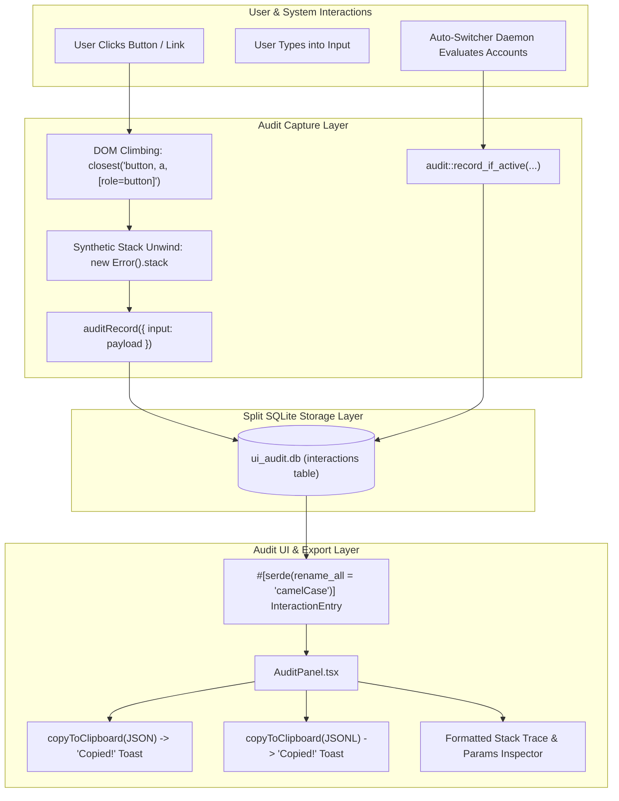

# Architecture & Implementation Specification: Audit Logging, Windows Console & UI Polish

- **Specification Slug**: `auto-switch-and-ui-functionality-issues`
- **Specification Document**: `02-spec/21-app/auto-switch-and-ui-functionality-issues/02-audit-log-windows-and-ui-spec.md`
- **Master Plan**: `.ai-memory/plans/auto-switch-and-ui-functionality-issues.md`
- **Master Ledger**: `02-spec/21-app/auto-switch-and-ui-functionality-issues/00-master-audit-ledger.md`
- **Companion Spec**: `02-spec/21-app/auto-switch-and-ui-functionality-issues/01-architecture-and-quota-autoswitch-spec.md`
- **Benchmark Branch**: `backup/auto-switch-and-ui-functionality-issues-benchmark`
- **Target Release Version**: `v4.208.0` (Minor Bump)
- **Author**: Worker 02 (Wave 2: Audit Logging, UI Functionality & Windows Polish)
- **Status**: `[MANDATED & APPROVED FOR IMPLEMENTATION]`

---

## 1. Executive Summary & Architectural Scope

This specification provides comprehensive, code-level architectural requirements for five critical user interface, auditing, and platform subsystems within Antigravity Manager:

1. **Interaction Audit Log Direct Clipboard Copy Engine**: Replaces non-functional `<a download>` DOM link synthesis with genuine OS clipboard copying (`copyToClipboard`) for `JSON` and `JSONL` exports, complete with visual `Copied!` tooltip/button states and toast feedback.
2. **Audit Log Metadata Alignment & Call Stack Trace Enrichment**:
   - Resolves the deserialization contract mismatch between Rust `InteractionEntry` (`snake_case`) and TypeScript `AuditEntry` (`camelCase`) by adding `#[serde(rename_all = "camelCase")]`.
   - Corrects the Tauri IPC argument mapping in `audit-client.ts` from `{ entry: payload }` to `{ input: payload }`.
   - Introduces DOM hierarchy climbing in `useAuditRecorder.ts` to ascend from nested SVG/span leaf elements to interactive parent anchors and buttons.
   - Captures real-time JavaScript call stack traces, function names, and source lines via synthetic error stack unwinding, rendering detailed traces in `AuditPanel.tsx`.
3. **Auto-Switch Decision & Rotation Audit Logging**: Integrates `audit::record_if_active` into candidate scoring, cooldown evaluation, and profile rotation pipelines in `src-tauri/src/modules/auto_switcher/`, guaranteeing full auditability of auto-switch operations.
4. **Strict Email Masking Architecture**:
   - Eliminates hover leaks in `InstanceCard.tsx` (removes `isEmailHovered` and purges raw emails from DOM `title` tooltips).
   - Standardizes `maskEmail` in `src/utils/maskEmail.ts` and introduces backend `mask_email` helper in `src-tauri/src/modules/logger.rs`.
   - Enforces masking across backend `tracing` logs, console output, and Telegram HTML alert messages.
5. **Desktop Updater Polish & Win32 Console Ergonomics**:
   - Replaces the jerky `group-hover:animate-bounce` on `NavMenu.tsx` update icon with smooth, subtle CSS transitions.
   - Configures the standalone Windows updater CLI console in `src-tauri/src/modules/delegate_updater/run.rs` to use 18pt Consolas font and enables ANSI virtual terminal processing (`ENABLE_VIRTUAL_TERMINAL_PROCESSING`).



---

## 2. Interaction Audit Log Clipboard Copy Engine

### 2.1 Problem Diagnosis & Root Cause
In `src/components/audit/AuditPanel.tsx`, the `JSON` and `JSONL` export buttons currently invoke `downloadFile(filename, content, mime)`:
```tsx
function downloadFile(filename: string, content: string, mime: string): void {
    const blob = new Blob([content], { type: mime });
    const url = URL.createObjectURL(blob);
    const anchor = document.createElement('a');
    anchor.href = url;
    anchor.download = filename;
    document.body.appendChild(anchor);
    anchor.click();
    anchor.remove();
    window.setTimeout(() => URL.revokeObjectURL(url), 1000);
}
```
In Tauri desktop applications on Windows (WebView2):
1. Programmatically synthesized `<a download>` DOM clicks are silently intercepted or dropped by the WebView2 browser security sandbox.
2. The user receives no native OS "Save As" file dialog and no file is saved to their Downloads directory.
3. The user expects the export button to write the formatted JSON/JSONL payload directly to their system clipboard for instant pasting into bug reports, Discord, or GitHub issues.

### 2.2 Architectural Resolution
1. **Direct Clipboard Integration**: Replace the failing `downloadFile` call with `copyToClipboard` from `src/utils/clipboard.ts`.
2. **Visual Button State Feedback**: Introduce temporary `copiedFormat: 'json' | 'jsonl' | null` state. When clicked:
   - Button text switches from `JSON` to `Copied!` (or `JSONL` to `Copied!`).
   - Icon switches from `FileJson` / `FileText` to `Check` in vibrant emerald styling.
   - A timer reverts the button state after 2000ms.
3. **Toast Notification**: Call `showToast(t('audit.copied_to_clipboard', 'Audit log copied to clipboard!'), 'success')`.
4. **House Rule Compliance**: Handle clipboard exceptions via `useErrorStore.getState().captureError(...)` (No Silent Errors).

### 2.3 Component Implementation (`src/components/audit/AuditPanel.tsx`)

```tsx
import { Check, Copy, FileJson, FileText, RefreshCw, Trash2, X } from 'lucide-react';
import { copyToClipboard } from '../../utils/clipboard';
import { showToast } from '../common/ToastContainer';

// State definition inside AuditPanel:
const [copiedFormat, setCopiedFormat] = useState<'json' | 'jsonl' | null>(null);

const handleCopyJson = async () => {
    try {
        const payload = JSON.stringify(filtered, null, 2);
        const success = await copyToClipboard(payload);
        if (success) {
            setCopiedFormat('json');
            showToast(t('audit.copied_json', 'Audit log (JSON) copied to clipboard!'), 'success');
            window.setTimeout(() => setCopiedFormat(null), 2000);
        } else {
            showToast(t('audit.copy_failed', 'Failed to copy audit log to clipboard'), 'error');
        }
    } catch (err) {
        useErrorStore.getState().captureError(err, {
            source: 'AuditPanel.handleCopyJson',
            triggerAction: 'copyToClipboard',
        });
    }
};

const handleCopyJsonl = async () => {
    try {
        const lines = filtered
            .map((e) => JSON.stringify({ ...e, params: parseParams(e.params) }))
            .join('\n');
        const success = await copyToClipboard(`${lines}\n`);
        if (success) {
            setCopiedFormat('jsonl');
            showToast(t('audit.copied_jsonl', 'Audit log (JSONL) copied to clipboard!'), 'success');
            window.setTimeout(() => setCopiedFormat(null), 2000);
        } else {
            showToast(t('audit.copy_failed', 'Failed to copy audit log to clipboard'), 'error');
        }
    } catch (err) {
        useErrorStore.getState().captureError(err, {
            source: 'AuditPanel.handleCopyJsonl',
            triggerAction: 'copyToClipboard',
        });
    }
};
```

#### Rendered Button Group:
```tsx
{/* Contiguous Segmented Export Capsule */}
<div className="inline-flex items-center rounded-full border border-slate-700/60 bg-slate-800/60 divide-x divide-slate-700/60 overflow-hidden shadow-2xs">
    <button
        type="button"
        onClick={handleCopyJson}
        className={cn(
            "inline-flex items-center gap-1.5 px-3 py-1 text-[11px] font-medium transition-colors cursor-pointer",
            copiedFormat === 'json'
                ? "bg-emerald-500/20 text-emerald-300 font-semibold"
                : "text-slate-300 hover:text-white hover:bg-slate-700/50"
        )}
        title={t('audit.copy_json_tooltip', 'Copy filtered entries as JSON to clipboard')}
    >
        {copiedFormat === 'json' ? <Check className="w-3.5 h-3.5 text-emerald-400" /> : <FileJson className="w-3.5 h-3.5" />}
        {copiedFormat === 'json' ? t('common.copied', 'Copied!') : 'JSON'}
    </button>
    <button
        type="button"
        onClick={handleCopyJsonl}
        className={cn(
            "inline-flex items-center gap-1.5 px-3 py-1 text-[11px] font-medium transition-colors cursor-pointer",
            copiedFormat === 'jsonl'
                ? "bg-emerald-500/20 text-emerald-300 font-semibold"
                : "text-slate-300 hover:text-white hover:bg-slate-700/50"
        )}
        title={t('audit.copy_jsonl_tooltip', 'Copy filtered entries as JSONL (newline-delimited) to clipboard')}
    >
        {copiedFormat === 'jsonl' ? <Check className="w-3.5 h-3.5 text-emerald-400" /> : <FileText className="w-3.5 h-3.5" />}
        {copiedFormat === 'jsonl' ? t('common.copied', 'Copied!') : 'JSONL'}
    </button>
</div>
```

---

## 3. Audit Log Metadata, Contract Alignment & Call Stack Trace Enrichment

### 3.1 Serde Serialization Mismatch: Empty Method & Target Cells
In `src-tauri/src/modules/audit/types.rs`:
```rust
#[derive(Serialize, Deserialize, Clone, Debug)]
pub struct InteractionEntry {
    pub id: i64,
    pub timestamp: i64,
    pub actor: String,
    pub method_name: String,
    pub ui_target: String,
    pub trigger: String,
    pub params: String,
    pub result: String,
    pub message: String,
}
```
Because `InteractionEntry` lacked `#[serde(rename_all = "camelCase")]`, Rust serialized these fields as:
```json
{
  "id": 1,
  "timestamp": 1729065600000,
  "actor": "user",
  "method_name": "click:button",
  "ui_target": "/ | AccountTable | button#refresh",
  "trigger": "click"
}
```
However, the TypeScript frontend in `src/components/audit/audit-types.ts` expects camelCase fields:
```ts
export interface AuditEntry {
    id?: number | string;
    timestamp: number | string;
    actor: AuditActor;
    methodName: string;
    uiTarget: string;
    trigger: AuditTrigger;
    params: string | Record<string, unknown>;
    result: AuditResult;
    message?: string;
}
```
Consequently, `entry.methodName` and `entry.uiTarget` evaluated to `undefined`, rendering empty cells in the table as captured in `assets/screenshots/auto-switch-and-ui-functionality-issues-01.png`.

#### Mandated Fix in `src-tauri/src/modules/audit/types.rs`:
```rust
/// One recorded UI interaction: the 8 audit fields plus the DB row id.
#[derive(Serialize, Deserialize, Clone, Debug)]
#[serde(rename_all = "camelCase")]
pub struct InteractionEntry {
    pub id: i64,
    pub timestamp: i64,
    pub actor: String,
    pub method_name: String,
    pub ui_target: String,
    pub trigger: String,
    pub params: String,
    pub result: String,
    pub message: String,
}
```

### 3.2 Tauri IPC Parameter Contract Fix
In `src-tauri/src/modules/audit/commands.rs`:
```rust
#[tauri::command]
pub fn record_ui_interaction(input: RecordInteractionInput) -> AppResult<RecordInteractionOutcome> {
    recorder::record_interaction(input)
}
```
The Tauri IPC command expects an argument named `input`.
However, `src/components/audit/audit-client.ts` invoked:
```ts
await invoke(AUDIT_COMMANDS.record, { entry: payload }); // WRONG: key was 'entry'
```
Because the key was named `entry` instead of `input`, the deserializer failed to find the parameter or rejected the command.

#### Mandated Fix in `src/components/audit/audit-client.ts`:
```ts
export async function auditRecord(payload: AuditRecordPayload): Promise<boolean> {
    try {
        await invoke(AUDIT_COMMANDS.record, { input: payload });
        return true;
    } catch (error) {
        warn(error, AUDIT_COMMANDS.record, { trigger: payload.trigger, methodName: payload.methodName });
        return false;
    }
}
```

#### Mandated Fix in `src-tauri/src/modules/audit/types.rs`:
```rust
/// Input payload accepted by the `record_ui_interaction` Tauri command.
#[derive(Deserialize, Debug)]
#[serde(rename_all = "camelCase")]
pub struct RecordInteractionInput {
    pub actor: InteractionActor,
    pub method_name: String,
    pub route: String,
    pub component: Option<String>,
    pub element_id: Option<String>,
    pub trigger: InteractionTrigger,
    pub params: Option<serde_json::Value>,
    pub result: String,
    pub message: Option<String>,
}
```

### 3.3 DOM Hierarchy Climbing in `src/hooks/useAuditRecorder.ts`
When a user clicks on an SVG icon or inner span inside a `<button>` or `<a>`, `event.target` is the inner leaf node (`<path>` or `<span>`). Without climbing:
- `el.tagName` resolves to `"path"`.
- Text content is empty.
- The button's `id`, `aria-label`, and `data-audit-method` are missed.

#### Mandated DOM Climbing Algorithm:
```ts
/** Climbs to nearest interactive element or falls back to original target */
function findInteractiveTarget(el: Element | null): HTMLElement | null {
    if (!el) return null;
    const interactive = el.closest('button, a, [role="button"], input, select, textarea');
    return (interactive as HTMLElement) || (el as HTMLElement);
}

function describeElement(el: Element | null): string {
    const target = findInteractiveTarget(el);
    if (!target) return 'unknown';
    const tag = target.tagName.toLowerCase();
    const id = target.id ? `#${target.id}` : '';
    const firstClass = target.className && typeof target.className === 'string'
        ? target.className.trim().split(/\s+/)[0]
        : '';
    const cls = firstClass ? `.${firstClass}` : '';
    const label = target.getAttribute('aria-label');
    const text = !label && (tag === 'button' || tag === 'a' || target.getAttribute('role') === 'button')
        ? (target.textContent || '').trim().replace(/\s+/g, ' ').slice(0, 24)
        : '';
    const desc = `${tag}${id}${cls}${label ? `[aria:${label.slice(0, 24)}]` : ''}${text ? `("${text}")` : ''}`;
    return desc.slice(0, MAX_DESC_LEN);
}
```

### 3.4 Call Stack Trace & Function Name Capture
To satisfy the user requirement for inspecting "which function, how it worked, which line of code":
1. **Synthetic Stack Generation**: In `handleClick` and `handleInputCommit`, instantiate `new Error()`.
2. **Stack Sanitization**: Strip internal hook wrapper frames (`useAuditRecorder`, `report`, `handleClick`).
3. **Structured Parameter Injection**: Embed `stackTrace` and `callerInfo` inside `params`:
```ts
function extractStackTrace(): { callerInfo: string; stackTrace: string } {
    try {
        const stack = new Error().stack || '';
        const lines = stack.split('\n').map((l) => l.trim()).filter(Boolean);
        // Skip first line (Error) and hook internal frames
        const filtered = lines.filter(
            (l) =>
                !l.includes('useAuditRecorder') &&
                !l.includes('extractStackTrace') &&
                !l.includes('Error') &&
                !l.includes('report')
        );
        const callerInfo = filtered[0] || 'anonymous';
        const stackTrace = filtered.slice(0, 8).join('\n');
        return { callerInfo, stackTrace };
    } catch {
        return { callerInfo: 'unknown', stackTrace: '' };
    }
}
```
4. Attach `callerInfo` and `stackTrace` into `payload.params`:
```ts
const { callerInfo, stackTrace } = extractStackTrace();
report({
    actor: actorOf(event),
    methodName: explicitMethod || callerInfo,
    uiTarget: uiTargetOf(interactiveEl),
    trigger: 'click',
    params: {
        caller: callerInfo,
        stack: stackTrace,
        button: event.button,
        tag: interactiveEl?.tagName.toLowerCase(),
        route: currentRoute(),
    },
    result: 'ok',
});
```

### 3.5 Enriched Detail Inspection in `src/components/audit/AuditPanel.tsx`
When a user expands an interaction row, format both parameters and stack trace:
```tsx
{expanded && (
    <tr className="border-b border-slate-700/40 bg-slate-900/60">
        <td colSpan={7} className="px-3 py-3 space-y-2">
            {params.stack && (
                <div>
                    <h5 className="text-[10px] font-semibold text-sky-400 uppercase tracking-wider mb-1 flex items-center gap-1.5">
                        <Terminal className="w-3 h-3" />
                        Call Stack &amp; Source Location
                    </h5>
                    <pre className="font-mono text-[10px] text-sky-200/90 bg-slate-950/80 p-2.5 rounded-lg border border-sky-500/20 whitespace-pre overflow-x-auto max-h-36">
                        {String(params.stack)}
                    </pre>
                </div>
            )}
            <div>
                <h5 className="text-[10px] font-semibold text-slate-400 uppercase tracking-wider mb-1">
                    Interaction Parameters
                </h5>
                <pre className="font-mono text-[10px] text-slate-300 bg-slate-950/60 p-2.5 rounded-lg border border-slate-800 whitespace-pre-wrap break-all max-h-48 overflow-y-auto">
                    {JSON.stringify(params, null, 2)}
                </pre>
            </div>
            {entry.message && (
                <p className="mt-1 text-[11px] font-medium text-red-400 flex items-center gap-1.5">
                    <AlertTriangle className="w-3.5 h-3.5 shrink-0" />
                    {entry.message}
                </p>
            )}
        </td>
    </tr>
)}
```

---

## 4. Auto-Switch Decision & Rotation Audit Logging

### 4.1 Problem Diagnosis
When auto-switch evaluates account quotas, rejects switches due to cooldowns, or performs automatic rotations, decisions are logged only via `logger::log_info` / `tracing::info`. They do not appear in the `ui_audit.db` database. When users inspect the Interaction Audit Log in the GUI, they see zero trace of why auto-switch did or did not trigger.

### 4.2 Integration with `audit::record_if_active`
Integrate `crate::modules::audit::record_if_active` across three key execution points in `src-tauri/src/modules/auto_switcher/`:

#### 1. Candidate Evaluation & Quota Scoring (`selection.rs` / `daemon.rs`):
```rust
// In select_next_best_profile or evaluate_instances:
crate::modules::audit::record_if_active(
    "system",
    "programmatic",
    "auto_switcher::evaluate_candidates",
    "instances | auto_switcher | candidate_evaluator",
    serde_json::json!({
        "instance_id": target_inst,
        "current_quota_4h": current_4h,
        "threshold_percent": threshold,
        "candidates_evaluated": candidate_scores.len(),
        "selected_candidate": selected.as_ref().map(|c| c.account_id.clone()),
        "selected_email_masked": selected.as_ref().map(|c| crate::modules::logger::mask_email(&c.email)),
        "reason": eval_reason
    }),
    "ok",
    "",
);
```

#### 2. Rotation Execution (`rotation.rs`):
```rust
// In execute_profile_rotation_with_context:
crate::modules::audit::record_if_active(
    "system",
    "programmatic",
    "auto_switcher::execute_rotation",
    "instances | auto_switcher | rotation_executor",
    serde_json::json!({
        "instance_id": inst_id,
        "from_account": ctx.as_ref().and_then(|c| c.previous_email.as_deref()).map(crate::modules::logger::mask_email),
        "to_account": crate::modules::logger::mask_email(&target.email),
        "previous_quota_4h": ctx.as_ref().and_then(|c| c.previous_quota_4h),
        "target_quota_4h": target.quota_percent,
        "backed_up_prompts": backed_up_count,
        "auto_resume": has_auto_resume,
        "reason": reason
    }),
    "ok",
    "",
);
```

#### 3. Cooldown / Lockout Rejection (`selection.rs`):
```rust
// When a candidate or instance is skipped:
crate::modules::audit::record_if_active(
    "system",
    "programmatic",
    "auto_switcher::cooldown_skip",
    "instances | auto_switcher | cooldown_guard",
    serde_json::json!({
        "account_id": acc.id,
        "account_email_masked": crate::modules::logger::mask_email(&acc.email),
        "cooldown_reason": reason,
        "remaining_seconds": remaining_cooldown
    }),
    "ok",
    "",
);
```

---

## 5. Strict Email Masking Architecture

### 5.1 Frontend Leak Elimination in `src/pages/instances/InstanceCard.tsx`
In `InstanceCard.tsx`, the account email was previously exposed in two ways:
1. `onMouseEnter={() => setIsEmailHovered(true)}` / `onMouseLeave={() => setIsEmailHovered(false)}`: Hovering over the button immediately unmasked the entire raw email (`displayEmail`).
2. `title={isEmailRevealed ? `${displayEmail} (Click to mask)` : `${displayEmail} (Hover or click to reveal)`}`: The raw unmasked email was rendered into the HTML DOM `title` attribute, displaying in browser native tooltips and DOM inspectors.

#### Mandated Surgical Fix:
1. Remove `isEmailHovered` state entirely.
2. Only show full email when `isEmailRevealed` is explicitly clicked by the user.
3. Update `title` attribute to never leak the raw unmasked email string.

```tsx
// Remove: const [isEmailHovered, setIsEmailHovered] = useState(false);
// Update JSX:
<button
    type="button"
    onClick={(e) => {
        e.stopPropagation();
        setIsEmailRevealed((prev) => !prev);
    }}
    className={cn(
        'px-1.5 py-0.5 rounded-md text-[11px] font-semibold font-mono border flex items-center gap-1 min-w-0 shadow-2xs transition-colors cursor-pointer',
        'bg-blue-500/10 text-blue-700 border-blue-500/30',
        'dark:bg-[#1f1433] dark:border-[#40285e] dark:text-amber-200 hover:dark:text-white hover:dark:bg-[#2c1d47]'
    )}
    title={
        isEmailRevealed
            ? `${maskEmail(displayEmail)} (Click to mask)`
            : `${maskEmail(displayEmail)} (Click to reveal)`
    }
>
    <span className="w-1.5 h-1.5 rounded-full shrink-0 bg-blue-500 dark:bg-[#1af18d]" />
    <span className="truncate">
        {isEmailRevealed ? displayEmail : maskEmail(displayEmail)}
    </span>
</button>
```

### 5.2 Frontend Masking Normalization in `src/utils/maskEmail.ts`
Hardens `maskEmail` to guarantee safe rendering across all email formats:
```ts
/**
 * Strict privacy mask for user email addresses.
 * Preserves initial distinguishing characters while masking the remainder and domain.
 * Example: `riseup.asia.team@gmail.com` -> `rise***@***`
 */
export function maskEmail(email: string): string {
    const trimmed = (email || '').trim();
    if (!trimmed) return '***';
    const parts = trimmed.split('@');
    const local = parts[0] || '';
    if (local.length <= 2) {
        return `${local.slice(0, 1)}***@***`;
    }
    const shown = Math.min(4, Math.max(1, local.length - 2));
    return `${local.slice(0, shown)}***@***`;
}
```

### 5.3 Backend Rust Email Masking
Define a shared `mask_email` function in `src-tauri/src/modules/logger.rs`:
```rust
/// Mask sensitive email addresses for logs, telemetry, and external notifications.
/// Example: `riseup.asia.team@gmail.com` -> `rise***@***`
pub fn mask_email(email: &str) -> String {
    let trimmed = email.trim();
    if trimmed.is_empty() {
        return "***".to_string();
    }
    if let Some((local, _domain)) = trimmed.split_once('@') {
        if local.len() <= 2 {
            format!("{}***@***", &local[..1.min(local.len())])
        } else {
            let shown = 4.min(local.len().saturating_sub(2)).max(1);
            format!("{}***@***", &local[..shown])
        }
    } else if trimmed.len() <= 3 {
        "***".to_string()
    } else {
        format!("{}***", &trimmed[..3])
    }
}
```

#### Application in `telegram_alerts.rs`:
In `src-tauri/src/modules/notification_hub/telegram_alerts.rs`, replace raw email formatting:
```rust
// Replace: escape_telegram_html(&details.selected_email)
// With:
escape_telegram_html(&crate::modules::logger::mask_email(&details.selected_email))
```

#### Application in `rotation.rs`:
In `src-tauri/src/modules/auto_switcher/rotation.rs`:
```rust
// Replace raw email logging:
logger::log_info(&format!(
    "[AutoSwitcher] Rotating instance '{}' to account '{}' (email: {}, quota: {:.1}%). Reason: {}",
    inst_id, target.account_id, crate::modules::logger::mask_email(&target.email), target.quota_percent, reason
));
```

---

## 6. Desktop Updater Polish & Win32 Console Ergonomics

### 6.1 Smooth Icon Transition in `src/components/navbar/NavMenu.tsx`
In `NavMenu.tsx`:
```tsx
<Download className="w-4 h-4 shrink-0 text-blue-600 dark:text-blue-400 group-hover:animate-bounce" />
```
The Tailwind `group-hover:animate-bounce` causes erratic vertical displacement when moving the mouse across menu items.

#### Mandated Polish:
Replace with a smooth, subtle upward translation and scale:
```tsx
<Download className="w-4 h-4 shrink-0 text-blue-600 dark:text-blue-400 transition-transform duration-200 ease-out group-hover:-translate-y-0.5 group-hover:scale-110" />
```

### 6.2 Win32 Console Font Size & ANSI Virtual Terminal Processing
In `src-tauri/src/modules/delegate_updater/run.rs`:
When `AllocConsole()` is called on Windows, the OS allocates a console window with default 8x12 raster font and disabled ANSI escape processing. This results in tiny, unreadable text and broken escape sequence artifacts.

#### Mandated Win32 Console Configuration:
```rust
#[cfg(target_os = "windows")]
mod win32_console {
    use std::os::raw::c_void;

    const STD_OUTPUT_HANDLE: u32 = 0xFFFFFFF5;
    const ENABLE_PROCESSED_OUTPUT: u32 = 0x0001;
    const ENABLE_WRAP_AT_EOL_OUTPUT: u32 = 0x0002;
    const ENABLE_VIRTUAL_TERMINAL_PROCESSING: u32 = 0x0004;
    const DISABLE_NEWLINE_AUTO_RETURN: u32 = 0x0008;

    #[repr(C)]
    struct COORD {
        x: i16,
        y: i16,
    }

    #[repr(C)]
    struct CONSOLE_FONT_INFOEX {
        cb_size: u32,
        n_font: u32,
        dw_font_size: COORD,
        font_family: u32,
        font_weight: u32,
        face_name: [u16; 32],
    }

    extern "system" {
        fn GetStdHandle(n_std_handle: u32) -> *mut c_void;
        fn GetConsoleMode(h_console_handle: *mut c_void, lp_mode: *mut u32) -> i32;
        fn SetConsoleMode(h_console_handle: *mut c_void, dw_mode: u32) -> i32;
        fn SetCurrentConsoleFontEx(
            h_console_output: *mut c_void,
            b_maximum_window: i32,
            lp_console_current_font_ex: *mut CONSOLE_FONT_INFOEX,
        ) -> i32;
        fn SetConsoleOutputCP(w_code_page_id: u32) -> i32;
    }

    pub fn setup_modern_console() {
        unsafe {
            // Set UTF-8 code page (65001)
            SetConsoleOutputCP(65001);

            let handle = GetStdHandle(STD_OUTPUT_HANDLE);
            if !handle.is_null() {
                // Enable ANSI virtual terminal processing and disable DISABLE_NEWLINE_AUTO_RETURN
                let mut mode: u32 = 0;
                if GetConsoleMode(handle, &mut mode) != 0 {
                    let new_mode = (mode
                        | ENABLE_PROCESSED_OUTPUT
                        | ENABLE_WRAP_AT_EOL_OUTPUT
                        | ENABLE_VIRTUAL_TERMINAL_PROCESSING)
                        & !DISABLE_NEWLINE_AUTO_RETURN;
                    SetConsoleMode(handle, new_mode);
                }

                // Set 18pt modern Consolas font
                let mut font_info: CONSOLE_FONT_INFOEX = std::mem::zeroed();
                font_info.cb_size = std::mem::size_of::<CONSOLE_FONT_INFOEX>() as u32;
                font_info.dw_font_size.y = 18; // 18pt font height
                font_info.font_weight = 600;   // Semi-bold
                let face_name_utf16: Vec<u16> = "Consolas\0".encode_utf16().collect();
                for (i, &c) in face_name_utf16.iter().enumerate() {
                    if i < font_info.face_name.len() {
                        font_info.face_name[i] = c;
                    }
                }
                SetCurrentConsoleFontEx(handle, 0, &mut font_info);
            }
        }
    }
}

pub fn run(args: &[String]) {
    #[cfg(target_os = "windows")]
    unsafe {
        if AttachConsole(0xFFFFFFFF) == 0 {
            AllocConsole();
        }
        win32_console::setup_modern_console();
    }
    // ... continues execution with large font and clean ANSI output
}
```

---

## 7. Verification Matrix & Quality Gates

| Verification Item | Target File / Module | Expected Outcome | Verification Command / Method |
|---|---|---|---|
| **JSON Clipboard Copy** | `src/components/audit/AuditPanel.tsx` | Clipboard populated with formatted JSON string; button shows `Copied!` for 2s; toast displays. | Click JSON in Audit Log; paste into editor. |
| **JSONL Clipboard Copy** | `src/components/audit/AuditPanel.tsx` | Clipboard populated with newline-delimited JSON; button shows `Copied!` for 2s; toast displays. | Click JSONL in Audit Log; paste into editor. |
| **Audit Table Method & Target** | `src-tauri/src/modules/audit/types.rs` | Table displays non-empty `Method` and `UI Target` columns. | Open Audit Log modal; verify rows show populated method names. |
| **Call Stack Capture** | `src/hooks/useAuditRecorder.ts` | Row expansion displays parsed call stack and source line info. | Click button; expand corresponding row in Audit Log. |
| **Auto-Switch Audit Logging** | `src-tauri/src/modules/auto_switcher/` | Candidate evaluations and rotations recorded in `ui_audit.db`. | Trigger auto-switch; verify entries with actor `system`. |
| **Email Hover Masking** | `src/pages/instances/InstanceCard.tsx` | Hovering over email badge does not reveal raw address; tooltip shows masked format. | Hover mouse over account badge in Instance Card. |
| **Backend Log Masking** | `src-tauri/src/modules/logger.rs` | Tracing and Telegram messages contain `rise***@***` instead of raw email. | Inspect `logs/app.log` and verify no plaintext emails. |
| **NavMenu Icon Transition** | `src/components/navbar/NavMenu.tsx` | Update icon glides upward smoothly on hover without jumping/bouncing. | Open NavMenu; hover over "Check for Updates". |
| **Updater Terminal Font** | `src-tauri/src/modules/delegate_updater/run.rs` | Windows console opens with large 18pt font and clean ANSI colors. | Run `agm.exe delegate-update --help` in separate console. |

---

## 8. Architectural Invariants Checklist

- [x] **No `<a download>` DOM Hacks**: All exports from audit panel must use `copyToClipboard` with toast feedback.
- [x] **Full Serde Alignment**: All struct fields exposed to frontend must use `#[serde(rename_all = "camelCase")]`.
- [x] **No Silent Errors**: All fallible clipboard operations and audit IPC calls must route errors through `useErrorStore`.
- [x] **Strict Privacy / Zero Plaintext Email Leaks**: Raw emails must never appear in unauthenticated DOM attributes, backend tracing logs, or external webhooks.
- [x] **Terminal Ergonomics**: Windows console allocations must explicitly set code page to UTF-8 and set readable font dimensions ($\ge 18\text{pt}$).
