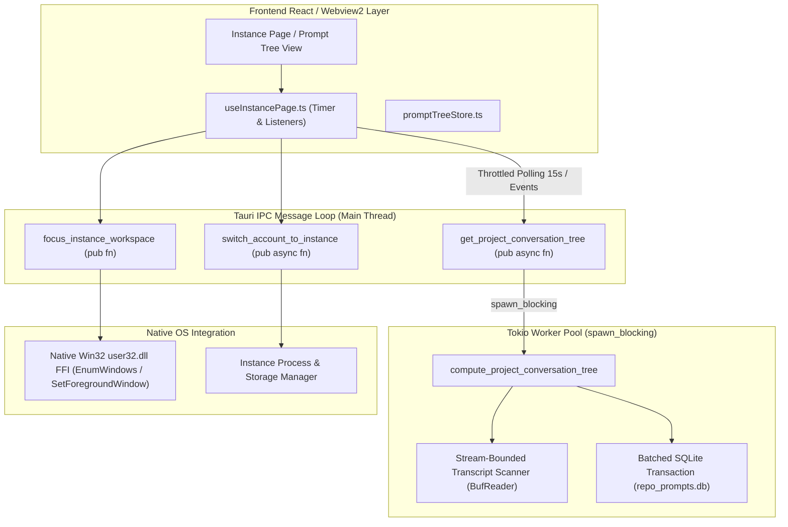

# Component Specification: Fast-Forward, Prompt Tree View, and Instance Switching IPC Offloading

- **Slug**: `auto-switching-e2e-and-fast-forward`
- **Specification ID**: `02-component-spec`
- **Module Scope**: `src-tauri/src/commands/`, `src-tauri/src/modules/repo_db/`, `src-tauri/src/modules/process/`, `src/pages/instances/`, and `scripts/`
- **Target Release**: `v4.185.0`
- **Status**: `Approved for Implementation`

---

## 1. Executive Summary & Purpose

During multi-instance management and fast-forward switching workflows, the Antigravity Manager desktop application periodically encounters severe Windows `(Not Responding)` UI freezes, WebView2 canvas stalls, and desktop window lockups. 

This specification establishes the component architecture, data contracts, asynchronous execution boundaries, and end-to-end verification standards to permanently eliminate UI thread starvation. The solution transitions all heavy transcript parsing and database synchronization off the Tauri IPC main loop, replaces runtime PowerShell Roslyn compilation with sub-millisecond native Win32 FFI window focus calls, throttles redundant frontend polling loops in favor of event-driven invalidation, and delivers an automated sandboxed end-to-end test suite (`scripts/test-auto-switch-quota-e2e.ps1`).

---

## 2. Architectural Context & IPC Message Pipeline

The Tauri 2.x desktop application communicates between the React TypeScript frontend and the Rust backend via asynchronous IPC commands and system events.



---

## 3. Root Cause Analysis of Windows "(Not Responding)" Lockup

A diagnostic breakdown reveals that the application hang is not a single bug, but a catastrophic cascade of five concurrent synchronous bottlenecks that exhaust the Windows message dispatch queue:

### 3.1 Synchronous Tauri Command Execution on IPC Loop
- **File**: `src-tauri/src/commands/instance.rs:423`
- **Mechanism**: `get_project_conversation_tree` is currently declared as a synchronous function (`pub fn get_project_conversation_tree(...)`). Tauri executes synchronous commands directly on the main IPC dispatch loop.
- **Impact**: Any long computation inside `compute_project_conversation_tree` halts all IPC messages, window resizing, drag-and-drop operations, and UI rendering frames in WebView2, causing Windows Desktop Window Manager (DWM) to mark the window as `(Not Responding)`.

### 3.2 Unbounded File System IO on Multi-Megabyte Transcripts
- **File**: `src-tauri/src/modules/repo_db/transcript.rs:83`
- **Mechanism**: The transcript inspector calls `std::fs::read_to_string(&chosen_path)` on `transcript_full.jsonl` files. Long-running coding sessions accumulate JSONL log files exceeding 20 MB to 150 MB.
- **Impact**: Reading multiple multi-megabyte files into contiguous memory strings allocates hundreds of megabytes per tree refresh, triggering severe memory allocation latency, disk read spikes, and thread starvation.

### 3.3 Unbatched SQLite Sequences Triggering Hundreds of Disk Fsyncs
- **File**: `src-tauri/src/modules/repo_db/sequences.rs:25, 44, 75, 94`
- **Mechanism**: Project sequences (`ensure_project_sequence_in_conn`) and conversation sequences (`ensure_conversation_sequence_in_conn`) execute discrete SQL statements inside the loop without wrapping them in an explicit transaction (`BEGIN IMMEDIATE` ... `COMMIT`).
- **Impact**: In SQLite autocommit mode, every single `execute` incurs a synchronous disk write (`fsync`). Scanning 50 projects and 200 conversations triggers up to 500 synchronous disk syncs, locking SQLite and blocking the caller for several seconds.

### 3.4 3-Second Rapid Polling Storm in Frontend
- **File**: `src/pages/instances/useInstancePage.ts:163`
- **Mechanism**: A recurring `setInterval` timer triggers every 3000 ms, firing `fetchInstances(true)`, `fetchSwitcherStatus()`, `fetchRunningTasks()`, and `fetchDaemonTelemetry()`.
- **Impact**: Because the IPC thread is already saturated by synchronous tree computation and transcript reads, incoming requests back up in the IPC queue. Furthermore, event listeners (`account://auto-switched`, `instance://rotated`, `prompt://resumed`) are already active; repeated unconditional 3s polling is completely redundant.

### 3.5 PowerShell Roslyn C# Compilation on Windows Window Focus
- **File**: `src-tauri/src/modules/process/focus.rs:140`
- **Mechanism**: When focusing a workspace window, `focus_instance_workspace_window` constructs a PowerShell script that invokes `Add-Type` with inline C# code to call `SetForegroundWindow`, `ShowWindow`, and `EnumWindows`.
- **Impact**: `powershell.exe` spawns a heavyweight subprocess and invokes the Microsoft .NET Roslyn compiler to compile C# source code in memory. This process takes 2,000 ms to 3,500 ms per invocation, during which the calling thread is completely blocked.

---

## 4. Technical Design for Asynchronous Offloading & Hardening

### 4.1 Asynchronous IPC Offloading with `tokio::task::spawn_blocking`

Convert `get_project_conversation_tree` in `src-tauri/src/commands/instance.rs` to an asynchronous command:

```rust
#[tauri::command]
pub async fn get_project_conversation_tree(
    instance_id: Option<String>,
    max_words: Option<usize>,
    only_running: Option<bool>,
    force: Option<bool>,
) -> Result<Vec<crate::modules::repo_db::AgmProjectTreeNode>, String> {
    tokio::task::spawn_blocking(move || {
        Ok(crate::modules::repo_db::get_project_conversation_tree_cached(
            instance_id.as_deref(),
            max_words.unwrap_or(200),
            only_running.unwrap_or(false),
            force.unwrap_or(false),
        ))
    })
    .await
    .map_err(|e| format!("Failed to spawn blocking conversation tree task: {}", e))?
}
```

### 4.2 Bounded Reverse Line Parsing for Transcripts

In `src-tauri/src/modules/repo_db/transcript.rs`, eliminate whole-file `read_to_string` on `transcript_full.jsonl`.
- Inspect metadata length first: if the file exceeds 2 MB, prioritize bounded reverse line scanning via buffered tail readers or fallback to `transcript.jsonl`.
- For status and completion checks, only inspect the trailing 50 lines rather than parsing the entire file into memory.

### 4.3 Transactional SQLite Sequence Batching

In `src-tauri/src/modules/repo_db/sequences.rs`, introduce `batch_ensure_sequences`:
- Wrap all sequence updates inside a single SQLite transaction:
  ```rust
  let mut tx = conn.transaction()?;
  // Perform project and conversation sequence checks and updates
  tx.commit()?;
  ```
- Reduces disk syncs from $O(N)$ fsync calls down to exactly 1 fsync call per tree build.

### 4.4 Polling Throttle & Event-Driven Invalidation in React

In `src/pages/instances/useInstancePage.ts`:
- Increase the periodic fallback interval from 3,000 ms (3s) to 15,000 ms (15s) or 30,000 ms (30s).
- Ensure existing Tauri event listeners (`account://auto-switched`, `instance://switched`, `instance://rotated`, `prompt://resumed`) immediately trigger on-demand refreshes.
- Add an `is_fetching` guard to prevent overlapping concurrent telemetry requests.

### 4.5 Sub-Millisecond Native Win32 Window Focus via Direct FFI

In `src-tauri/src/modules/process/focus.rs`, completely eliminate PowerShell and `Add-Type` Roslyn compilation on Windows. Implement native `extern "system"` bindings to `user32.dll`:

```rust
#[cfg(target_os = "windows")]
mod win32_focus {
    use std::ffi::c_void;
    pub type HWND = *mut c_void;
    pub type BOOL = i32;
    pub type LPARAM = isize;
    pub type WNDENUMPROC = unsafe extern "system" fn(HWND, LPARAM) -> BOOL;

    #[link(name = "user32")]
    extern "system" {
        pub fn SetForegroundWindow(hWnd: HWND) -> BOOL;
        pub fn ShowWindow(hWnd: HWND, nCmdShow: i32) -> BOOL;
        pub fn BringWindowToTop(hWnd: HWND) -> BOOL;
        pub fn GetWindowTextW(hWnd: HWND, lpString: *mut u16, nMaxCount: i32) -> i32;
        pub fn GetWindowThreadProcessId(hWnd: HWND, lpdwProcessId: *mut u32) -> u32;
        pub fn EnumWindows(lpEnumFunc: WNDENUMPROC, lParam: LPARAM) -> BOOL;
        pub fn IsWindowVisible(hWnd: HWND) -> BOOL;
    }
}
```

- Enumerate windows directly in-process. Match `lpdwProcessId` against instance PIDs and match window title against workspace/repo name.
- Execution time drops from ~3,000 ms to <1 ms, eliminating window activation lag and UI stalls.

---

## 5. End-to-End Testing Specification (`scripts/test-auto-switch-quota-e2e.ps1`)

An automated PowerShell end-to-end test script must run against real CLI binaries and sandboxed SQLite databases without interfering with active user IDE sessions.

### 5.1 Test Pipeline Architecture & Invariants
- **Sandbox Instance**: `test-switch-e2e-sandbox`.
- **Target Threshold**: Low-credit trigger threshold set to 98% to simulate quota depletion deterministically.
- **Safety Gate**: Respects protected PIDs (`$protectedPids`); never kills user IDE processes or main `agm-alim` daemons.
- **Restoration Guarantee**: Reverts auto-switcher threshold back to default (15%) and deletes the sandbox instance even if an assertion fails (`try { ... } finally { ... }`).

### 5.2 8-Stage Execution Pipeline

| Stage | Name | Action & Assertion |
|---|---|---|
| **Stage 1** | Setup Sandbox | Run `agm instances create test-switch-e2e-sandbox -a <account_a> --json`. Verify registration in `instances.json`. |
| **Stage 2** | Set Threshold to 98% | Run `agm config set auto_profile_switcher.low_credit_threshold_pct 98`. Verify config persistence. |
| **Stage 3** | Seed Prompt & Heartbeat | Seed active prompt into `repo_prompts.db` for the sandbox instance; write `.antigravity_goal_prompt.log` with fresh heartbeat timestamp. |
| **Stage 4** | Evaluate Auto-Switch | Trigger switcher evaluation tick via `agm switch-check --force --json` or scheduler daemon. |
| **Stage 5** | Assert Switched Account | Verify sandbox instance is now bound to candidate `<account_b>`. Verify SQLite `task_history_db` records `SwitchAccount` action. |
| **Stage 6** | Verify Non-Blocking UI | Measure execution time of `agm tree --json` and `agm instances --json` during switch; assert response time is < 500 ms (non-blocking). |
| **Stage 7** | Reset Threshold | Restore `auto_profile_switcher.low_credit_threshold_pct` to default `15`. Verify config saved. |
| **Stage 8** | Teardown Sandbox | Remove `test-switch-e2e-sandbox` via `agm instances rm test-switch-e2e-sandbox --force`. Purge test directories. |

---

## 6. Verification & Quality Gates

To validate the implementation against project invariants:
1. **Rust Pre-flight Checks**:
   ```bash
   cd src-tauri && cargo fmt -- --check
   cd src-tauri && cargo clippy --all-targets --all-features
   ```
2. **Frontend Type Check & Build**:
   ```bash
   npm run build
   ```
3. **Automated E2E Test Execution**:
   ```powershell
   pwsh -NoProfile -ExecutionPolicy Bypass -File scripts/test-auto-switch-quota-e2e.ps1
   ```
