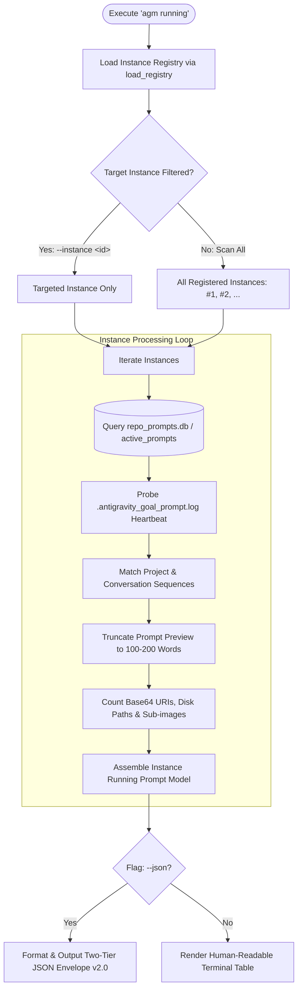

# Specification: CLI and UI Testing for Antigravity Backups — Architecture & Data Model

**Document ID**: `02-spec/21-app/cli-and-ui-testing-for-antigravity-backups/01-architecture-spec.md`  
**Parent Task**: `cli-and-ui-testing-for-antigravity-backups`  
**Status**: APPROVED ARCHITECTURE SPECIFICATION  
**Target Branch**: `main`  
**Author**: Spec Author 01  
**Attribution**: strictly `@aukgit`  
**Subtask Plans**:
- [.ai-memory/plans/subtasks/cli-and-ui-testing-for-antigravity-backups/01-subtask-git-sync-and-preflight.md](../../../.ai-memory/plans/subtasks/cli-and-ui-testing-for-antigravity-backups/01-subtask-git-sync-and-preflight.md)
- [.ai-memory/plans/subtasks/cli-and-ui-testing-for-antigravity-backups/02-subtask-architecture-and-specs.md](../../../.ai-memory/plans/subtasks/cli-and-ui-testing-for-antigravity-backups/02-subtask-architecture-and-specs.md)

---

## 1. User Request (Verbatim)

```text
agm running --json # list prompts , instances
gitmap agy running --json
gitmap agy ff
gitmap agy backup running-prompts (rp) # + images
gitmap ag restore running-prompts (rp)
gitmap ag restore running-prompts (rp) $instance
agm backup running $instacne
agm restore running $instacne

Make sure you release with a minor bump at the end and make sure CI CD is green

# CLI and UI Testing for Antigravity Backups: high priority instruction, non-negotiable task

When you are testing the CLI and the UI of the backups, a few things. If we run the `Antigravity Manager or Antigravity Tools` and say, "Yeah, running prompts," running, it basically would list out the running prompts. First, it would list out the instances, how many instances are there, with their number and sequence so that I can use that to call again or inject a prompt again or do anything with it. So link should give under each one of the instances, how many that's running prompts. For each one of the prompts, it would actually give 100, 200 words, and that should be configurable from settings for both of the cases. So if we run from git-map, it would be git-map AGY running, it would list out the prompts with the instances. So nice view so that I can understand and see it, not the full prompt, but 100 words. We could also do JSON as a flag, giving everything on the output as a JSON. Also, we could do git-map AGY FF for fast-forward. That would just basically going to delegate that to `Antigravity Manager or Antigravity Tools` to do the fast forwarding. And also we can do `gitmap` AGY backup. Backup will give you running prompts, and we can, running prompts with image, plus images. Then when we say running, it should also give a number, like how many images are there with that prompt as well. If we do AGY restore. These commands should be there, you know, just to implement that. And when we are running the CLI commands, it should actually show every step, which prompts are getting backed up with images, where and how, and how it is restoring that. So basically, it can give a instance name as well, if we wanted to. If we don't give, then it would try to do it for both. Instance as well. All this needs to have help, proper segment so that anyone can understand. Need to have UI help along with it. Make sure that you test it, end-to-end test it so everything works. You put images to the item so that you can add the image and check the image restore is done. And also, everything needs to have tracing that this is the images, sub-images, and things that we are dealing with, so that you can understand that everything is working fine.
```

---

## 2. System Architecture & Problem Classification

This specification establishes the end-to-end architectural contract and data models for running prompt inspection, multimodal backup, and restoration across the Antigravity Manager (`agm`) and GitMap (`gitmap agy`) ecosystems.

```
+---------------------------------------------------------------------------------------------------+
|                                 Running Prompt Inspection Surface                                 |
|                                                                                                   |
|    Terminal CLI: 'agm running [--json]'         Terminal CLI: 'gitmap agy running [--json]'       |
|    GUI Tree View: Instances / Prompt Tree       REST / IPC API: /api/v1/prompts/running           |
+-------------------------------------------------+-------------------------------------------------+
                                                  |
                                                  v
+---------------------------------------------------------------------------------------------------+
|                        Core Engine: src-tauri/src/bin/agm/running_prompts_cmds.rs                  |
|                                                                                                   |
|  1. Instance Discovery: Iterates registered Antigravity instances (#1 default, #2 custom, ...)   |
|  2. Sequence Generator: Assigns [AGM:P001 | GM:#1] (Project) & [AGM:C001 | GM:<cid>] (Conv)       |
|  3. Word Truncation: Reads 'prompt_preview_max_words' from gui_config.json (100-200, default 100) |
|  4. Multimodal Analyzer: Counts Base64 data URIs + referenced disk file paths + sub-images        |
|  5. Step-by-Step Progress Logger: 4-step real-time progress for backup & restoration operations    |
|  6. Output Formatter: Table view (human terminal) OR Two-Tier JSON Envelope v2.0 (--json)        |
+-------------------------------------------------+-------------------------------------------------+
                                                  |
                 +--------------------------------+--------------------------------+
                 |                                                                 |
                 v                                                                 v
+------------------------------------------------+  +-----------------------------------------------+
|         Split SQLite Storage Layer             |  |           Live Instance Filesystem            |
|                                                |  |                                               |
|  - repo_prompts.db: 'active_prompts' table     |  |  - workspaceStorage: state.vscdb / logs       |
|  - backup_prompts.db: 'prompt_backups' table   |  |  - .antigravity_goal_prompt.log (Heartbeats)  |
|  - conversation_summaries.db: Chat titles      |  |  - .antigravity_resume_task.<inst>.json       |
+------------------------------------------------+  +-----------------------------------------------+
```

### Problem Classification & Root Causes

1. **Command Routing Ambiguity**:
   - Running `agm running` previously defaulted to `agm tree` (via fallback dispatch in `src-tauri/src/bin/agm/main.rs`), while passing arguments like `agm running --json` routed into miscellaneous GitMap pass-through handlers.
   - `agm running` must directly invoke `running_prompts_cmds::cmd_running_prompts`, providing a unified, multi-instance running prompt overview with support for `--json`, `--words <N>`, and `--instance <inst>`.

2. **Missing Dual Sequence Identifiers in Prompt Inspection**:
   - While `agm tree` formats `[AGM:P001 | GM:#1]` and `[AGM:C001 | GM:<cid>]`, prompt listing and inspection commands lacked these dual sequences, breaking GitMap AGY parity and cross-tool targeting.

3. **Hardcoded Preview Length**:
   - Prompt previews previously used hardcoded limits (15 words in backups, 80 characters in summaries, or 100 words in CLI). Users require configurable prompt preview truncation between 100 and 200 words (default: 100) controlled via `gui_config.json` (`prompt_preview_max_words`) and GUI settings.

4. **Multimodal Blindness in Status Reports**:
   - Existing listings only exposed a boolean `has_images: true/false`. Automated pipelines and users cannot observe the exact image attachment counts, failing to distinguish between Base64 data URIs, referenced local file attachments, and multimodal sub-images.

5. **Lack of Step-by-Step Progress Logging**:
   - Running backup and restore operations executed silently without informative progress stages, leaving developers unaware of whether payloads, binary assets, or SQLite transactions were currently in progress.

6. **Absence of Standardized Machine Ingestion Contract**:
   - Automation tools, daemons, and CI/CD test runners require the standardized AGM Two-Tier JSON Envelope v2.0 format when invoking `--json`, rather than bare unversioned JSON arrays.

---

## 3. Multi-Instance Running Prompts Query Engine

The multi-instance running prompts query engine orchestrates scanning across all registered Antigravity profiles:



### 3.1 Instance Discovery & Sequencing
- **Registry Loading**: Invokes `crate::modules::instance::load_registry()` to retrieve all configured instances.
- **Instance Indexing**: Instances are assigned sequential integer identifiers:
  - `#1`: Primary default instance (`id == "default"` or `is_default == true`).
  - `#2`, `#3` ...: Secondary or cloned instances in registered order.
- **Active Liveness Detection**: Cross-references process tables (`sysinfo`) and `.antigravity_goal_prompt.log` timestamps to tag instances as `ACTIVE` (heartbeat < 60s) or `IDLE`.

### 3.2 Prompt Query & Status Filtering
- For each instance, queries `repo_prompts.db` table `active_prompts` where `status IN ('running', 'queued')` or active conversation turn steps exist.
- Reverse-scans the latest transcripts (`transcript_full.jsonl`) to identify genuine user prompts, bypassing trailing telemetry and heartbeat records.
- Extracts status:
  - `running`: Active execution step in flight.
  - `queued`: Enqueued in FIFO scheduler awaiting instance availability.

---

## 4. Sequence Numbering & Dual ID Hierarchy

All running prompt inspection queries and views MUST expose deterministic, bidirectional sequence identifiers matching GitMap AGY standards:

```
[Instance Sequence]  ->  #1, #2, #3 ... (Assigned in registration order from instance registry)
      │
      └── [Project Sequence]       ->  [AGM:P001 | GM:#1]
                │
                └── [Conversation Sequence]  ->  [AGM:C001 | GM:c03264c7]
                          │
                          └── [Prompt Turn Sequence]   ->  Turn #1, Turn #2 ...
```

### 4.1 Instance Sequence (`#N`)
- 1-based index assigned to instances based on `instance::load_registry()` order.
- Instance `#1` is always the active default instance (`default` or `__default__`).
- Secondary instances receive `#2`, `#3`, etc.

### 4.2 Dual Project Sequence (`[AGM:P001 | GM:#1]`)
- **AGM Sequence Code (`AGM:P<03d>`)**: 3-digit zero-padded sequential index (`P001`, `P002`, `P003`) assigned to distinct workspace repositories tracked in `repo_prompts.db`.
- **GitMap Project Sequence (`GM:#<d>`)**: 1-based integer sequence assigned to projects in GitMap cluster discovery (`GM:#1`, `GM:#2`).
- **Composite Format**: `[AGM:P001 | GM:#1]`.

### 4.3 Dual Conversation Sequence (`[AGM:C001 | GM:<cid>]`)
- **AGM Conversation Code (`AGM:C<03d>`)**: 3-digit zero-padded index within the project conversation hierarchy.
- **GitMap Conversation Sequence (`GM:<cid>`)**: 8-character hex prefix of the Antigravity conversation UUID (e.g. `GM:c03264c7`).
- **Composite Format**: `[AGM:C001 | GM:c03264c7]`.

### 4.4 Bidirectional Sequence Resolution Invariant (`resolve_agm_sequence_target`)
The sequence resolution engine in `src-tauri/src/modules/repo_db/tree_format.rs` MUST resolve any of the following input formats to the exact instance, project, and conversation:
- Token forms accepted: `P001`, `AGM:P001`, `GM:#1`, `C001`, `AGM:C001`, `GM:<cid>`, `1`, `#1`.

---

## 5. Configurable Prompt Word Truncation Engine

Prompt text snippets displayed in terminal views, status reports, and JSON envelopes are truncated using word boundaries to preserve semantic legibility.

```
+---------------------------------------------------------------------------------------------------+
|                            Word Truncation Resolution Precedence                                  |
|                                                                                                   |
|  1. CLI Flag: --full                                  -> No truncation (Full prompt text)         |
|  2. CLI Flag: --words <N> / --wc <N> / -w <N>         -> Explicit word count (e.g. 150)           |
|  3. User Configuration: 'prompt_preview_max_words'    -> Read from gui_config.json (100 - 200)    |
|  4. Subsystem Hard Fallback                           -> 100 words                                |
+---------------------------------------------------------------------------------------------------+
```

### 5.1 Configuration Schema
- **Storage Location**: `gui_config.json` in user application directory.
- **Configuration Key**: `prompt_preview_max_words` (TypeScript: `promptPreviewWordLimit` / `prompt_preview_max_words`).
- **Data Type**: `usize` (Rust) / `number` (TypeScript).
- **Default Value**: `100` words.
- **Allowed Range**: `100` to `200` words.
- **Clamping Invariant**: Values provided outside `100..=200` via GUI or config file are automatically clamped: `max(100, min(val, 200))`. CLI explicit flag overrides (`--words <N>`) permit arbitrary values for ad-hoc terminal debugging.

### 5.2 Implementation Contracts

#### Rust Config Model (`src-tauri/src/models/config.rs`)
```rust
#[derive(Debug, Clone, Serialize, Deserialize)]
pub struct AppConfig {
    // ... existing fields ...
    #[serde(default = "default_prompt_preview_max_words")]
    pub prompt_preview_max_words: usize,
}

fn default_prompt_preview_max_words() -> usize {
    100
}

impl AppConfig {
    /// Effective preview word limit clamped to [100, 200]
    pub fn effective_prompt_preview_max_words(&self) -> usize {
        self.prompt_preview_max_words.clamp(100, 200)
    }
}
```

#### TypeScript Interface (`src/types/config.ts`)
```typescript
export interface AppConfig {
    // ... existing fields ...
    prompt_preview_max_words?: number; // Configurable prompt word preview limit (100-200, default 100)
}
```

#### Truncation Utility (`src-tauri/src/modules/repo_db/text_utils.rs`)
```rust
/// Bounded word-level truncation with ellipsis and precise word counting
pub fn truncate_words_bounded(text: &str, max_words: usize) -> (String, usize) {
    let words: Vec<&str> = text.split_whitespace().collect();
    let total = words.len();
    if total <= max_words {
        (words.join(" "), total)
    } else {
        (format!("{} ...", words[..max_words].join(" ")), total)
    }
}
```

---

## 6. Multimodal Image Count Calculation & Tracing

Running prompts may contain attached image data encoded as inline Base64 data URIs, disk-referenced file paths, or multimodal sub-images. The engine must extract, count, and trace each asset accurately.

### 6.1 Image Attachment Taxonomy
1. **Inline Base64 Data URIs**:
   - Matched by pattern `data:image/(png|jpeg|jpg|webp|gif|svg\+xml|bmp);base64,...`.
   - Extracted into in-memory payloads for preview and clipboard export.
2. **Local Disk References**:
   - Matched by whitespace-delimited tokens ending with image extensions: `.png`, `.jpg`, `.jpeg`, `.webp`, `.gif`, `.svg`, `.bmp`.
   - Strips `file:///` and `file://` prefixes to obtain canonical paths.
3. **Multimodal Sub-Images**:
   - Subagent prompt turns and nested tool calls referencing media objects.
   - Identified in JSON envelopes under `sub_images: [...]` or embedded in `image_payload`.
4. **Screenshot ID Tokens**:
   - Matched by tokens: `SS_ID_<digits>`, `screenshot_id=<id>`.

### 6.2 Data Model Extraction Contract
In `src-tauri/src/modules/repo_db/detection.rs`:
- Function `extract_image_uris_or_paths(content: &str) -> (Vec<String>, Vec<String>)` returns:
  - `data_uris`: Vector of distinct Base64 data URI strings.
  - `found_paths`: Vector of distinct local filesystem paths.
- Total image count calculation:
  $$\text{image\_count} = \text{data\_uris.len}() + \text{found\_paths.len}()$$
- A prompt is classified as `has_images = true` if $\text{image\_count} > 0$ or `image_payload.is_some()`.
- Deep multimodal tracing logs each image type during CLI and UI operations:
  ```text
  [TRACING] Prompt ID: e60e14b0 | Images: 2 (1 Base64 URI, 1 Local Path: screenshots/flow.png)
  ```

---

## 7. Step-by-Step Progress Logging Protocol

To eliminate silent execution during backup and restoration workflows, CLI commands (`agm backup running [instance]`, `agm restore running [instance]`, and GitMap wrappers) must emit structured real-time 4-step progress updates:

### 7.1 Backup Progress Ladder (`agm backup running [instance]`)

```text
[STEP 1/4] Discovering running prompts across instances...
           Found 1 active instance(s), 2 running prompt turn(s).
[STEP 2/4] Tracing and extracting multimodal image payloads...
           Extracted 2 image asset(s) (1 Base64 URI, 1 disk reference).
[STEP 3/4] Persisting snapshot to backup_prompts.db & state cache...
           Snapshot stored under ID: bk-20261020-001 (FIFO key: 1729440000).
[STEP 4/4] Verifying backup integrity...
           Backup verified successfully (2 prompts, 2 images, 0 errors).
```

### 7.2 Restoration Progress Ladder (`agm restore running [instance]`)

```text
[STEP 1/4] Locating latest backup snapshot in backup_prompts.db...
           Snapshot found: bk-20261020-001 (Created: 2026-10-20 02:30:00).
[STEP 2/4] Reconstituting multimodal image assets and payload caches...
           Reconstituted 2 image asset(s) into local cache.
[STEP 3/4] Inserting prompts into active_prompts FIFO queue...
           Enqueued 2 prompt(s) with strict FIFO ordering (ORDER BY created_at ASC, id ASC).
[STEP 4/4] Seeding workspace resumption file & signaling instance...
           Created .antigravity_resume_task.default.json and refreshed Prompt Tree.
```

---

## 8. Two-Tier JSON Envelope Schema v2.0 (`--json`)

When invoked with `--json`, `agm running` must output data wrapped in the Two-Tier JSON Envelope v2.0 schema:

```json
{
  "attributes": {
    "type": "agm/running-prompts",
    "version": "2.0",
    "source": "agm-cli",
    "workDirectory": {
      "path": "${workDir}",
      "isApplied": true,
      "isEnforced": false
    },
    "command": "agm running --json"
  },
  "variables": {
    "workDir": "workspace",
    "repoDir": "${workDir}/antigravity-manager"
  },
  "data": {
    "total_instances": 2,
    "total_running_prompts": 3,
    "word_limit": 100,
    "instances": [
      {
        "instance_seq": 1,
        "instance_id": "default",
        "instance_name": "Default",
        "is_active": true,
        "running_count": 2,
        "prompts": [
          {
            "seq": 1,
            "id": "e60e14b0-0695-40eb-a31e-29517bb569a0",
            "project_seq_code": "AGM:P001",
            "gitmap_project_seq": "GM:#1",
            "conversation_seq_code": "AGM:C001",
            "gitmap_conversation_seq": "GM:c03264c7",
            "project_id": "antigravity-manager-d58c5517",
            "repo_name": "Antigravity-Manager",
            "repo_path": "workspace/antigravity-manager",
            "status": "running",
            "word_count": 142,
            "truncated_word_count": 100,
            "prompt_snippet": "Implement running prompts inspection ...",
            "has_images": true,
            "image_count": 2,
            "image_uris_count": 1,
            "image_paths_count": 1,
            "image_paths": [
              "workspace/antigravity-manager/screenshots/flow.png"
            ],
            "updated_at": 1729440000
          }
        ]
      }
    ]
  }
}
```

---

## 9. Terminal Table Layout (`agm running`)

When executed without `--json`, `agm running` renders a clean, human-readable terminal table grouped by instance:

```text
=== AGM Running Prompts Across Instances (Word Preview Limit: 100) ===

[Instance #1: Default (default) - ACTIVE]
SEQ   PROJECT SEQ            CONV SEQ               STATUS    IMAGES   WORDS   PROMPT PREVIEW
----------------------------------------------------------------------------------------------------------------------
#1    [AGM:P001 | GM:#1]     [AGM:C001 | GM:c032]   running   2 imgs   142     Implement running prompts inspection ...
#2    [AGM:P001 | GM:#1]     [AGM:C002 | GM:8f9a]   queued    None     85      Verify split SQLite backup integrity

[Instance #2: Instance 2 (inst-2) - IDLE]
No active or queued prompts running.
```

---

## 10. Invariants & Quality Guardrails

1. **Strict Relative Git Paths Invariant**:
   - All paths referenced in specifications, logs, CLI outputs, and JSON envelopes MUST be strictly repository-relative (`02-spec/...`, `src/...`, `src-tauri/...`). Absolute paths with drive letters (`D:\...`, `C:\...`) are strictly forbidden.

2. **FIFO Queue & Restoration Invariant**:
   - All prompt restore, dispatch, and queue processing queries across SQLite databases (`active_prompts`, `prompt_backups`) MUST enforce strict First-In-First-Out ordering using `ORDER BY created_at ASC, id ASC`.

3. **Caller IDE Self-Preservation**:
   - Automated tests and CLI commands MUST detect the caller's active IDE process (`detect_caller_instance_id()`) to prevent terminating the developer's working IDE session.

4. **No Silent Errors Invariant**:
   - Fallible database reads, configuration loading, or file parsing MUST propagate via `AppError` or record via `crate::error::record_ignored(result, "justification")`. Empty error catches are strictly forbidden.

5. **Attribution Integrity**:
   - Documentation and changelogs must strictly attribute `@aukgit` (`(Thanks to @aukgit)`).

---

## 11. Cross-References

- Subtask 01 (Preflight): [.ai-memory/plans/subtasks/cli-and-ui-testing-for-antigravity-backups/01-subtask-git-sync-and-preflight.md](../../../.ai-memory/plans/subtasks/cli-and-ui-testing-for-antigravity-backups/01-subtask-git-sync-and-preflight.md)
- Subtask 02 (Specs): [.ai-memory/plans/subtasks/cli-and-ui-testing-for-antigravity-backups/02-subtask-architecture-and-specs.md](../../../.ai-memory/plans/subtasks/cli-and-ui-testing-for-antigravity-backups/02-subtask-architecture-and-specs.md)
- Backup & Restore Spec: `02-spec/21-app/cli-and-ui-testing-for-antigravity-backups/02-backup-restore-and-gitmap-spec.md`
- Verification & Help Spec: `02-spec/21-app/cli-and-ui-testing-for-antigravity-backups/03-verification-and-help-spec.md`
- Parent Plan: `.ai-memory/plans/cli-and-ui-testing-for-antigravity-backups.md`
- Skill Documentation: `.agents/skills/cli-and-ui-testing-for-antigravity-backups/skill.md`
