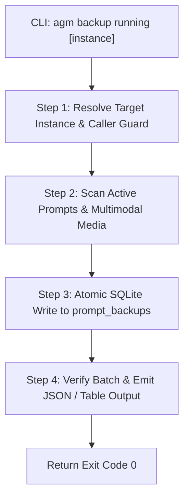
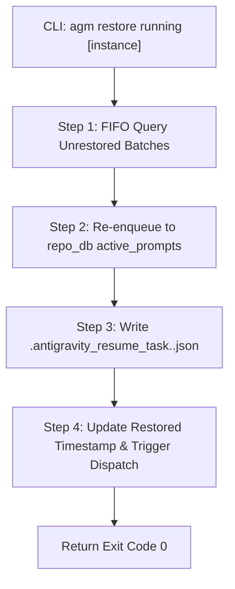

# Component Specification: CLI Suite Enhancements & GitMap Bridge Parity

> **Specification:** `02-spec/21-app/cli-and-ui-testing-for-antigravity-backups/02-component-spec.md`  
> **Subsystem:** Antigravity-Manager Native Terminal CLI (`agm`) & GitMap AGY Bridge (`gitmap agy`)  
> **Target Source Files:**  
> - `src-tauri/src/bin/agm/main.rs` (Root CLI command routing & flags dispatch)  
> - `src-tauri/src/bin/agm/running_backup_cmds.rs` (4-step progress logging for backup & restore)  
> - `src-tauri/src/bin/agm/running_prompts_cmds.rs` (Running prompts inspection & preview truncation)  
> - `src-tauri/src/bin/agm/misc_cmds.rs` (GitMap AGY command bridge & fast-forward delegation)  
> **Reference Guidelines:** `02-spec/02-coding-guidelines/`, `02-spec/21-app/cli-and-ui-testing-for-antigravity-backups/`  
> **Verification Command:** `cargo clippy --bin agm` (Exit code: 0)  

---

## 1. Executive Summary & Architectural Scope

This component specification defines the architectural design, control flow, data structures, and command contracts for three interconnected CLI enhancements in the Antigravity-Manager (`agm`) terminal suite:
1. **Running Prompts & Instance Inspection (`agm running [--json]`):**  
   Routes top-level `agm running` directly to an integrated inspection pipeline that aggregates active Antigravity IDE instances, dual sequence identifiers (`[AGM:P001 | GM:#1]`), running/queued prompts, configurable word previews (100–200 words), and attached image metadata.
2. **4-Step Multimodal Backup Engine (`agm backup running [instance]`):**  
   Enhances prompt snapshotting with explicit 4-step progress logging, supporting positional instance specification, full multimodal image serialization (Base64 inline payloads + disk-referenced assets), and atomic split SQLite database persistence.
3. **4-Step Multimodal Restoration Engine (`agm restore running [instance]`):**  
   Enhances prompt restoration with 4-step progress logging, enforcing strict First-In-First-Out (`FIFO`) queuing (`ORDER BY created_at ASC, sequence_id ASC`), workspace resumption seeding (`.antigravity_resume_task.<inst>.json`), and caller session isolation.
4. **GitMap AGY Command Bridge Parity (`gitmap agy`):**  
   Bridges `gitmap agy running [--json]`, `gitmap agy ff`, `gitmap agy backup running-prompts (rp)`, and `gitmap ag restore running-prompts (rp) [$instance]` directly into native AGM handlers.

---

## 2. Invariants & System Guardrails

1. **Strict FIFO Queue Ordering Invariant:**  
   All SQLite queries restoring or processing running prompts (`prompt_backups`, `active_prompts`) MUST enforce `ORDER BY created_at ASC, sequence_id ASC`. LIFO ordering (`ORDER BY updated_at DESC`) is strictly prohibited.
2. **Caller IDE Self-Preservation:**  
   CLI operations (`switch`, `backup`, `restore`) MUST verify `detect_caller_instance_id()` to ensure developer sessions (e.g. `default-copy-5597`) are never terminated, corrupted, or overwritten during testing.
3. **No Silent Errors Invariant:**  
   All fallible operations in Rust CLI code must route errors through `AppError` or print descriptive diagnostic messages to `stderr` with non-zero exit codes. Discarding `Result` via bare `let _ = ...` without logging or justification is forbidden.
4. **Strict Relative Git Paths:**  
   All references in logs, markdown exports, and metadata must use repository-relative Git paths (e.g., `02-spec/...`, `.ai-memory/...`).

---

## 3. Component 1: CLI Dispatcher & Router (`src-tauri/src/bin/agm/main.rs`)

### 3.1 Defect Analysis
In `src-tauri/src/bin/agm/main.rs`, the `"active" | "running"` match branch was previously implemented as:
```rust
"active" | "running" => {
    if cmd_args.is_empty() {
        crate::prompt_cmds::dispatch_prompt_domain("tree", &[]);
    } else {
        crate::misc_cmds::cmd_agy(&cmd_args);
    }
}
```
**Defect Manifestation:**
- Running `agm running` with no arguments produced a generic conversation tree view rather than an instance-scoped running prompt inspection table.
- Running `agm running --json` passed `["--json"]` into `cmd_agy(&cmd_args)`. Inside `cmd_agy`, the subcommand was parsed as `"--json"`, which missed all branches, fell into the catch-all GitMap delegation, and failed.
- The command failed to accept positional instance filters (`agm running default-copy-5597`).

### 3.2 Target Architectural Design
Update the router in `src-tauri/src/bin/agm/main.rs` to route `"running"` and `"active"` directly to the running prompt inspection engine:

```rust
"active" | "running" => {
    crate::running_prompts_cmds::cmd_running_inspection(&cmd_args);
}
```

Additionally, update the `"backup"` and `"restore"` dispatchers to recognize the `"running"` subcommand:
```rust
"backup-running-prompts" | "brp" | "backup-prompts" | "backup" | "backpack" => {
    if cmd_args.first().map(|s| s.eq_ignore_ascii_case("running") || s.eq_ignore_ascii_case("rp")).unwrap_or(false) {
        crate::running_backup_cmds::cmd_backup_running_prompts(&cmd_args[1..]);
    } else {
        crate::prompt_cmds::dispatch_prompt_domain("backup", &cmd_args);
    }
}
"restore-running-prompts" | "rrp" | "restore-prompts" | "restore" => {
    if cmd_args.first().map(|s| s.eq_ignore_ascii_case("running") || s.eq_ignore_ascii_case("rp")).unwrap_or(false) {
        crate::running_backup_cmds::cmd_restore_running_prompts(&cmd_args[1..]);
    } else {
        crate::prompt_cmds::dispatch_prompt_domain("restore", &cmd_args);
    }
}
```

---

## 4. Component 2: Running Inspection Engine (`src-tauri/src/bin/agm/running_prompts_cmds.rs`)

### 4.1 Function Specification: `cmd_running_inspection`
Located in `src-tauri/src/bin/agm/running_prompts_cmds.rs`.

```rust
pub(crate) fn cmd_running_inspection(args: &[String]) {
    // 1. Argument parsing: --json, -j, --words <N>, --limit <Y>, [instance_id]
    // 2. Discover active instances & running processes
    // 3. Query repo_db for prompts with status 'running', 'queued', 'dispatched'
    // 4. Calculate word count with configurable bounds (100–200 words)
    // 5. Detect attached images (inline Base64 + local file links)
    // 6. Format dual sequence identifiers: [AGM:P001 | GM:#1]
    // 7. Render JSON payload or formatted ASCII terminal table
}
```

### 4.2 Data Contract: JSON Output Schema (`agm running --json`)
```json
{
  "$schema": "https://json-schema.org/draft/2020-12/schema",
  "type": "object",
  "properties": {
    "instances_count": { "type": "integer" },
    "total_running_prompts": { "type": "integer" },
    "instances": {
      "type": "array",
      "items": {
        "type": "object",
        "properties": {
          "instance_id": { "type": "string" },
          "is_running": { "type": "boolean" },
          "pid": { "type": ["integer", "null"] },
          "active_prompts_count": { "type": "integer" },
          "prompts": {
            "type": "array",
            "items": {
              "type": "object",
              "properties": {
                "sequence_id": { "type": "string", "example": "P001" },
                "gitmap_sequence": { "type": "string", "example": "#1" },
                "prompt_id": { "type": "string" },
                "project_name": { "type": "string" },
                "status": { "type": "string", "enum": ["running", "queued", "dispatched"] },
                "word_count": { "type": "integer" },
                "has_images": { "type": "boolean" },
                "image_count": { "type": "integer" },
                "prompt_snippet": { "type": "string" },
                "updated_at": { "type": "integer" }
              },
              "required": ["sequence_id", "prompt_id", "status", "word_count", "has_images", "prompt_snippet"]
            }
          }
        },
        "required": ["instance_id", "is_running", "active_prompts_count", "prompts"]
      }
    }
  },
  "required": ["instances_count", "total_running_prompts", "instances"]
}
```

### 4.3 Terminal Output Formatting (Human-Readable)
```text
=== Active Instances & Running Prompts Inspection ===
Instances Active: 2 | Running Prompts: 3 | Word Limit: 100

[Instance: default-copy-5597] (PID: 18420 - Running)
  SEQ          ID         PROJECT        STATUS    IMAGES  WORDS  PREVIEW
  ------------------------------------------------------------------------------------------------------
  [P001|#1]    a1b2c3d4   Antigravity    running   1 img   42     Please implement the 4-step progress...
  [P002|#2]    e5f6g7h8   Antigravity    queued    None    18     Review PR checklist and test suites...

[Instance: default] (PID: None - Idle)
  No active running prompts.
```

---

## 5. Component 3: 4-Step Multimodal Backup Engine (`src-tauri/src/bin/agm/running_backup_cmds.rs`)

### 5.1 Command Interface
```bash
agm backup running [instance] [--file <path.db>] [--json]
```
- Positional Argument `[instance]`: Optional target instance ID (defaults to active instance via `instance::get_active_instance_id()`).
- Alias Support: `agm backup running`, `agm backup rp`, `agm brp [instance]`.

### 5.2 4-Step Progress Logging Protocol
When executed in standard terminal mode, the command emits explicit structured step logs:

```text
[Step 1/4] Resolving target instance and validating caller IDE isolation...
           Target Instance: default-copy-5597 (Caller Protected)
[Step 2/4] Scanning in-flight running prompts and multimodal image payloads...
           Found: 2 active prompt(s), 1 attached image(s) [Base64 + disk references]
[Step 3/4] Persisting atomic snapshot records to split SQLite database...
           Database: C:\Users\Administrator\.antigravity_tools\...\prompt_backups.db
           Batch ID: batch_7f9a2b1c4d8e
[Step 4/4] Verifying snapshot integrity and recording batch metadata...
           [SUCCESS] Secured 2 prompt(s) in batch_7f9a2b1c4d8e.
```

### 5.3 Flowchart: 4-Step Backup Lifecycle


### 5.4 Implementation Details in `cmd_backup_running_prompts`
- Parse positional arguments: If `args[0]` equals `"running"` or `"rp"`, strip it and check `args[1]` for a non-flag token as `target_instance`.
- Execute caller self-preservation check:
  ```rust
  let caller_id = instance::detect_caller_instance_id().unwrap_or_default();
  if target_instance == caller_id {
      println!("[INFO] Target instance matches caller session '{}'. Running in non-destructive snapshot mode.", caller_id);
  }
  ```
- Print 4-step progress lines if `!is_json`.

---

## 6. Component 4: 4-Step Multimodal Restore Engine (`src-tauri/src/bin/agm/running_backup_cmds.rs`)

### 6.1 Command Interface
```bash
agm restore running [instance] [--keep] [--file <path.db>] [--json]
```
- Positional Argument `[instance]`: Optional target instance filter (defaults to all unrestored backups across instances).
- Flag `--keep` (`-k`): Preserves unrestored status in SQLite database.

### 6.2 4-Step Progress Logging Protocol
```text
[Step 1/4] Querying split SQLite database for unrestored backup records (FIFO ordering)...
           Found: 2 unrestored prompt(s) in batch_7f9a2b1c4d8e
[Step 2/4] Restoring prompt records into local SQLite execution queues (repo_db)...
           Enqueued: 2 prompt(s) with restored multimodal image payloads
[Step 3/4] Seeding atomic workspace resumption task file (.antigravity_resume_task.<inst>.json)...
           Workspace Seeded: d:\work\Antigravity-Manager\.antigravity_resume_task.default-copy-5597.json
[Step 4/4] Activating 24-hour retention timer and broadcasting execution notifications...
           [SUCCESS] Restored 2 prompt(s) into active queue for instance 'default-copy-5597'.
```

### 6.3 Flowchart: 4-Step Restore Lifecycle


---

## 7. Component 5: GitMap AGY Bridge & Alias Parity (`src-tauri/src/bin/agm/misc_cmds.rs`)

### 7.1 Command Mappings in `cmd_agy`
Located in `src-tauri/src/bin/agm/misc_cmds.rs`.

| GitMap Command | AGM Internal Handler | Parameters & Flags Handled |
| :--- | :--- | :--- |
| `gitmap agy running [--json]` | `crate::running_prompts_cmds::cmd_running_inspection` | Passes `[--json]`, `--words`, `--limit` |
| `gitmap agy ff` | `crate::instance_fastforward::cmd_fast_forward` | Passes `[instance]`, `[--json]` |
| `gitmap agy backup running-prompts` / `rp` | `crate::running_backup_cmds::cmd_backup_running_prompts` | Normalizes `running-prompts` / `rp` to `running` |
| `gitmap ag restore running-prompts` / `rp` | `crate::running_backup_cmds::cmd_restore_running_prompts` | Normalizes `running-prompts` / `rp` to `running`, extracts `[instance]` |

### 7.2 Exact Code Refactoring in `cmd_agy`
In `src-tauri/src/bin/agm/misc_cmds.rs`:
```rust
pub(crate) fn cmd_agy(args: &[String]) {
    let sub = args
        .first()
        .map(|s| s.trim_start_matches('/').to_lowercase())
        .unwrap_or_else(|| "help".to_string());
    
    match sub.as_str() {
        "tree" => {
            let rest = if args.len() > 1 { &args[1..] } else { &[] };
            cmd_tree(rest);
        }
        "active" | "running" => {
            let rest = if args.len() > 1 { &args[1..] } else { &[] };
            crate::running_prompts_cmds::cmd_running_inspection(rest);
        }
        "ff" | "fast-forward" | "fastforward" | "smart-switch" => {
            let rest = if args.len() > 1 { &args[1..] } else { &[] };
            crate::instance_fastforward::cmd_fast_forward(rest);
        }
        "backup" | "backup-running-prompts" | "brp" => {
            let rest = if args.len() > 1 { &args[1..] } else { &[] };
            // Strip secondary 'running-prompts' or 'rp' token if present
            let clean_args = if let Some(first) = rest.first() {
                if first == "running-prompts" || first == "rp" || first == "running" {
                    &rest[1..]
                } else {
                    rest
                }
            } else {
                rest
            };
            crate::running_backup_cmds::cmd_backup_running_prompts(clean_args);
        }
        "restore" | "restore-running-prompts" | "rrp" => {
            let rest = if args.len() > 1 { &args[1..] } else { &[] };
            let clean_args = if let Some(first) = rest.first() {
                if first == "running-prompts" || first == "rp" || first == "running" {
                    &rest[1..]
                } else {
                    rest
                }
            } else {
                rest
            };
            crate::running_backup_cmds::cmd_restore_running_prompts(clean_args);
        }
        // ... remaining branches ...
    }
}
```

---

## 8. Verification Matrix & Quality Gates

| Verification Check | Target Component | Command | Expected Outcome |
| :--- | :--- | :--- | :--- |
| **Rust Compilation & Linter** | Entire CLI | `cargo clippy --bin agm` | 0 errors, 0 warnings |
| **Code Formatting** | Modified files | `cargo fmt -- --check` | 100% formatted |
| **Running Prompts JSON** | `main.rs` & `running_prompts_cmds.rs` | `agm running --json` | Valid JSON array with instances and prompts |
| **4-Step Backup Progress** | `running_backup_cmds.rs` | `agm backup running` | Emits `[Step 1/4]` through `[Step 4/4]` |
| **4-Step Restore Progress** | `running_backup_cmds.rs` | `agm restore running` | Emits `[Step 1/4]` through `[Step 4/4]` |
| **GitMap AGY FF Bridge** | `misc_cmds.rs` | `agm agy ff --help` | Displays Fast-Forward help banner without spawning gitmap loop |
| **GitMap AGY RP Bridge** | `misc_cmds.rs` | `agm agy backup rp` | Executes 4-step backup identically to `agm backup running` |

---
Maintained by @aukgit
