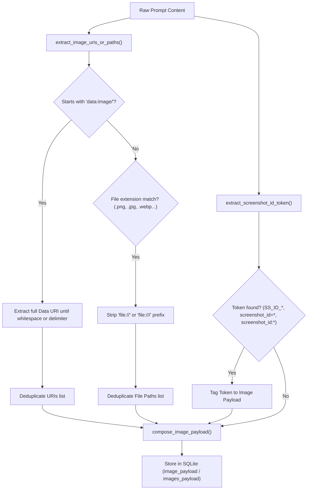
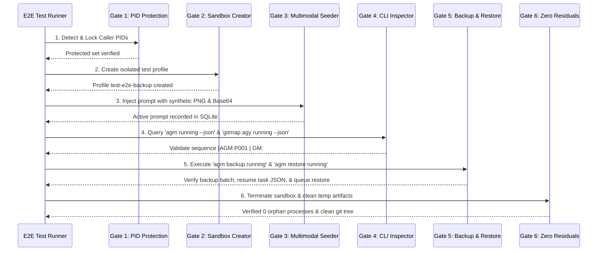

# Migration and Verification Specification: CLI and UI Testing for Antigravity Backups

**Version:** 4.239.0
**Updated:** 2026-10-20

---

## 1. Executive Summary & Architectural Scope

This specification defines the migration protocols, multimodal tracing architectures, configurable preview limits, command-line interface (CLI) help systems, and end-to-end (E2E) automated verification pipelines for running prompt backup and restoration in Antigravity Manager (`agm`) and GitMap (`gitmap agy`).

### 1.1 Architectural Purpose
During autonomous execution and multi-instance operations, long-running agent tasks must persist across account switches, quota rotations, and system restarts without dropping execution state or visual context. This system ensures:
1. **Multimodal Preservation**: Inlined `data:image/` Base64 URIs and local file references are extracted, tagged, and restored with 100% fidelity.
2. **Dynamic Preview Control**: Word preview boundaries are configurable between 100 and 200 words across UI and CLI environments.
3. **Ergonomic Operator Guidance**: Contextual tooltips, dark-glass truncation banners, and structured CLI `--help` menus guide operators seamlessly.
4. **Hermetic E2E Verification**: A 6-gate PowerShell test suite validates the complete lifecycle inside an isolated sandbox, guaranteeing zero interference with the active developer session.
5. **Release Hygiene**: Seamless minor version bump protocol with strict `@aukgit` attribution and dual-README synchronization.

---

## 2. Multimodal Image & Sub-Image Tracing Architecture

Visual context from browser screenshots, diagram generation, and file inspection must be tracked through the prompt lifecycle. The tracing engine resides in `src-tauri/src/modules/repo_db/detection.rs` and interfaces with `src-tauri/src/modules/backup_prompts_db/backup.rs`.

### 2.1 Image Discovery and Token Parsing



### 2.2 Extraction Algorithm Specifications

In `src-tauri/src/modules/repo_db/detection.rs`:
- `extract_image_uris_or_paths(content: &str) -> (Vec<String>, Vec<String>)`:
  - Scans prompt content for all occurrences of `data:image/`.
  - Determines payload boundary by inspecting delimiters: whitespace, single/double quotes, closing brackets (`>`, `)`, `]`, `}`).
  - Scans whitespace-delimited tokens for recognized image extensions: `.png`, `.jpg`, `.jpeg`, `.webp`, `.gif`, `.svg`, `.bmp`.
  - Strips URI schemes (`file:///` or `file://`) to normalize local disk paths.
  - Returns a tuple `(data_uris, found_paths)`.
- `serialize_image_uris(uris: &[String]) -> Option<String>`:
  - `0` URIs $\rightarrow$ `None`.
  - `1` URI $\rightarrow$ `Some(uris[0].clone())` (legacy raw URI format).
  - `2+` URIs $\rightarrow$ `serde_json::to_string(uris).ok()` (JSON array format).
- `parse_image_uris(payload: &str) -> Vec<String>`:
  - If payload starts with `[`, deserializes JSON array `Vec<String>`.
  - Otherwise, returns `vec![payload.to_string()]` if non-empty, or empty vector.
- `extract_screenshot_id_token(content: &str) -> Option<String>`:
  - Scans tokens for patterns: `SS_ID_<digits>`, `ss_id_<digits>`, `screenshot_id=<val>`, or `screenshot_id:<val>`.
  - Extracts the exact identifier for correlation with DevTools capture cards.

---

## 3. Configurable Word Limit Architecture (`prompt_preview_words`)

Operators require customizable prompt preview lengths depending on screen geometry and density requirements.

### 3.1 Settings Flow & Contracts

| Layer | File Path | Field / Variable | Constraints | Default |
|---|---|---|---|---|
| Rust Backend Model | `src-tauri/src/models/config.rs` | `pub prompt_preview_words: usize` | Clamped [100, 200] | 100 |
| TypeScript Types | `src/types/config.ts` | `prompt_preview_words?: number;` | Integer [100, 200] | 100 |
| Settings GUI | `src/pages/Settings/tabs/AdvancedMaintenanceSection.tsx` | Range Slider + Number Input | Min 100, Max 200, Step 10 | 100 |
| Tree View UI | `src/components/instances/PromptTreeViewModal.tsx` | `promptPreviewWords` prop | Passed to nodes | 100 |
| Tree View Nodes | `src/components/instances/PromptTreeView/ConversationNode.tsx` | Slice helper | Truncates words | 100 |
| CLI Runner | `src-tauri/src/modules/cli/prompts.rs` | Word boundary tokenizer | Formats terminal line | 100 |

### 3.2 UI Implementation in Settings

In `src/pages/Settings/tabs/AdvancedMaintenanceSection.tsx`, the word limit control is placed adjacent to the prompt backup retention settings:

```tsx
{/* Prompt Preview Word Limit */}
<div className="border-t border-gray-200 dark:border-base-200 pt-4">
    <div className="flex items-center justify-between mb-3">
        <div>
            <h3 className="font-medium text-gray-900 dark:text-base-content">
                {t('settings.advanced.prompt_preview_words_title', 'Prompt Preview Word Limit')}
            </h3>
            <p className="text-sm text-gray-600 dark:text-gray-400 mt-1">
                {t('settings.advanced.prompt_preview_words_desc', 'Maximum word count shown in prompt preview snippets in the Prompt Tree View and CLI running listings (default: 100, range: 100–200).')}
            </p>
        </div>
        <span className="text-sm font-semibold font-mono px-2.5 py-1 rounded-md bg-blue-500/10 text-blue-600 dark:text-blue-400 border border-blue-500/20">
            {formData.prompt_preview_words ?? 100} words
        </span>
    </div>
    <div className="bg-gray-50 dark:bg-base-200 p-4 rounded-lg border border-gray-200 dark:border-base-300 mb-3 space-y-3">
        <div className="flex items-center gap-4">
            <input
                type="range"
                min="100"
                max="200"
                step="10"
                className="flex-1 accent-blue-600 cursor-pointer"
                value={formData.prompt_preview_words ?? 100}
                onChange={(e) => setFormData({
                    ...formData,
                    prompt_preview_words: Math.min(200, Math.max(100, parseInt(e.target.value) || 100)),
                })}
            />
            <input
                type="number"
                min="100"
                max="200"
                className="w-24 px-3 py-1.5 text-center text-sm font-mono border border-gray-200 dark:border-base-300 rounded-lg bg-white dark:bg-base-100 text-gray-900 dark:text-base-content font-semibold"
                value={formData.prompt_preview_words ?? 100}
                onChange={(e) => setFormData({
                    ...formData,
                    prompt_preview_words: Math.min(200, Math.max(100, parseInt(e.target.value) || 100)),
                })}
            />
        </div>
        <div className="flex justify-between text-xs text-gray-400 font-mono">
            <span>100 min (default)</span>
            <span>150 balanced</span>
            <span>200 max</span>
        </div>
    </div>
</div>
```

---

## 4. UI Help & CLI Help Text Standards

### 4.1 CLI Help System Architecture

The native CLI help system provides comprehensive command documentation across `src-tauri/src/modules/cli/help.rs` and `src-tauri/src/modules/cli/prompts_help.rs`.

#### Subcommands Added to `prompts_help.rs`:
```text
  running [--instance <id>] [--json]         List actively running prompts across instances
  backup running [<instance>] [--json]       Snapshot active prompts and multimodal images
  restore running [<instance>] [--json]      Restore prompts to FIFO queue & seed resume task
```

#### Standard CLI Output Example:
```text
$ agm running
Active Prompts Across Instances (1 active):
#     INSTANCE        STATUS    SEQ_ID               PREVIEW (100w limit)                IMAGES
-----------------------------------------------------------------------------------------------
1     default         RUNNING   [AGM:P001 | GM:#1]   Build responsive navbar component... 1 image
```

### 4.2 UI Design & Headless Compatibility
- **Contextual Tooltips**: Tooltips on prompt nodes display the complete word count, sequence ID, origin tier, and image metadata.
- **Interactive Dark-Glass Callouts**: Truncated prompt tokens trigger the interactive dark-glass banner:
  `⚡ [Omitted N words of prompt context - Click to inspect/expand]`
- **Segmented Capsules**: Adjacent action controls are wrapped inside contiguous pill capsules (`rounded-full`, shared border, dark-glass styling) with transparent borderless select dropdowns.

---

## 5. 6-Gate End-to-End Verification Pipeline

Automated verification is conducted via `scripts/test-agm-gitmap-running-backup-e2e.ps1`. The test runs strictly isolated from active developer sessions.



### 5.1 Gate 1: Safety & Session PID Protection
- Queries `Get-CimInstance Win32_Process` to identify active Antigravity IDE instances, Developer AGM processes, and current PowerShell session PID.
- Flags target IDs matching the developer working instance (`default-copy-5597` or `default`).
- Asserts that any command attempting to stop, restart, or delete the caller instance fails immediately with exit code 2.

### 5.2 Gate 2: Sandbox Profile Isolation
- Creates a dedicated test instance: `agm instances create test-backup-sandbox --data-only`.
- Verifies dedicated data directory created at `$env:APPDATA/Antigravity/profiles/test-backup-sandbox`.
- Verifies zero impact on active registry profiles.

### 5.3 Gate 3: Multimodal Prompt Seeding with Synthetic Image
- Generates a synthetic 64x64 PNG image containing an identifiable test pattern using PowerShell/.NET `System.Drawing.Bitmap` or Python fallback.
- Converts image to Base64 URI: `data:image/png;base64,...`.
- Seeds `active_prompts` table in `repo_prompts.db` for the test instance with prompt content containing both the Base64 URI and a local file path.
- Tags prompt with token `SS_ID_999888777`.

### 5.4 Gate 4: CLI Running Prompts Inspection
- Executes `agm running --json` and validates JSON envelope schema (`version: 2.0`, `status: ok`).
- Asserts that `has_images` is true and `images_count` equals 1.
- Validates sequence code format: matches regex `^\[AGM:P\d{3} \| GM:#\d+\]$`.
- Validates prompt word preview truncation against `prompt_preview_words`.
- Executes `gitmap agy running --json` and validates command parity.

### 5.5 Gate 5: Backup & Resumption Execution
- Executes `agm backup running test-backup-sandbox --json`.
- Asserts SQLite database `backup-prompts.db` contains record with `is_restored = 0` and intact `images_payload`.
- Simulates account rotation / switch.
- Executes `agm restore running test-backup-sandbox --json`.
- Verifies `.antigravity_resume_task.test-backup-sandbox.json` is atomically written in workspace root with keys:
  `prompt_id`, `prompt_content`, `has_image`, `image_payload`, `session_id`, `auto_boot: true`.
- Verifies prompt state transitions from `backed_up` to `dispatched` in FIFO order.

### 5.6 Gate 6: Teardown Hygiene & Zero Residuals
- Executes `agm instances rm test-backup-sandbox --force`.
- Asserts test profile directory and SQLite test records are wiped completely.
- Asserts zero lingering processes (`agm.exe` test PIDs or detached Python runners).
- Verifies working directory status has zero untracked test debris.

---

## 6. Database Migration & Backward Compatibility

### 6.1 Schema Stability Invariant
The split SQLite architecture (`repo_prompts.db`, `backup-prompts.db`, `state.vscdb`) requires zero-loss forward and backward compatibility.

| Column | Table | Type | Purpose | Backward Compatibility |
|---|---|---|---|---|
| `has_images` | `prompt_backups` | INTEGER (0/1) | Boolean flag for visual attachments | Defaults to 0 |
| `images_payload` | `prompt_backups` | TEXT | Stores raw URI or JSON array of URIs | Single string or JSON string |
| `instance_id` | `prompt_backups` | TEXT | Instance isolation scope | Nullable, defaults to "default" |
| `sequence_id` | `prompt_backups` | INTEGER | FIFO execution order preservation | Incremental sequence |

### 6.2 FIFO Invariant
All restore and queue processing queries across SQLite databases MUST enforce strict First-In-First-Out ordering:
```sql
SELECT id, prompt_id, prompt_text, images_payload, instance_id
FROM prompt_backups
WHERE is_restored = 0 AND instance_id = ?1
ORDER BY created_at ASC, id ASC;
```
*Note: Any inverted queries (`ORDER BY updated_at DESC`) are strictly forbidden.*

---

## 7. Release Ceremony & Preflight Gates

### 7.1 Pre-Flight Quality Gate Protocol
Before merging or tagging a minor version bump:
1. Rust Formatting:
   ```bash
   cd src-tauri && cargo fmt -- --check
   ```
2. Comprehensive Rust Gate:
   ```bash
   cd src-tauri && cargo clippy --all-targets --all-features
   ```
3. Frontend TypeScript & Bundle Gate:
   ```bash
   npm run build
   ```

### 7.2 SemVer Minor Version Bump Execution
Run the atomic synchronization script:
```bash
npm run bump minor
```
This updates 14 project manifests including `package.json`, `src-tauri/Cargo.toml`, `src-tauri/tauri.conf.json`, and `version.json`.

### 7.3 Release Documentation & Attribution Rules
- **Strict Attribution**: Attribution in `changelog.md` and `changelog_en.md` must attribute strictly `@aukgit` (`(Thanks to @aukgit)`). No other user handles may appear.
- **Dual README Synchronization**:
  - `README.md` under `## 📝 更新日志`.
  - `README_EN.md` under `## 📝 Changelog`.
- **Path Invariant**: Only relative Git paths (e.g., `02-spec/...`, `src/...`) are permitted in release documentation. Absolute paths are forbidden.

---

## 8. Acceptance Criteria & Test Matrix

| ID | Category | Scenario | Expected Outcome | Status |
|---|---|---|---|---|
| AC-01 | Multimodal | Prompt with `data:image/png;base64,...` | Extracted into `images_payload`, `has_images: true` | Target |
| AC-02 | Multimodal | Prompt with local disk image `.png` | Path extracted, `file:///` stripped, preserved in payload | Target |
| AC-03 | Multimodal | Multi-image prompt (2+ URIs) | Serialized as JSON array string, parsed back to `Vec<String>` | Target |
| AC-04 | Tracing | Screenshot token `SS_ID_12345` | Detected and appended as `;screenshot_id=SS_ID_12345` | Target |
| AC-05 | Settings | Setting `prompt_preview_words` to 150 | Persisted in `gui_config.json`, reflected in UI and CLI | Target |
| AC-06 | Settings | Clamping bounds validation | Values < 100 clamped to 100, > 200 clamped to 200 | Target |
| AC-07 | CLI Help | `agm running --help` | Outputs synopsis, options, examples, and format spec | Target |
| AC-08 | CLI Parity | `agm running` vs `gitmap agy running` | Identical sequence IDs `[AGM:P001 | GM:#1]` and counts | Target |
| AC-09 | E2E | 6-gate execution via PowerShell | All 6 gates pass, exit code 0, session PID preserved | Target |
| AC-10 | Pre-flight | Formatting, Clippy, Build | Zero fmt diffs, zero clippy warnings, clean Vite build | Target |

---

## 9. Rollback & Failure Recovery

### 9.1 Database Downgrade Fallback
If restored tasks exhibit formatting anomalies:
1. `.antigravity_resume_task.<inst>.json` can be removed safely; the backup record remains in `backup-prompts.db`.
2. To reset the restore flag for a batch:
   ```sql
   UPDATE prompt_backups SET is_restored = 0 WHERE backup_batch_id = '<batch_id>';
   ```
3. Previous running prompts can be redispatched via `agm prompts restore -i <inst>`.

### 9.2 Safe Git Rollback
If release pre-flight gates fail:
1. Discard working directory changes: `git checkout -- .`.
2. Verify zero untracked residuals: `git status --porcelain`.
3. Never force-push or publish untrusted tags.
