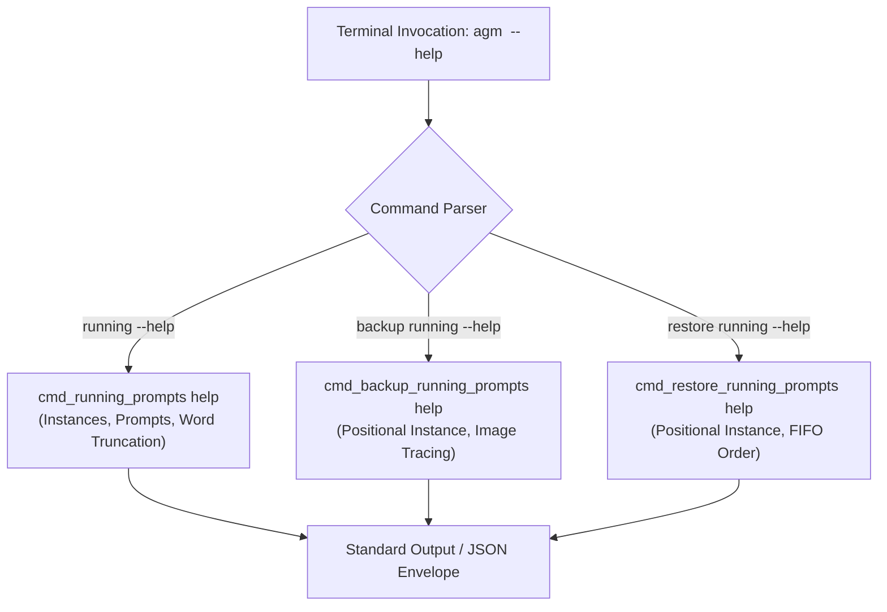
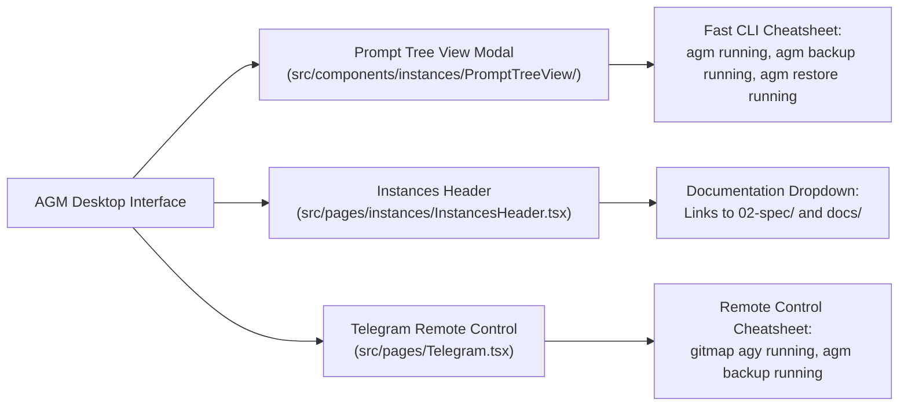
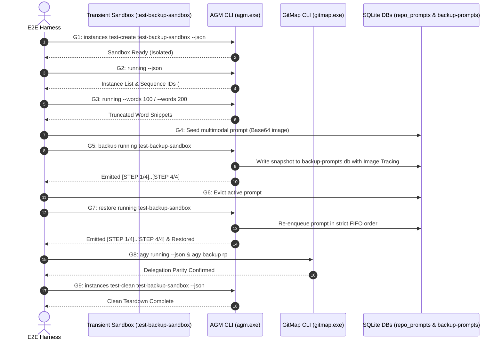

# CLI & UI Testing for Antigravity Backups: Verification, Terminal Help & Release Specification

## 1. Scope & System Invariants

This specification defines the formal requirements, terminal help segments, UI cheatsheet integrations, automated end-to-end verification protocols, and release governance for the Antigravity-Manager (AGM) running prompt backup, restoration, and GitMap delegation subsystem (`cli-and-ui-testing-for-antigravity-backups`).

### 1.1 Core System Invariants

1. **Strictly Relative Paths Invariant**: All file references, documentation links, command templates, and test scripts must record strictly repository-relative Git paths (e.g., `02-spec/...`, `.ai-memory/...`, `scripts/...`, `src/...`, `src-tauri/...`). Absolute filesystem paths are strictly prohibited across all documentation, plans, changelogs, and release notes.
2. **Caller IDE Self-Preservation**: Automated test suites, CLI dispatchers, and auto-switcher daemons must detect and shield the caller's active IDE process (`detect_caller_instance_id()`). Commands targeting the caller instance (`agm instances stop`, `rm`, `switch`) must fail-fast with exit code 2 unless `--force` is explicitly provided.
3. **Transient Test Sandboxing**: Verification suites must execute inside ephemeral, isolated test sandboxes created via `agm instances test-create <name> --json` and completely eradicated via `agm instances test-clean <name> --json`, leaving zero orphan processes or filesystem remnants.
4. **FIFO Restore & Queue Invariant**: All prompt backup, restore, dispatch, and queue processing queries across SQLite databases (`active_prompts`, `prompt_backups`, `repo_prompts.db`) must enforce strict First-In-First-Out ordering using `ORDER BY created_at ASC, id ASC`.
5. **Strict Contributor Attribution**: Release documentation and changelogs must strictly attribute `@aukgit` (`(Thanks to @aukgit)`). No other GitHub user handles may appear in release changelogs or release notes.
6. **No Silent Errors**: Every fallible operation must route through `AppError` in Rust or `useErrorStore` in TypeScript. Swallowing errors with bare `let _ = ...`, `.ok()`, or empty `catch {}` blocks is strictly forbidden. Best-effort operations must invoke `crate::error::record_ignored` with a justification comment.

---

## 2. Terminal Help Segments Specification

The terminal interface must provide dedicated, self-documenting help segments for running prompt inspection, backup, and restoration. Each help banner must support human-readable table rendering, structured JSON schema output (`--json`), and comprehensive examples.



### 2.1 `agm running --help`

#### Synopsis
```text
agm running [ls] [options]
agm running-prompts [ls] [options]
agm active [options]
```

#### Description
Inspect all active running prompts across Antigravity IDE instances. Displays an instance summary header followed by per-instance active prompt listings with configurable word truncation, dual sequence identifiers (`[AGM:P001 | GM:#1]`, `[AGM:C001 | GM:<cid>]`), and attached image metrics.

#### Options & Arguments
- `ls`, `list`: Explicit listing subcommand (default when no subcommand is passed).
- `--words <N>`, `--wc <N>`: Maximum words to display per prompt preview (range: `100..=200`, default: `100` or configured `prompt_preview_max_words`).
- `--limit <Y>`, `-l <Y>`: Limit the number of prompt records per instance (default: `8`).
- `--full`: Display full prompt instructions without word truncation.
- `--instance <id|#seq>`, `-i <id|#seq>`: Filter prompt listing to a specific sandbox instance or sequence number.
- `--json`: Output clean, machine-readable JSON envelope for automated tooling.
- `-h`, `--help`: Display this help banner and exit.

#### Human-Readable Terminal Help Output
```text
AGM Running Prompts & Instance Inspection:
  agm running [--json] [--words <N>] [--limit <Y>] [--full] [-i <instance>]

Description:
  Enumerate all sandbox instances with sequence numbers (#1, #2), active IDE processes,
  and running prompt queues with configurable word previews and attached image counts.

Subcommands & Aliases:
  agm running                  List running prompts across instances (default 100 words)
  agm running-prompts ls       Alias for running prompt inspection
  agm active                   Shorthand alias for active prompt inspection

Options:
  --words, --wc <N>   Maximum preview words (100-200, default: 100 or settings value)
  --limit, -l <Y>     Maximum prompt rows to display per instance (default: 8)
  --full              Show full prompt text without word truncation
  -i, --instance <id> Filter by instance profile name or sequence token (#1, #2)
  --json              Output structured JSON payload for CI/CD and automation
  -h, --help          Show this operational help segment

Examples:
  agm running                         # Inspect running prompts (100 words preview)
  agm running --words 200             # Inspect with expanded 200-word preview
  agm running --json                  # Output machine-readable JSON across all instances
  agm running -i #1                   # Inspect prompts for instance #1 only
  gitmap agy running --json           # GitMap parity invocation
```

#### Structured JSON Output Schema (`agm running --json`)
```json
{
  "total_instances": 2,
  "total_running_prompts": 3,
  "instances": [
    {
      "sequence_id": "#1",
      "instance_id": "default",
      "display_name": "Default IDE",
      "pid": 11588,
      "is_alive": true,
      "account_email": "dev-alpha@example.com",
      "running_count": 2,
      "prompts": [
        {
          "seq": 1,
          "prompt_id": "p-0192e4a1-872f-7bc3-96b1-912a781b2e54",
          "project_seq": "[AGM:P001 | GM:#1]",
          "conv_seq": "[AGM:C001 | GM:conv-89f1]",
          "project_name": "Antigravity-Manager",
          "status": "running",
          "has_images": true,
          "image_count": 2,
          "word_count": 142,
          "preview_snippet": "Implement running prompt backup with step-by-step image tracing...",
          "created_at": "2026-10-20T02:15:00Z"
        }
      ]
    }
  ]
}
```

---

### 2.2 `agm backup running --help`

#### Synopsis
```text
agm backup running [instance] [options]
agm running backup [options]
agm running-prompts backup [options]
```

#### Description
Take an atomic snapshot of active and in-flight prompts into the split SQLite database (`backup-prompts.db`). Automatically strips `"running"` noise when passed as a positional modifier, resolves optional instance targets, and streams step-by-step progress logging with multimodal image tracing.

#### Options & Arguments
- `[instance]`: Optional target instance name, ID, or sequence token (e.g., `#1`, `default`, `Worker-2`). If omitted, snapshots active prompts across all active instances.
- `-f`, `--file <path.db>`: Custom SQLite database path for prompt backups (default: `backup-prompts/backup-prompts.db`).
- `--json`: Output structured JSON execution payload.
- `-h`, `--help`: Display this help banner and exit.

#### Human-Readable Terminal Help Output
```text
AGM Backup Running Prompts (Split SQLite):
  agm backup running [instance] [-f <path.db>] [--json]
  agm running-prompts backup [-f <path.db>] [--json]

Description:
  Atomic parallel snapshot of active and queued prompts to the split SQLite database.
  Safely captures prompt text, dual sequence tokens, and attached multimodal images
  prior to account switching, system maintenance, or process termination.

Arguments:
  [instance]          Optional instance target name, ID, or sequence token (#1, #2).
                      If omitted, prompts across ALL instances are captured.

Options:
  -f, --file <file>   Target custom SQLite database path
  --json              Format snapshot telemetry as structured JSON
  -h, --help          Show this operational help segment

Step-by-Step Progress Logging:
  During execution, the CLI emits real-time step progress with image tracing:
    [STEP 1/4] Scanning active workspaces for running prompts...
    [STEP 2/4] Extracting multimodal image payloads and screenshot tokens...
    [STEP 3/4] Writing atomic snapshot batch to split SQLite database...
    [STEP 4/4] Writing .antigravity_resume_task.<inst>.json workspace seed...

Examples:
  agm backup running                  # Backup running prompts across all instances
  agm backup running #1               # Backup running prompts for instance #1 only
  agm backup running Worker-2         # Backup running prompts for named instance
  gitmap agy backup running-prompts   # GitMap parity invocation
  gitmap agy backup rp                # Shorthand GitMap parity invocation
```

---

### 2.3 `agm restore running --help`

#### Synopsis
```text
agm restore running [instance] [options]
agm running restore [options]
agm running-prompts restore [options]
```

#### Description
Restore and re-inject previously captured prompt snapshots from the split SQLite database back into active workspace FIFO queues (`repo_prompts.db:active_prompts`). Strips `"running"` modifier noise, supports targeted or global restoration, preserves strict FIFO order (`ORDER BY created_at ASC, id ASC`), and streams real-time image re-injection progress.

#### Options & Arguments
- `[instance]`: Optional target instance name, ID, or sequence token (e.g., `#1`, `default`). If omitted, prompts across all instances are restored.
- `-k`, `--keep`: Preserve backup records in unrestored state without starting the 1-day retention purge timer.
- `-f`, `--file <path.db>`: Source SQLite database file path.
- `--json`: Output structured JSON restore results.
- `-h`, `--help`: Display this help banner and exit.

#### Human-Readable Terminal Help Output
```text
AGM Restore Running Prompts (Split SQLite):
  agm restore running [instance] [--keep] [-f <path.db>] [--json]
  agm running-prompts restore [--keep] [-f <path.db>] [--json]

Description:
  Re-inject backed-up prompts from split SQLite database into active execution queues.
  Maintains strict FIFO sequence ordering and reconstructs multimodal image attachments.

Arguments:
  [instance]          Optional target instance name, ID, or sequence token (#1, #2).
                      If omitted, prompts for ALL instances are restored.

Options:
  -k, --keep          Preserve backup records without marking as restored
  -f, --file <file>   Target custom SQLite database path
  --json              Output structured JSON restore payload
  -h, --help          Show this operational help segment

Step-by-Step Progress Logging:
  During restore, the CLI streams real-time re-injection steps:
    [STEP 1/4] Reading latest unrestored backup batch from SQLite...
    [STEP 2/4] Verifying multimodal image payloads and local paths...
    [STEP 3/4] Re-enqueuing prompts into repo_prompts.db in FIFO stack order...
    [STEP 4/4] Seeding .antigravity_resume_task.json and signaling IDE watcher...

Examples:
  agm restore running                 # Restore prompts across all instances
  agm restore running #1              # Restore prompts for instance #1 only
  agm restore running Worker-2        # Restore prompts for named instance
  agm restore running --keep          # Restore prompts while preserving backup state
  gitmap ag restore running-prompts   # GitMap parity invocation
  gitmap ag restore rp #1             # Shorthand GitMap restore for instance #1
```

---

## 3. UI Help Documentation & Command Cheatsheet Specification

The graphical user interface must provide non-intrusive, dark-glass documentation links and interactive CLI cheatsheets directly within the relevant operational contexts.



### 3.1 Fast CLI Cheatsheet Component Design

1. **Visual Styling**:
   - Encapsulated in a segmented dark-glass card (`bg-slate-50 dark:bg-[#090611]`, border `border-slate-200 dark:border-[#40285e]`, rounded `rounded-xl`).
   - Monospace font (`font-mono text-[11px]`) with distinct command tokens.
   - Click-to-copy button with visual feedback (`Copy` icon transitions to emerald `Check` icon for 1.8 seconds).
2. **Standard Cheatsheet Commands**:
   - `agm running --json`: Enumerate instances and running prompts in JSON.
   - `agm running --words 200`: Inspect running prompts with expanded 200-word preview.
   - `agm backup running`: Take snapshot of all active prompts with images.
   - `agm backup running #1`: Snapshot prompts for instance #1 with image tracing.
   - `agm restore running`: Restore all prompts into FIFO queue.
   - `agm restore running #1`: Restore prompts for instance #1.
   - `gitmap agy running --json`: GitMap parity running prompt inspection.
   - `gitmap agy ff`: Fast-forward account rotation via GitMap delegation.
   - `gitmap agy backup rp`: GitMap running prompt backup shorthand.
   - `gitmap ag restore rp`: GitMap running prompt restore shorthand.

### 3.2 UI Documentation Links

Toolbars and modal footers must provide direct markdown documentation links:
- **Prompt Tree View Modal Footer**: Link to `02-spec/21-app/cli-and-ui-testing-for-antigravity-backups/03-verification-and-help-spec.md` with label `Prompt Backup & CLI Guide`.
- **Instances Header Toolbar**: Help dropdown linking to:
  - `docs/release_guide.md`: Release and version management.
  - `02-spec/21-app/cli-and-ui-testing-for-antigravity-backups/03-verification-and-help-spec.md`: CLI verification and help segments.
  - `02-spec/21-app/account-switch-testing-with-antigravity-tools/01-architecture-spec.md`: Account switching and quota governance.

---

## 4. End-to-End Verification Protocol (`scripts/test-agm-gitmap-running-backup-e2e.ps1`)

The automated PowerShell verification suite tests the entire running prompt inspection, multimodal backup, word truncation, and restoration lifecycle across AGM and GitMap CLI interfaces.

### 4.1 Verification Gate Matrix (G1 through G9)

| Gate # | Phase | Verification Rule | Command / Target | Pass Condition |
| :--- | :--- | :--- | :--- | :--- |
| **G1** | Sandbox Provisioning | Isolated instance setup | `agm instances test-create test-backup-sandbox --json` | Exit code 0, isolated AppData directory created, caller IDE PID protected |
| **G2** | Instance & Prompt Discovery | Enumeration and running prompts | `agm running --json` & `gitmap agy running --json` | Valid JSON array, sequence tokens (`#1`, `#2`) present, running count matches |
| **G3** | Word Preview Truncation | Configurable word limit | `agm running --words 100` vs `agm running --words 200` | Word count clamped to configured boundaries, suffix `...` appended on truncation |
| **G4** | Multimodal Prompt Seeding | Prompt with image attachment | `agm queue "Test prompt" --instance test-backup-sandbox` | Row inserted into `repo_prompts.db:active_prompts`, `has_images = 1`, valid image payload |
| **G5** | Step-by-Step Backup | Snapshot with image tracing | `agm backup running test-backup-sandbox` | Steps 1/4 through 4/4 emitted, row written to `backup-prompts.db`, image paths verified |
| **G6** | Active Queue Eviction | Simulate rotation / IDE restart | Direct SQLite or purge command | Active prompt row cleared from `active_prompts`, backup batch preserved |
| **G7** | Step-by-Step Restore | Positional restore with FIFO order | `agm restore running test-backup-sandbox` | Steps 1/4 through 4/4 emitted, prompt re-enqueued, FIFO timestamp intact |
| **G8** | GitMap Delegation Parity | GitMap CLI route validation | `gitmap agy running` & `gitmap agy backup rp` | Output matches AGM native execution, exit code 0 |
| **G9** | Teardown & Hygiene | Complete sandbox cleanup | `agm instances test-clean test-backup-sandbox --json` | Zero leftover test directories or processes, caller IDE remains completely healthy |

### 4.2 PowerShell E2E Test Script Specification

The script must be saved at `scripts/test-agm-gitmap-running-backup-e2e.ps1` with the following execution architecture:



---

## 5. Release Ceremony & Version Governance Specification

Following successful E2E test verification and code audit, the release author must execute the formal release ceremony adhering to all project governance rules.

### 5.1 Version Bump Invariants
- **Version Transition**: `v4.238.3` $\rightarrow$ `v4.239.0` (SemVer Minor Bump).
- **Automation Command**: `npm run bump minor`.
  - Automatically synchronizes `package.json`, `package-lock.json`, `src-tauri/Cargo.toml`, `src-tauri/Cargo.lock`, `src-tauri/tauri.conf.json`, `src-tauri/src/bin/agm/common.rs`, and related manifests across all 14 designated locations.
  - Skeletons release headings in `changelog.md` and `changelog_en.md`.

### 5.2 Contributor Attribution Invariant
- **Rule**: Audit Git commit log (`<last-tag>..HEAD`). Attribution must attribute **strictly** `@aukgit` (`(Thanks to @aukgit)`) in `changelog.md` and `changelog_en.md`.
- **Prohibition**: Do **NOT** include any other GitHub user handles (`@...`) in release changelogs or release notes. This guarantees the GitHub release page contributors list contains only `aukgit` and none else.

### 5.3 Documentation & README Synchronization
- **Mandatory Update**: For stable releases, the release author **MUST** update the release summary in both:
  1. `README.md` (under `## 📝 更新日志`)
  2. `README_EN.md` (under `## 📝 Changelog`)
- Leaving `README.md` / `README_EN.md` with outdated release notes while updating `CHANGELOG.md` is strictly forbidden.

### 5.4 Pre-Flight Quality Gates
Before tagging or pushing the release commit, the following three local pre-flight gates must pass without error:

1. **Rust Formatting**:
   ```bash
   cd src-tauri && cargo fmt -- --check
   ```
2. **Rust Clippy Gate**:
   ```bash
   cd src-tauri && cargo clippy --all-targets --all-features
   ```
3. **Frontend Compilation**:
   ```bash
   npm run build
   ```

### 5.5 CI/CD Telemetry Inspection & GitMap Verification
- **Pipeline Telemetry**: Run `gitmap pe -t` to inspect CI/CD execution telemetry, failure stack traces, and workflow status.
- **Pipeline Suggestions**: Run `gitmap sug` to verify zero pending lint or workflow remediation recommendations.
- **Git Push & Tag**: Stable release must be tagged and pushed to `main`:
  ```bash
  git tag v4.239.0
  git push origin main
  git push origin v4.239.0
  ```
