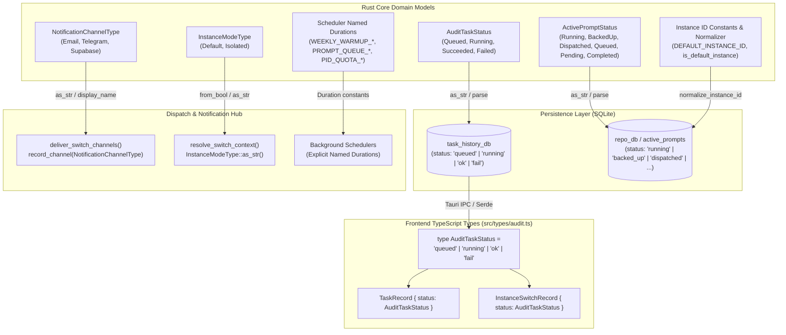

# Specification: Code Dryness, Constants, Enums & Status Centralization

> **Spec ID:** `code-dryness-and-guard-inversion-01`  
> **Status:** APPROVED & IN DESIGN  
> **Scope:** AuditTaskStatus, ActivePromptStatus, NotificationChannelType, InstanceModeType, Default Instance ID Normalization, Scheduler Durations & Timeouts, Frontend TypeScript Type Alignment  
> **Target Block:** Block 1 (Constants, Enums & Status Centralization)  
> **Related Plans:** [01-constants-and-enums.md](../../../.ai-memory/plans/subtasks/code-dryness-and-guard-inversion/01-constants-and-enums.md)

---

## 1. Executive Summary

In Antigravity Manager (`AGM`), cross-module coordination—encompassing task audit histories, prompt lifecycle queues, multi-channel alerting, instance profile sandboxing, and background schedulers—is fundamental to real-time operations. Historically, however, multiple subsystems evolved using "stringly-typed" status strings, ad-hoc string comparisons (`status == "ok"`, `status == "running"`, `instance_id == "default" || instance_id == "__default__"`), and inline numeric literals for operational durations (`Duration::from_secs(60)`, `Duration::from_secs(300)`).

This proliferation of scattered magic strings and inline durations incurs significant architectural debt:
1. **Silent Logic Drift & Typos:** A typo such as `"queue"` vs `"queued"` or `"fail"` vs `"failed"` fails silently at runtime rather than producing a compile-time failure.
2. **Duplicated Normalization Logic:** The default profile check (`id == "default" || id == "__default__" || id.is_empty()`) is redundantly implemented in over 25 distinct locations across `src-tauri/src/modules/repo_db/` and `src-tauri/src/modules/instance/`.
3. **Implicit Protocol Divergence:** SQLite databases store legacy wire formats (e.g., `"ok"`, `"fail"`, `"backed_up"`, `"dispatched"`), while frontend TypeScript interfaces rely on unstructured `string` fields, masking schema mismatches.
4. **Violation of the 30-Second Invariant:** Inline duration literals in background daemons obfuscate timing guarantees and risk violating the project's strict rule that no polling scheduler may run faster than once every 30 seconds (`interval >= 30s`) without backoff.

This specification establishes the architectural foundation for **Block 1: Constants, Enums & Status Centralization**. It formalizes type-safe Rust enums with zero-allocation conversions, centralizes default instance identification and normalization, establishes a single source of truth for scheduler timing constants, and enforces strict TypeScript type parity.

---

## 2. System Architecture & Information Flow

The centralization of statuses, channel types, and timing invariants creates a unified contract spanning the Rust backend, SQLite persistence layers, IPC boundary, and React frontend:



---

## 3. Subsystem Technical Specifications

### 3.1 Task History Status Centralization (`src-tauri/src/modules/task_history_db/types.rs`)

The `task_history_db` records long-running and asynchronous operations (account switches, scheduler runs, prompt restores, and cache sweeps). Currently, statuses are manipulated as bare string literals (`"queued"`, `"running"`, `"ok"`, `"fail"`).

#### 3.1.1 Enum Definition: `AuditTaskStatus`
In `src-tauri/src/modules/task_history_db/types.rs`, define:

```rust
use serde::{Deserialize, Serialize};
use std::fmt;
use std::str::FromStr;

#[derive(Debug, Clone, Copy, PartialEq, Eq, Hash, Serialize, Deserialize)]
#[serde(rename_all = "lowercase")]
pub enum AuditTaskStatus {
    Queued,
    Running,
    #[serde(rename = "ok")]
    Succeeded,
    #[serde(rename = "fail")]
    Failed,
}

impl AuditTaskStatus {
    /// Return the wire string format persisted in SQLite and communicated over IPC.
    #[inline]
    pub const fn as_str(&self) -> &'static str {
        match self {
            Self::Queued => "queued",
            Self::Running => "running",
            Self::Succeeded => "ok",
            Self::Failed => "fail",
        }
    }

    /// Check if the task has concluded execution.
    #[inline]
    pub const fn is_terminal(&self) -> bool {
        matches!(self, Self::Succeeded | Self::Failed)
    }

    /// Check if the task is actively queued or running.
    #[inline]
    pub const fn is_in_flight(&self) -> bool {
        matches!(self, Self::Queued | Self::Running)
    }
}

impl fmt::Display for AuditTaskStatus {
    fn fmt(&self, f: &mut fmt::Formatter<'_>) -> fmt::Result {
        f.write_str(self.as_str())
    }
}

impl FromStr for AuditTaskStatus {
    type Err = String;

    fn from_str(s: &str) -> Result<Self, Self::Err> {
        match s.trim().to_ascii_lowercase().as_str() {
            "queued" => Ok(Self::Queued),
            "running" => Ok(Self::Running),
            "ok" | "succeeded" | "success" => Ok(Self::Succeeded),
            "fail" | "failed" | "error" => Ok(Self::Failed),
            other => Err(format!("Unknown AuditTaskStatus: '{other}'")),
        }
    }
}
```

#### 3.1.2 Integration with `AuditTask` RAII Guard
The `AuditTask` lifecycle guard manages initial enqueueing and eventual completion:
- `AuditTask::start(action, subject, instance_id)` invokes `enqueue(action, subject, AuditTaskStatus::Queued.as_str(), instance_id)`.
- `succeed(&mut self, detail)` delegates to `self.finish(AuditTaskStatus::Succeeded, detail, None)`.
- `succeed_with_payload(&mut self, detail, payload_json)` delegates to `self.finish(AuditTaskStatus::Succeeded, detail, Some(payload_json))`.
- `fail(&mut self, detail)` delegates to `self.finish(AuditTaskStatus::Failed, detail, None)`.
- `finish(&mut self, status: AuditTaskStatus, detail: &str, payload_json: Option<&str>)` passes `status.as_str()`.
- `Drop for AuditTask` defaults unfinalized tasks to `AuditTaskStatus::Failed.as_str()`.

---

### 3.2 Active Prompt Status Centralization (`src-tauri/src/modules/repo_db/models.rs`)

The `repo_db` subsystem tracks prompts captured from running IDEs, snapshot backups for profile switches, and queue dispatches. Current queries use hardcoded string checks (`status IN ('running', 'in_flight', 'dispatched')`, `ap.status == "queued" || ap.status == "pending"`).

#### 3.2.1 Enum Definition: `ActivePromptStatus`
In `src-tauri/src/modules/repo_db/models.rs`, define:

```rust
use serde::{Deserialize, Serialize};
use std::fmt;
use std::str::FromStr;

#[derive(Debug, Clone, Copy, PartialEq, Eq, Hash, Serialize, Deserialize)]
#[serde(rename_all = "snake_case")]
pub enum ActivePromptStatus {
    Running,
    BackedUp,
    Dispatched,
    Queued,
    Pending,
    Completed,
}

impl ActivePromptStatus {
    /// Return the canonical database string representation.
    #[inline]
    pub const fn as_str(&self) -> &'static str {
        match self {
            Self::Running => "running",
            Self::BackedUp => "backed_up",
            Self::Dispatched => "dispatched",
            Self::Queued => "queued",
            Self::Pending => "pending",
            Self::Completed => "completed",
        }
    }

    /// Check if the prompt is actively executing or dispatched.
    #[inline]
    pub const fn is_active(&self) -> bool {
        matches!(self, Self::Running | Self::Dispatched)
    }

    /// Check if the prompt is waiting in the dispatch queue.
    #[inline]
    pub const fn is_queued_or_pending(&self) -> bool {
        matches!(self, Self::Queued | Self::Pending)
    }

    /// Check if the prompt reached terminal completion.
    #[inline]
    pub const fn is_terminal(&self) -> bool {
        matches!(self, Self::Completed)
    }
}

impl fmt::Display for ActivePromptStatus {
    fn fmt(&self, f: &mut fmt::Formatter<'_>) -> fmt::Result {
        f.write_str(self.as_str())
    }
}

impl FromStr for ActivePromptStatus {
    type Err = String;

    fn from_str(s: &str) -> Result<Self, Self::Err> {
        match s.trim().to_ascii_lowercase().as_str() {
            "running" => Ok(Self::Running),
            "backed_up" | "backedup" => Ok(Self::BackedUp),
            "dispatched" | "in_flight" => Ok(Self::Dispatched),
            "queued" => Ok(Self::Queued),
            "pending" => Ok(Self::Pending),
            "completed" | "done" => Ok(Self::Completed),
            other => Err(format!("Unknown ActivePromptStatus: '{other}'")),
        }
    }
}
```

#### 3.2.2 Query Constants
To maintain strict query fidelity and eliminate string typos in SQLite prepared statements across `repo_db/tree_phases.rs`, `repo_db/queue.rs`, and `repo_db/tree_format.rs`:
- `ACTIVE_PROMPT_IN_FLIGHT_STATUSES: &[&str] = &["running", "in_flight", "dispatched"];`
- `ACTIVE_PROMPT_QUEUED_STATUSES: &[&str] = &["queued", "pending"];`

---

### 3.3 Notification Channel Type Centralization (`src-tauri/src/modules/notification_hub/channels.rs`)

The notification hub alerts administrators across multiple communication channels when account switches occur or quotas are depleted. Currently, `record_channel` consumes bare `&str` values (`"email"`, `"telegram"`, `"supabase"`).

#### 3.3.1 Enum Definition: `NotificationChannelType`
In `src-tauri/src/modules/notification_hub/channels.rs`, define:

```rust
use std::fmt;

#[derive(Debug, Clone, Copy, PartialEq, Eq, Hash)]
pub enum NotificationChannelType {
    Email,
    Telegram,
    Supabase,
}

impl NotificationChannelType {
    #[inline]
    pub const fn as_str(&self) -> &'static str {
        match self {
            Self::Email => "email",
            Self::Telegram => "telegram",
            Self::Supabase => "supabase",
        }
    }

    #[inline]
    pub const fn display_name(&self) -> &'static str {
        match self {
            Self::Email => "Email Alert",
            Self::Telegram => "Telegram Bot",
            Self::Supabase => "Supabase Fleet Sync",
        }
    }
}

impl fmt::Display for NotificationChannelType {
    fn fmt(&self, f: &mut fmt::Formatter<'_>) -> fmt::Result {
        f.write_str(self.as_str())
    }
}
```

#### 3.3.2 Refactoring `record_channel`
Refactor `record_channel` signature to:
```rust
pub(crate) fn record_channel(channel: NotificationChannelType, result: Result<String, String>) -> String
```
Logs format consistently as:
- `[Notify] email: OK ...`
- `[Notify] telegram: FAIL ...`
- `[Notify] supabase: OK ...`

---

### 3.4 Instance Mode Type Centralization (`src-tauri/src/modules/notification_hub/switch_context.rs`)

The switch notification payload categorizes whether an account switch affected the default shared instance or an isolated sandbox instance.

#### 3.4.1 Enum Definition: `InstanceModeType`
In `src-tauri/src/modules/notification_hub/switch_context.rs`, define:

```rust
use std::fmt;

#[derive(Debug, Clone, Copy, PartialEq, Eq, Hash)]
pub enum InstanceModeType {
    Default,
    Isolated,
}

impl InstanceModeType {
    #[inline]
    pub const fn as_str(&self) -> &'static str {
        match self {
            Self::Default => "default",
            Self::Isolated => "isolated",
        }
    }

    #[inline]
    pub const fn from_bool(is_default: bool) -> Self {
        if is_default {
            Self::Default
        } else {
            Self::Isolated
        }
    }

    #[inline]
    pub const fn is_default(&self) -> bool {
        matches!(self, Self::Default)
    }
}

impl fmt::Display for InstanceModeType {
    fn fmt(&self, f: &mut fmt::Formatter<'_>) -> fmt::Result {
        f.write_str(self.as_str())
    }
}
```

#### 3.4.2 Integration into `resolve_switch_context`
In `resolve_switch_context(new_email: &str, instance_spec: &str)`:
```rust
let instance_mode = InstanceModeType::from_bool(is_default);
(old_email, inst_id, inst_name, instance_mode.as_str().to_string())
```

---

### 3.5 Default Instance ID Normalization (`src-tauri/src/modules/instance.rs` & `repo_db.rs`)

Antigravity uses both `"default"` and legacy `"__default__"` (or empty string `""`) to denote the un-sandboxed default system profile. Currently, over 25 files scatter inline checks:
`if instance_id == "__default__" || instance_id == "default" || instance_id.is_empty()`

#### 3.5.1 Central Constants & Pure Helper Functions
In `src-tauri/src/modules/instance.rs` (and re-exported through `src-tauri/src/modules/repo_db.rs`):

```rust
/// Canonical identifier for the default shared instance.
pub const DEFAULT_INSTANCE_ID: &str = "default";

/// Legacy internal identifier for the default instance preserved for backward database compatibility.
pub const LEGACY_DEFAULT_INSTANCE_ID: &str = "__default__";

/// Determine whether the given instance identifier designates the default instance.
/// Matches "default", "__default__", or an empty / whitespace-only string.
#[inline]
pub fn is_default_instance(id: &str) -> bool {
    let trimmed = id.trim();
    trimmed.is_empty()
        || trimmed.eq_ignore_ascii_case(DEFAULT_INSTANCE_ID)
        || trimmed == LEGACY_DEFAULT_INSTANCE_ID
}

/// Normalize an arbitrary instance identifier: returns "default" if it represents
/// the default instance, or the trimmed identifier otherwise.
#[inline]
pub fn normalize_instance_id<'a>(id: &'a str) -> &'a str {
    if is_default_instance(id) {
        DEFAULT_INSTANCE_ID
    } else {
        id.trim()
    }
}
```

#### 3.5.2 Elimination of Scattered Logic
This normalizer directly replaces repetitive branching across:
- `repo_db/detection.rs`
- `repo_db/dispatch.rs`
- `repo_db/gemini_dirs.rs`
- `repo_db/liveness.rs`
- `repo_db/queue.rs`
- `repo_db/resend.rs`
- `repo_db/restore.rs`
- `repo_db/tree_collect.rs`
- `repo_db/tree_nodes.rs`
- `repo_db/tree_phases.rs`

---

### 3.6 Scheduler Durations & Timeouts Centralization (`src-tauri/src/modules/scheduler.rs`)

`src-tauri/src/modules/scheduler.rs` governs three long-running background tasks. All inline `Duration::from_secs(...)` calls must be lifted to top-level named constants.

#### 3.6.1 Constants Table

| Constant Identifier | Value | Target Subsystem / Loop | Purpose / Invariant Justification |
| :--- | :--- | :--- | :--- |
| `WEEKLY_WARMUP_STARTUP_DELAY` | `Duration::from_secs(60)` | `start_scheduler` | Enforces the 60s startup quiet period after app launch before first scan. |
| `WEEKLY_WARMUP_SCAN_INTERVAL` | `Duration::from_secs(300)` | `start_scheduler` | 5-minute periodic interval to scan accounts nearing their 7-day reset. |
| `MODEL_WARMUP_THROTTLE_DELAY` | `Duration::from_secs(2)` | `start_scheduler` | Paces sequential model warmup requests to prevent upstream 429 bursts. |
| `WARMUP_UI_REFRESH_DELAY` | `Duration::from_secs(2)` | `start_scheduler` | Brief delay after warmup completion before triggering UI quota refresh. |
| `PROMPT_QUEUE_STARTUP_DELAY` | `Duration::from_secs(5)` | `start_prompt_queue_scheduler` | Initial pause before activating background adaptive FIFO prompt queue ticker. |
| `PROMPT_QUEUE_ACTIVE_POLL_INTERVAL` | `Duration::from_secs(5)` | `start_prompt_queue_scheduler` | Fast 5s ticker interval while pending prompts await idle IDE slots. |
| `PROMPT_QUEUE_IDLE_BACKOFF_INTERVAL` | `Duration::from_secs(30)` | `start_prompt_queue_scheduler` | Idle 30s backoff interval when queue is empty, strictly adhering to the 30s floor. |
| `PID_QUOTA_SYNC_STARTUP_DELAY` | `Duration::from_secs(35)` | `start_instance_pid_quota_scheduler` | Startup quiet pause before initiating background instance PID sync. |
| `PID_QUOTA_SYNC_INTERVAL` | `Duration::from_secs(600)` | `start_instance_pid_quota_scheduler` | 10-minute periodic cycle inspecting live PIDs and syncing quotas. |
| `WARMUP_HISTORY_RETENTION_SECS` | `30 * 86_400` (i64) | `start_scheduler` | 30-day retention cutoff for historical warmup event records. |

#### 3.6.2 Implementation in `src-tauri/src/modules/scheduler.rs`
```rust
// --- Scheduler Timing & Duration Constants ---
pub const WEEKLY_WARMUP_STARTUP_DELAY: Duration = Duration::from_secs(60);
pub const WEEKLY_WARMUP_SCAN_INTERVAL: Duration = Duration::from_secs(300);
pub const MODEL_WARMUP_THROTTLE_DELAY: Duration = Duration::from_secs(2);
pub const WARMUP_UI_REFRESH_DELAY: Duration = Duration::from_secs(2);
pub const PROMPT_QUEUE_STARTUP_DELAY: Duration = Duration::from_secs(5);
pub const PROMPT_QUEUE_ACTIVE_POLL_INTERVAL: Duration = Duration::from_secs(5);
pub const PROMPT_QUEUE_IDLE_BACKOFF_INTERVAL: Duration = Duration::from_secs(30);
pub const PID_QUOTA_SYNC_STARTUP_DELAY: Duration = Duration::from_secs(35);
pub const PID_QUOTA_SYNC_INTERVAL: Duration = Duration::from_secs(600);
pub const WARMUP_HISTORY_RETENTION_SECS: i64 = 30 * 86_400;
```

---

### 3.7 TypeScript Frontend Type Alignment (`src/types/audit.ts`)

In the frontend, `TaskRecord.status` and `InstanceSwitchRecord.status` are currently untyped `string` primitives. This creates ambiguity when rendering status badges, spinning states, and completion indicators.

#### 3.7.1 Type Definition & Property Alignment
In `src/types/audit.ts`, export the canonical status union and update models:

```typescript
/**
 * Canonical task execution status emitted by the task history database.
 * - 'queued': Task is scheduled and awaiting execution slot.
 * - 'running': Task is actively executing.
 * - 'ok': Task finished successfully.
 * - 'fail': Task terminated with an error or unhandled panic.
 */
export type AuditTaskStatus = 'queued' | 'running' | 'ok' | 'fail';

export interface TaskRecord {
    id: string;
    action_code: number;
    action: string;
    action_label: string;
    status: AuditTaskStatus | string;
    subject: string;
    detail: string;
    instance_id: string;
    split_path: string;
    from_email?: string;
    to_email?: string;
    created_at: number;
    finished_at?: number | null;
}

export interface InstanceSwitchRecord {
    id: string;
    from_email: string;
    to_email: string;
    created_at: number;
    finished_at?: number | null;
    status: AuditTaskStatus | string;
    switch_reason: string;
    how: string;
    steps?: SwitchAuditSteps;
    raw_payload?: string;
}
```

#### 3.7.2 Exported Type Guards
```typescript
/** Check if a task status represents a completed terminal state. */
export function isTaskTerminal(status: AuditTaskStatus | string): boolean {
    return status === 'ok' || status === 'fail';
}

/** Check if a task status represents an in-flight active state. */
export function isTaskInFlight(status: AuditTaskStatus | string): boolean {
    return status === 'queued' || status === 'running';
}
```

---

## 4. Architectural Invariants

1. **Zero Raw Status String Comparisons:** Internal backend dispatch routines, guards, and status mutations must not compare string literals (e.g. `s == "ok"`). They must match on typed enums (`AuditTaskStatus::Succeeded`, `ActivePromptStatus::Running`).
2. **Backward Database Compatibility:** Database columns in SQLite remain `TEXT` with established string values (`"ok"`, `"fail"`, `"queued"`, `"running"`, `"backed_up"`, `"dispatched"`, `"default"`, `"__default__"`). Enums must serialize and deserialize to these exact strings without database migration requirements.
3. **Strict 30-Second Polling Floor:** All scheduler loop durations must be explicit named constants. Background idle polling loops must maintain a floor of at least 30 seconds (`PROMPT_QUEUE_IDLE_BACKOFF_INTERVAL = 30s`).
4. **FIFO Dispatch Invariant:** Centralization of prompt statuses must preserve strict First-In-First-Out ordering (`ORDER BY created_at ASC, id ASC`) across all queries.
5. **No Silent Failures:** Parsing of unknown string representations via `FromStr` must return a descriptive `Err`, never a swallowed default or silent panic.

---

## 5. Verification Matrix & Quality Gates

| Verification Gate | Command | Expected Outcome |
| :--- | :--- | :--- |
| **Rust Code Formatting** | `cargo fmt -- --check` | Zero formatting differences across touched Rust modules. |
| **Rust Compilation & Clippy** | `cargo clippy --all-targets --all-features` | Zero warnings and zero errors across all modules. |
| **Rust Unit Tests** | `cargo test modules::task_history_db` | All enum string conversions, parsing, and RAII tests pass. |
| **TypeScript Compilation** | `npm run build` | Vite build completes cleanly; zero type errors against `AuditTaskStatus`. |
| **IPC Contract Stability** | Mock Task Enqueue & Retrieval | JSON payloads match expected wire schema (`"status": "ok"`). |

---

## 6. Implementation References

- Implementation Subtask Plan: [01-constants-and-enums.md](../../../.ai-memory/plans/subtasks/code-dryness-and-guard-inversion/01-constants-and-enums.md)
- Subsystem Invariants: `AGENTS.md` (FIFO Restore, System-Wide Broadcasting, No Silent Errors)
