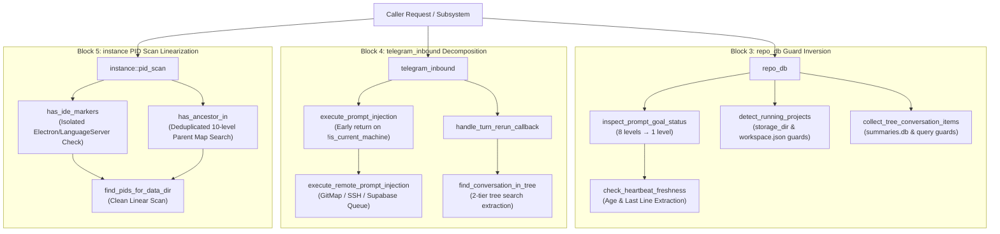

# Component Specification: Nested If Flattening, Guard Inversion & Function Decomposition

> **Document:** `02-spec/21-app/code-dryness-and-guard-inversion/02-component-spec.md`  
> **Associated Plan:** `.ai-memory/plans/subtasks/code-dryness-and-guard-inversion/02-nested-if-and-guard-clauses.md`  
> **Master Plan:** `.ai-memory/plans/code-dryness-100-steps-master-plan.md` (Blocks 3, 4, 5)  
> **Status:** APPROVED & READY FOR WORKER 02  
> **Author:** Spec Author 02  
> **Primary Attribution:** `@aukgit` (`(Thanks to @aukgit)`)  
> **Target Scope:**
> - `src-tauri/src/modules/repo_db/goal_heartbeat.rs` (`inspect_prompt_goal_status`, helper extraction `check_heartbeat_freshness`)
> - `src-tauri/src/modules/repo_db/detection.rs` (`detect_running_projects`, workspace storage loop guard clauses)
> - `src-tauri/src/modules/repo_db/tree_collect.rs` (`collect_tree_conversation_items`, summaries SQLite loop guard clauses)
> - `src-tauri/src/modules/telegram_inbound/injection.rs` (`execute_prompt_injection`, helper extraction `execute_remote_prompt_injection`)
> - `src-tauri/src/modules/telegram_inbound/send_flow.rs` (`handle_turn_rerun_callback`, helper extraction `find_conversation_in_tree`)
> - `src-tauri/src/modules/instance/pid_scan.rs` (`find_pids_for_data_dir`, helper extraction `has_ide_markers`, `has_ancestor_in`)

---

## 1. Executive Summary & Core Invariants

### 1.1 Objective
Eliminate deep "Pyramid of Doom" nesting, monolithic control flow branches, and repetitive loop traversals across the core backend modules (`repo_db`, `telegram_inbound`, and `instance`). By applying the **Guard Clause Inversion Principle (Quick Exit)**, Rust's `let ... else { continue; / return ...; }` syntax, and targeted helper extractions, maximum nesting depth across critical paths is reduced from 8 levels down to 1 level, maintaining 100% behavioral parity and zero runtime regressions.

### 1.2 Core Architectural Invariants
1. **Invariant 1: Guard Clause Precedence (Fail Fast / Quick Exit)**: Invert validation conditions (`if !condition { return/continue; }`) immediately upon entry. Happy path execution MUST stay at root indentation level (depth 1).
2. **Invariant 2: No Silent Errors (House Rule)**: Never introduce bare `.ok()` or suppress fallible operations during refactoring. Operations requiring best-effort continuation must route through `crate::error::record_ignored(result, "context")` with an explicit `// Justification:` comment.
3. **Invariant 3: Strict FIFO Queue Ordering**: All prompt restore and dispatch logic in `repo_db` preserves `ORDER BY created_at ASC, id ASC`.
4. **Invariant 4: Zero Structural Drift in Transcripts**: When querying SQLite databases (`conversation_summaries.db`, `repo_prompts.db`), column order, data types, and filtering heuristics (e.g. non-prompt filters, ghost conversation filters) remain strictly bit-identical.
5. **Invariant 5: Clean Decomposition (< 15 lines per helper)**: Extracted functions are pure, focused, and testable without side effects on caller state.

---

## 2. Problem Classification & Root Cause Analysis (RCA)

### 2.1 RCA 1: Pyramid of Doom in `repo_db` (Nesting Depths 6–8)
- **Symptoms:** High cognitive load, error-prone edits, and compiler warning accumulation when maintaining prompt goal heartbeats, workspace project detection, and conversation tree aggregation.
- **Root Cause:**
  1. In `src-tauri/src/modules/repo_db/goal_heartbeat.rs` (`inspect_prompt_goal_status`, lines 363–402):
     8 nested blocks:
     `for ws in workspaces` &rarr; `if cfg_p.exists()` &rarr; `if let Ok(c) = fs::read_to_string()` &rarr; `if let Ok(cfg) = serde_json::from_str()` &rarr; `if hb_p.exists()` &rarr; `if let Ok(meta) = fs::metadata()` &rarr; `if let Ok(modified) = meta.modified()` &rarr; `if age <= (cfg.interval_secs + 4)`.
  2. In `src-tauri/src/modules/repo_db/detection.rs` (`detect_running_projects`, lines 53–125):
     7 nested blocks:
     `if storage_dir.exists()` &rarr; `if let Ok(entries) = fs::read_dir()` &rarr; `for entry in entries.flatten()` &rarr; `if ws_folder.is_dir()` &rarr; `if ws_json_path.exists()` &rarr; `if let Ok(content) = fs::read_to_string()` &rarr; `if let Ok(json_val) = serde_json::from_str()`.
  3. In `src-tauri/src/modules/repo_db/tree_collect.rs` (`collect_tree_conversation_items`, lines 79–147):
     6 nested blocks:
     `for (owning_inst_id, base) in &candidate_dirs` &rarr; `if summaries_db.exists()` &rarr; `if let Ok(s_conn) = s_conn` &rarr; `if let Ok(mut stmt) = s_conn.prepare()` &rarr; `if let Ok(rows) = stmt.query_map()` &rarr; `for item in rows.flatten()`.
- **Surgical Remedy:** Apply `let ... else { continue; }` and inverted boolean guards (`if !path.exists() { continue; }`) to collapse all nested layers into a sequential, top-to-bottom pipeline. Extract heartbeat age and last line parsing into `check_heartbeat_freshness`.

### 2.2 RCA 2: Monolithic Function Branches in `telegram_inbound`
- **Symptoms:** `execute_prompt_injection` spans 374 lines with a massive top-level `if super::node_label::is_current_machine(&target_node) { ... } else { ... }` where both branches exceed 100 lines each. Similarly, `handle_turn_rerun_callback` embeds multi-level nested loops to search a 2D conversation tree.
- **Root Cause:**
  1. In `src-tauri/src/modules/telegram_inbound/injection.rs`: Local prompt dispatch and remote cluster dispatch (GitMap SSH, cluster exec, Supabase queue fallback) are coupled in a single monolithic function body.
  2. In `src-tauri/src/modules/telegram_inbound/send_flow.rs`: Conversation matching across active project trees iterates over projects and conversations with manual outer-loop break flags (`let mut matched_target = None;`).
- **Surgical Remedy:**
  - In `injection.rs`, invert the target node check: `if !super::node_label::is_current_machine(&target_node) { return execute_remote_prompt_injection(...).await; }`. Extract all remote GitMap/SSH/Supabase dispatch logic into `execute_remote_prompt_injection`. The local execution branch remains unindented in `execute_prompt_injection`.
  - In `send_flow.rs`, extract `find_conversation_in_tree(tree: &[ProjectConversationItem], cid8: &str) -> Option<(ProjectConversationItem, ConversationItem)>` to return matching targets directly without temporary variables or multi-level break flags.

### 2.3 RCA 3: Repeated Lineage Traversal & Inline Markers in `instance/pid_scan.rs`
- **Symptoms:** `find_pids_for_data_dir` in `src-tauri/src/modules/instance/pid_scan.rs` contains duplicated 10-level ancestor graph walking loops (lines 276–286 for default instances and lines 301–312 for named sandboxed instances). Furthermore, IDE process heuristic detection hardcodes a 19-line nested `if let Some(parent) = exe_path.parent()` check inline inside the loop.
- **Root Cause:** Process scanning logic conflates binary filesystem layout validation with PID graph traversal. Both default instance filtering (verifying ancestors are NOT in `instance_root_pids`) and named instance filtering (verifying ancestors ARE in `matched_set`) walk the exact same `parent_map` graph with identical depth bounds (`0..10`).
- **Surgical Remedy:**
  - Extract `has_ide_markers(exe: &str, name: &str) -> bool` to isolate language server and Electron runtime layout checks.
  - Extract `has_ancestor_in(start_pid: u32, parent_map: &HashMap<u32, u32>, target_set: &HashSet<u32>, max_depth: usize) -> bool` to deduplicate graph climbing.

---

## 3. Subsystem Detailed Specifications



---

### 3.1 Subsystem 1: `repo_db` Guard Inversion

#### 3.1.1 `src-tauri/src/modules/repo_db/goal_heartbeat.rs`
- **Target Function:** `pub fn inspect_prompt_goal_status(_instance_id: &str, workspaces: &[String]) -> (bool, Option<String>, Option<String>)`
- **Nesting Reduction:** 8 levels &rarr; 1 level
- **Extracted Helper:**
  ```rust
  /// Check heartbeat timestamp freshness and read the last non-empty line
  fn check_heartbeat_freshness(
      cfg: &PromptGoalHeartbeatConfig,
      now: i64,
  ) -> (bool, Option<String>) {
      let hb_p = Path::new(&cfg.heartbeat_file);
      if !hb_p.exists() {
          return (false, None);
      }

      let is_fresh = fs::metadata(hb_p)
          .ok()
          .and_then(|meta| meta.modified().ok())
          .map(|modified| {
              let dt: chrono::DateTime<Utc> = modified.into();
              let age = now - dt.timestamp();
              age <= (cfg.interval_secs as i64 + 4)
          })
          .unwrap_or(false);

      let last_line = fs::read_to_string(hb_p).ok().and_then(|content| {
          content
              .lines()
              .rev()
              .find(|l| !l.trim().is_empty())
              .map(|s| s.to_string())
      });

      (is_fresh, last_line)
  }
  ```
- **Refactored Loop Structure:**
  ```rust
  pub fn inspect_prompt_goal_status(
      _instance_id: &str,
      workspaces: &[String],
  ) -> (bool, Option<String>, Option<String>) {
      let now = Utc::now().timestamp();
      for ws in workspaces {
          let ws_p = Path::new(ws);
          let cfg_p = ws_p.join(".antigravity_goal_heartbeat.json");
          if !cfg_p.exists() {
              continue;
          }
          let Ok(c) = fs::read_to_string(&cfg_p) else {
              continue;
          };
          let Ok(cfg) = serde_json::from_str::<PromptGoalHeartbeatConfig>(&c) else {
              continue;
          };
          let (is_fresh, last_line) = check_heartbeat_freshness(&cfg, now);
          return (is_fresh, Some(cfg.heartbeat_file), last_line);
      }
      (false, None, None)
  }
  ```

#### 3.1.2 `src-tauri/src/modules/repo_db/detection.rs`
- **Target Function:** `pub fn detect_running_projects(instance_id: &str) -> Result<Vec<RunningProject>, String>`
- **Nesting Reduction:** 7 levels &rarr; 1 level
- **Refactored Pre-flight & Directory Scanning:**
  ```rust
  // If storage dir does not exist, return empty project list early
  if !storage_dir.exists() {
      invalidate_prompt_tree_cache(Some(target_id));
      return Ok(projects);
  }

  let Ok(entries) = fs::read_dir(&storage_dir) else {
      invalidate_prompt_tree_cache(Some(target_id));
      return Ok(projects);
  };

  for entry in entries.flatten() {
      let ws_folder = entry.path();
      if !ws_folder.is_dir() {
          continue;
      }

      let ws_json_path = ws_folder.join("workspace.json");
      if !ws_json_path.exists() {
          continue;
      }

      let Ok(content) = fs::read_to_string(&ws_json_path) else {
          continue;
      };

      let Ok(json_val) = serde_json::from_str::<serde_json::Value>(&content) else {
          continue;
      };

      let folder_uri = json_val
          .get("folder")
          .and_then(|v| v.as_str())
          .or_else(|| json_val.get("configuration").and_then(|v| v.as_str()));

      let Some(uri) = folder_uri else {
          continue;
      };

      let raw_path = decode_uri_to_path(uri);
      let project_path = Path::new(&raw_path);
      let repo_name = project_path
          .file_name()
          .map(|n| n.to_string_lossy().to_string())
          .unwrap_or_else(|| "unnamed-project".to_string());

      let base_project_id = format!(
          "{}-{}",
          repo_name.to_lowercase(),
          entry.file_name().to_string_lossy()
      );
      let composite_id = format!("{}__{}", base_project_id, target_id);

      let is_project_active =
          is_instance_active && is_prompt_running_for_project(&raw_path, target_id);

      let pid_opt = pids.first().copied();
      crate::modules::logger::log_instance_prompt_audit(
          target_id,
          &instance.name,
          &repo_name,
          &raw_path,
          &ws_folder.to_string_lossy(),
          pid_opt,
          "WorkspaceStorageScan + ProcessLiveness",
          is_project_active,
          if is_project_active {
              "ACTIVE_IN_FLIGHT_TASKS"
          } else if !is_instance_active {
              "INSTANCE_PROCESS_DEAD"
          } else {
              "IDLE_NO_ACTIVE_TASKS"
          },
      );

      projects.push(RunningProject {
          id: composite_id,
          instance_id: target_id.to_string(),
          repo_name,
          repo_path: raw_path,
          workspace_storage_path: Some(ws_folder.to_string_lossy().to_string()),
          is_running: is_project_active,
          last_detected_at: now,
      });
  }
  ```

#### 3.1.3 `src-tauri/src/modules/repo_db/tree_collect.rs`
- **Target Function:** `pub(crate) fn collect_tree_conversation_items(...)`
- **Nesting Reduction:** 6 levels &rarr; 1 level
- **Refactored Database Iteration Loop:**
  ```rust
  for (owning_inst_id, base) in &candidate_dirs {
      let summaries_db = base.join("conversation_summaries.db");
      if !summaries_db.exists() {
          continue;
      }

      let Ok(s_conn) = Connection::open_with_flags(
          &summaries_db,
          rusqlite::OpenFlags::SQLITE_OPEN_READ_ONLY | rusqlite::OpenFlags::SQLITE_OPEN_URI,
      )
      .or_else(|_| {
          let uri = format!(
              "file:{}?immutable=1",
              summaries_db.to_string_lossy().replace('\\', "/")
          );
          Connection::open_with_flags(
              &uri,
              rusqlite::OpenFlags::SQLITE_OPEN_READ_ONLY
                  | rusqlite::OpenFlags::SQLITE_OPEN_URI,
          )
      }) else {
          continue;
      };

      let registry = crate::modules::instance::registry::load_registry().unwrap_or_default();
      let is_owning_inst_alive = if owning_inst_id == "default"
          || owning_inst_id == "__default__"
      {
          crate::modules::process::is_antigravity_running(None) || {
              let def_dir = crate::modules::instance::get_default_antigravity_data_dir();
              !crate::modules::instance::find_pids_for_data_dir(
                  &def_dir.to_string_lossy(),
                  true,
              )
              .is_empty()
          }
      } else if let Some(inst) = registry
          .instances
          .iter()
          .find(|i| i.id == *owning_inst_id || i.name == *owning_inst_id)
      {
          crate::modules::instance::is_instance_running(
              &inst.id,
              &inst.data_dir,
              inst.pid,
          ) || (inst.is_default && crate::modules::process::is_antigravity_running(None))
      } else {
          crate::modules::process::is_antigravity_running(None)
      };

      // Justification: busy_timeout on a third-party read-only database is a nicety; reads continue with the default
      crate::error::record_ignored(
          s_conn.pragma_update(None, "busy_timeout", 3000),
          "set busy_timeout on Antigravity summaries database",
      );

      let Ok(mut stmt) = s_conn.prepare(
          "SELECT conversation_id, title, preview, status, not_fully_idle, workspace_uris, last_modified_time 
           FROM conversation_summaries 
           ORDER BY last_modified_time DESC 
           LIMIT 200",
      ) else {
          continue;
      };

      let Ok(rows) = stmt.query_map([], |row| {
          Ok((
              row.get::<_, String>(0)?,
              row.get::<_, String>(1)?,
              row.get::<_, String>(2)?,
              row.get::<_, String>(3)?,
              row.get::<_, i32>(4)?,
              row.get::<_, Option<String>>(5)?,
              row.get::<_, String>(6)?,
          ))
      }) else {
          continue;
      };

      for item in rows.flatten() {
          // Process conversation record at root indentation
          ...
      }
  }
  ```

---

### 3.2 Subsystem 2: `telegram_inbound` Monolithic Function Decomposition

#### 3.2.1 `src-tauri/src/modules/telegram_inbound/injection.rs`
- **Target Function:** `pub async fn execute_prompt_injection(args_str: &str) -> String`
- **Extracted Helper:**
  ```rust
  /// Dispatch prompt injection to a remote cluster node via GitMap cluster exec, SSH, or Supabase queue
  pub async fn execute_remote_prompt_injection(
      target_node: &str,
      target_project: &str,
      prompt_text: &str,
      explicit_instance: Option<&str>,
      local_config: &supabase_sync::SupabaseSyncConfig,
  ) -> String {
      let inst_flag = explicit_instance
          .map(|i| format!(" --instance {}", i))
          .unwrap_or_default();
      let remote_cmd = format!(
          "agm prompt {}{} \"{}\"",
          target_project, inst_flag, prompt_text
      );
      let mut dispatched_gitmap = false;
      let mut gm_cmd1 = Command::new("gitmap");
      #[cfg(target_os = "windows")]
      {
          use std::os::windows::process::CommandExt;
          gm_cmd1.creation_flags(0x08000000);
      }
      let gm_out = gm_cmd1
          .args(["cluster", "exec", target_node, &remote_cmd])
          .output()
          .or_else(|_| {
              let mut gm_cmd2 = Command::new("gitmap");
              #[cfg(target_os = "windows")]
              {
                  use std::os::windows::process::CommandExt;
                  gm_cmd2.creation_flags(0x08000000);
              }
              gm_cmd2
                  .args(["ssh", "exec", &remote_cmd, "--node", target_node])
                  .output()
          });
      if let Ok(out) = gm_out {
          if out.status.success() {
              dispatched_gitmap = true;
          }
      }
      if !dispatched_gitmap {
          if let Ok(results) = crate::modules::ssh_manager::exec_ssh_command(
              target_node,
              std::slice::from_ref(&remote_cmd),
              None,
              None,
              None,
          ) {
              if results.iter().any(|r| r.success) {
                  dispatched_gitmap = true;
              }
          }
      }

      let mut enqueued_supabase = false;
      let cmd_id = uuid::Uuid::new_v4().to_string();
      for ep in &local_config.endpoints {
          if ep.is_enabled && ep.role == "secondary" {
              if let Ok(c) = SupabaseClient::new(ep) {
                  let payload = json!({
                      "id": cmd_id,
                      "target_node": target_node,
                      "target_node_id": target_node,
                      "source": "telegram",
                      "project_id": target_project,
                      "instance_id": explicit_instance.unwrap_or("default"),
                      "command": "prompt",
                      "command_text": remote_cmd,
                      "prompt": prompt_text,
                      "status": "pending",
                      "created_at": Utc::now().timestamp()
                  });
                  if c.insert("command_queue", payload).await.is_ok() {
                      enqueued_supabase = true;
                      break;
                  }
              }
          }
      }

      if dispatched_gitmap {
          format!(
              "🚀 <b>Prompt Dispatched Remotely</b> to node <code>{}</code>\n\
              <b>Target:</b> <code>{}</code>{}\n\
              <b>Transport:</b> GitMap Cluster SSH\n\
              <b>Command:</b> <code>{}</code>",
              clean_for_telegram_html(target_node, 32),
              clean_for_telegram_html(target_project, 40),
              explicit_instance
                  .map(|i| format!(" (inst: <code>{}</code>)", clean_for_telegram_html(i, 20)))
                  .unwrap_or_default(),
              clean_for_telegram_html(&remote_cmd, 120)
          )
      } else if enqueued_supabase {
          format!(
              "📡 <b>Prompt Enqueued Remotely</b> for node <code>{}</code>\n\
              <b>Target:</b> <code>{}</code>{}\n\
              <b>Transport:</b> Supabase Command Queue\n\
              <b>Status:</b> Pending pickup\n\
              <b>ID:</b> <code>{}</code>",
              clean_for_telegram_html(target_node, 32),
              clean_for_telegram_html(target_project, 40),
              explicit_instance
                  .map(|i| format!(" (inst: <code>{}</code>)", clean_for_telegram_html(i, 20)))
                  .unwrap_or_default(),
              clean_for_telegram_html(&cmd_id, 36)
          )
      } else {
          format!(
              "❌ <b>Remote Dispatch Failed:</b> Could not reach node <code>{}</code> via GitMap SSH or secondary Supabase queue.",
              clean_for_telegram_html(target_node, 32)
          )
      }
  }
  ```
- **Refactored `execute_prompt_injection` Structure:**
  ```rust
  if !super::node_label::is_current_machine(&target_node) {
      return execute_remote_prompt_injection(
          &target_node,
          &target_project,
          &prompt_text,
          explicit_instance.as_deref(),
          &local_config,
      )
      .await;
  }

  // Local execution logic continues directly at root indentation (no else wrapper)
  let seq_resolved = repo_db::resolve_agm_sequence_target(&target_project);
  ...
  ```

#### 3.2.2 `src-tauri/src/modules/telegram_inbound/send_flow.rs`
- **Target Function:** `pub async fn handle_turn_rerun_callback(_chat_id: i64, payload: &str, is_verify: bool) -> (String, Option<Value>)`
- **Extracted Helper:**
  ```rust
  /// Search project conversation tree for a conversation matching short ID, UUID prefix, or sequence code
  fn find_conversation_in_tree(
      tree: &[crate::modules::repo_db::models::ProjectConversationItem],
      cid8: &str,
  ) -> Option<(
      crate::modules::repo_db::models::ProjectConversationItem,
      crate::modules::repo_db::models::ConversationItem,
  )> {
      let cid8_lower = cid8.to_lowercase();
      for proj in tree {
          for conv in &proj.conversations {
              if conv.short_id.eq_ignore_ascii_case(cid8)
                  || conv.conversation_id.to_lowercase().starts_with(&cid8_lower)
                  || conv.seq_code.eq_ignore_ascii_case(cid8)
              {
                  return Some((proj.clone(), conv.clone()));
              }
          }
      }
      None
  }
  ```
- **Flattened Rerun Target Matching:**
  ```rust
  // Lookup conversation across active instances and prompt sequences
  let tree = crate::modules::repo_db::get_project_conversation_tree(200, false);
  let (proj, conv) = match find_conversation_in_tree(&tree, cid8) {
      Some(m) => m,
      None => {
          // Fallback: check sequence resolution directly
          if let Some(res) =
              crate::modules::repo_db::tree_format::resolve_agm_sequence_target(cid8)
          {
              let full_cid = res.conversation_id.unwrap_or_else(|| cid8.to_string());
              let inst_id = if res.instance_id.is_empty() {
                  "default".to_string()
              } else {
                  res.instance_id
              };
              return dispatch_turn_rerun_execution(
                  cid8,
                  &full_cid,
                  &inst_id,
                  &res.repo_path,
                  &res.seq_code,
                  &res.gitmap_seq_code,
                  turn_num,
                  is_verify,
                  None,
              )
              .await;
          } else {
              return (
                  format!(
                      "⚠️ <b>Conversation Not Found:</b> No active conversation matching <code>{}</code> in registry.\n💡 Send <code>/seek</code> to list available conversations.",
                      clean_for_telegram_html(cid8, 24)
                  ),
                  None,
              );
          }
      }
  };
  ```

---

### 3.3 Subsystem 3: Ancestor Lineage Traversal in `instance/pid_scan.rs`

#### 3.3.1 `src-tauri/src/modules/instance/pid_scan.rs`
- **Target Function:** `pub fn find_pids_for_data_dir(data_dir: &str, is_default: bool) -> Vec<u32>`
- **Extracted Helpers:**
  1. `has_ide_markers`:
     ```rust
     /// Verify whether binary path or executable name matches Antigravity IDE indicators
     fn has_ide_markers(exe: &str, name: &str) -> bool {
         let exe_path = Path::new(exe);
         if let Some(parent) = exe_path.parent() {
             parent.join("resources").join("app.asar").exists()
                 || parent
                     .join("resources")
                     .join("bin")
                     .join("language_server.exe")
                     .exists()
                 || parent
                     .join("resources")
                     .join("bin")
                     .join("language_server")
                     .exists()
                 || exe.ends_with("antigravity.exe")
                 || exe.ends_with("/antigravity")
                 || name == "antigravity.exe"
                 || name == "antigravity"
         } else {
             name == "antigravity.exe" || name == "antigravity"
         }
     }
     ```
  2. `has_ancestor_in`:
     ```rust
     /// Climb parent PID chain up to max_depth levels to check membership in target_set
     fn has_ancestor_in(
         start_pid: u32,
         parent_map: &HashMap<u32, u32>,
         target_set: &std::collections::HashSet<u32>,
         max_depth: usize,
     ) -> bool {
         let mut curr = start_pid;
         for _ in 0..max_depth {
             if target_set.contains(&curr) {
                 return true;
             }
             if let Some(&parent) = parent_map.get(&curr) {
                 curr = parent;
             } else {
                 break;
             }
         }
         false
     }
     ```
- **Refactored `find_pids_for_data_dir` Lineage Resolution:**
  ```rust
  // Process candidate filtering using has_ide_markers
  } else if is_default_candidate {
      if has_ide_markers(exe, name) {
          default_candidate_pids.push(pid_u32);
      }
  }

  if is_default {
      // Only accept processes whose ancestors do NOT belong to any instance process
      for cand_pid in default_candidate_pids {
          if !has_ancestor_in(cand_pid, &parent_map, &instance_root_pids, 10) {
              matched_pids.push(cand_pid);
          }
      }
  } else {
      // For instances, strictly include child processes that descend from matched root PIDs
      let mut matched_set: std::collections::HashSet<u32> =
          matched_pids.iter().cloned().collect();
      for proc_info in &processes {
          let pid_u32 = proc_info.pid;
          if matched_set.contains(&pid_u32) {
              continue;
          }
          if let Some(&parent) = parent_map.get(&pid_u32) {
              if has_ancestor_in(parent, &parent_map, &matched_set, 10) {
                  matched_pids.push(pid_u32);
                  matched_set.insert(pid_u32);
              }
          }
      }
  }

  matched_pids
  ```

---

## 4. Verification & Testing Matrix

| Component | Target File | Verification Metric | Command |
| :--- | :--- | :--- | :--- |
| **Rust Formatting** | All touched files | 0 unformatted lines | `cd src-tauri && cargo fmt -- --check` |
| **Compiler & Linter** | All touched files | 0 warnings, 0 clippy hints | `cd src-tauri && cargo clippy --all-targets --all-features` |
| **Heartbeat Inspection** | `goal_heartbeat.rs` | Max nesting depth &le; 1 level | Code review & unit test verification |
| **Project Detection** | `detection.rs` | Storage loop nesting &le; 1 level | Unit tests & workspace scan verification |
| **Tree Collection** | `tree_collect.rs` | Loop nesting &le; 1 level | Tree generation tests |
| **Telegram Inbound** | `injection.rs`, `send_flow.rs` | Local & remote dispatch decoupled | `cargo test --package antigravity-manager --lib modules::telegram_inbound` |
| **PID Lineage Scanning** | `pid_scan.rs` | Deduplicated ancestor traversal | `cargo test --package antigravity-manager --lib modules::instance` |

---

## 5. Risk Assessment & Rollback Protocol

1. **Risk:** Unintended inversion logic altering loop execution (e.g., exiting loop instead of advancing to next item).
   - **Mitigation:** Use `continue;` strictly inside loop bodies; reserve `return;` only for outer function guard clauses.
2. **Risk:** PID scanning misses deep Electron child processes if parent map lookup diverges.
   - **Mitigation:** `has_ancestor_in` maintains identical `0..10` depth bounding and checks `matched_set.insert(pid_u32)` to ensure dynamic discovery of grandchildren.
3. **Rollback Strategy:** Each refactored function is isolated to its respective module file with zero public signature changes, allowing single-file Git reverts without cascading breaks.
