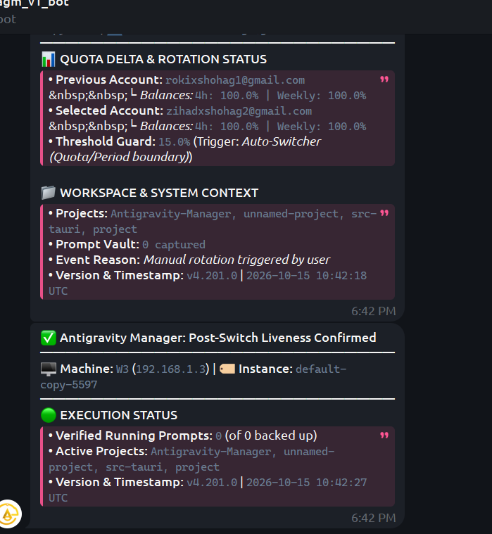

# Architecture Specification: Enhancing Telegram Bot UI, CSV/File Exports & GitMap Multi-Machine SSH RSA Integration

> **Target:** `02-spec/21-app/enhancing-telegram-ui-and-gitmap-integration/01-architecture-spec.md`  
> **Status:** APPROVED  
> **Author:** @aukgit  
> **Version:** 1.0.0  
> **Slug:** `enhancing-telegram-ui-and-gitmap-integration`  
> **Scope:** Telegram Notification Hub, Telegram Inbound Bot UI, Multipart CSV/JSON Document Export, GitMap Multi-Machine SSH Integration, and RSA-2048 Envelope Password Encryption  

---

## User Request (Verbatim)

```text
Task 03: Enhancing Telegram UI and GitMap Integration
1. Fix the literal `&nbsp;&nbsp;` HTML entity rendering bug in `src-tauri/src/modules/notification_hub/telegram_alerts.rs` (Telegram HTML mode only supports `&lt;`, `&gt;`, `&amp;`, `&quot;`; replace `&nbsp;&nbsp;` with Unicode spaces / figure spaces `\u{2007}\u{2007}` or standard spaces inside formatting, plus rich inline keyboard buttons on switch/liveness alerts such as Check Balance, Export CSV, Prompt Instance, Refresh Status).
2. Enhance Telegram Bot UI (`src-tauri/src/modules/telegram_inbound/`):
   - Rich `/help` manual with categorized click-to-copy (`<code>...</code>`) command examples (Prompts, Machine/Instance Targeting, Account Balance/Quota, CSV/JSON File Export, GitMap SSH/Cluster Delegation).
   - Dedicated `/balance` (and `/credits`, `/quota`) command showing per-instance active account, 4h & weekly balance percentages, credit usage, and machine bindings, plus inline buttons.
   - CSV and File Format Output (`--csv`, `--json`, `/export <accounts|instances|balance|nodes|prompts> [csv|json]`, `sendDocument` multipart upload in `src-tauri/src/modules/telegram_inbound/media.rs` so users receive downloadable `.csv` or `.json` files directly in Telegram as well as CLI `--csv` / `--format csv|json`).
   - Streamlined Machine & Instance Prompting (`/prompt <machine|instance> <text>`, `/target <machine> <instance>`, interactive inline buttons to pick machine -> instance -> prompt or check balance).
3. GitMap Multi-Machine / Multi-Instance Control & SSH Integration (`src-tauri/src/modules/ssh_manager/`, `src-tauri/src/bin/agm/`):
   - Import SSH node inventory from `gitmap` (`gitmap ssh nodes export-json` / `~/.gitmap/` / `~/.ssh/config`) into AGM CLI (`agm ssh import-gitmap`, `agm ssh nodes`, `agm ssh status`, `agm ssh balance`) and UI.
   - Control multiple machines, instances, accounts, fast-forwarding (`ff`), switching, and prompt delegation over SSH (`agm ssh exec <node> ...`, `agm ssh prompt <node> <instance> <prompt>`, `agm ssh balance`).
   - Detect whether `gitmap` is installed (`gitmap --version`); if missing, provide a CLI suggestion (`agm ssh install-gitmap` / `gitmap` install one-liner) and a Tauri command that can launch PowerShell to install `gitmap` automatically.
   - RSA Algorithm Password Encryption (`src-tauri/src/modules/ssh_manager/keys.rs` & `src-tauri/src/utils/crypto.rs`): First-time SSH password login encrypts the password using an RSA keypair (`rsa_oaep` / RSA-2048 envelope encryption backed by `~/.agm/ssh/rsa_vault_key` + public key) so passwords are NEVER stored as plaintext anywhere on disk, and encrypted credentials bundle can be exported/deployed to other machines securely.
```

---

## Visual Evidence

### Screenshot 1: Telegram Switch Alert (`&nbsp;&nbsp;` HTML Rendering Bug & Missing Inline Buttons)



**Observed Defects in Screenshot 1:**
- In `src-tauri/src/modules/notification_hub/telegram_alerts.rs` (lines 191 and 193), the rotation alert embeds `&nbsp;&nbsp;└ <i>Balances:</i>` inside a Telegram `parse_mode: "HTML"` message.
- Telegram Bot API HTML parser only recognizes four named entities: `&lt;`, `&gt;`, `&amp;`, and `&quot;`. Because `&nbsp;` is unsupported by Telegram's HTML parser, it is printed literally as `&nbsp;&nbsp;└ Balances: 4h: 100.0% | Weekly: 100.0%`.
- Furthermore, when no active prompt text or image is attached to the rotation event (`full_prompt_content.trim().is_empty()`), `reply_markup` evaluates to `None`, leaving both the **Account Rotation** alert (`telegram_alerts.rs`) and the **Post-Switch Liveness Confirmed** alert (`telemetry.rs`) devoid of interactive action buttons.

### Screenshot 2: Desired Telegram Rich Inline Keyboard Button UX


**Design Target in Screenshot 2:**
- High-contrast, scannable telemetry notifications paired with rich, full-width and multi-column inline keyboard action buttons beneath every alert and status card (e.g., `💰 Check Balance | 4h / Weekly`, `📥 Export CSV`, `💬 Prompt Instance`, `🔄 Refresh Status`).

---

## 1. Executive Summary & Architectural Goals

This specification defines a cohesive architecture across three interconnected subsystems of Antigravity Manager (AGM):

1. **Telegram HTML Entity Sanitization & Rich Alert Keyboards (`src-tauri/src/modules/notification_hub/`)**:
   - Eliminate all unsupported HTML named entities (`&nbsp;`, `&bull;`) from Telegram HTML templates, replacing `&nbsp;&nbsp;` with Unicode figure spaces (`\u{2007}\u{2007}`) and `&bull;` with literal Unicode bullets (`•`).
   - Attach rich inline keyboards (`build_switch_alert_reply_markup` and `build_liveness_alert_reply_markup`) to every account switch and post-switch liveness notification so operators can immediately inspect balances, export CSV telemetry, prompt the target instance, or refresh status in one tap.

2. **Enhanced Telegram Bot Command Center & Native File Exports (`src-tauri/src/modules/telegram_inbound/`)**:
   - Upgrade `/help` (`reports_b.rs`) into an exhaustive, categorized click-to-copy (`<code>...</code>`) command manual covering Prompt Injection, Machine/Instance Targeting, Account Balance/Quota Inspection, CSV/JSON Document Export, and GitMap SSH/Cluster Delegation.
   - Introduce dedicated `/balance` (aliases `/credits`, `/quota`) reports showing per-instance bound accounts, 4-hour and weekly quota percentages, remaining credit headroom, threshold guards, and machine bindings with interactive inline keyboards.
   - Add `send_telegram_document` (`media.rs`) using `reqwest::multipart::Form` against `/bot<token>/sendDocument` and wire `/export <accounts|instances|balance|nodes|prompts> [csv|json]` (plus `--csv` and `--json` flags on `/balance`, `/accounts`, `/instances`, `/nodes`, `/prompts`) so users receive downloadable `.csv` and `.json` files directly in Telegram chat, with full CLI parity (`--csv`, `--json`, `--format csv|json`).
   - Streamline machine and instance prompting (`/prompt <machine|instance> <text>`, `/target <machine> <instance> [conversation]`) with interactive inline button pickers.

3. **GitMap Multi-Machine SSH Integration & RSA-2048 Password Vault (`src-tauri/src/modules/ssh_manager/`, `src-tauri/src/utils/crypto.rs`, `src-tauri/src/bin/agm/`)**:
   - Synchronize SSH node inventories seamlessly from `gitmap` (`gitmap ssh nodes export-json`, `~/.gitmap/gitmap-ssh-nodes.json`, and `~/.ssh/config`) via `agm ssh import-gitmap`, `agm ssh nodes`, `agm ssh status`, and `agm ssh balance`.
   - Enable multi-machine, multi-instance remote control over SSH: `agm ssh balance [node]`, `agm ssh status [node]`, `agm ssh prompt <node> <instance> <prompt>`, `agm ssh switch <node> <instance> [email]`, and `agm ssh ff [node]`.
   - Provide automatic `gitmap` binary detection (`gitmap --version`), actionable CLI installation helpers (`agm ssh install-gitmap`), and a Tauri command (`install_gitmap_ via_powershell` / `install_gitmap_cli`) that spawns PowerShell or shell installation safely using the job-breakaway fallback ladder.
   - Implement **RSA-2048 Envelope Encryption** (`ag_rsa_v1_...`) in `src-tauri/src/utils/crypto.rs` and `src-tauri/src/modules/ssh_manager/keys.rs` backed by a persistent RSA-2048 keypair (`~/.agm/ssh/rsa_vault_key` and `~/.agm/ssh/rsa_vault_key.pub`) so first-time SSH password logins are encrypted with the RSA public key before ever touching disk and can be securely exported/imported across authorized machines.

---

## 2. Subsystem 1: Telegram Alert HTML Fix & Rich Inline Keyboards

### 2.1 Root Cause & Entity Sanitization (`telegram_alerts.rs` & `telemetry.rs`)

Telegram's `HTML` parse mode strictly supports only `&lt;`, `&gt;`, `&amp;`, `&quot;`, and numeric character references. Any occurrence of `&nbsp;` or `&bull;` is either rendered verbatim as raw text (`&nbsp;&nbsp;`) or risks triggering a `400 Bad Request: can't parse entities` fallback.

**Required Modifications in `src-tauri/src/modules/notification_hub/telegram_alerts.rs`:**
1. Replace lines 191 and 193:
   - From: `&nbsp;&nbsp;└ <i>Balances:</i> <code>4h: {} | Weekly: {}</code>`
   - To: `\u{2007}\u{2007}└ <i>Balances:</i> <code>4h: {} | Weekly: {}</code>`
2. Replace line 159 (`links.join(" &bull; ")`) in both `telegram_alerts.rs` and `telemetry.rs` with `links.join(" • ")`.
3. Add a sanitizer helper `sanitize_telegram_html_entities(html: &str) -> String` in `src-tauri/src/modules/telegram_inbound/formatting.rs` that normalizes any stray `&nbsp;` to `\u{2007}` and `&bull;` to `•` before dispatching to Telegram's `/sendMessage` endpoint.

### 2.2 Rich Inline Keyboards on Account Switch & Liveness Alerts

Instead of returning `None` when `full_prompt_content` is empty, `dispatch_telegram_switch_alert` (`telegram_alerts.rs`) and `dispatch_post_switch_prompt_telemetry` (`telemetry.rs`) MUST always attach a rich inline keyboard built via `telegram_inbound::build_switch_alert_reply_markup`:

```rust
pub fn build_switch_alert_reply_markup(
    instance_name: &str,
    selected_email: &str,
    target_4h: &str,
    target_weekly: &str,
    prompt_text: &str,
    asset_urls: &[String],
) -> serde_json::Value
```

**Button Layout:**
- **Row 1 (Rich Status Summary Button — modeled after Screenshot 2):**
  - `🟢 {instance_name} | 4h: {target_4h} | Wk: {target_weekly}` → `callback_data: "cmd:balance"`
- **Row 2 (Quick Actions):**
  - `💰 Check Balance` → `callback_data: "cmd:balance"`
  - `📥 Export CSV` → `callback_data: "cmd:export balance csv"`
- **Row 3 (Instance & Fleet Control):**
  - `💬 Prompt Instance` → `callback_data: format!("send:i:{}", safe_instance_id)` (or `"cmd:send"` fallback)
  - `🔄 Refresh Status` → `callback_data: "cmd:observe"`
- **Row 4+ (Conditional Copy Buttons):**
  - If `prompt_text` is non-empty, include `📋 Copy Prompt` (`copy_text`) and `🖼️ Copy Prompt + Images` as before.

---

## 3. Subsystem 2: Enhanced Telegram Bot UI, `/balance`, & CSV/JSON Document Export

### 3.1 Dedicated `/balance` (`/credits`, `/quota`) Command

**Target Files:**
- `src-tauri/src/modules/telegram_inbound/reports_a.rs`
- `src-tauri/src/modules/telegram_inbound/processing.rs`
- `src-tauri/src/modules/telegram_inbound/daemon.rs`

**Functionality:**
- `format_balance_report(filter_arg: &str) -> String` aggregates:
  1. **Machine & Cluster Context:** Local machine hostname, IP, node alias, and quota protection threshold (`quota_protection.threshold_percentage`).
  2. **Per-Instance Active Account Binding:** Iterates over all registered instances (`instance::load_registry()`), resolving each instance's bound account (`bound_account_id` / `bound_email` or default active account), live PID status (`🟢 Running` / `⚪ Idle`), 4-hour quota percentage (`4h: XX.X%`), weekly quota percentage (`Weekly: YY.Y%`), subscription tier (`PRO` / `ULTRA` / `FREE`), and estimated credit headroom.
  3. **Standby Account Pool Summary:** Top candidate accounts ready for fast-forward rotation (`auto_switcher::extract_dual_window_quotas`), sorted by highest 4h & weekly balance.
- **Inline Keyboard (`resolve_balance_markup`):**
  - Row 1: `[🔄 Refresh Balance (cmd:balance)]`, `[⚡ Fast-Forward (cmd:ff)]`
  - Row 2: `[📥 Export Balance CSV (cmd:export balance csv)]`, `[📄 Export JSON (cmd:export balance json)]`
  - Row 3: `[🏷️ Instances (cmd:instances)]`, `[💬 Send Prompt (cmd:send)]`

### 3.2 Native CSV & JSON File Output (`sendDocument` Multipart Upload)

**Target Files:**
- `src-tauri/src/modules/telegram_inbound/media.rs`
- `src-tauri/src/modules/telegram_inbound/reports_a.rs`
- `src-tauri/src/modules/telegram_inbound/daemon.rs`
- `src-tauri/src/bin/agm/quota_cmds.rs` & `src-tauri/src/bin/agm/account_cmds.rs`

**Telegram Multipart Document Upload (`media.rs`):**
```rust
pub async fn send_telegram_document(
    bot_token: &str,
    chat_id: i64,
    file_bytes: &[u8],
    file_name: &str,
    mime_type: &str,
    caption: &str,
    reply_markup: Option<serde_json::Value>,
) -> Result<String, crate::error::AppError>
```
- Uses `reqwest::multipart::Part::bytes(file_bytes.to_vec()).file_name(file_name.to_string()).mime_str(mime_type)` and posts to `https://api.telegram.org/bot{bot_token}/sendDocument` with `parse_mode = "HTML"`.
- Returns the Telegram `document.file_id` and records the hash in `media_vault` via `record_media_vault`.

**Structured Export Generator (`generate_export_document`):**
Supports targets: `balance` (or `quota`/`credits`), `accounts`, `instances`, `nodes` (or `ssh`), and `prompts` in both `csv` and `json` formats:
- `/export <target> [csv|json]` (default `csv`)
- Flag detection on existing commands: `/balance --csv`, `/balance --json`, `/accounts --csv`, `/instances --csv`, `/nodes --csv`, `/prompts --csv`
- RFC 4180 compliant CSV serialization (proper escaping of double quotes, commas, and newlines) plus summary caption and inline buttons to switch between CSV and JSON or refresh.
- **CLI Parity:** `agm balance [--csv|--json]`, `agm accounts [--csv|--json]`, `agm instances [--csv|--json]`, and `agm ssh balance [--csv|--json]` output clean CSV/JSON directly to stdout (or `--out <path>`).

### 3.3 Streamlined Machine & Instance Prompting (`/prompt`, `/target`, `/send`)

**Target Files:**
- `src-tauri/src/modules/telegram_inbound/processing.rs`
- `src-tauri/src/modules/telegram_inbound/send_flow.rs`
- `src-tauri/src/modules/telegram_inbound/ui_remote.rs`

**Enhancements:**
1. **Flexible `/prompt` Target Resolution:**
   - Supports `/prompt <machine_or_instance> <prompt_text>` and `/prompt --node <machine> --instance <instance> <prompt_text>` in addition to conversation sequence IDs (`C001`, `P001`).
   - If the first token matches a known instance name/ID (e.g. `default`, `#1`, `inst-1`) on the local machine, injects directly into that instance's active conversation or enqueues into its FIFO prompt queue.
   - If the first token matches a registered SSH/GitMap node alias (e.g. `W3`, `vm-01`), delegates the prompt over SSH (`agm ssh prompt <node> <instance> <text>`).
2. **Multi-Machine `/target` Aiming:**
   - `/target <machine> <instance> [conversation]` or `/target <instance> [conversation]` locks the default destination for subsequent plain-text messages, displaying an inline keyboard with `[💬 Check Aim (/where)]`, `[💰 Instance Balance]`, and `[🧹 Clear Target (/target clear)]`.
3. **Interactive `/help` Manual (`format_help_manual` in `reports_b.rs`):**
   - Re-organized with clear category headers and click-to-copy `<code>...</code>` examples for:
     - 🟢 **Prompt Injection & Machine/Instance Targeting** (`/send`, `/prompt`, `/target`)
     - 💰 **Account Balance, Credits & Quota Telemetry** (`/balance`, `/quota`, `/credits`, `/ff`)
     - 📥 **CSV & JSON File Exports** (`/export balance csv`, `/export accounts csv`, `/export instances json`, `/balance --csv`)
     - 🟠 **GitMap Multi-Machine SSH & Cluster Control** (`/ssh nodes`, `/ssh balance`, `/ssh prompt`, `/gitmap pe`)
     - 🔵 **Window, Screen & Remote UI** (`/open`, `/screenshot`, `/ui goto`)

---

## 4. Subsystem 3: GitMap Multi-Machine SSH Integration & RSA-2048 Password Encryption

### 4.1 RSA-2048 Envelope Password Encryption (`src-tauri/src/utils/crypto.rs` & `src-tauri/src/modules/ssh_manager/keys.rs`)

**Security Requirement:**
When a user logs into an SSH host with a password for the first time (or configures an SSH node password in CLI/GUI), the password MUST NEVER be stored in plaintext on disk. Furthermore, unlike `machine-uid`-bound symmetric keys that break when exporting node bundles to another machine, SSH credentials must use **RSA-2048 Asymmetric Envelope Encryption** backed by a dedicated RSA keypair in `~/.agm/ssh/`.

**Cryptographic Design (`ag_rsa_v1_` Envelope):**
1. **RSA Vault Keypair Lifecycle (`src-tauri/src/modules/ssh_manager/keys.rs`):**
   - Key paths: `~/.agm/ssh/rsa_vault_key` (PKCS#1/PKCS#8 PEM private key, `0600` permissions on Unix) and `~/.agm/ssh/rsa_vault_key.pub` (PEM/OpenSSH public key).
   - `ensure_rsa_vault_keypair() -> Result<(PathBuf, PathBuf), String>`:
     - Checks if `~/.agm/ssh/rsa_vault_key` exists; if not, generates a 2048-bit RSA keypair using `boring2::rsa::Rsa::generate(2048)` (already compiled in `Cargo.toml` as `boring2 = "4.15.15"`) with `ssh-keygen -t rsa -b 2048 -m PEM` fallback.
2. **RSA-OAEP / PKCS1v15 + AES-256-GCM Hybrid Envelope (`src-tauri/src/utils/crypto.rs`):**
   - Prefix: `const ENCRYPTED_RSA_V1_PREFIX: &str = "ag_rsa_v1_";`
   - `encrypt_password_rsa(plaintext: &str) -> Result<String, String>`:
     - Generates an ephemeral 256-bit AES key (`[u8; 32]`) and 96-bit nonce (`[u8; 12]`) via `OsRng`.
     - Encrypts `plaintext` with `Aes256Gcm`.
     - Encrypts the 32-byte ephemeral AES key using the RSA-2048 public key (`boring2::rsa::Rsa::public_encrypt` with `Padding::PKCS1_OAEP` or `Padding::PKCS1`).
     - Encodes as `ag_rsa_v1_<base64_rsa_encrypted_key>.<base64_nonce>.<base64_aes_ciphertext>`.
   - `decrypt_password_rsa(encrypted: &str) -> Result<String, String>`:
     - Parses the three segments after `ag_rsa_v1_`, decrypts the 32-byte AES key using the RSA-2048 private key (`~/.agm/ssh/rsa_vault_key`), and decrypts the AES-256-GCM ciphertext.
   - Backward compatibility: `decrypt_string` in `src-tauri/src/utils/crypto.rs` transparently handles `ag_rsa_v1_`, `ag_enc_v2_`, and legacy `ag_enc_` prefixes!
3. **First-Time SSH Password Login Auto-Encryption:**
   - When `SshConnectionRecord` is saved (`save_ssh_connections` / `upsert_ssh_connection_password`), any non-empty password that does not start with `ag_rsa_v1_` is automatically encrypted via `encrypt_password_rsa` before writing `ssh_nodes.json` or `gitmap-ssh-nodes.json`.
   - `export_all_bundle` and `import_all_bundle` in `src-tauri/src/modules/ssh_manager/bundles.rs` optionally include `rsa_vault_key.pub` (and when `--include-vault-key` is specified, the encrypted vault key) so multi-machine deployments can decrypt shared SSH node credentials seamlessly.

### 4.2 GitMap Detection, Auto-Install PowerShell Launcher & SSH Inventory Sync

**Target Files:**
- `src-tauri/src/modules/ssh_manager/sync.rs`
- `src-tauri/src/modules/ssh_manager/exec.rs`
- `src-tauri/src/commands/fleet.rs`
- `src-tauri/src/bin/agm/ssh_cmds.rs`
- `src-tauri/src/bin/agm/ssh_handlers.rs`

1. **GitMap Detection & Auto-Installer (`check_gitmap_status` & `install_gitmap_cli`):**
   - Probes `gitmap --version` (and `~/.cargo/bin/gitmap`, `~/.local/bin/gitmap`).
   - If `gitmap` is not installed:
     - CLI commands display an actionable hint:
       `💡 GitMap CLI not detected. Run 'agm ssh install-gitmap' to install automatically.`
     - `agm ssh install-gitmap` and Tauri command `install_gitmap_cli` launch PowerShell (on Windows) or `sh` (on macOS/Linux) using `spawn_with_job_breakaway_fallback` (respecting the Windows Job Object breakaway invariant) to install/build `gitmap` (`cargo install --git https://github.com/alimtvnetwork/gitmap` or local sibling repo/release installer script).
2. **Importing SSH Nodes from GitMap (`agm ssh import-gitmap`):**
   - Executes `gitmap ssh nodes export-json` if `gitmap` is available, or reads `~/.gitmap/gitmap-ssh-nodes.json`, `../repo-secrets/gitmap-ssh-nodes.json`, and parses `~/.ssh/config` host blocks.
   - Merges discovered nodes into AGM's `ssh_nodes.json` (`sync_ssh_connections_locally`), encrypting any raw passwords with `encrypt_password_rsa` and updating `~/.ssh/config` managed block.
3. **Multi-Machine / Multi-Instance Control over SSH (`agm ssh ...`):**
   - `agm ssh balance [target] [--csv|--json]`: Queries `agm balance --json` across target SSH node(s) (or `all`) and renders a unified multi-machine, multi-instance quota & credit table (or CSV/JSON export).
   - `agm ssh status [target]`: Queries live instances, bound accounts, and running prompt counts across SSH nodes.
   - `agm ssh prompt <node> <instance> "<prompt>"`: Dispatches a prompt to a specific instance on a remote SSH machine (`agm prompt send --instance <instance> "<prompt>"`).
   - `agm ssh switch <node> <instance> [email]` & `agm ssh ff [node]`: Triggers account rotation or fast-forward on remote SSH machine(s).

---

## 5. File Inventory & Disjoint Ownership Matrix

| Subtask | Target Files | Responsibility |
| :--- | :--- | :--- |
| **Subtask 01** (`01-spec-and-plan.md`) | `02-spec/21-app/enhancing-telegram-ui-and-gitmap-integration/01-architecture-spec.md`<br>`.ai-memory/plans/subtasks/enhancing-telegram-ui-and-gitmap-integration/*.md` | Architecture specification, visual evidence analysis, and disjoint subtask plans. |
| **Subtask 02** (`02-telegram-bot-and-csv-export.md`) | `src-tauri/src/modules/notification_hub/telegram_alerts.rs`<br>`src-tauri/src/modules/notification_hub/telemetry.rs`<br>`src-tauri/src/modules/telegram_inbound/formatting.rs`<br>`src-tauri/src/modules/telegram_inbound/media.rs`<br>`src-tauri/src/modules/telegram_inbound/reports_a.rs`<br>`src-tauri/src/modules/telegram_inbound/reports_b.rs`<br>`src-tauri/src/modules/telegram_inbound/processing.rs`<br>`src-tauri/src/modules/telegram_inbound/daemon.rs`<br>`src-tauri/src/modules/telegram_inbound/send_flow.rs` | Fix `&nbsp;&nbsp;` HTML bug, add rich inline buttons on switch/liveness alerts, add `/balance` & `/export` commands, implement `send_telegram_document` multipart CSV/JSON upload, enhance `/help` and machine/instance prompting. |
| **Subtask 03** (`03-gitmap-ssh-rsa-and-cli.md`) | `src-tauri/src/utils/crypto.rs`<br>`src-tauri/src/modules/ssh_manager/types.rs`<br>`src-tauri/src/modules/ssh_manager/keys.rs`<br>`src-tauri/src/modules/ssh_manager/connections.rs`<br>`src-tauri/src/modules/ssh_manager/sync.rs`<br>`src-tauri/src/modules/ssh_manager/exec.rs`<br>`src-tauri/src/modules/ssh_manager/bundles.rs`<br>`src-tauri/src/commands/fleet.rs`<br>`src-tauri/src/bin/agm/ssh_cmds.rs`<br>`src-tauri/src/bin/agm/ssh_handlers.rs`<br>`src-tauri/src/bin/agm/quota_cmds.rs`<br>`src-tauri/src/bin/agm/main.rs`<br>`src-tauri/src/lib.rs` | Implement RSA-2048 password encryption (`ag_rsa_v1_`), `gitmap` SSH node import (`import-gitmap`), multi-machine SSH control (`balance`, `status`, `prompt`, `ff`), CLI `--csv`/`--json` output, and PowerShell `gitmap` auto-installer. |

---

## 6. Verification & Pre-Flight Gate

1. **Unit & Integration Tests:**
   - Verify `dispatch_telegram_switch_alert` formatting contains zero `&nbsp;` or `&bull;` substrings and produces valid `inline_keyboard` JSON even when no active prompt is running.
   - Verify CSV/JSON generation for `balance`, `accounts`, `instances`, `nodes`, and `prompts` produces valid RFC 4180 CSV and valid JSON.
   - Verify `encrypt_password_rsa` and `decrypt_password_rsa` round-trip arbitrary SSH passwords using the 2048-bit RSA keypair and never persist plaintext in `SshConnectionRecord`.
2. **Pre-Flight Commands:**
   - `cd src-tauri && cargo fmt -- --check`
   - `cd src-tauri && cargo clippy --all-targets --all-features`
   - `npm run build`
