# Specification 01: Error Logs Root Cause Analysis (RCA) & Remediation Specification

## User Request (Verbatim)
```
The Data Agent Kit plugin needs to be configured.
Do this right away as critical functionality will either be missing or not work correctly if the plugin is not configured.
The following is a <SYSTEM_MESSAGE> not actually sent by the user. It is provided by the system as important information to pay attention to.

<SYSTEM_MESSAGE>
[Message] timestamp=2026-10-17T14:56:54Z sender=a392ecbb-e067-485c-9758-29d6bd0d39e8 priority=MESSAGE_PRIORITY_HIGH content=You are Spec Author 01 for task 'fleet-node-navigation-and-error-log-plan'. You have no prior chat context; this brief is your complete specification.

### Boundaries & Crash Prevention:
- You are an authoring subagent (`TypeName: 'self'`).
- You strictly own and write ONLY these two files:
  1. `02-spec/21-app/fleet-node-navigation-and-error-log-plan/01-error-logs-rca-and-remediation-spec.md`
  2. `.ai-memory/plans/subtasks/fleet-node-navigation-and-error-log-plan/01-error-logs-remediation-plan.md`
- NEVER touch or write to any other file, especially not files owned by Spec Author 02.
- TOTAL BAN ON RAW SEARCH TOOLS: NEVER run `rg`, `ripgrep`, `grep`, `git grep`, `Select-String`, `Get-ChildItem -Recurse`, or `findstr`.
- GitMap Search Primacy: Execute all code, symbol, and pattern searches exclusively via GitMap commands (`gitmap aum search`, `gitmap find`, `gitmap cat`).
- TOTAL BAN ON GIT COMMANDS: NEVER run `git add`, `git commit`, `git push`, `git status`, `git diff`, `git checkout`.
- Strict Relative Git Paths: All paths cited in your work must be relative to repository root (`src/...`, `src-tauri/...`, `02-spec/...`). Zero absolute paths.
- Execution Guard: This task is PLAN MODE. Do NOT modify any source code files (`src/`, `src-tauri/`). Author comprehensive specs and actionable AI instructions.
</SYSTEM_MESSAGE>
```

---

## Executive Summary & Log Metrics Overview

During routine operation, telemetry audits and diagnostic logs across the Antigravity-Manager runtime revealed 5 persistent error log patterns totaling over 20,700 log events:

| Pattern ID | Error Classification | Occurrence Count | Primary Source File | Core Impact |
| :--- | :--- | :--- | :--- | :--- |
| **P1** | Prompt Queue Scheduler Infinite Retry Storm & OS Error 3 | **17,100+** | `src-tauri/src/modules/backup_prompts_db/tests.rs`<br>`src-tauri/src/modules/repo_db/queue.rs`<br>`src-tauri/src/modules/scheduler.rs` | Unit test pollutes production database; background scheduler enters 5-second infinite dispatch loop writing to non-existent disk path. |
| **P2** | Supabase Transport Error & Fleet Query Storm | **3,440+** | `src/components/instances/fleet/useFleetMachines.ts`<br>`src-tauri/src/modules/supabase_client/client.rs` | Frontend polls every 15s indefinitely on paused free-tier Supabase; backend logs full backtraces on NXDOMAIN DNS errors. |
| **P3** | Broken Pipe Panic (`os error 232`) on CLI Output Pipe Closure | **Persistent** | `src-tauri/src/modules/logger.rs`<br>`src-tauri/src/bin/agm/main.rs` | Downstream CLI pipe closures (`agm ... \| head`) trigger Rust stdout panic; custom panic hook dumps false critical stacktrace into logs. |
| **P4** | SQLite Lock Contention on Sequence Metadata | **177+** | `src-tauri/src/modules/repo_db/sequences.rs` | `unchecked_transaction()` (BEGIN DEFERRED) deadlocks on upgrading SHARED read lock to RESERVED lock during concurrent tree reads. |
| **P5** | Missing `storage.json` / `state.vscdb` on Instance Creation & Cloning | **28+** | `src-tauri/src/modules/device/profiles.rs`<br>`src-tauri/src/modules/instance/create.rs`<br>`src-tauri/src/modules/instance/clone.rs` | `write_profile` unconditionally rejects writing spoofed hardware identity if target `storage.json` does not exist prior to IDE first launch. |

---

## Pattern 1: Prompt Queue Scheduler Infinite Retry Storm & OS Error 3 (17,100x)

### 1. Exact Reproduction Logs
```text
WARN [PromptQueueScheduler] agy dispatch failed for prompt 'prompt_inst_a': workspace directory does not exist: '/nonexistent/repo'; keeping in queue
WARN best_effort: write resume task snapshot: The system cannot find the path specified. (os error 3)
```

### 2. Deep Root Cause Analysis

#### A. Production Database Test Pollution
In `src-tauri/src/modules/backup_prompts_db/tests.rs` (lines 69–128), unit test `test_restore_scoping_across_instances` verifies backup restoration scoping:
```rust
// src-tauri/src/modules/backup_prompts_db/tests.rs:87-98
for (rid, pid, inst) in [
    ("r-a", "prompt_inst_a", Some("inst-a")),
    ("r-b", "prompt_inst_b", Some("inst-b")),
    ("r-null", "prompt_inst_null", None),
] {
    conn.execute(
        "INSERT INTO prompt_backups (...) VALUES (?1, 'b-scope', ?2, 'proj', '/nonexistent/repo', ...)",
        params![rid, pid, now, inst],
    ).unwrap();
}
let scoped_a = restore_running_prompts(Some("inst-a"), true, Some(custom_file)).unwrap();
```
While the test correctly passes a temporary `custom_file` for `prompt_backups.db`, the implementation of `restore_running_prompts_for_instance` in `src-tauri/src/modules/backup_prompts_db/restore.rs` executes:
```rust
// src-tauri/src/modules/backup_prompts_db/restore.rs:123-126
crate::error::record_ignored(
    repo_db::save_or_requeue_prompt(&active_p),
    "save_or_requeue_prompt",
);
```
`repo_db::save_or_requeue_prompt` does not accept a custom DB path; it connects directly to the default production `repo_prompts.db` via `repo_db::schema::connect_db()`.
Consequently, running `cargo test` silently injects `prompt_inst_a`, `prompt_inst_b`, and `prompt_inst_null` with `repo_path = "/nonexistent/repo"` and `status = 'queued'` into the real, live `active_prompts` table on the host machine.

#### B. Missing Pre-Dispatch Directory Validation & OS Error 3
In `src-tauri/src/modules/repo_db/queue.rs` (lines 188–217), the queue dispatcher processes enqueued prompts:
```rust
// src-tauri/src/modules/repo_db/queue.rs:193-207
// Write .antigravity_resume_task.json to project directory
let task_file = PathBuf::from(&prompt.repo_path).join(".antigravity_resume_task.json");
...
if let Ok(json_str) = serde_json::to_string_pretty(&payload) {
    crate::error::record_ignored(
        fs::write(&task_file, json_str),
        "write resume task snapshot",
    );
}

// Spawn prompt via agy
let sent = spawn_prompt_via_agy(&prompt);
if let Err(ref spawn_err) = sent {
    crate::modules::logger::log_warn(&format!(
        "[PromptQueueScheduler] agy dispatch failed for prompt '{}': {spawn_err}; keeping in queue",
        prompt.id
    ));
    continue;
}
```
1. `queue.rs:194` builds a path `/nonexistent/repo/.antigravity_resume_task.json` without verifying `Path::new(&prompt.repo_path).is_dir()`.
2. Calling `fs::write(&task_file, ...)` on Windows fails with `os error 3` (`ERROR_PATH_NOT_FOUND` - "The system cannot find the path specified."). Because of `record_ignored`, it emits: `WARN best_effort: write resume task snapshot: The system cannot find the path specified. (os error 3)`.
3. Next, `spawn_prompt_via_agy(&prompt)` executes and returns `Err("workspace directory does not exist: '/nonexistent/repo'")`.
4. Line 212 logs `WARN [PromptQueueScheduler] agy dispatch failed... keeping in queue`.
5. Line 216 triggers `continue;`. The row in `active_prompts` remains with status `'queued'`, `retry_count` is nonexistent, and the prompt is never purged or marked failed.

#### C. Unbounded Adaptive Ticker Storm
In `src-tauri/src/modules/scheduler.rs` (lines 421–473), `start_prompt_queue_scheduler()` runs in a continuous Tokio loop:
```rust
// src-tauri/src/modules/scheduler.rs:432-467
let pending_count = tauri::async_runtime::spawn_blocking(|| {
    crate::modules::repo_db::count_enqueued_prompts(None)
}).await.unwrap_or(0);

if pending_count > 0 {
    // Ticks every 5 seconds
    ...
    tokio::time::sleep(PROMPT_QUEUE_ACTIVE_POLL_INTERVAL).await; // 5s
}
```
Because `count_enqueued_prompts(None)` queries `SELECT COUNT(*) FROM active_prompts WHERE status IN ('backed_up', 'queued', 'pending')`, and `prompt_inst_a` is permanently stuck in `'queued'`, `pending_count` is always `> 0`.
The scheduler runs every 5 seconds, 24 hours a day (17,280 iterations/day), spewing both warning logs on every cycle.

### 3. Callers and Blast Radius
- **Callers**: `start_prompt_queue_scheduler()` (`scheduler.rs`), `check_and_dispatch_enqueued_prompts()` (`queue.rs`), `restore_running_prompts_for_instance()` (`restore.rs`), unit tests in `tests.rs`.
- **Blast Radius**:
  - Floods `app.log` with tens of thousands of duplicate warning entries, causing disk growth and log bloat.
  - Consumes CPU cycles and SQLite locks every 5 seconds on the main thread and database file.
  - Legitimate queued prompts can be blocked behind invalid corrupted prompts if FIFO queue processing halts or repeatedly retries the same broken head.

### 4. Prevention Invariants
1. **Test DB Isolation Invariant**: Unit tests MUST NEVER write to, modify, or connect to production database files (`repo_prompts.db`, `task_index.db`, etc.). All helper functions in restore and backup modules must accept an optional connection or custom DB path override (`custom_repo_db: Option<&str>`). If running under `#[cfg(test)]`, writing to production databases must panic or use isolated in-memory/temp databases.
2. **Pre-dispatch Path Validation Invariant**: `check_and_dispatch_enqueued_prompts()` MUST verify `Path::new(&prompt.repo_path).is_dir()` BEFORE attempting any filesystem write (`.antigravity_resume_task.json`) or process spawn (`spawn_prompt_via_agy`).
3. **Dead Letter & Max Retry Bound Invariant**: Corrupt prompts whose workspace directories do not exist or that fail dispatch repeatedly must transition to a terminal status (e.g. `'failed_missing_workspace'` or `'dead_letter'`) after 3 attempts, or be quarantined, rather than remaining `'queued'` indefinitely.

### 5. Structured Future AI Instructions
- **File 1**: `src-tauri/src/modules/backup_prompts_db/restore.rs`
  - Parameterize `restore_running_prompts_for_instance` with `custom_repo_db: Option<&str>`.
  - Pass `custom_repo_db` down to `repo_db::save_or_requeue_prompt_in_db(&active_p, custom_repo_db)`.
- **File 2**: `src-tauri/src/modules/backup_prompts_db/tests.rs`
  - In `test_restore_scoping_across_instances`, pass a dedicated temporary `custom_repo_db` path (e.g., `temp_dir.join("test-repo-prompts.db")`) so tests never touch production `repo_prompts.db`.
- **File 3**: `src-tauri/src/modules/repo_db/queue.rs`
  - At line 188 of `check_and_dispatch_enqueued_prompts`:
    Check `if !Path::new(&prompt.repo_path).is_dir()`.
    If invalid:
    1. Log warning: `[PromptQueueScheduler] workspace path does not exist: '{}'; marking prompt '{}' as failed_invalid_path`.
    2. Execute `UPDATE active_prompts SET status = 'failed_invalid_path', updated_at = ?1 WHERE id = ?2`.
    3. Do NOT call `fs::write` or `spawn_prompt_via_agy`. Continue to next prompt.
- **File 4**: `src-tauri/src/modules/repo_db/schema.rs` & `active_prompts`
  - Add optional retry count check or purge dead test entries (`DELETE FROM active_prompts WHERE repo_path = '/nonexistent/repo'`).

---

## Pattern 2: Supabase Transport Error & Fleet Query Storm (3,440x)

### 1. Exact Reproduction Logs
```text
ERROR supabase_client: Supabase client select transport error on https://pezjuuddecbyfmqxytrv.supabase.co/rest/v1/nodes?select=*&order=last_heartbeat_at.desc: error sending request for url (https://pezjuuddecbyfmqxytrv.supabase.co/rest/v1/nodes?select=*&order=last_heartbeat_at.desc): error trying to connect: dns error: No such host is known. (os error 10053 / NXDOMAIN)
```

### 2. Deep Root Cause Analysis

#### A. Paused Free-Tier Supabase Projects
Supabase free-tier projects automatically pause after 7 days of inactivity. When paused, Supabase unpublishes DNS records for `<project_ref>.supabase.co`. Any incoming DNS resolution returns `NXDOMAIN` ("No such host is known").

#### B. Unbounded Frontend Polling Without Backoff
In `src/components/instances/fleet/useFleetMachines.ts`:
```typescript
// src/components/instances/fleet/useFleetMachines.ts:8, 146-160
const POLL_INTERVAL_SECONDS = 15;
...
useEffect(() => {
    if (!isSyncEnabled) return;

    const timer = setInterval(() => {
        setCountdown((prev) => {
            if (prev <= 1) {
                fetchMachines(false);
                return POLL_INTERVAL_SECONDS;
            }
            return prev - 1;
        });
    }, 1000);

    return () => clearInterval(timer);
}, [isSyncEnabled, fetchMachines]);
```
- `useFleetMachines` sets a hardcoded 15-second interval.
- When `fetchMachines(false)` fails, `useErrorStore.getState().trackWarning` records the failure, but the countdown resets right back to 15 seconds.
- There is NO exponential backoff, NO consecutive failure threshold, and NO circuit breaker.
- When an instance is open in the background, it issues 4 requests per minute, 240 requests per hour, producing 3,440 errors in under 15 hours.

#### C. Excessive Log Verbosity with Full Stack Backtraces
In `src-tauri/src/modules/supabase_client/client.rs`:
```rust
// src-tauri/src/modules/supabase_client/client.rs:66-82
pub(crate) fn log_transport_error(&self, op: &str, url: &str, err: &reqwest::Error) {
    let backtrace = std::backtrace::Backtrace::capture();
    tracing::error!(
        target: "supabase_client",
        operation = op,
        url = url,
        error = %err,
        is_timeout = err.is_timeout(),
        is_connect = err.is_connect(),
        status = ?err.status(),
        backtrace = %backtrace,
        "Supabase client {} transport error on {}: {}",
        op,
        url,
        err
    );
}
```
For every failed request, `log_transport_error` captures an expensive stack backtrace and emits a high-priority `tracing::error!`. A transport DNS failure is an expected transient or paused-project network condition, not an internal application logic crash. Logging it as an `ERROR` with backtrace 3,440 times bloats the log files by dozens of megabytes.

### 3. Callers and Blast Radius
- **Callers**: `useFleetMachines.ts` -> `supabaseService.getFleetMachines` -> Tauri IPC `get_fleet_machines` -> `SupabaseClient::select`.
- **Blast Radius**:
  - Constant background network traffic attempting to query unresolvable DNS names.
  - High CPU overhead from 3,440 synchronous `Backtrace::capture()` executions.
  - Log pollution masking other genuine backend issues.

### 4. Prevention Invariants
1. **Network Exponential Backoff Invariant**: Any background polling hook in the frontend (`useFleetMachines`, `useSupabaseSync`, etc.) MUST implement exponential backoff on consecutive network failures (e.g., 15s -> 30s -> 60s -> 300s max) and reset to the base interval only upon a successful response.
2. **Transient Network Log Level Invariant**: Network transport failures (timeout, connection refused, DNS NXDOMAIN) MUST be logged at `tracing::warn!` without backtraces, reserving `tracing::error!` with full backtrace strictly for protocol violations, serialization bugs, or unexpected internal invariant failures.
3. **Circuit Breaker for Paused Projects**: If DNS returns `NXDOMAIN` (or 3 consecutive connect failures occur), the client should trip a circuit breaker for at least 10 minutes or notify the user via a clean badge ("Supabase project paused or unreachable") rather than spamming backend queries.

### 5. Structured Future AI Instructions
- **File 1**: `src/components/instances/fleet/useFleetMachines.ts`
  - Introduce `consecutiveFailures` state.
  - Calculate dynamic delay: `Math.min(POLL_INTERVAL_SECONDS * Math.pow(2, consecutiveFailures), 300)`.
  - On catch in `fetchMachines`: increment `consecutiveFailures`.
  - On success in `fetchMachines`: reset `consecutiveFailures` to 0.
- **File 2**: `src-tauri/src/modules/supabase_client/client.rs`
  - In `log_transport_error`:
    ```rust
    if err.is_connect() || err.is_timeout() {
        tracing::warn!(
            target: "supabase_client",
            operation = op,
            url = url,
            error = %err,
            "Supabase client {} transport warning on {}: {}",
            op, url, err
        );
    } else {
        let backtrace = std::backtrace::Backtrace::capture();
        tracing::error!(
            target: "supabase_client",
            ...
        );
    }
    ```

---

## Pattern 3: Broken Pipe Panic (`os error 232`) on CLI Output Pipe Closure

### 1. Exact Reproduction Logs
From `crash_stacktrace.log` and `panic.log`:
```text
[2026-10-17T...] [PID: 23684] CRITICAL PANIC on thread 'main' at library/std/src/io/stdio.rs:1120:9: failed printing to stdout: The pipe is being closed. (os error 232)
[STACK TRACE]
   0: std::backtrace::Backtrace::create
   1: antigravity_manager::modules::logger::init_logger_inner::{{closure}}
   2: std::panicking::rust_panic_with_hook
   3: std::io::stdio::_print
   4: antigravity_manager::bin::agm::main
```

### 2. Deep Root Cause Analysis

#### A. Standard Rust `println!` Panic on Broken Pipe
In Rust standard library, macros `println!`, `print!`, and `writeln!(std::io::stdout())` panic if the underlying `Write::write_all` fails.
When a CLI utility runs in a shell and its output is piped into another utility (e.g. `agm instance list | head -n 5`, `agm prompt list | fzf`, or piping to a pager like `less` and exiting):
- The receiving process reads the required lines and terminates its process.
- The operating system closes the read end of the pipe.
- When `agm` attempts its next `println!`, the OS returns:
  - On Windows: `os error 232` (`ERROR_NO_DATA`: "The pipe is being closed.") or `os error 109` (`ERROR_BROKEN_PIPE`).
  - On Linux/macOS: `os error 32` (`EPIPE`: "Broken pipe") or signal `SIGPIPE`.
- Rust's standard library panics with `failed printing to stdout: The pipe is being closed. (os error 232)`.

#### B. Global Panic Hook Misclassification
In `src-tauri/src/modules/logger.rs` (lines 115–179), `init_logger_inner()` installs a blanket panic hook:
```rust
// src-tauri/src/modules/logger.rs:115-136
std::panic::set_hook(Box::new(|panic_info| {
    let backtrace = std::backtrace::Backtrace::force_capture();
    ...
    let err_msg = format!(
        "[{timestamp}] [PID: {pid}] CRITICAL PANIC on thread '{thread_name}' at {location}: {payload}\n[STACK TRACE]\n{backtrace:?}\n"
    );
    eprintln!("{}", err_msg);
    tracing::error!("{}", err_msg);
    if let Ok(log_dir) = get_log_dir() {
        crate::error::record_ignored(std::fs::write(log_dir.join("panic.log"), &err_msg), ...);
        ... writeln!(f, "{err_msg}") into crash_stacktrace.log ...
    }
}));
```
The panic hook treats every panic identically as a "CRITICAL PANIC", logging complete stacktraces to `panic.log`, `crash_stacktrace.log`, and `tracing::error!`.
For a CLI binary, early pipe closure is a standard Unix/Windows exit condition, not a critical bug or application defect. Generating crash logs and stacktraces for normal pipe termination misleads developers and telemetry auditors.

### 3. Callers and Blast Radius
- **Callers**: Any CLI execution (`agm ...`) piped to head, tail, grep, findstr, or pagers.
- **Blast Radius**:
  - Generates alarming entries in `panic.log` and `crash_stacktrace.log`.
  - Non-zero exit code (panicking returns exit code 101) breaks chained shell scripts (`agm ... | head && next_command`).

### 4. Prevention Invariants
1. **CLI Broken Pipe Graceful Exit Invariant**: Broken pipe panics or I/O errors (`os error 232`, `os error 109`, `EPIPE`) occurring on stdout/stderr MUST exit cleanly with code 0 (or standard termination) without logging to `panic.log` or capturing stacktraces.
2. **Panic Hook Filtering Invariant**: The global panic hook in `logger.rs` MUST inspect `panic_info.payload()` and skip crash log generation if the payload matches standard stdout/stderr pipe closure patterns (`failed printing to stdout`, `Broken pipe`, `os error 232`, `os error 109`).

### 5. Structured Future AI Instructions
- **File 1**: `src-tauri/src/modules/logger.rs`
  - In `std::panic::set_hook`, add payload inspection before generating crash logs:
    ```rust
    let is_broken_pipe = payload.contains("failed printing to stdout")
        || payload.contains("os error 232")
        || payload.contains("Broken pipe")
        || payload.contains("os error 109");

    if is_broken_pipe {
        // Exit process cleanly on broken pipe without recording a crash
        std::process::exit(0);
    }
    ```
- **File 2**: `src-tauri/src/bin/agm/main.rs`
  - In the CLI entry point, consider ignoring `SIGPIPE` on Unix and wrapping top-level execution with clean exit handling.

---

## Pattern 4: SQLite Lock Contention on Sequence Metadata (177x)

### 1. Exact Reproduction Logs
```text
WARN best_effort: refresh conversation sequence metadata: database is locked
```

### 2. Deep Root Cause Analysis

#### A. Lock Upgrade Deadlocks with `unchecked_transaction()`
In `src-tauri/src/modules/repo_db/sequences.rs` (lines 174–196):
```rust
// src-tauri/src/modules/repo_db/sequences.rs:182-195
if let Ok(tx) = conn.unchecked_transaction() {
    let seq = if let Ok(existing) = tx.query_row(
        "SELECT seq_id FROM agm_conversation_sequences WHERE conversation_id = ?1",
        params![conversation_id],
        |row| row.get::<_, i64>(0),
    ) {
        crate::error::record_ignored(
            tx.execute(
                "UPDATE agm_conversation_sequences SET project_key = ?2, title = ?3, instance_id = ?4, updated_at = ?5 WHERE conversation_id = ?1",
                params![conversation_id, project_key, title, instance_id, now],
            ),
            "refresh conversation sequence metadata",
        );
        existing
    } ...
```
1. `conn.unchecked_transaction()` executes `BEGIN DEFERRED`.
2. Under `DEFERRED`, the transaction begins in passive mode with NO database lock.
3. When `tx.query_row("SELECT ...")` runs, SQLite acquires a `SHARED` (read) lock.
4. When `tx.execute("UPDATE ...")` runs, SQLite attempts to upgrade the lock from `SHARED` to `RESERVED` (write).
5. If another connection (e.g., prompt tree scanner, queue scheduler, or background telemetry) already holds a `SHARED` lock or is concurrently trying to upgrade, SQLite CANNOT grant the upgrade.
6. When two deferred transactions simultaneously hold `SHARED` locks and both attempt to upgrade to `RESERVED`, a mutual deadlock occurs. SQLite immediately returns `SQLITE_BUSY` ("database is locked").
7. `crate::error::record_ignored` catches this error and logs `WARN best_effort: refresh conversation sequence metadata: database is locked`.

#### B. Inadequate Busy Timeout & Concurrency Settings
While WAL mode allows concurrent readers and one writer, deferred lock upgrades during write operations on sequence metadata bypass WAL protections if a connection has not set an adequate `busy_timeout` or uses deferred transactions instead of immediate transactions.

### 3. Callers and Blast Radius
- **Callers**: `ensure_conversation_sequence_in_conn`, `ensure_project_sequence_in_conn`, `batch_ensure_sequences`.
- **Blast Radius**:
  - 177+ best-effort warning logs recorded during prompt listing or tree rendering.
  - Metadata updates (`updated_at`, `title`) fail silently, potentially leaving stale titles in the conversation sequence table.

### 4. Prevention Invariants
1. **Immediate Transaction Invariant for Writes**: Any transaction that will or may execute an `UPDATE` or `INSERT` MUST begin with `TransactionBehavior::Immediate` (`BEGIN IMMEDIATE`), ensuring SQLite acquires a `RESERVED` lock immediately and serializes writers without lock upgrade deadlocks.
2. **Busy Timeout Invariant**: All connections to `repo_prompts.db` MUST configure `conn.busy_timeout(Duration::from_millis(5000))` upon opening, ensuring transient contention waits up to 5 seconds before failing with `SQLITE_BUSY`.

### 5. Structured Future AI Instructions
- **File 1**: `src-tauri/src/modules/repo_db/sequences.rs`
  - In `ensure_conversation_sequence_in_conn` and `ensure_project_sequence_in_conn`:
    Replace `conn.unchecked_transaction()` with:
    `conn.transaction_with_behavior(rusqlite::TransactionBehavior::Immediate)`.
  - Add explicit retry loop (up to 3 attempts with 50ms exponential backoff) if `execute` returns `rusqlite::Error::SqliteFailure` with `SQLITE_BUSY`.
- **File 2**: `src-tauri/src/modules/repo_db/schema.rs`
  - Verify that `connect_db()` executes `conn.busy_timeout(std::time::Duration::from_secs(5))` and `PRAGMA journal_mode = WAL;`.

---

## Pattern 5: Missing `storage.json` / `state.vscdb` on Instance Creation & Cloning (28x)

### 1. Exact Reproduction Logs
```text
WARN best_effort: write device profile: storage_json_missing: "C:\\Users\\Administrator\\AppData\\Roaming\\Antigravity\\User\\globalStorage\\storage.json"
```

### 2. Deep Root Cause Analysis

#### A. Strict Existence Requirement in `write_profile`
In `src-tauri/src/modules/device/profiles.rs`:
```rust
// src-tauri/src/modules/device/profiles.rs:61-65
pub fn write_profile(storage_path: &Path, profile: &DeviceProfile) -> Result<(), String> {
    if !storage_path.exists() {
        return Err(format!("storage_json_missing: {:?}", storage_path));
    }
    let content = fs::read_to_string(storage_path)...
```
`write_profile` strictly expects `storage.json` to already exist on disk. If the file does not exist, it immediately returns `Err(format!("storage_json_missing: {:?}", storage_path))`.

#### B. Profile Injection Precedes IDE Cold Start
In `src-tauri/src/modules/instance/create.rs` (lines 176–185) and `src-tauri/src/modules/instance/clone.rs` (lines 230–242):
```rust
// src-tauri/src/modules/instance/create.rs:176-185
let profile = acc.device_profile.clone().unwrap_or_else(crate::modules::device::generate_profile);
let storage_path = db_dir.join("storage.json");
crate::error::record_ignored(
    crate::modules::device::write_profile(&storage_path, &profile),
    "write device profile",
);
```
- When creating a brand-new instance directory or cloning into a fresh directory, the IDE has never run in that folder.
- `storage.json` is a file created by the Antigravity/VS Code runtime during its first startup.
- `create.rs` attempts to pre-seed the synthetic hardware profile (`machineId`, `macMachineId`, etc.) before launching the IDE.
- Because `storage.json` does not exist yet, `write_profile` fails with `storage_json_missing`.
- `record_ignored` logs 28 warnings, and the instance starts with default un-spoofed telemetry until later modified.

### 3. Callers and Blast Radius
- **Callers**: `create_instance` (`instance/create.rs`), `clone_instance` (`instance/clone.rs`).
- **Blast Radius**:
  - 28 warning logs during instance setup and testing.
  - New instances fail to have their synthetic hardware fingerprint seeded prior to IDE cold-start, risking telemetry attribution before the first launch.

### 4. Prevention Invariants
1. **Self-Healing Storage Invariant**: `write_profile()` MUST be self-healing: if `storage.json` does not exist, it MUST create parent directories and initialize a valid minimal `storage.json` containing the required telemetry structure rather than failing.
2. **Cold-Start Pre-Seeding Invariant**: Newly created and cloned instances MUST guarantee valid `storage.json` and `state.vscdb` structures exist on disk before the IDE process is launched.

### 5. Structured Future AI Instructions
- **File 1**: `src-tauri/src/modules/device/profiles.rs`
  - In `write_profile(storage_path: &Path, profile: &DeviceProfile)`:
    Replace the existence check with:
    ```rust
    if let Some(parent) = storage_path.parent() {
        if !parent.exists() {
            let _ = fs::create_dir_all(parent);
        }
    }

    let mut json: Value = if storage_path.exists() {
        let content = fs::read_to_string(storage_path).map_err(|e| format!("read_failed: {}", e))?;
        serde_json::from_str(&content).unwrap_or_else(|_| serde_json::json!({}))
    } else {
        serde_json::json!({})
    };
    ```
  - Insert telemetry fields into `json`, format pretty, and write to disk.

---

## Cross-Pattern Correlation & Architectural Invariants

### Unified Anti-Storm Architecture

```mermaid
flowchart TD
    subgraph P1["Pattern 1: Prompt Queue"]
        P1_Test["Unit Test: test_instance_scoped_restore"] -->|Pollutes prod DB| P1_ProdDB[("repo_prompts.db")]
        P1_ProdDB -->|Stuck 'queued' with bad path| P1_Sched["PromptQueueScheduler (5s ticker)"]
        P1_Sched -->|No path check -> os error 3| P1_Storm["17,100x Warning Storm"]
    end

    subgraph P2["Pattern 2: Supabase Fleet"]
        P2_Paused["Paused Supabase Project"] -->|DNS NXDOMAIN| P2_Client["SupabaseClient::select"]
        P2_UI["useFleetMachines (15s hardcoded)"] -->|No backoff| P2_Client
        P2_Client -->|Backtrace capture & ERROR| P2_Storm["3,440x Error Storm"]
    end

    subgraph P3["Pattern 3: CLI Broken Pipe"]
        P3_CLI["agm CLI Output"] -->|Piped to head/less| P3_Pipe["Pipe Closed (os error 232)"]
        P3_Pipe -->|Rust stdlib println! panic| P3_Hook["Global Panic Hook"]
        P3_Hook -->|False Critical Crash Log| P3_Logs["panic.log & crash_stacktrace.log"]
    end

    subgraph P4["Pattern 4: SQLite Lock Contention"]
        P4_Seq["ensure_conversation_sequence"] -->|BEGIN DEFERRED| P4_Tx["unchecked_transaction"]
        P4_Tx -->|SHARED -> RESERVED Upgrade| P4_Lock["SQLITE_BUSY: database is locked"]
        P4_Lock --> P4_Logs["177x Warning Logs"]
    end

    subgraph P5["Pattern 5: Missing storage.json"]
        P5_Create["Instance Create/Clone"] -->|Pre-seeds device profile| P5_Write["write_profile"]
        P5_Write -->|storage.json does not exist| P5_Err["storage_json_missing"]
        P5_Err --> P5_Logs["28x Warning Logs"]
    end
```


### System Invariants Summary
- **Invariant I1 (Test Hermeticity)**: Tests shall never mutate global persistent state. Every database interaction in `tests.rs` must operate on isolated in-memory or ephemeral temporary databases.
- **Invariant I2 (Pre-Condition Enforcement)**: External resources (filesystem paths, directories) must be validated before attempting I/O side effects.
- **Invariant I3 (Adaptive Polling Resilience)**: All polling timers must degrade gracefully via exponential backoff upon repeated failures.
- **Invariant I4 (CLI Clean Signal Handling)**: Downstream pipe terminations are normal exit conditions and must never generate crash dumps.
- **Invariant I5 (SQLite Concurrency Discipline)**: Write transactions in SQLite must start as `IMMEDIATE` with bounded `busy_timeout` to eliminate deadlocks.
- **Invariant I6 (Self-Healing File Creation)**: Configuration and hardware profile writers must create missing files on demand rather than requiring pre-existing files.

---

## Verification Matrix & Regression Prevention Gates

| Pattern | Target Verification Test | Success Metric |
| :--- | :--- | :--- |
| **P1** | Run `cargo test --bin antigravity-manager modules::backup_prompts_db` | Verify zero rows written to production `repo_prompts.db`; verify scheduler does not log warnings for missing workspace directories. |
| **P2** | Disconnect internet / use paused Supabase URL and mount `useFleetMachines` | Polling interval expands from 15s to 30s, 60s, up to 300s; log emits `WARN` without stack backtrace. |
| **P3** | Run `agm instance list \| head -n 1` (or Windows equivalent pipe break) | Exits with code 0; zero new entries in `panic.log` or `crash_stacktrace.log`. |
| **P4** | Concurrently execute prompt tree rendering and sequence metadata updates | Zero `database is locked` warnings observed in `app.log`. |
| **P5** | Create new instance via `agm instance create test-p5` without launching IDE | `storage.json` is automatically created with valid telemetry profile; zero warnings logged. |
