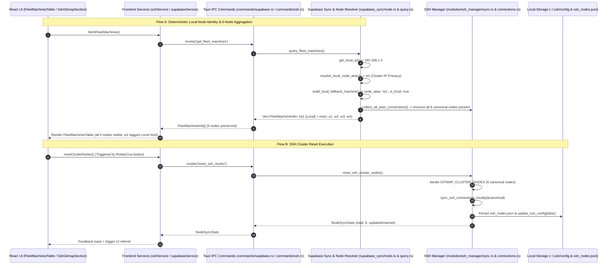

# Architecture Spec: Cluster Node Identity Resolution, GitMap Node Parity & SSH Cluster Reset

**Slug:** `fleet-system-and-ui-ux-bug-fixes`  
**File:** `02-spec/21-app/fleet-system-and-ui-ux-bug-fixes/01-architecture-spec.md`  
**Target Release:** `v4.160.0`  
**Status:** APPROVED FOR IMPLEMENTATION  
**Subagent:** Spec Subagent 01  
**Disjoint Subtask Plan:** `.ai-memory/plans/subtasks/fleet-system-and-ui-ux-bug-fixes/01-fleet-and-ssh-cluster.md`  

---

## 1. Architectural Overview & Problem Context

Antigravity-Manager (`agm`) coordinates local instance execution and distributed multi-machine operations across developer workstations and automated workers. The cluster topology is canonically managed by GitMap across 6 nodes (`w1`, `main`, `u1`, `w2`, `w3`, `w4`).

Recent operational audits revealed three architectural defects affecting node identity and cluster management:

1. **Local Node Identity Misattribution (Cluster-IP Primacy Defect):**  
   When AGM boots on the local machine (`192.168.1.3`), `supabase_sync/node.rs`, `migration.rs`, `query.rs`, `commands/supabase.rs`, and `fleet_sync.rs` fail to consistently resolve the local node alias to `w1`. Instead, they fall back to empty strings, machine UIDs, or generic system hostnames (e.g. `Node-b32812`). While `email_watcher::detect_machine_name()` implements Cluster-IP primacy, the Supabase sync engine and fleet telemetry pathways lack this capability, resulting in mismatched node telemetry, broken lease resolution, and confusion between local and remote states.

2. **GitMap Cluster Nodes Parity & Local Node Dropping (6-Node Invariant Violation):**  
   The cluster contains exactly 6 canonical nodes (`w1`, `main`, `u1`, `w2`, `w3`, `w4`). In the frontend hook `useFleetMachines.ts`, local nodes are explicitly stripped via `filter((m) => !(m as { is_local?: boolean }).is_local ...)`, leaving the `FleetMachinesTable` showing at most 5 nodes. In addition, `collect_all_peer_connections()` in `query.rs` omits canonical GitMap nodes when external CLI queries or seed paths are missing, causing peer loop truncation.

3. **Absence of SSH Cluster Reset Mechanism:**  
   When local node caches drift or SSH configurations become corrupted, operators have no atomic mechanism to restore the 6 canonical GitMap cluster nodes into the local SSH connection registry and `~/.ssh/config`. There is no backend reset routine, no exposed Tauri command, no service method, and no reset action in the UI toolbars.

This specification defines the architectural design to resolve all three issues, establishing deterministic Cluster-IP primacy, guaranteeing 6-node cluster parity, and implementing an atomic SSH cluster reset ladder.

---

## 2. End-to-End System Data Flow Architecture

The diagram below illustrates the unified identity resolution, 6-node aggregation pipeline, and the SSH cluster reset flow:



---

## 3. Subsystem Architectural Specifications

### 3.1 Local Node Identity Resolution (Cluster-IP Primacy)

#### Problem
In `src-tauri/src/modules/supabase_sync/node.rs`, identity resolution relies exclusively on `machine_uid::get()`, while `get_local_ip()` returns the network interface IP (e.g. `192.168.1.3`). Downstream modules (`migration.rs`, `query.rs`, `commands/supabase.rs`, and `fleet_sync.rs`) read `config.node_alias`, which defaults to empty if unconfigured by the user. Consequently, the local machine appears as an anonymous node (`Node-xxxx`) rather than the cluster-assigned identity `w1`.

#### Solution & Resolution Ladder
Implement a canonical helper `resolve_local_node_alias()` in `src-tauri/src/modules/supabase_sync/node.rs` that executes the following 5-stage resolution ladder:

1. **Stage 1 (Local IP Detection):** Call `get_local_ip()`. If IP is invalid, empty, or loopback (`127.0.0.1`), proceed to Stage 3.
2. **Stage 2 (Cluster-IP Primacy - Authoritative):**
   - Check if `local_ip` matches any entry in `crate::modules::ssh_manager::GITMAP_CLUSTER_NODES`. If `local_ip == "192.168.1.3"`, immediately return `"w1"`.
   - Check if `local_ip` matches any stored connection in `crate::modules::ssh_manager::load_ssh_connections()`. If matched and alias is non-empty, return that alias.
3. **Stage 3 (User Configuration in Supabase Config):**
   - Inspect `load_config()?.node_alias`. If non-empty and not conflicting with a different remote IP in `GITMAP_CLUSTER_NODES`, return `config.node_alias.trim()`.
4. **Stage 4 (Email Vault DB Notification Settings):**
   - Inspect `crate::modules::email_vault_db::get_notification_settings()?.local_machine_name`. If non-empty and non-conflicting, return it.
5. **Stage 5 (Host Name Fallback):**
   - Query `sysinfo::System::host_name()`. If empty, format as `"Node-"` + first 6 characters of `get_local_node_id()`.

```rust
/// Resolve authoritative local node alias using Cluster-IP primacy
pub fn resolve_local_node_alias() -> String {
    let local_ip = get_local_ip();
    let has_valid_ip = !local_ip.is_empty() && local_ip != "127.0.0.1";

    // 1. Cluster-IP Primacy from canonical GitMap cluster nodes
    if has_valid_ip {
        for &(alias, ip, _, _) in crate::modules::ssh_manager::GITMAP_CLUSTER_NODES {
            if ip == local_ip.trim() {
                return alias.to_string();
            }
        }
        if let Ok(conns) = crate::modules::ssh_manager::load_ssh_connections() {
            if let Some(c) = conns.iter().find(|c| c.ip_address.trim() == local_ip.trim() && !c.alias.trim().is_empty()) {
                return c.alias.trim().to_string();
            }
        }
    }

    // 2. User configuration
    if let Ok(cfg) = super::load_config() {
        let trimmed = cfg.node_alias.trim();
        if !trimmed.is_empty() {
            return trimmed.to_string();
        }
    }

    // 3. Email notification settings
    if let Ok(settings) = crate::modules::email_vault_db::get_notification_settings() {
        let trimmed = settings.local_machine_name.trim();
        if !trimmed.is_empty() {
            return trimmed.to_string();
        }
    }

    // 4. Hostname fallback
    let node_id = get_local_node_id();
    let short_id = if node_id.len() > 6 { &node_id[..6] } else { &node_id };
    sysinfo::System::host_name().unwrap_or_else(|| format!("Node-{}", short_id))
}
```

#### Integration Points:
- `src-tauri/src/modules/supabase_sync/migration.rs`: In `build_local_fallback_machine()`, assign:
  ```rust
  let node_alias = resolve_local_node_alias();
  ```
  Ensure both `node_alias` and `alias` fields receive this value.
- `src-tauri/src/modules/supabase_sync/query.rs`:
  - In `build_local_and_ssh_fleet()`, use `resolve_local_node_alias()` so the local entry is labeled `w1`.
  - In `query_fleet_machines()`, when processing Supabase records, if `is_local` or `ip_address == get_local_ip()`, ensure `node_alias` falls back to `resolve_local_node_alias()`.
- `src-tauri/src/commands/supabase.rs`:
  - In `get_local_node_info()`, set:
    ```rust
    node_alias: supabase_sync::resolve_local_node_alias(),
    ```
- `src-tauri/src/modules/fleet_sync.rs`:
  - In `generate_local_fleet_sync_payload()`, replace naive `sysinfo::System::host_name()` with `crate::modules::supabase_sync::resolve_local_node_alias()`.

---

### 3.2 GitMap Cluster Nodes 6-Node Parity

#### Problem
The canonical GitMap cluster consists of 6 defined physical hosts:
1. `w1` (`192.168.1.3`, Administrator, Windows) - Local Host
2. `main` (`192.168.1.20`, Administrator, Windows)
3. `u1` (`192.168.1.22`, root, Linux)
4. `w2` (`192.168.1.7`, Administrator, Windows)
5. `w3` (`192.168.1.12`, Administrator, Windows)
6. `w4` (`192.168.1.13`, Administrator, Linux)

In `src/components/instances/fleet/useFleetMachines.ts`, the frontend actively filtered out the local node:
```typescript
let filtered = data.filter(
    (m) => !(m as { is_local?: boolean }).is_local &&
           (effectiveLocalId ? m.node_id !== effectiveLocalId : true)
);
```
Furthermore, `collect_all_peer_connections()` in `src-tauri/src/modules/supabase_sync/query.rs` loaded peers only from `load_ssh_connections()`, candidate seed paths, and dynamic CLI output. If `load_ssh_connections()` was uninitialized and GitMap CLI was missing, nodes like `u1` or `w4` were absent.

#### Solution & Invariants
1. **Frontend Parity Invariant:** `useFleetMachines.ts` must **NEVER** discard `is_local: true` records. All 6 nodes must be retained in state. The local machine (`w1`) is rendered with a dedicated badge (`Local Host` / `Current Node`) and displays live in-flight prompts and active local instances.
2. **Backend Seeding Invariant:** In `collect_all_peer_connections()` (`src-tauri/src/modules/supabase_sync/query.rs`), add a 4th fallback step: iterate over `GITMAP_CLUSTER_NODES` and add any node whose alias or IP is not yet present. This guarantees all 6 nodes exist in the peer inventory regardless of disk state.
3. **Peer Loop Deduplication:** In `build_local_and_ssh_fleet()` and `query_fleet_machines()`:
   - Local node `w1` (`192.168.1.3`, `is_local: true`) is inserted first.
   - For every connection in `collect_all_peer_connections()`:
     - If `conn.ip_address == local_ip` or `conn.alias.eq_ignore_ascii_case(&local_alias)`, skip it in the peer loop so `w1` is not duplicated, while keeping `w1` as the local entry.
     - Otherwise, append `build_ssh_mesh_machine_info(&conn, now)`.
   - Result: Exactly 6 nodes (`w1`, `main`, `u1`, `w2`, `w3`, `w4`) are returned.

---

### 3.3 SSH Cluster Reset Subsystem

#### Problem
When network interfaces rotate or SSH configurations desynchronize across workstations, users have no direct way to reset the cluster nodes to the canonical 6-node topology.

#### Solution
Implement an end-to-end atomic reset workflow:

#### 1. Backend Module (`src-tauri/src/modules/ssh_manager/sync.rs`)
Implement `reset_ssh_cluster_nodes() -> Result<NodeSyncStats, String>`:
- Build `SshConnectionRecord` instances for all 6 entries in `GITMAP_CLUSTER_NODES`.
- Populate canonical port (`22`), username (`Administrator` for Windows, `root` for `u1`), and OS (`windows` or `linux`).
- Invoke `sync_ssh_connections_locally(&canonical_records)`.
- Re-generate OpenSSH client configuration via `update_ssh_config(false)`.
- Return `NodeSyncStats` containing counts of total, inserted, updated, and unchanged nodes.

```rust
/// Reset SSH connections to the canonical 6-node GitMap cluster topology
pub fn reset_ssh_cluster_nodes() -> Result<NodeSyncStats, String> {
    let mut canonical_records = Vec::new();
    let now = chrono::Utc::now().to_rfc3339();

    for &(alias, ip, user, os) in GITMAP_CLUSTER_NODES {
        canonical_records.push(SshConnectionRecord {
            alias: alias.to_string(),
            ip_address: ip.to_string(),
            port: 22,
            username: user.to_string(),
            key_path: String::new(),
            os: os.to_string(),
            encrypted_password: String::new(),
            encryption_algo: "RSA-2048".to_string(),
            os_group: Some(if os.eq_ignore_ascii_case("windows") { "Windows".to_string() } else { "Linux".to_string() }),
            os_version: None,
            build_version: None,
            first_run_at: Some(now.clone()),
            created_at: Some(now.clone()),
        });
    }

    let stats = sync_ssh_connections_locally(&canonical_records)?;
    // Ensure OpenSSH config reflects canonical entries
    crate::error::record_ignored(update_ssh_config(false), "reset_ssh_cluster update_ssh_config");
    Ok(stats)
}
```

#### 2. Tauri Command Layer (`src-tauri/src/commands/ssh.rs` & `src-tauri/src/lib/run.rs`)
- Define command in `src-tauri/src/commands/ssh.rs`:
  ```rust
  #[tauri::command]
  pub async fn reset_ssh_cluster() -> Result<NodeSyncStats, String> {
      tokio::task::spawn_blocking(ssh_manager::reset_ssh_cluster_nodes)
          .await
          .map_err(|e| format!("Task join error: {}", e))?
  }
  ```
- Register `commands::reset_ssh_cluster` in the invoke handler in `src-tauri/src/lib/run.rs`.

#### 3. Frontend Service Layer (`src/services/sshService.ts`)
Add method to `sshService`:
```typescript
async resetClusterNodes(): Promise<NodeSyncStats> {
    try {
        return await invoke<NodeSyncStats>('reset_ssh_cluster');
    } catch (err) {
        useErrorStore.getState().captureError(err, {
            source: 'sshService.resetClusterNodes',
            triggerAction: 'reset_ssh_cluster',
        });
        throw err;
    }
}
```

#### 4. UI Toolbar Integrations
- **`src/components/instances/FleetMachinesTable.tsx`:**
  - Add "Reset Cluster" action button inside the segmented pill capsule toolbar (`rounded-full bg-slate-800/60 border border-slate-700/60 p-0.5 divide-x`).
  - Icon: `RotateCcw` from `lucide-react` (styled with `text-amber-400`).
  - Tooltip: `"Reset Cluster Nodes to Canonical Defaults (w1, main, u1, w2, w3, w4)"`.
  - Action: Invokes `sshService.resetClusterNodes()`, displays confirmation toast, and triggers `handleManualRefresh()`.
- **`src/components/settings/EmailNotifications/SshGitmapSection.tsx`:**
  - Mount "Reset Cluster" button within the contiguous segmented pill capsule alongside "Import SSH from GitMap" and "Deploy Encrypted Credentials".
  - Icon: `RotateCcw` from `lucide-react`.
  - Action: Invokes `sshService.resetClusterNodes()`, displays toast, and refreshes the node inventory table via `loadAllSshData()`.

---

## 4. Canonical GitMap Cluster Node Matrix

| Alias | IPv4 Address | Port | Default User | OS | Topology Role | Display Order |
|:------|:-------------|:-----|:-------------|:---|:--------------|:--------------|
| **`w1`** | `192.168.1.3` | `22` | `Administrator` | Windows | Primary Local Workstation & Gateway | 1 (Local Host Pin) |
| **`main`** | `192.168.1.20` | `22` | `Administrator` | Windows | Master Build & Central Release Daemon | 2 |
| **`u1`** | `192.168.1.22` | `22` | `root` | Linux | Headless Linux CI & Subagent Host | 3 |
| **`w2`** | `192.168.1.7` | `22` | `Administrator` | Windows | Secondary Windows Worker Node | 4 |
| **`w3`** | `192.168.1.12` | `22` | `Administrator` | Windows | Tertiary Windows Worker Node | 5 |
| **`w4`** | `192.168.1.13` | `22` | `Administrator` | Linux | Quaternary Linux Compute Node | 6 |

---

## 5. Acceptance Criteria

- [ ] `resolve_local_node_alias()` in `src-tauri/src/modules/supabase_sync/node.rs` returns `"w1"` when `get_local_ip()` is `192.168.1.3`.
- [ ] `build_local_fallback_machine()` in `src-tauri/src/modules/supabase_sync/migration.rs` assigns `node_alias: "w1"` and `alias: "w1"` on local machines matching `192.168.1.3`.
- [ ] `get_local_node_info` in `src-tauri/src/commands/supabase.rs` returns `node_alias: "w1"` instead of an empty string.
- [ ] `generate_local_fleet_sync_payload` in `src-tauri/src/modules/fleet_sync.rs` reports `node_alias: "w1"` when running on `192.168.1.3`.
- [ ] `collect_all_peer_connections()` in `src-tauri/src/modules/supabase_sync/query.rs` contains all 6 canonical GitMap cluster nodes (`w1`, `main`, `u1`, `w2`, `w3`, `w4`).
- [ ] `build_local_and_ssh_fleet()` and `query_fleet_machines()` return 6 distinct machines without dropping `w1` or creating duplicates.
- [ ] `useFleetMachines.ts` preserves local node `w1` (`is_local: true`) in state and does not filter it out.
- [ ] `FleetMachinesTable.tsx` displays all 6 nodes with badge counter `6`, highlighting `w1` as `Local Host`.
- [ ] `reset_ssh_cluster_nodes()` in `src-tauri/src/modules/ssh_manager/sync.rs` resets connections to canonical GitMap cluster nodes and returns `NodeSyncStats`.
- [ ] Tauri command `reset_ssh_cluster` is registered in `src-tauri/src/lib/run.rs` and callable from frontend.
- [ ] `sshService.resetClusterNodes()` is available in `src/services/sshService.ts`.
- [ ] "Reset Cluster" button with `RotateCcw` is mounted in `FleetMachinesTable.tsx` and `SshGitmapSection.tsx` inside segmented pill capsules conforming to UI conventions.
