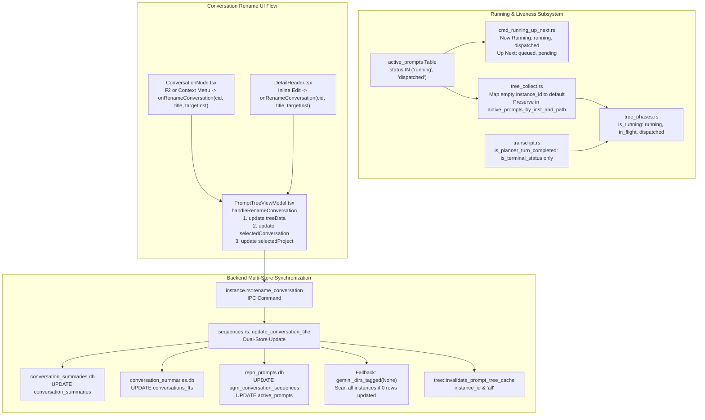

# Component Specification 02: Prompt Tree Liveness Detection & Conversation Rename Synchronization

> **Specification ID:** `02-component-spec`  
> **Parent Slug:** `fleet-system-and-ui-ux-bug-fixes`  
> **Target Subsystem:** Prompt Tree Liveness, Active Prompts Detection, Transcript Turn Status, Conversation Renaming, Multi-Store Sync  
> **Status:** `[APPROVED]`  
> **Author:** `@aukgit`  
> **Affected Files:**
> - `src-tauri/src/commands/cmd_running_up_next.rs`
> - `src-tauri/src/modules/repo_db/tree_collect.rs`
> - `src-tauri/src/modules/repo_db/tree_phases.rs`
> - `src-tauri/src/modules/repo_db/transcript.rs`
> - `src-tauri/src/modules/repo_db/sequences.rs`
> - `src/components/instances/PromptTreeView/types.ts`
> - `src/components/instances/PromptTreeView/PromptTreeViewModal.tsx`
> - `src/components/instances/PromptTreeView/ConversationNode.tsx`
> - `src/components/instances/PromptTreeView/DetailHeader.tsx`
> - `src/components/instances/PromptTreeView/TreePanel.tsx`

---

## 1. Problem Statement & Root Cause Analysis

### 1.1 Running Prompt Detection & Liveness Breakdown

During real-time monitoring and prompt tree inspections in Antigravity-Manager, running prompts and dispatched turns frequently disappeared or were miscategorized as idle or merely queued. Detailed investigation identified four interconnected root causes across the backend detection pipeline:

1. **Misclassification of Dispatched Prompts in `cmd_running_up_next.rs`:**
   - In `src-tauri/src/commands/cmd_running_up_next.rs`, `query_now_running` filtered rows using `WHERE status = 'running'`.
   - Simultaneously, `query_up_next` and `query_up_next_total` filtered rows using `WHERE status IN ('queued', 'pending', 'dispatched')`.
   - When a prompt is dispatched to an Antigravity IDE instance or headless agent worker, its state transitions to `dispatched`. At this stage, the task is no longer waiting in the queue; it is actively being executed by the model and tool runner.
   - Categorizing `dispatched` as part of `up_next` while omitting it from `now_running` left the "Now Running" banner blank while showing the executing task in the "Up Next" queue, confusing users into thinking execution was stalled.

2. **Premature Filtering of Empty Instance IDs in `tree_collect.rs`:**
   - In `src-tauri/src/modules/repo_db/tree_collect.rs`, active prompts collected from `list_all_prompts()` were processed with an early guard:
     ```rust
     if ap.instance_id.trim().is_empty() {
         continue;
     }
     ```
   - In single-instance and default IDE configurations, prompt submissions frequently omit an explicit `instance_id` (leaving it as empty string `""` or `NULL`).
   - The system's standard predicate helper `is_default_instance_match(inst_id)` explicitly defines `""`, `"default"`, and `"__default__"` as matching the default instance.
   - By dropping any `ap` with an empty `instance_id`, `active_prompts_by_inst_and_path` failed to record active prompts for default workspaces, causing running indicator badges to vanish.

3. **Omission of Dispatched Status in Fallback Project Synthesis (`tree_phases.rs`):**
   - In `src-tauri/src/modules/repo_db/tree_phases.rs`, `discover_fallback_projects` queries `active_prompts` to ensure active workspaces appear in the tree even when `conversation_summaries.db` has not yet indexed them.
   - However, the `is_running` field was set using:
     ```rust
     is_running: status.equals_any(&["running", "in_flight"]),
     ```
   - Prompts with `status = "dispatched"` were omitted, resulting in `is_running: false`. As a consequence, running project cards in the left panel displayed as idle without the green pulsing indicator while active execution was ongoing.

4. **Premature Turn Completion on Empty Status in `transcript.rs`:**
   - In `src-tauri/src/modules/repo_db/transcript.rs`, `is_planner_turn_completed(has_open_tools, s_status)` evaluated:
     ```rust
     pub(crate) fn is_planner_turn_completed(has_open_tools: bool, s_status: &str) -> bool {
         if has_open_tools {
             return false;
         }
         s_status.is_empty() || is_terminal_status(s_status)
     }
     ```
   - When an LLM begins streaming a `PLANNER_RESPONSE` or generates intermediate tokens before a tool invocation, the step status in `transcript.jsonl` / `transcript_full.jsonl` is initially blank/empty (`""`).
   - Treating an empty `s_status` as completed caused the live transcript parser to assume the turn had concluded, flipping the conversation state to idle mid-generation and dropping the live running banner.

---

### 1.2 Conversation Rename Synchronization & State Drift

Renaming a conversation in the UI exhibited synchronization defects where renames would either not persist across views, fail silently for secondary instances, or leave the full-text search index out of date:

1. **Direct Property Mutation in `DetailHeader.tsx`:**
   - When a user committed a new title in `DetailHeader.tsx`, the component executed:
     ```tsx
     await invoke('rename_conversation', { ... });
     selectedConversation.title = trimmed;
     ```
   - Directly mutating `selectedConversation.title` bypassed React's component state lifecycle.
   - The left sidebar (`TreePanel.tsx` / `ConversationNode.tsx`) did not update because `treeData` in `PromptTreeViewModal.tsx` was unaffected.
   - Furthermore, `selectedConversation` in the parent modal remained un-notified, causing desynchronization across tabs.

2. **Lost `targetInst` in `ConversationNode.tsx`:**
   - In `ConversationNode.tsx`, the rename callback was invoked without passing the target instance:
     ```tsx
     if (onRenameConversation) {
         await onRenameConversation(conv.conversation_id, trimmed);
     }
     ```
   - The parent modal defaulted the instance to `selectedProject?.instance_id || instanceId || 'default'`.
   - If the user renamed a conversation node belonging to a project different from `selectedProject`, the rename command was dispatched to the wrong instance directory, resulting in SQLite records remaining unchanged.

3. **Incomplete State Updates in `PromptTreeViewModal.tsx`:**
   - In `handleRenameConversation`, `setTreeData` was called to map over `treeData`, but `selectedConversation` and `selectedProject` were never updated.
   - If the renamed conversation was currently selected, the detail view header, breadcrumbs, and inspector continued to display the stale title until the modal was closed and reopened.

4. **FTS Table Desynchronization & Narrow Search in `sequences.rs`:**
   - In `src-tauri/src/modules/repo_db/sequences.rs`, `update_conversation_title` executed `UPDATE conversation_summaries SET title = ? ...` but failed to update the virtual table `conversations_fts`.
   - Because `conversations_fts` indexes conversation titles for fast full-text searching, searches using the new title failed while searches using the old title continued to return stale matches.
   - Additionally, `update_conversation_title` only scanned `gemini_dirs_for_instance(&resolved_inst)`. If an instance path was misconfigured or an instance was cloned under a new ID, looking up the database in that directory yielded 0 rows updated, failing the rename even though the conversation existed in another local profile.

---

## 2. Architecture & Data Contracts



---

## 3. Detailed Technical Requirements

### 3.1 Running Prompt Detection & Liveness Pipeline

#### 3.1.1 Query Definitions in `src-tauri/src/commands/cmd_running_up_next.rs`
- **Now Running Query (`query_now_running`):**
  - Prompt rows with `status = 'running'` OR `status = 'dispatched'` represent in-flight, actively executing turns.
  - SQL Statement:
    ```sql
    SELECT id, instance_id, status, created_at, image_payload IS NOT NULL
    FROM active_prompts
    WHERE status IN ('running', 'dispatched') AND {pred}
    ORDER BY created_at ASC, id ASC LIMIT 1
    ```
- **Up Next Query (`query_up_next`):**
  - Prompt rows waiting in queue are restricted strictly to `queued` and `pending`.
  - SQL Statement:
    ```sql
    SELECT id, instance_id, status, created_at, image_payload IS NOT NULL
    FROM active_prompts
    WHERE status IN ('queued', 'pending') AND {pred}
    ORDER BY created_at ASC, id ASC LIMIT 4
    ```
- **Up Next Total Count (`query_up_next_total`):**
  - SQL Statement:
    ```sql
    SELECT COUNT(*) FROM active_prompts
    WHERE status IN ('queued', 'pending') AND {pred}
    ```

#### 3.1.2 Default Instance ID Preservation in `src-tauri/src/modules/repo_db/tree_collect.rs`
- When iterating through `active_list` in `collect_tree_data`:
  - Do NOT skip prompts whose `instance_id.trim().is_empty()`.
  - Normalize the instance using `is_default_instance_match`:
    ```rust
    let inst = if is_default_instance_match(&ap.instance_id) {
        "default".to_string()
    } else {
        crate::modules::instance::resolve_instance_id(&ap.instance_id)
            .unwrap_or_else(|_| ap.instance_id.clone())
    };
    ```
  - Insert into `active_prompts_by_inst_and_path.entry((inst, key)).or_default().push(ap)`.

#### 3.1.3 Project Running Status in `src-tauri/src/modules/repo_db/tree_phases.rs`
- In `discover_fallback_projects`:
  - When synthesizing `RunningProject` entries from `active_prompts`:
    ```rust
    is_running: status.equals_any(&["running", "in_flight", "dispatched"]),
    ```
  - This ensures projects with dispatched prompts immediately reflect the active running state.

#### 3.1.4 In-Flight Status Preservation in `src-tauri/src/modules/repo_db/transcript.rs`
- In `is_planner_turn_completed(has_open_tools: bool, s_status: &str) -> bool`:
  - An empty `s_status` must NOT be considered terminal.
  - Implementation:
    ```rust
    pub(crate) fn is_planner_turn_completed(has_open_tools: bool, s_status: &str) -> bool {
        if has_open_tools {
            return false;
        }
        // An empty s_status represents an in-flight or streaming turn.
        // Only explicit terminal statuses (done, completed, idle, error) indicate turn completion.
        is_terminal_status(s_status)
    }
    ```

---

### 3.2 Conversation Rename Synchronization & Dual-Store Updates

#### 3.2.1 Frontend Propagation Contract
- **Type Signature in `src/components/instances/PromptTreeView/types.ts`:**
  ```typescript
  export type RenameConversationFn = (
      conversationId: string,
      newTitle: string,
      targetInst?: string
  ) => Promise<void> | void;
  ```
- **Props in `ConversationNode.tsx` & `TreePanel.tsx`:**
  - Update `onRenameConversation` to accept optional `targetInst?: string`.
  - In `ConversationNode.tsx::handleSaveTitle`:
    ```typescript
    const targetInst = conv.instance_id || project.instance_id;
    if (onRenameConversation) {
        await onRenameConversation(conv.conversation_id, trimmed, targetInst);
    }
    ```
- **Props in `DetailHeader.tsx`:**
  - Add `onRenameConversation?: RenameConversationFn` to `DetailHeaderProps`.
  - In `handleCommitTitle`:
    ```typescript
    const targetInst = selectedConversation.instance_id || 'default';
    if (onRenameConversation) {
        await onRenameConversation(selectedConversation.conversation_id, trimmed, targetInst);
    } else {
        await invoke('rename_conversation', {
            instanceId: targetInst,
            conversationId: selectedConversation.conversation_id,
            newTitle: trimmed,
        });
        selectedConversation.title = trimmed;
    }
    ```
- **Reactive State Sync in `PromptTreeViewModal.tsx`:**
  - Update `handleRenameConversation`:
    ```typescript
    const handleRenameConversation = async (
        conversationId: string,
        newTitle: string,
        targetInst?: string
    ) => {
        const inst = targetInst || selectedProject?.instance_id || instanceId || 'default';
        await invoke('rename_conversation', {
            instanceId: inst,
            conversationId,
            newTitle,
        });

        // 1. Update treeData
        setTreeData((prev) =>
            prev.map((p) => ({
                ...p,
                conversations: p.conversations.map((c) =>
                    c.conversation_id === conversationId ? { ...c, title: newTitle } : c
                ),
            }))
        );

        // 2. Update selectedConversation
        setSelectedConversation((prev) =>
            prev && prev.conversation_id === conversationId ? { ...prev, title: newTitle } : prev
        );

        // 3. Update selectedProject
        setSelectedProject((prev) =>
            prev
                ? {
                      ...prev,
                      conversations: prev.conversations.map((c) =>
                          c.conversation_id === conversationId ? { ...c, title: newTitle } : c
                      ),
                  }
                : prev
        );
    };
    ```
  - Forward `onRenameConversation={handleRenameConversation}` to `<DetailHeader ... />`.

---

#### 3.2.2 Backend Multi-Store & FTS5 Synchronization (`src-tauri/src/modules/repo_db/sequences.rs`)

`update_conversation_title` must execute an atomic dual-store update across both SQLite databases:

1. **Specific Instance Scan:**
   - Attempt to update `conversation_summaries.db` in directories returned by `gemini_dirs_for_instance(&resolved_inst)`.
   - Update `conversation_summaries`:
     ```sql
     UPDATE conversation_summaries
     SET title = ?1, last_modified_time = ?2
     WHERE conversation_id = ?3;
     ```
     (with fallback to `WHERE conversation_id LIKE ?3` if exact match updates 0 rows).
   - Update `conversations_fts` virtual table:
     ```sql
     UPDATE conversations_fts
     SET title = ?1
     WHERE conversation_id = ?2;
     ```
     (with fallback to `WHERE conversation_id LIKE ?2` if exact match updates 0 rows).
   - Track total rows updated across all databases.

2. **Universal Tagged Dirs Fallback:**
   - If `total_rows_updated == 0`:
     - Iterate through all directories returned by `gemini_dirs_tagged(None)`.
     - Attempt the same `conversation_summaries` and `conversations_fts` updates.
     - Stop once the conversation is successfully updated.

3. **AGM Sequence & Active Prompts Sync:**
   - In `repo_prompts.db`:
     ```sql
     UPDATE agm_conversation_sequences
     SET title = ?1, updated_at = ?2
     WHERE conversation_id = ?3;

     UPDATE active_prompts
     SET preview_raw = ?1, preview_clean = ?1
     WHERE session_id = ?2 AND (preview_raw IS NULL OR preview_raw = '' OR preview_raw LIKE 'Untitled%');
     ```

4. **Cache Invalidation:**
   - Invalidate prompt tree caches:
     ```rust
     super::tree::invalidate_prompt_tree_cache(Some(&resolved_inst));
     super::tree::invalidate_prompt_tree_cache(Some("all"));
     ```

---

## 4. Verification Matrix & Acceptance Criteria

| Subsystem | Test Case | Target Verification | Expected Outcome |
| :--- | :--- | :--- | :--- |
| **Liveness** | Prompt dispatched to IDE | `get_running_and_up_next(Some("default"))` | `now_running` contains the dispatched prompt; `up_next` contains only queued/pending prompts. |
| **Liveness** | Default instance prompt submission | `collect_tree_data(Some("default"))` with empty `instance_id` | Prompts are retained in `active_prompts_by_inst_and_path` and render with active badge. |
| **Liveness** | Active project fallback | `discover_fallback_projects` with `status = 'dispatched'` | Synthesized project card has `is_running: true`. |
| **Liveness** | Streaming transcript turn | `is_planner_turn_completed(false, "")` | Returns `false`. Conversation remains in running state during streaming. |
| **Rename** | Rename from DetailHeader | Double-click title in `DetailHeader`, commit new name | `treeData`, `selectedConversation`, and `selectedProject` all update without modal restart. |
| **Rename** | Rename from ConversationNode | Press F2 on conversation node in non-default project | Passes node's `targetInst` to backend; proper instance database is modified. |
| **Rename** | FTS Table Synchronization | Update title to "Alpha Feature", query FTS | `SELECT conversation_id FROM conversations_fts WHERE conversations_fts MATCH 'Alpha'` returns the row. |
| **Rename** | Fallback Instance Lookup | Rename conversation with incorrect instance target | `gemini_dirs_tagged(None)` fallback locates the DB and successfully applies the title update. |
