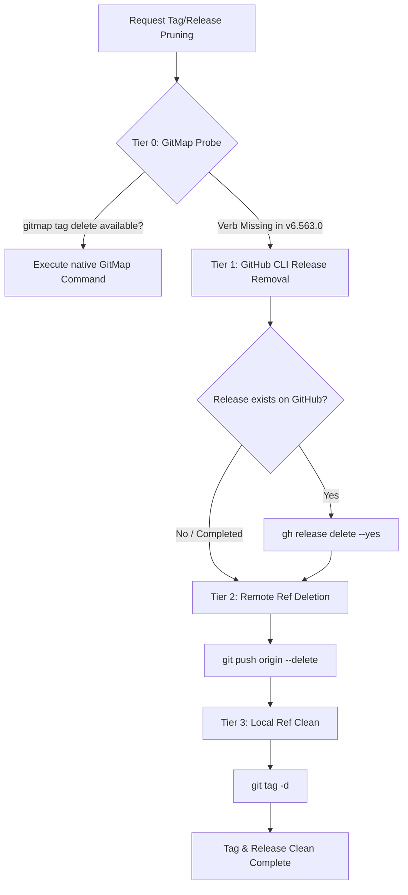
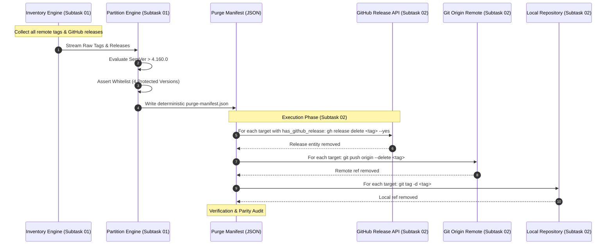
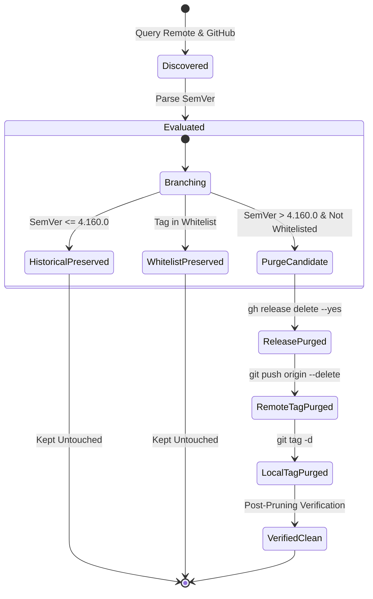

# Architecture Specification: Git Tag and Release Page Management & Historical Pruning Pipeline

> **Spec ID:** `02-spec/21-app/git-tag-and-release-page-management/01-architecture-spec.md`  
> **Status:** APPROVED & READY FOR IMPLEMENTATION  
> **Target Repository:** `alimtvnetwork/Antigravity-Manager`  
> **Cutoff Boundary:** Version > `4.160.0` (all tags `<= 4.160.0` are historical and strictly preserved)  
> **Whitelisted Versions:** `v4.190.0`, `v4.206.0`, `v4.225.0`, `v4.226.0` (strictly preserved)  
> **Author:** Spec Author 01 (Systems Architecture & Repository Hygiene)  
> **Related Master Plan:** [.ai-memory/plans/git-tag-and-release-page-management.md](../../../.ai-memory/plans/git-tag-and-release-page-management.md)  
> **Subtask Plans:**  
> - [.ai-memory/plans/subtasks/git-tag-and-release-page-management/01-inventory-and-filter-tags-and-releases.md](../../../.ai-memory/plans/subtasks/git-tag-and-release-page-management/01-inventory-and-filter-tags-and-releases.md)  
> - [.ai-memory/plans/subtasks/git-tag-and-release-page-management/02-delete-github-releases-and-remote-tags.md](../../../.ai-memory/plans/subtasks/git-tag-and-release-page-management/02-delete-github-releases-and-remote-tags.md)  
> **Coding Guidelines:** [AGENTS.md](../../../AGENTS.md) | [02-spec/02-coding-guidelines/](../../../02-spec/02-coding-guidelines/)

---

## 1. Executive Summary & Problem Classification

### 1.1 Problem Statement
The `alimtvnetwork/Antigravity-Manager` repository has accumulated a large number of transient, intermediate, and obsolete Git tags and associated GitHub Releases across rapid development cycles. This namespace saturation causes:
1. **GitHub Release Page Saturation:** Excessive release pages degrade user navigation and obscure stable milestone releases.
2. **Git Client Ref Clutter:** Downstream clients fetching `--tags` incur overhead pulling hundreds of dangling reference pointers.
3. **Release Confusion:** Users and automated update check mechanisms encounter noisy pre-release and development tags rather than authoritative milestone builds.

### 1.2 Objective & Purge Scope
This specification defines the deterministic architecture, mathematical filtering criteria, execution protocol, and verification checks required to clean the repository:
- **Historical Preserved Baseline:** All tags and releases created at or before version `4.160.0` (i.e. `SemVer <= 4.160.0`, including `v4.160.0`, `v4.159.0`, `v4.1.0`, etc.) must remain untouched.
- **Active Post-Cutoff Purge Window:** Any tag or release created after `4.160.0` (i.e. `SemVer > 4.160.0`) is subject to purging, unless it matches the whitelist.
- **Strict Whitelist (4 Protected Versions):** Exactly four designated versions within the post-4.160 window are protected and must remain intact across both GitHub Releases and remote/local Git tags:
  1. `v4.190.0`
  2. `v4.206.0`
  3. `v4.225.0`
  4. `v4.226.0`
- **Target of Purge:** All other tags and releases where `version > 4.160.0` and `version` is not in the whitelist must be purged from:
  - GitHub Releases (release entries, asset bundles, tarballs)
  - Remote Git tags on `origin` (`refs/tags/*`)
  - Local Git tag stores in working clones

---

## 2. Core Architectural Invariants & Safety Contracts

### Invariant 1: Repository Identity Assertion
Execution tools must assert that the active remote `origin` resolves strictly to `alimtvnetwork/Antigravity-Manager`. Any execution against unexpected upstream remotes or mirrors must halt immediately.

### Invariant 2: Cutoff Boundary Invariant (Floor Guard)
The version boundary `4.160.0` is an absolute floor. Any tag evaluating to `major < 4` or `major == 4 && minor <= 160` evaluates to `is_historical = true` and is strictly excluded from deletion candidates.

### Invariant 3: Whitelist Preservation Invariant (Immunity Guard)
The 4 whitelisted tags are immune to all deletion stages. The system asserts immunity at two independent stages:
1. During manifest generation in Subtask 01.
2. Immediately before executing any deletion command in Subtask 02 (pre-flight guard).

```
Whitelisted Versions:
├── v4.190.0  [IMMUNE]
├── v4.206.0  [IMMUNE]
├── v4.225.0  [IMMUNE]
└── v4.226.0  [IMMUNE]
```

### Invariant 4: Positive Boolean Model
All internal data structures, flags, filtering expressions, and status checks must adhere to positive boolean naming conventions:
- `is_whitelisted` (True if tag is in the 4-version whitelist)
- `is_post_cutoff` (True if SemVer > 4.160.0)
- `is_purge_target` (True if `is_post_cutoff && !is_whitelisted`)
- `is_historical` (True if SemVer <= 4.160.0)
- `is_dry_run` (True if operating in preview simulation mode)
- `is_remote_tag_present` (True if tag ref exists on remote `origin`)
- `is_local_tag_present` (True if tag ref exists in local git storage)
- `has_github_release` (True if a corresponding GitHub Release exists)
- `is_valid_semver` (True if string conforms to SemVer specification)

Negative flags (such as `no_delete`, `unretained`, `is_not_whitelisted`, or `disable_prune`) are strictly forbidden.

### Invariant 5: Two-Stage Deletion Order (GitHub Release First)
When deleting an item that has both a GitHub Release and a Git Tag:
1. **Stage 1 (GitHub Release):** The GitHub Release entry must be deleted first via GitHub API / `gh release delete`.
2. **Stage 2 (Git Remote Ref):** The remote tag reference must be deleted second via `git push origin --delete <tag>`.

*Rationale:* If the remote Git tag is deleted first while the GitHub Release remains, GitHub maintains an orphaned release entry pointing to a dangling commit or creates an unlinked release state, causing API errors during subsequent cleanup.

### Invariant 6: Tooling Fallback Ladder Invariant
GitMap (version `v6.563.0`) currently lacks native tag/release pruning subcommands (e.g. `gitmap tag delete` or `gitmap release delete`). The execution architecture explicitly defines a structured fallback ladder routing to authenticated GitHub CLI and Git remote commands.

---

## 3. Tooling Analysis & GitMap Fallback Ladder

### 3.1 GitMap v6.563.0 Capability Assessment
GitMap is the project's primary CLI utility for multi-repository scanning, cross-node SSH delegation, pipeline telemetry, and working tree management. An audit of GitMap v6.563.0 reveals:
- **Supported Capabilities:** Repository discovery (`gitmap scan`), parallel cloning (`gitmap clone`), pipeline telemetry diagnosis (`gitmap pe -t`), cluster management (`gitmap cluster`), and macro execution.
- **Unsupported/Missing Verbs:** GitMap contains no subcommands for remote tag destruction, GitHub release page removal, or ref deletion.
- **Design Philosophy:** Destructive ref mutations on public remote namespaces require elevated authentication tokens (`gh` auth scopes or SSH push credentials) that GitMap intentionally isolates from general repository scanning.

### 3.2 The 4-Tier Fallback Ladder



| Tier | Tool / Interface | Command Pattern | Responsibility |
|---|---|---|---|
| **Tier 0** | GitMap Native CLI | `gitmap tag prune / delete` | Probe for future native support; falls back when missing. |
| **Tier 1** | GitHub CLI (`gh`) | `gh release delete <tag> --yes` | Removes GitHub Release entity and associated uploaded release assets. |
| **Tier 2** | Git Network Client | `git push origin --delete <tag>` | Deletes remote reference `refs/tags/<tag>` from `origin`. |
| **Tier 3** | Git Local Client | `git tag -d <tag>` | Purges local tag reference from `.git/refs/tags/` and packed-refs. |

---

## 4. SemVer Parsing, Version Comparison & Partitioning Algorithm

### 4.1 Version Normalization
Each tag is evaluated by stripping any leading `v` or `V` prefix:
$$\text{CleanTag} = \text{RegexReplace}(Tag, \text{"\^v"}, \text{""})$$

A version string is parsed into its semantic components:
$$\text{Version} = (\text{Major}, \text{Minor}, \text{Patch}, \text{PreRelease})$$

### 4.2 Comparison Logic
For two semantic versions $A$ and $B$:
1. If $A.\text{Major} \neq B.\text{Major}$, comparison is determined by $A.\text{Major} \lessgtr B.\text{Major}$.
2. If $A.\text{Major} = B.\text{Major}$ and $A.\text{Minor} \neq B.\text{Minor}$, comparison is determined by $A.\text{Minor} \lessgtr B.\text{Minor}$.
3. If $A.\text{Major} = B.\text{Major}$ and $A.\text{Minor} = B.\text{Minor}$, comparison is determined by $A.\text{Patch} \lessgtr B.\text{Patch}$.

### 4.3 Partitioning Predicates
Let $\text{Cutoff} = (4, 160, 0)$.

1. **Cutoff Predicate:**
   $$\text{is\_post\_cutoff}(V) \iff V > \text{Cutoff}$$
   $$\text{is\_historical}(V) \iff V \le \text{Cutoff}$$

2. **Whitelist Predicate:**
   $$\text{is\_whitelisted}(V) \iff V \in \{ \text{"v4.190.0"}, \text{"v4.206.0"}, \text{"v4.225.0"}, \text{"v4.226.0"} \}$$

3. **Purge Target Predicate:**
   $$\text{is\_purge\_target}(V) \iff \text{is\_post\_cutoff}(V) \land \neg \text{is\_whitelisted}(V)$$

### 4.4 Partition Taxonomy

```
Total Discovered Tags
│
├── Partition A: PRESERVED_HISTORICAL (SemVer <= 4.160.0)
│   ├── Examples: v4.160.0, v4.159.0, v4.150.0, v4.1.0, v1.0.0
│   └── Action: IMMUTABLE PRESERVE (Untouched)
│
├── Partition B: PRESERVED_WHITELIST (SemVer > 4.160.0 & Whitelisted)
│   ├── Items: v4.190.0, v4.206.0, v4.225.0, v4.226.0
│   └── Action: IMMUTABLE PRESERVE (Protected by Dual Guard)
│
└── Partition C: PURGE_TARGET (SemVer > 4.160.0 & Not Whitelisted)
    ├── Items: All intermediate versions, alpha/beta builds, test releases
    └── Action: PURGE (Release -> Remote Tag -> Local Tag)
```

---

## 5. Architectural Flow & Lifecycle State Diagrams

### 5.1 End-to-End Orchestration Pipeline



### 5.2 Tag Lifecycle State Machine



---

## 6. Detailed Subsystem Specifications

### 6.1 Subsystem 1: Inventory & Discovery Engine (Subtask 01)
- **Inputs:**
  - Remote tag list via `git ls-remote --tags origin` or GitHub API `GET /repos/alimtvnetwork/Antigravity-Manager/git/matching-refs/tags`.
  - GitHub releases catalog via `gh release list --repo alimtvnetwork/Antigravity-Manager --limit 1000`.
  - Local tag list via local ref inspection.
- **Responsibilities:**
  - Collate all distinct tag names across remote, local, and GitHub Releases.
  - Normalize version strings and extract numeric components.
  - Produce an exhaustive raw inventory.

### 6.2 Subsystem 2: Evaluation & Partitioning Engine (Subtask 01)
- **Responsibilities:**
  - Process raw inventory through the mathematical partitioning algorithm.
  - Populate exact metadata: `is_whitelisted`, `is_post_cutoff`, `is_purge_target`, `has_github_release`, `is_remote_tag_present`, `is_local_tag_present`.
  - Export structured `purge-manifest.json` containing:
    - Summary metrics: total tags, historical preserved count, whitelist count, purge candidate count.
    - Deterministic array of purge targets sorted in descending SemVer order.

### 6.3 Subsystem 3: Deletion Orchestrator & Rate Limiting (Subtask 02)
- **Responsibilities:**
  - Read `purge-manifest.json`.
  - Execute Tier 1: GitHub Release deletion via `gh release delete <tag> --yes`.
  - Execute Tier 2: Remote tag deletion via `git push origin --delete <tag>`.
  - Execute Tier 3: Local tag deletion via `git tag -d <tag>`.
  - Apply adaptive delay (150ms - 300ms) between remote calls to respect GitHub API secondary rate limits and prevent socket exhaustion.
  - Enforce atomic failure logging in `audit-log.json`.

### 6.4 Subsystem 4: Verification & Consistency Reporter (Post-Execution)
- **Responsibilities:**
  - Query GitHub Releases API to verify 0 unexpected releases exist in the post-4.160 window.
  - Confirm the 4 whitelisted releases remain accessible with status 200:
    - `v4.190.0`
    - `v4.206.0`
    - `v4.225.0`
    - `v4.226.0`
  - Query remote Git tags to confirm no purged tags exist on `origin`.
  - Produce final summary report.

---

## 7. Data Contracts & JSON Schemas

### 7.1 Purge Manifest Schema (`purge-manifest.json`)
```json
{
  "$schema": "https://json-schema.org/draft/2020-12/schema",
  "title": "PurgeManifest",
  "type": "object",
  "properties": {
    "repository": { "type": "string", "enum": ["alimtvnetwork/Antigravity-Manager"] },
    "cutoff_version": { "type": "string", "enum": ["4.160.0"] },
    "whitelist": {
      "type": "array",
      "items": { "type": "string" },
      "minItems": 4,
      "maxItems": 4
    },
    "metrics": {
      "type": "object",
      "properties": {
        "total_discovered": { "type": "integer" },
        "preserved_historical_count": { "type": "integer" },
        "preserved_whitelist_count": { "type": "integer" },
        "purge_target_count": { "type": "integer" }
      },
      "required": ["total_discovered", "preserved_historical_count", "preserved_whitelist_count", "purge_target_count"]
    },
    "purge_targets": {
      "type": "array",
      "items": {
        "type": "object",
        "properties": {
          "tag_name": { "type": "string" },
          "semver": { "type": "string" },
          "has_github_release": { "type": "boolean" },
          "is_remote_tag_present": { "type": "boolean" },
          "is_local_tag_present": { "type": "boolean" },
          "is_post_cutoff": { "type": "boolean" },
          "is_whitelisted": { "type": "boolean" },
          "is_purge_target": { "type": "boolean" }
        },
        "required": [
          "tag_name",
          "semver",
          "has_github_release",
          "is_remote_tag_present",
          "is_local_tag_present",
          "is_post_cutoff",
          "is_whitelisted",
          "is_purge_target"
        ]
      }
    }
  },
  "required": ["repository", "cutoff_version", "whitelist", "metrics", "purge_targets"]
}
```

---

## 8. Safety Guards, Risk Matrix & Failure Mitigation

### 8.1 Pre-Flight Whitelist Assertion Logic
Before issuing any destructive CLI call (`gh release delete` or `git push origin --delete`), the orchestrator checks:

```python
# Positive boolean verification check
def assert_safe_to_purge(tag_name: str, semver_str: str) -> bool:
    whitelisted_tags = {"v4.190.0", "v4.206.0", "v4.225.0", "v4.226.0"}
    is_whitelisted = tag_name in whitelisted_tags or f"v{semver_str}" in whitelisted_tags
    if is_whitelisted:
        raise SecurityViolation(f"CRITICAL: Attempted to purge whitelisted tag: {tag_name}")
    
    parsed = parse_semver(semver_str)
    is_post_cutoff = (parsed.major > 4) or (parsed.major == 4 and parsed.minor > 160)
    if not is_post_cutoff:
        raise SecurityViolation(f"CRITICAL: Attempted to purge historical tag <= 4.160.0: {tag_name}")
    
    return True
```

### 8.2 Risk Matrix

| Risk Event | Severity | Probability | Automated Mitigation |
|---|---|---|---|
| **Accidental Whitelist Deletion** | Critical | Very Low | Hardcoded dual-stage assertion; execution aborts if tag matches any of the 4 whitelisted versions. |
| **Historical Baseline Corruption** | Critical | Very Low | Strict mathematical cutoff filter (`major == 4 && minor <= 160` evaluates immediately to preserved). |
| **GitHub API Rate Limiting** | Medium | Medium | Adaptive sliding throttle (200ms per request) with exponential backoff on HTTP 403 / 429. |
| **Partial Failure (Network Drop)** | Low | Medium | Manifest records idempotency status; execution resumes seamlessly from the first unpurged entry. |
| **Orphaned Release References** | Medium | Low | Enforce Stage 1 (release deletion) prior to Stage 2 (git ref deletion). |

---

## 9. Verification & Acceptance Criteria

1. **Floor Boundary Integrity:**
   - Tag `v4.160.0` and all prior tags (`v4.159.0`, `v4.158.0`, etc.) are intact on remote and GitHub Releases.
2. **Whitelist Preservation Integrity:**
   - The four tags `v4.190.0`, `v4.206.0`, `v4.225.0`, and `v4.226.0` exist on `origin` and their GitHub release pages remain accessible.
3. **Purge Completeness:**
   - Zero non-whitelisted tags with version `> 4.160.0` exist on `origin`.
   - Zero non-whitelisted releases with version `> 4.160.0` exist on GitHub Releases.
4. **Audit Trail Parity:**
   - Every deleted release and tag has a corresponding verified entry in `audit-log.json` detailing timestamp, response code, and ref name.
