# Specification 03: Supabase Circuit Breaker, Polling Cadence Optimization & CLM Cache Stabilization

## User Request (Verbatim)

```markdown
You are Spec Author 03 for task gitmap-node-and-prompt-system-issues. You have no prior chat context; this brief is your complete specification.

### Objectives:
Author two comprehensive specification and subtask plan documents:
1. `02-spec/21-app/gitmap-node-and-prompt-system-issues/03-migration-and-verification-spec.md`
2. `.ai-memory/plans/subtasks/gitmap-node-and-prompt-system-issues/03-supabase-polling-and-clm.md`

### Contents to Include:
- Architectural and integration specifications for:
  - Supabase 5-Minute Cooldown Circuit Breaker: Define atomic `LAST_SUPABASE_ERROR_TIMESTAMP` in `src-tauri/src/modules/supabase_sync/types.rs` with 300s duration; gate calls in `fetch_fleet_machines`, `query_fleet_machines`, and `list_active_leases`; suppress repeated stack backtrace spam on transport errors; provide bypass and reset on user-initiated `test_supabase_endpoint` and `save_supabase_config`.
  - Transaction Frequency & Polling Cadence: Relax aggressive timers in `useInstanceSelector.ts` (4s -> event-driven/60s), `useInstancePage.ts` (15s -> 60s/300s), and `useFleetMachines.ts` (15s -> 300s); add 30-second TTL cache for account listing in `src-tauri/src/modules/account/crud.rs` to stop repetitive reads of 46 JSON account files; add debouncing in `useAccountStore.ts`.
  - CLM (Conversation Liveness Module) Cache Sabotage Remediation: Remove circular `invalidate_prompt_tree_cache()` calls from `src-tauri/src/modules/repo_db/detection.rs:254` so `get_project_conversation_tree_cached` hits its 120s TTL cache and eliminates console log spam (`PROMPT_LIVENESS_PROBE`, `InstancePromptAudit`).
  - Pre-flight quality gates, minor version bump release ceremony, changelog synchronization with `@aukgit` attribution, and CI/CD verification.
- Exact file boundaries, implementation logic, and verification criteria.

### Boundaries & Crash Prevention:
- You are a subagent with write tools (`write_to_file`, `replace_file_content`).
- You MUST write ONLY to your two assigned files:
  - `02-spec/21-app/gitmap-node-and-prompt-system-issues/03-migration-and-verification-spec.md`
  - `.ai-memory/plans/subtasks/gitmap-node-and-prompt-system-issues/03-supabase-polling-and-clm.md`
- NEVER write to any other file!
- TOTAL BAN ON RAW SEARCH TOOLS: NEVER run `rg`, `ripgrep`, `grep`, `git grep`, `Select-String`, `Get-ChildItem -Recurse`, or `findstr`.
- TOTAL BAN ON GIT COMMANDS: NEVER run `git add`, `git commit`, `git status`, `git diff`, etc.
- Strict Relative Git Paths: All paths cited must be relative to the repository root.

When both files are created and complete, send a message to the caller and stop.
```

---

## 1. Executive Summary & Problem Analysis

This specification establishes architectural controls, runtime circuit breakers, caching layers, and polling frequency reductions across the Antigravity-Manager frontend and backend to address three systemic performance, stability, and observability defects:

```mermaid
flowchart TD
    subgraph S1["Defect 1: Supabase Transport Storm"]
        E1["Unreachable Remote Supabase"] -->|Every 15s| P1["fetch_fleet_machines / query_fleet_machines / list_active_leases"]
        P1 -->|Timeout & Backtrace Spam| L1["Console / Log Saturation"]
        P1 -.->|Remediation| CB["5-Minute Cooldown Circuit Breaker (300s)"]
        CB -->|Instant Fallback| FB["Local Machine / SSH Fallback (0ms)"]
    end

    subgraph S2["Defect 2: Aggressive Polling & JSON Thrashing"]
        T1["useInstanceSelector: 4s Poll"] --> F1["Frequent Disk I/O"]
        T2["useInstancePage: 15s Poll"] --> F2["Runs 5 Heavy Tasks"]
        T3["useFleetMachines: 15s Poll"] --> F3["Unneeded Remote Requests"]
        T4["list_accounts: Uncached"] --> F4["Re-reads 46 Account JSON Files"]
        F1 & F2 & F3 & F4 -.->|Remediation| PC["Cadence Relaxation + 30s TTL Cache + Debounce"]
    end

    subgraph S3["Defect 3: CLM Cache Sabotage"]
        D1["detect_active_projects Sweep"] -->|Line 254| INV["invalidate_prompt_tree_cache(target_id)"]
        INV -->|Bypasses 120s TTL| D2["get_project_conversation_tree_cached Cache Miss"]
        D2 -->|Heavy Filesystem Scan| LOG["PROMPT_LIVENESS_PROBE Log Spam"]
        INV -.->|Remediation| DEL["Remove Circular Invalidation at Line 254"]
    end
```



### Defect 1: Supabase Transport Error Storm & Unbounded Backtraces
- **Location:** `src-tauri/src/modules/supabase_sync/fleet.rs`, `src-tauri/src/modules/supabase_sync/query.rs`, `src-tauri/src/modules/workspace_lease_manager/release.rs`
- **Root Cause:** When remote Supabase instances are unreachable, offline, or experiencing transient network partition, background callers (`fetch_fleet_machines`, `query_fleet_machines`, and `list_active_leases`) repeatedly execute outbound HTTP requests on every UI poll loop (every 15 seconds). Each request times out, emitting multi-line error traces to logs and UI error trackers, degrading network performance and masking genuine application errors.
- **Remediation:** Introduce an atomic circuit breaker (`LAST_SUPABASE_ERROR_TIMESTAMP`) with a 300-second (5-minute) cooldown duration. When tripped, calls immediately short-circuit to local/cached data without attempting transport calls. Bypass and reset the cooldown on explicit user actions (`test_supabase_endpoint`, `save_supabase_config`).

### Defect 2: High Transaction Frequency & JSON Filesystem Thrashing
- **Location:** `src/components/navbar/instanceSelector/useInstanceSelector.ts`, `src/pages/instances/useInstancePage.ts`, `src/components/instances/fleet/useFleetMachines.ts`, `src-tauri/src/modules/account/crud.rs`, `src/stores/useAccountStore.ts`
- **Root Cause:**
  1. `useInstanceSelector.ts` runs `setInterval(fetchInstances, 4000)` regardless of dropdown visibility.
  2. `useInstancePage.ts` runs a monolithic throttled poll every 15,000ms executing 5 concurrent queries including `get_project_conversation_tree`, `fetchInstances`, `fetchAccounts`, `fetchSwitcherStatus`, and `fetchDaemonTelemetry`.
  3. `useFleetMachines.ts` sets `POLL_INTERVAL_SECONDS = 15` for remote multi-machine tables.
  4. In `src-tauri/src/modules/account/crud.rs`, `list_accounts()` loads and parses every registered account JSON file (46 files on developer systems) from disk on every invocation, followed by a weekly usage calculation scan in `token_stats`.
  5. `useAccountStore.ts` lacks request debouncing and coalescing for overlapping calls to `fetchAccounts()`.
- **Remediation:**
  1. Relax `useInstanceSelector.ts` from 4s to 60s background fallback with event-driven refresh on dropdown open.
  2. Relax `useInstancePage.ts` from 15s to 60s (active window) / 300s (hidden/unfocused window).
  3. Relax `useFleetMachines.ts` from 15s to 300s (5-minute cadence matching Supabase cooldown).
  4. Implement an in-memory 30-second TTL cache for `list_accounts()` in `src-tauri/src/modules/account/crud.rs`, with synchronous invalidation on mutations (`save_account`, `delete_account`, `add_account`, `update_account_priority`).
  5. Add debounce and in-flight request deduplication to `useAccountStore.ts`.

### Defect 3: CLM (Conversation Liveness Module) Cache Sabotage
- **Location:** `src-tauri/src/modules/repo_db/detection.rs:254`
- **Root Cause:** In `detect_active_projects`, line 254 calls `invalidate_prompt_tree_cache(Some(target_id));` on every detection sweep. Because `detect_active_projects` is invoked periodically by the UI and background workers, this unconditionally purges the prompt tree cache before `get_project_conversation_tree_cached` can benefit from its 120-second TTL. The cache hit rate drops to 0%, forcing expensive SQLite scans and transcript regex parsing on every cycle, flooding the console with `PROMPT_LIVENESS_PROBE` and `InstancePromptAudit` telemetry log spam.
- **Remediation:** Delete the circular `invalidate_prompt_tree_cache(Some(target_id));` call from `src-tauri/src/modules/repo_db/detection.rs`. Tree cache invalidation must be reserved strictly for genuine mutating events (such as prompt termination, prompt creation, or explicit user refresh).

---

## 2. Architectural Design & Technical Specifications

### 2.1 Supabase 5-Minute Cooldown Circuit Breaker

#### 2.1.1 State Definition & Invariants
In `src-tauri/src/modules/supabase_sync/types.rs`:
```rust
use std::sync::atomic::{AtomicBool, AtomicU64, Ordering};
use once_cell::sync::Lazy;

/// Timestamp (Unix epoch seconds) of the most recent Supabase transport error.
/// Initialized to 0 (no active error/cooldown).
pub(crate) static LAST_SUPABASE_ERROR_TIMESTAMP: Lazy<AtomicU64> = Lazy::new(|| AtomicU64::new(0));

/// Duration of the circuit breaker cooldown period in seconds (5 minutes).
pub const SUPABASE_COOLDOWN_DURATION_SECS: u64 = 300;

/// Check whether Supabase queries are currently inhibited by the cooldown circuit breaker.
pub fn is_supabase_in_cooldown() -> bool {
    let last = LAST_SUPABASE_ERROR_TIMESTAMP.load(Ordering::Relaxed);
    if last == 0 {
        return false;
    }
    let now = chrono::Utc::now().timestamp().max(0) as u64;
    now.saturating_sub(last) < SUPABASE_COOLDOWN_DURATION_SECS
}

/// Record a Supabase transport or connectivity failure, tripping the circuit breaker for 300 seconds.
pub fn record_supabase_error() {
    let now = chrono::Utc::now().timestamp().max(0) as u64;
    LAST_SUPABASE_ERROR_TIMESTAMP.store(now, Ordering::Relaxed);
}

/// Reset the Supabase circuit breaker cooldown, allowing immediate network calls.
/// Must be invoked on user-initiated actions (e.g. test connection, manual config save).
pub fn reset_supabase_cooldown() {
    LAST_SUPABASE_ERROR_TIMESTAMP.store(0, Ordering::Relaxed);
}
```

#### 2.1.2 Gating in Core Query Paths
1. **`fetch_fleet_machines` (`src-tauri/src/modules/supabase_sync/fleet.rs`):**
   - At function entry, check `is_supabase_in_cooldown()`. If `true`, log a debug message (`tracing::debug!(target: "supabase_sync", "Supabase in 5m cooldown; returning local machine fallback immediately")`) and return `Ok(vec![construct_local_machine_info(&config, &[])])` without attempting any HTTP requests.
   - On network/HTTP error (`reqwest` error, connection refused, timeout, HTTP 5xx): call `record_supabase_error()` and log a single concise warning without verbose backtraces:
     ```rust
     record_supabase_error();
     tracing::warn!(target: "supabase_sync", "Supabase transport error: {e}. Cooldown activated for 300s");
     ```
2. **`query_fleet_machines` (`src-tauri/src/modules/supabase_sync/query.rs`):**
   - At function entry, check `is_supabase_in_cooldown()`. If `true`, immediately return `Ok(build_local_and_ssh_fleet())`.
   - On error creating client or querying endpoints: call `record_supabase_error()` and return `Ok(build_local_and_ssh_fleet())`.
3. **`list_active_leases` (`src-tauri/src/modules/workspace_lease_manager/release.rs`):**
   - Check `crate::modules::supabase_sync::is_supabase_in_cooldown()`. If `true`, return `Ok(Vec::new())` (or return cached leases from `ACTIVE_REMOTE_LEASES`).
   - On transport error executing the Supabase query: call `crate::modules::supabase_sync::record_supabase_error()`.

#### 2.1.3 Manual Override & Cooldown Bypass
In `src-tauri/src/commands/supabase.rs`:
1. **`test_supabase_endpoint`:**
   - Call `supabase_sync::reset_supabase_cooldown();` immediately prior to testing the client connection so that developer-initiated diagnostics bypass the cooldown.
   - If test succeeds, cooldown remains 0. If test fails, the test returns its result payload normally without locking the user out of testing alternative endpoints.
2. **`save_supabase_config`:**
   - Call `supabase_sync::reset_supabase_cooldown();` so updated credentials or corrected endpoint URLs can immediately be verified.

---

### 2.2 Transaction Frequency & Polling Cadence Optimization

#### 2.2.1 Frontend Polling Frequency Adjustments

| Component / Hook File | Existing Cadence | Optimized Cadence | Mechanism & Rationale |
|:---|:---|:---|:---|
| `src/components/navbar/instanceSelector/useInstanceSelector.ts` | 4,000ms (`setInterval`) | 60,000ms background + On-Demand | Polls every 60s when closed; immediately calls `fetchInstances()` when `isOpen` changes from `false` to `true`. |
| `src/pages/instances/useInstancePage.ts` | 15,000ms (`setInterval`) | 60,000ms active / 300,000ms idle | Active tab polls every 60s; `document.hidden` relaxes cadence to 300s. Event listeners handle immediate refreshes. |
| `src/components/instances/fleet/useFleetMachines.ts` | 15s (`POLL_INTERVAL_SECONDS`) | 300s (`POLL_INTERVAL_SECONDS = 300`) | Matches 5-minute cooldown; manual refresh button resets countdown to 300s. |

#### 2.2.2 Backend Account List 30-Second TTL Cache
In `src-tauri/src/modules/account/crud.rs`:
```rust
use std::sync::RwLock;
use std::time::Instant;

struct AccountListCache {
    accounts: Vec<Account>,
    cached_at: Instant,
}

static ACCOUNT_LIST_CACHE: Lazy<RwLock<Option<AccountListCache>>> = Lazy::new(|| RwLock::new(None));
pub const ACCOUNT_LIST_CACHE_TTL_SECS: u64 = 30;

pub fn invalidate_account_list_cache() {
    if let Ok(mut lock) = ACCOUNT_LIST_CACHE.write() {
        *lock = None;
    }
}
```
- In `list_accounts()`:
  1. Check `ACCOUNT_LIST_CACHE.read()`. If `cached_at.elapsed().as_secs() < ACCOUNT_LIST_CACHE_TTL_SECS`, return a cloned vector of cached accounts immediately.
  2. On cache miss: proceed with reading `index.accounts`, reading each individual JSON file, and populating weekly stats.
  3. Store result in `ACCOUNT_LIST_CACHE.write()` before returning.
- In mutating functions (`save_account`, `save_account_at_path`, `delete_account`, `add_account`, `update_account_priority`): call `invalidate_account_list_cache()`.

#### 2.2.3 Frontend Account Store Debounce & In-Flight Coalescing
In `src/stores/useAccountStore.ts`:
- Maintain an in-flight promise reference `let fetchAccountsPromise: Promise<void> | null = null;` and a debounce timestamp `let lastFetchTime = 0;`.
- In `fetchAccounts()`:
  1. If `fetchAccountsPromise` is active, return that existing promise to coalesce concurrent callers into a single network cycle.
  2. If `Date.now() - lastFetchTime < 1000` (1-second debounce) and `get().accounts.length > 0`, return immediately.
  3. Otherwise, set `fetchAccountsPromise = accountService.listAccounts().then(...)` and clear the reference in `finally`.

---

### 2.3 CLM (Conversation Liveness Module) Cache Sabotage Remediation

#### 2.3.1 Defect Mechanics in `detection.rs`
In `src-tauri/src/modules/repo_db/detection.rs:254`:
```rust
    if !is_instance_active {
        for p in &mut projects {
            p.is_running = false;
        }
    }

    // LINE 254: Circular sabotage - invalidates prompt tree cache every single detection cycle!
    // invalidate_prompt_tree_cache(Some(target_id));
    Ok(projects)
```
- When `detect_active_projects` executes, it detects project directory state and updates SQLite `running_projects`.
- Calling `invalidate_prompt_tree_cache(Some(target_id))` here destroys the in-memory 120s TTL cache in `get_project_conversation_tree_cached`.
- As a consequence, subsequent calls to `get_project_conversation_tree` from `useInstancePage.ts` or background tasks always hit a cold cache, re-scanning conversation files, parsing transcripts, and generating log warnings.

#### 2.3.2 Remediation
- Completely remove line 254: `invalidate_prompt_tree_cache(Some(target_id));` from `src-tauri/src/modules/repo_db/detection.rs`.
- Legitimate cache invalidation continues to occur where it belongs:
  - `add_prompt_to_history()`
  - `mark_prompt_completed()`
  - User-initiated manual refresh via `force: true` parameter in `get_project_conversation_tree`.

---

## 3. Requirements Traceability Matrix

| Requirement Component | Source Requirement | Target File(s) | Function / Symbol Affected |
|:---|:---|:---|:---|
| **Supabase Circuit Breaker State** | Supabase 5-Minute Cooldown Circuit Breaker | `src-tauri/src/modules/supabase_sync/types.rs` | `LAST_SUPABASE_ERROR_TIMESTAMP`, `is_supabase_in_cooldown`, `record_supabase_error`, `reset_supabase_cooldown` |
| **Fleet Fetch Gating** | Supabase 5-Minute Cooldown Circuit Breaker | `src-tauri/src/modules/supabase_sync/fleet.rs` | `fetch_fleet_machines` |
| **Fleet Query Gating** | Supabase 5-Minute Cooldown Circuit Breaker | `src-tauri/src/modules/supabase_sync/query.rs` | `query_fleet_machines` |
| **Lease List Gating** | Supabase 5-Minute Cooldown Circuit Breaker | `src-tauri/src/modules/workspace_lease_manager/release.rs` | `list_active_leases` |
| **Circuit Breaker Reset** | Bypass & reset on user action | `src-tauri/src/commands/supabase.rs` | `test_supabase_endpoint`, `save_supabase_config` |
| **Instance Selector Cadence** | Relax aggressive timers (4s -> event-driven/60s) | `src/components/navbar/instanceSelector/useInstanceSelector.ts` | `useInstanceSelector` (`setInterval` -> 60s + `isOpen` trigger) |
| **Instance Page Cadence** | Relax aggressive timers (15s -> 60s/300s) | `src/pages/instances/useInstancePage.ts` | `useInstancePage` (`performThrottledPoll` timer) |
| **Fleet Machines Cadence** | Relax aggressive timers (15s -> 300s) | `src/components/instances/fleet/useFleetMachines.ts` | `POLL_INTERVAL_SECONDS` |
| **Account Listing Cache** | 30s TTL cache for account listing | `src-tauri/src/modules/account/crud.rs` | `ACCOUNT_LIST_CACHE`, `list_accounts`, `invalidate_account_list_cache` |
| **Account Store Debounce** | Debouncing in `useAccountStore.ts` | `src/stores/useAccountStore.ts` | `fetchAccounts` |
| **CLM Cache Sabotage Fix** | Remove circular cache invalidation | `src-tauri/src/modules/repo_db/detection.rs` | `detect_active_projects` (remove line 254) |
| **Pre-Flight & Release Ceremony** | Pre-flight quality gates, release bump, `@aukgit` attribution | Root configs & changelog | `cargo fmt`, `cargo clippy`, `npm run build`, `npm run bump` |

---

## 4. Release Ceremony & Pre-Flight Quality Gates

### 4.1 Strict Maintainer Attribution Invariant
In accordance with repository guidelines:
- Release notes in `changelog.md` and `changelog_en.md` must attribute strictly `@aukgit`: `(Thanks to @aukgit)`.
- No other GitHub usernames or handles may appear in release attribution headers or trailers.

### 4.2 Local Pre-Flight Commands
Before merging or tagging a release:
```bash
# 1. Rust formatting verification
cd src-tauri && cargo fmt -- --check

# 2. Rust clippy gate (covers full compilation, all targets, all features)
cd src-tauri && cargo clippy --all-targets --all-features

# 3. Frontend production build gate
npm run build
```

### 4.3 Version Bump & README Synchronization
For stable or beta releases:
```bash
# Atomic bump across all 14 project manifest files
npm run bump <minor|patch|beta>

# Synchronize changelog summary to README.md and README_EN.md
# Ensure all referenced paths are strictly relative Git paths
```

---

## 5. Acceptance Criteria & Verification Plan

### 5.1 Supabase Cooldown Verification
1. Simulate Supabase unreachable (e.g. invalid endpoint or disconnected network).
2. Trigger `fetch_fleet_machines` or wait for background poll.
3. Verify that on first failure, `record_supabase_error()` is called and log shows single warning.
4. Verify that subsequent calls within 300s return fallback data in < 1ms without outbound HTTP requests and without backtrace spam.
5. Invoke `test_supabase_endpoint` or `save_supabase_config` and verify `LAST_SUPABASE_ERROR_TIMESTAMP` resets to 0.

### 5.2 Account Listing Cache Verification
1. Call `list_accounts()` consecutively 10 times in a loop.
2. Verify that account JSON files are read from disk only once on the first invocation.
3. Calls 2-10 complete in < 0.5ms from in-memory cache.
4. Modify an account priority via `update_account_priority` and verify cache is invalidated immediately.

### 5.3 CLM Cache Hit Verification
1. Invoke `detect_active_projects`.
2. Verify that `get_project_conversation_tree_cached` retains cached tree nodes across multiple detection sweeps without cache invalidation.
3. Confirm absence of `PROMPT_LIVENESS_PROBE` and `InstancePromptAudit` log spam during idle execution.

### 5.4 Frontend Polling Verification
1. Observe browser DevTools Network tab / console in `Instances` page.
2. Confirm `useInstanceSelector` does not poll every 4s.
3. Confirm `useFleetMachines` countdown begins at 300s instead of 15s.
4. Confirm `useInstancePage` poll interval is 60s active / 300s background.
