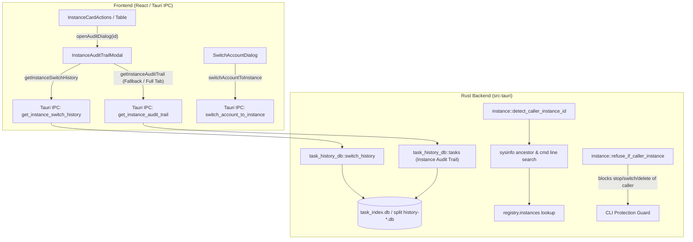

# Architecture Specification: Instance Management & UI/UX Synchronization

## Overview

This specification addresses:
1. **Audit Trail Visibility for Instances**: Guaranteeing that opening an instance's audit trail displays full historical events (switch cycles, backup, restore, sync, schedulers) without empty states or ID mismatch.
2. **Switch Account Dialog UI/UX Consistency**: Enhancing `SwitchAccountDialog.tsx` with unified dark-glass styling, high-contrast quota display, score-based ordering, and interactive hover feedback.
3. **Active Caller IDE Detection & Suicide Prevention in CLI**: Enabling CLI commands (`agm instances current`, `agm instances stop`, `agm switch`) to reliably identify the parent IDE terminal process via PID tree and command line arguments (`--user-data-dir`), strictly guarding the active caller instance against accidental termination.
4. **Lightweight Test Instance Lifecycle**: Introducing high-efficiency creation and cleanup (`agm instances create-test` / `rm-test` or `--test` flags) that provision data-only isolated sandboxes, verify auto-switcher and PID management safely, and immediately purge test artifacts.
5. **Database State Synchronization**: Ensuring SQLite databases (`task_index.db`, `history-*.db`, `fleet_sync.db`, `repo_prompts.db`) maintain synchronized, updated records across all instance operations.

## Architecture & Subsystems

## Key Invariants

1. **Audit Key Normalization**:
   - `instance_id` matching must normalize `'default'`, `''`, `NULL`, `'antigravity'`, `'agy'`, `'ide'`, and `'classic'` as the Default instance.
   - When no switches are present, `InstanceAuditTrailModal` automatically loads general instance audit records (`get_instance_audit_trail`) so the user never sees an empty void.

2. **Caller Instance Self-Preservation**:
   - When `agm` CLI is invoked from an IDE integrated terminal, it traces ancestor PIDs.
   - For any ancestor matching `Antigravity.exe` or `antigravity`, it inspects command line arguments for `--user-data-dir <path>`.
   - If matched to an instance in `registry.json`, that instance ID is marked protected.
   - If no `--user-data-dir` argument exists on the parent IDE, the caller is identified as `'default'`.
   - Any attempt to stop, switch, or delete the caller instance via CLI fails fast with error `Refusing to stop, switch, or delete instance '<id>' because this command is running inside it`.

3. **Test Instance Sandboxing & Rapid Teardown**:
   - Test instances use transient sandboxes under `%LOCALAPPDATA%\agm-instances\test-<nanoid>` with `--data-only` mode.
   - Creation takes < 50ms (zero binary copy).
   - Teardown cleanly removes folder and deletes database entries, leaving 0 byte footprint.
