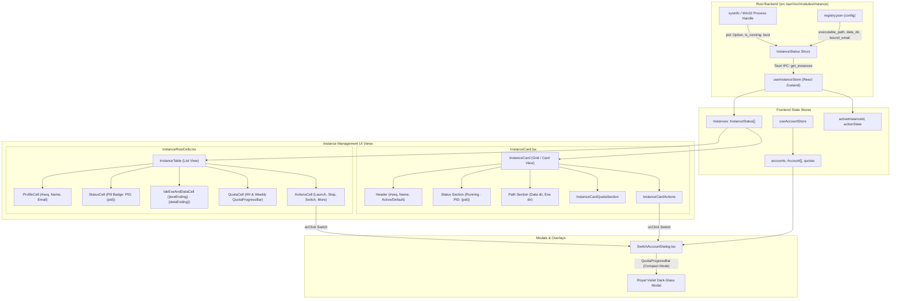
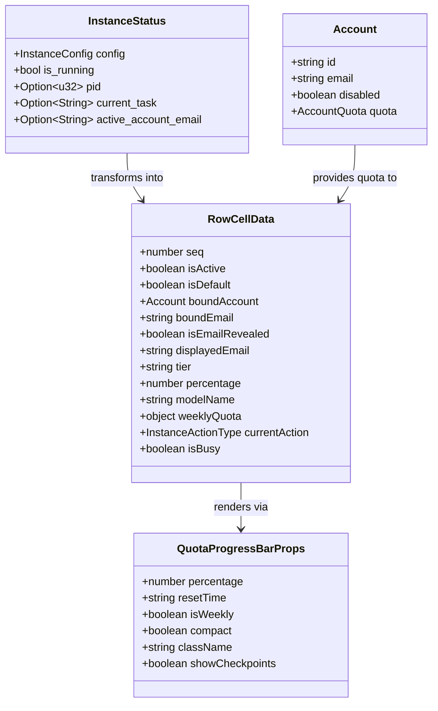

# Architecture Specification: Instance Management UI/UX & Layout Synchronization

**Document Slug:** `instance-management-and-ui-ux-synchronization`  
**Relative Path:** `02-spec/21-app/instance-management-and-ui-ux-synchronization/01-architecture-spec.md`  
**Scope:** UI Layout Enhancements, Single-Line Inline Paths, OS PID Clarity, and Switch Account Dialog Modernization  
**Status:** `Approved / Active Specification`  

---

## 1. Executive Summary & Problem Classification

The multi-instance management interface of Antigravity-Manager (AGM) provides developers and automation agents with controls to launch, stop, switch, and inspect sandboxed Antigravity IDE instances. While the underlying backend process engine manages individual IDE profiles with unique user data directories and process trees, the frontend UI currently suffers from three primary layout and clarity deficiencies:

1. **Table View Multi-Line Bloat in `IdeExeAndDataCell`**:
   In `src/components/instances/table/InstanceRowCells.tsx`, executable paths and user data directories are stacked vertically in a 2-line column (`flex flex-col`). This expands individual table row heights, misaligns table columns against adjacent single-line cells (`StatusCell`, `ProfileCell`), and reduces information density on dense operator monitors.
2. **Ambiguous Process Status & Unlabeled PID Display**:
   When an instance is actively running, the status badge presents a numeric value (e.g. `1632` or `(1632)`) without an explicit `PID:` label. Operators frequently confuse this number with internal port bindings, sequence indexes, or memory offsets. This specification confirms that `1632` is the native Operating System Process ID (`PID`) returned from the Win32/POSIX kernel process handle, and mandates explicit `PID: ${pid}` formatting across both List (`StatusCell`) and Card (`InstanceCard.tsx`) views.
3. **Switch Account Modal Design Divergence**:
   The `SwitchAccountDialog.tsx` modal currently uses legacy styling with ad-hoc color scales, disjointed unsegmented buttons, and a primitive custom HTML progress bar (`<div className="w-20 h-1.5 ...">`). It fails to reuse AGM's Royal Violet dark-glass design tokens and omits the standardized `QuotaProgressBar` component, resulting in inconsistent quota visualization between the instance grid and the account switcher.

---

## 2. System Architecture & UI/UX Component Hierarchy



### Component Responsibilities

| Component | File Path | Architecture Responsibilities |
| :--- | :--- | :--- |
| `StatusCell` | `src/components/instances/table/InstanceRowCells.tsx` | Renders running/idle/busy status. Displays pulsating status beacon and explicit `PID: ${pid}` label for running instances. |
| `IdeExeAndDataCell` | `src/components/instances/table/InstanceRowCells.tsx` | Formats and renders the ending part of the IDE executable and user data directory together on a single line (`{exeEnding} · {dataEnding}`) with an inline copy button. |
| `InstanceCard` | `src/pages/instances/InstanceCard.tsx` | Renders the grid card view. Standardizes process badge to `Running · PID: ${pid}` with green pulsating indicator and high-contrast styling. |
| `SwitchAccountDialog` | `src/pages/instances/SwitchAccountDialog.tsx` | Presents interactive account selection modal with score-based sorting, Royal Violet dark-glass surface tokens, segmented pill capsules, and integrated `QuotaProgressBar`. |

---

## 3. Detailed Architectural Requirements & Invariants

### 3.1 List View Layout Changes (`IdeExeAndDataCell`)

#### Defect Analysis
Currently, `IdeExeAndDataCell` structures content as:
```tsx
<div className="flex flex-col min-w-0 leading-tight">
    <div className="flex items-center gap-1 min-w-0 font-semibold">
        <Terminal className="w-3 h-3 text-slate-400 shrink-0" />
        <span className="truncate">{exeName}</span>
    </div>
    <div className="flex items-center gap-1 min-w-0 text-[10px] text-slate-500">
        <Folder className="w-3 h-3 text-slate-400 shrink-0" />
        <span className="truncate">{dataEnding || '—'}</span>
    </div>
</div>
```
This vertical stacking creates a multi-line box that inflates row height from `38px` to `52px+`.

#### Invariant I-01: Single-Line Horizontal Layout
`IdeExeAndDataCell` MUST present both the executable identifier and the data directory ending on a **single horizontal line** separated by a muted dot divider (`·`).
- **Executable Segment (`exeEnding`)**: Derived from `inst.config.executable_path` via `formatPathEnding(exeFull)` or clean basename fallback (`Antigravity.exe` / `Default IDE`).
- **Data Folder Segment (`dataEnding`)**: Derived from `resolveDataDir(inst)` via `formatPathEnding(fullPath)`.
- **Combined Layout**:
  ```tsx
  <div className="flex items-center justify-between gap-1.5 text-[11px] font-mono w-full">
      <div className="flex items-center gap-1.5 min-w-0 flex-1 truncate" title={`IDE: ${exeFull || exeName}\nData: ${fullPath}`}>
          <Terminal className="w-3 h-3 text-slate-400 shrink-0" />
          <span className="truncate text-slate-700 dark:text-slate-200 font-medium">
              {exeEnding}
          </span>
          <span className="text-slate-400 dark:text-slate-600 font-sans select-none">·</span>
          <Folder className="w-3 h-3 text-slate-400 shrink-0" />
          <span className="truncate text-slate-500 dark:text-slate-400">
              {dataEnding || '—'}
          </span>
      </div>
      <button
          type="button"
          onClick={onCopy}
          data-ui-name="copy-path-btn"
          data-ui-id={`copy-path-${inst.config.id}`}
          className="p-1 rounded-[5px] text-slate-400 hover:text-slate-700 dark:hover:text-slate-200 hover:bg-slate-200 dark:hover:bg-[#40285e] transition-colors cursor-pointer shrink-0 ml-1"
          title={isCopied ? 'Copied!' : 'Copy full data path'}
      >
          {isCopied ? <Check className="w-3 h-3 text-teal-500" /> : <Copy className="w-3 h-3" />}
      </button>
  </div>
  ```

---

### 3.2 Operating System Process ID (PID) Clarity

#### Confirmation of 1632 as OS PID
In Antigravity-Manager, the process tracking subsystem (`src-tauri/src/modules/instance.rs`) monitors spawned IDE child processes using OS system handles (`sysinfo::System`, `sysinfo::Pid`, and Win32 `OpenProcess`). When an instance starts:
1. `std::process::Command::spawn()` assigns a unique native Operating System Process ID (`child.id() as u32`).
2. This value is recorded in `InstanceStatus.pid` as `Option<u32>`.
3. Therefore, values such as `1632` unambiguously represent the **OS Process ID (`PID`)**.

#### Invariant I-02: Explicit `PID: ${pid}` Badge Notation
- In `StatusCell` (`src/components/instances/table/InstanceRowCells.tsx`):
  When `inst.is_running` is true and `inst.pid` is present, the status badge MUST explicitly render `PID: ${inst.pid}`:
  ```tsx
  <span 
      className="inline-flex items-center gap-1.5 px-2 py-0.5 rounded-full text-[10px] font-semibold bg-teal-50/90 text-teal-700 dark:bg-teal-950/60 dark:text-teal-300 border border-teal-300/50 dark:border-teal-800/80 backdrop-blur-xs font-mono"
      title={inst.pid ? `Operating System Process ID (PID): ${inst.pid}` : 'Running'}
  >
      <span className="w-1.5 h-1.5 rounded-full bg-teal-500 animate-pulse" />
      <span>{inst.pid ? `PID: ${inst.pid}` : 'Running'}</span>
  </span>
  ```
- In `InstanceCard.tsx` (`src/pages/instances/InstanceCard.tsx`):
  Replace the ambiguous `Running (${inst.pid})` string with explicit `PID:` notation:
  ```tsx
  {inst.is_running ? (
      <span className="inline-flex items-center gap-1.5 px-2 py-0.5 rounded-[5px] text-[10px] font-semibold bg-[#1af18d]/10 text-emerald-700 dark:text-[#1af18d] border border-[#1af18d]/30 shadow-2xs font-mono">
          <span className="w-1.5 h-1.5 rounded-full bg-[#1af18d] shadow-[0_0_4px_rgba(26,241,141,0.9)] animate-pulse" />
          <span>Running</span>
          {inst.pid && (
              <>
                  <span className="text-emerald-500/50 dark:text-[#1af18d]/50 font-sans">·</span>
                  <span>PID: {inst.pid}</span>
              </>
          )}
      </span>
  ) : (
      <span className="inline-flex items-center gap-1 px-2 py-0.5 rounded-[5px] text-[10px] font-medium bg-slate-500/10 text-slate-600 dark:text-slate-400 border border-slate-400/20">
          <span className="w-1.5 h-1.5 rounded-full bg-slate-400" />
          <span>Idle</span>
      </span>
  )}
  ```

---

### 3.3 Switch Account Dialog Redesign (`SwitchAccountDialog.tsx`)

#### Defect Analysis
The existing `SwitchAccountDialog.tsx` implements custom progress meters, basic rounded badges, and fragmented borders that deviate from the design system standards established across AGM.

#### Invariant I-03: Dark Glass Design Tokens & Segmented Capsules
The modal container, account rows, and controls MUST conform to AGM Royal Violet design tokens:
1. **Modal Container**:
   - `backdrop-blur-md bg-white/95 dark:bg-[var(--ui-surface-1,#120d1d)]/95`
   - Border: `border-slate-200 dark:border-[var(--ui-border-subtle,#40285e)]`
   - Shadow: `shadow-2xl rounded-2xl`
2. **Search Filter Bar**:
   - High-contrast segmented pill style with dark background (`dark:bg-[#090611]`), focus ring (`focus:ring-teal-500`), and placeholder contrast.
3. **Account Cards & Segmented Pill Capsules**:
   - Wrap quota metrics into contiguous segmented capsules with unified borders:
     `[ 4H: XX% | Weekly: YY% | Total: ZZ% ]`
   - Highlight currently bound account with Neon Emerald glow (`border-teal-400/60 dark:border-teal-700/80 bg-teal-50/80 dark:bg-teal-950/40`).
4. **Integration of `QuotaProgressBar`**:
   - Replace the ad-hoc `<div className="w-20 h-1.5 ...">` progress bar with AGM's standardized `QuotaProgressBar` component:
     ```tsx
     <QuotaProgressBar
         percentage={barPct}
         isWeekly={false}
         compact={true}
         className="w-24 shrink-0"
         showCheckpoints={false}
     />
     ```
   - Retain 4H and Weekly numeric badges while leveraging `QuotaProgressBar`'s unified color ramp (`#1af18d`, `#10b981`, `#eab308`, `#f97316`, `#ef4444`).
5. **Interactive Controls & Accessibility**:
   - Close modal upon pressing the `Escape` key (`keydown` listener).
   - Ensure the entire account row or the distinct `Select` button is comfortably clickable with visible hover and focus states.
   - Show animated `RotateCw` spinner with "Switching..." text during active switch.

---

## 4. Data Contracts & State Management



### CSS Token Mapping

| Token Class | Light Value | Dark Value (`ui-tokens.css`) | Purpose |
| :--- | :--- | :--- | :--- |
| `var(--ui-surface-1)` | `#ffffff` | `#120d1d` / `#171025` | Modal surface, card backdrop |
| `var(--ui-surface-2)` | `#f8fafc` | `#1f1433` / `#181126` | Nested rows, search bar, pill background |
| `var(--ui-border-subtle)` | `#e2e8f0` | `#40285e` / `#382252` | Modal borders, card dividers |
| `var(--ui-accent-neon)` | `#0d9488` | `#1af18d` | Running beacon, active account glow |

---

## 5. Verification Matrix & Non-Regression Standards

| Verification Item | Command / Test Action | Expected Result |
| :--- | :--- | :--- |
| TypeScript & React Compilation | `npm run build` | Zero TS compiler errors, zero asset bundle warnings. |
| Code Formatting & Linter | `npm run lint` | Zero ESLint / Prettier rule violations across touched files. |
| Inline List View Height | Inspect rendered `InstanceTable` in DOM | Row height `<= 40px`. `IdeExeAndDataCell` renders `{exeEnding} · {dataEnding}` on a single horizontal line. |
| OS PID Display | Inspect running instance row and card | `StatusCell` displays `PID: <number>`. `InstanceCard` displays `Running · PID: <number>`. |
| Switch Account Dialog Styling | Open `SwitchAccountDialog` | Modal renders dark-glass theme, segmented pill capsules, and integrated `QuotaProgressBar`. |
| Keyboard Accessibility | Open `SwitchAccountDialog` and press `Escape` | Modal gracefully closes without error. |
