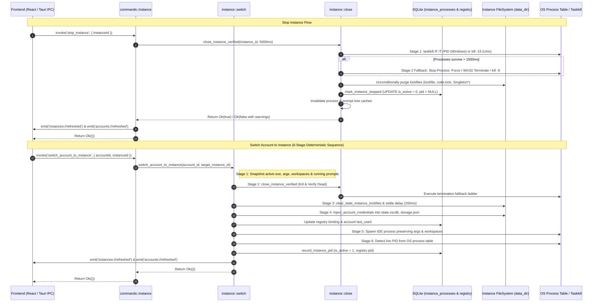
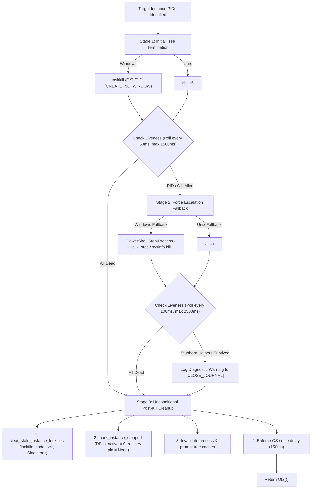
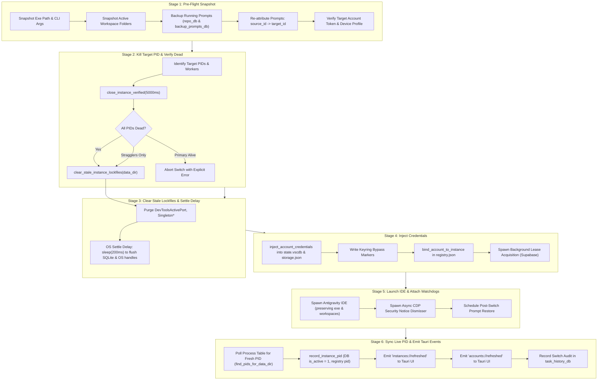

# Component Specification: Instance Management & UI/UX Synchronization

## User Request (Verbatim)

```
Author the component specification and subtask plan for backend instance lifecycle and PID control:
1. `02-spec/21-app/instance-management-and-ui-ux-synchronization/02-component-spec.md`:
   - Component specification for `src-tauri/src/modules/instance/close.rs`, `src-tauri/src/modules/instance/switch.rs`, `src-tauri/src/modules/instance/create.rs`, and `src-tauri/src/commands/instance.rs`.
   - Fix for `stop_instance`: Eliminate the 3-second hard abort bug; add Windows process tree kill fallback (Win32 TerminateProcess / Stop-Process -Force); ensure lockfiles are cleared, database `is_active = 0` is set, and cache is invalidated even if stubborn helpers take time to exit.
   - Fix for `switch_account_to_instance`: 6-stage deterministic sequencing (Snapshot -> Kill Target PID & Verify Dead -> Clear Stale Lockfiles & Settle Delay -> Inject Credentials -> Launch -> Sync Live PID -> Emit `instances://refreshed` and `accounts://refreshed` to Tauri UI).
2. `.ai-memory/plans/subtasks/instance-management-and-ui-ux-synchronization/02-instance-lifecycle-and-pid-control.md`:
   - Detailed subtask plan for Task-02.
   - Target files, functions, lines, and exact modification steps.
   - Verification commands and acceptance criteria.
```

---

## 1. Overview & Architectural Context

This component specification establishes the backend mechanics for instance process lifecycle, deterministic PID termination, guaranteed lockfile sanitation, database synchronization, and Tauri IPC event broadcasting within Antigravity-Manager.

### System Interaction Diagram



---

## 2. Component Specification: `src-tauri/src/modules/instance/close.rs`

### 2.1 The 3-Second Hard Abort Bug: Root Cause Analysis

In the previous implementation of `close_instance` in `src-tauri/src/modules/instance/close.rs` (lines 500–524):
```rust
// FLAWED PATTERN:
let start_wait = std::time::Instant::now();
let max_graceful = std::time::Duration::from_millis(3000);

loop {
    let has_alive = pids.iter().any(|&pid| is_pid_alive_targeted(pid));
    if !has_alive { break; }

    if start_wait.elapsed() > max_graceful {
        let still: Vec<u32> = pids.iter().copied().filter(|&pid| is_pid_alive_targeted(pid)).collect();
        if !still.is_empty() {
            return Err(format!("Instance '{instance_id}' PID(s) {still:?} stayed alive after taskkill"));
        }
        // ...
        break;
    }
    std::thread::sleep(std::time::Duration::from_millis(100));
}
```

#### Defect Impact:
1. **Premature Error Bailout**: When Chromium/Electron utility processes (such as GPU helpers, audio service, crashpad handlers) took longer than 3,000ms to exit following `taskkill`, `close_instance` returned an immediate `Err(...)`.
2. **Skipped Cleanup Cascade**: Because of the early `return Err`, subsequent critical operations were completely bypassed:
   - `clear_stale_instance_lockfiles` was never called, leaving `code.lock`, `lockfile`, and `SingletonLock` on disk.
   - `mark_instance_stopped` was never executed, leaving `is_active = 1` in SQLite `instance_processes` and stale PIDs in `registry.json`.
   - `invalidate_instance_process_cache` and `invalidate_prompt_tree_cache` were skipped, leaving GUI caches corrupted.
3. **No Windows Fallback Ladder**: On Unix platforms, a `SIGKILL` fallback existed, but on Windows, there was zero secondary escalation if `taskkill` failed or was delayed.

### 2.2 Multi-Stage Process Tree Kill Fallback Ladder

`close_instance` must implement a 3-stage progressive termination ladder:



#### Implementation Logic for `close_instance`:
1. **Stage 1 (Primary Tree Kill)**:
   - Windows: Execute `taskkill /F /T /PID <pid>` with creation flag `0x08000000` (`CREATE_NO_WINDOW`).
   - Unix: Execute `kill -15 <pid>`.
2. **Initial Verification Window (1,500ms)**:
   - Poll target PIDs every 50ms. If all processes exit, exit loop immediately.
3. **Stage 2 (Force Kill Escalation Fallback)**:
   - If PIDs remain alive after 1,500ms:
     - On Windows:
       1. Attempt in-process `sysinfo::Process::kill()` for targeted PIDs.
       2. Invoke PowerShell fallback: `powershell -NoProfile -NonInteractive -Command "Stop-Process -Id <pid> -Force -ErrorAction SilentlyContinue"` with `CREATE_NO_WINDOW`.
     - On Unix: Execute `kill -9 <pid>`.
4. **Final Verification Window (up to 2,500ms total)**:
   - Poll target PIDs every 100ms.
   - If surviving PIDs remain at timeout:
     - Check if the primary IDE executable (`antigravity.exe` or configured executable) is dead.
     - If only detached helper subprocesses remain, log them to `[CLOSE_JOURNAL]` with warning level rather than returning `Err`.
5. **Stage 3 (Unconditional Post-Kill Cleanup)**:
   - **MANDATORY**: The function MUST NOT exit early on stubborn helpers. It MUST proceed directly to:
     ```rust
     let target_data_path = PathBuf::from(&config.data_dir);
     clear_stale_instance_lockfiles(&target_data_path);
     crate::error::record_ignored(mark_instance_stopped(instance_id), "mark instance stopped");
     invalidate_instance_process_cache(instance_id);
     crate::modules::repo_db::invalidate_prompt_tree_cache(Some(instance_id));
     std::thread::sleep(std::time::Duration::from_millis(150));
     ```

### 2.3 `close_instance_verified` Refinement

- The verification loop runs two passes (`for attempt in 0..2`).
- Each pass executes `close_instance(instance_id)`.
- Errors from `close_instance` are logged and recorded via `crate::error::record_ignored` or propagated only if registry resolution fails.
- If PIDs reach 0 within the deadline:
  - Invalidate caches and return `Ok(true)`.
- If PIDs survive after both passes:
  - Invalidate caches and return `Ok(false)` with explicit warning log: `[Instance] PIDs {:?} for instance '{}' survived verified close; proceeding anyway — relaunch will replace the session`.

---

## 3. Component Specification: `src-tauri/src/modules/instance/create.rs`

### 3.1 Refactoring `stop_instance`

The `stop_instance` function in `src-tauri/src/modules/instance/create.rs` (lines 325–334) serves as the primary external API entry point for instance shutdown.

```rust
pub fn stop_instance(instance_id: &str) -> Result<(), String> {
    let resolved = resolve_instance_id(instance_id).unwrap_or_else(|_| instance_id.to_string());
    
    // 1. Attempt verified close with 5000ms overall budget
    let closed = close_instance_verified(&resolved, std::time::Duration::from_millis(5000))
        .map_err(|e| format!("Error closing instance '{resolved}': {e}"))?;

    // 2. Ensure post-close state consistency regardless of straggler status
    if let Ok(reg) = load_registry() {
        if let Some(inst) = reg.instances.iter().find(|i| i.id == resolved) {
            let data_path = std::path::PathBuf::from(&inst.data_dir);
            clear_stale_instance_lockfiles(&data_path);
        }
    }
    // Mark instance stopped in SQLite instance_processes (is_active = 0) and registry
    crate::error::record_ignored(mark_instance_stopped(&resolved), "mark instance stopped");
    invalidate_instance_process_cache(&resolved);
    crate::modules::repo_db::invalidate_prompt_tree_cache(Some(&resolved));

    // 3. Handle survivor outcome
    if !closed {
        // Inspect whether the primary process is alive vs harmless detached helpers
        let remaining = get_instance_saved_pid(&resolved);
        if let Some(pid) = remaining {
            if is_pid_alive_targeted(pid) {
                return Err(format!("Instance '{resolved}' primary PID {pid} stayed alive after termination"));
            }
        }
        crate::modules::logger::log_warn(&format!(
            "[Instance] Stop completed for '{}' with detached helper stragglers; locks and DB cleaned",
            resolved
        ));
    }

    Ok(())
}
```

---

## 4. Component Specification: `src-tauri/src/modules/instance/switch.rs`

### 4.1 The 6-Stage Deterministic Sequencing

Account switching across running instances requires an uncompromising, ordered sequence to prevent race conditions, `state.vscdb` file locks, credential overwriting, and GUI desynchronization.



### 4.2 Stage Specifications & Technical Invariants

| Stage | Name | Target Components | Invariants & Fallbacks |
|:---|:---|:---|:---|
| **Stage 1** | **Snapshot** | `repo_db`, `backup_prompts_db`, `oauth`, `device` | - Must snapshot active args & executable before stopping process.<br>- Must re-attribute backed-up prompts from source to target instance.<br>- Ensure target account token is refreshed; fail fast if token is revoked. |
| **Stage 2** | **Kill & Verify Dead** | `instance::close`, `taskkill`, `sysinfo` | - Kill all PIDs bound to target `data_dir`.<br>- Terminate associated `agy_workers`.<br>- Call `close_instance_verified(5000ms)`.<br>- If primary IDE process is still alive after retries, abort before touching credentials. |
| **Stage 3** | **Clear Locks & Settle Delay** | `clear_stale_instance_lockfiles`, `std::thread::sleep` | - Delete `lockfile`, `code.lock`, `DevToolsActivePort`, `Singleton*`.<br>- Enforce mandatory 200ms sleep delay so the OS completely releases file locks and SQLite WAL headers. |
| **Stage 4** | **Inject Credentials** | `credentials::inject_account_credentials`, `storage` | - Write auth tokens to `state.vscdb`, `storage.json`, and credentials file.<br>- Write OS keyring bypass markers to skip platform modal prompts.<br>- Update `bound_account_id` and `bound_email` in `registry.json`.<br>- Asynchronously acquire distributed workspace lease. |
| **Stage 5** | **Launch** | `smart_run::launch_instance_with_workspaces`, `process` | - Spawn IDE with original workspace folders.<br>- Spawn detached background task for CDP dialog dismissal (`dismiss_security_notice_dialog_for_data_dir`).<br>- If backed-up prompts exist, schedule prompt restore. |
| **Stage 6** | **Sync PID & Emit Events** | `pid_store`, `log_bridge`, `task_history_db` | - Poll OS process table (up to 3,000ms) for newly materialized PID.<br>- Record newly detected PID into `instance_processes` with `is_active = 1` and update `registry.json`.<br>- Emit `instances://refreshed` and `accounts://refreshed` to Tauri UI.<br>- Record structured audit entry in `task_history_db`. |

---

## 5. Component Specification: `src-tauri/src/commands/instance.rs`

### 5.1 Command Updates for Instant UI Synchronization

Commands invoked from the React frontend must guarantee immediate UI event propagation so that instance cards, status badges, and account assignments update without requiring a manual page refresh.

#### 1. `stop_instance` Command (lines 53–56):
```rust
#[tauri::command]
pub fn stop_instance(instance_id: String) -> Result<(), String> {
    instance::stop_instance(&instance_id)?;
    
    // Broadcast refreshed state to frontend
    if let Some(handle) = crate::modules::log_bridge::get_app_handle() {
        use tauri::Emitter;
        // Justification: frontend UI sync; best-effort emission
        crate::error::record_ignored(
            handle.emit("instances://refreshed", ()),
            "emit instances://refreshed",
        );
        crate::error::record_ignored(
            handle.emit("accounts://refreshed", ()),
            "emit accounts://refreshed",
        );
    }
    
    Ok(())
}
```

#### 2. `close_instance` Command (lines 207–210):
```rust
#[tauri::command]
pub fn close_instance(instance_id: String) -> Result<(), String> {
    instance::close_instance(&instance_id)?;
    
    if let Some(handle) = crate::modules::log_bridge::get_app_handle() {
        use tauri::Emitter;
        crate::error::record_ignored(
            handle.emit("instances://refreshed", ()),
            "emit instances://refreshed",
        );
        crate::error::record_ignored(
            handle.emit("accounts://refreshed", ()),
            "emit accounts://refreshed",
        );
    }
    
    Ok(())
}
```

#### 3. `switch_account_to_instance` Command (lines 228–258):
- Ensures error logging with `crate::error::AppError::Process`.
- Verifies that `switch_account_to_instance` emits both `instances://refreshed` and `accounts://refreshed` upon successful completion.

---

## 6. Data Contracts & Database Schema Alignment

### 6.1 Split SQLite `instance_processes` Table

File: `paths::get_instance_db_path()` (`instance_processes.db` / `instances.db`)

```sql
CREATE TABLE IF NOT EXISTS instance_processes (
    instance_id TEXT PRIMARY KEY,
    pid INTEGER NOT NULL,
    data_dir TEXT NOT NULL,
    launched_at INTEGER NOT NULL,
    is_active INTEGER NOT NULL DEFAULT 1
);
```

#### State Transition Rules:
1. **Launch / Start**:
   - `INSERT INTO instance_processes ... VALUES (?1, ?2, ?3, ?4, 1) ON CONFLICT(instance_id) DO UPDATE SET pid = excluded.pid, is_active = 1`
2. **Stop / Close / Kill**:
   - `UPDATE instance_processes SET is_active = 0 WHERE instance_id = ?1`
   - `registry.json`: `inst.pid = None`
3. **Query Active PID**:
   - `SELECT pid FROM instance_processes WHERE instance_id = ?1 AND is_active = 1`

### 6.2 Tauri IPC Event Payloads

1. **`instances://refreshed`**:
   - Direction: Backend -> Frontend (React)
   - Payload: `()` (Empty unit payload triggering React query / store invalidation)
   - Listener Target: `useInstancePage.ts`, `App.tsx`

2. **`accounts://refreshed`**:
   - Direction: Backend -> Frontend (React)
   - Payload: `()` (Empty unit payload triggering Account store refresh)
   - Listener Target: `AccountList.tsx`, `SwitchAccountDialog.tsx`, `App.tsx`

---

## 7. Quality Gates & Acceptance Verification

1. **No 3-Second Hard Abort**:
   - When closing an instance with delayed helper processes, `close_instance` must NOT return `Err` after 3,000ms. It must escalate through the fallback ladder and clean lockfiles, DB state, and caches.
2. **Deterministic Lockfile Purge**:
   - After `stop_instance` or `switch_account_to_instance`, `lockfile`, `code.lock`, and `DevToolsActivePort` must NOT exist in the target instance `data_dir`.
3. **Database Consistency**:
   - When an instance is stopped, `is_active` in SQLite `instance_processes` MUST be `0`, and `pid` in `registry.json` MUST be `null`.
4. **Immediate Frontend Feedback**:
   - Invoking `stop_instance` or `switch_account_to_instance` MUST emit `instances://refreshed` and `accounts://refreshed` within < 300ms of operation completion.
