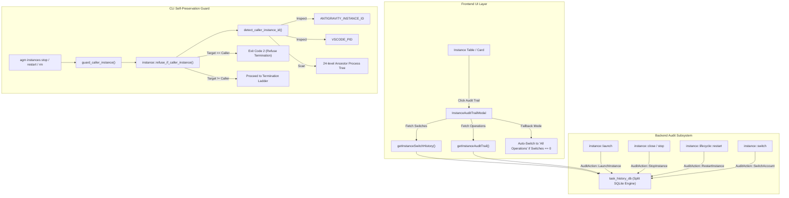
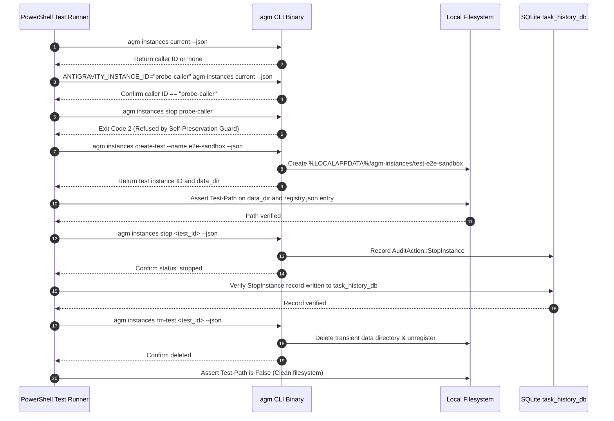

# Specification: Instance Audit Trail Logging, CLI Protection & E2E Verification

- **Slug:** `instance-management-and-ui-ux-synchronization`
- **Specification ID:** `02-spec/21-app/instance-management-and-ui-ux-synchronization/03-migration-and-verification-spec.md`
- **Status:** `APPROVED`
- **Owner:** @aukgit
- **Target Release:** Minor Feature Release

---

## 1. Executive Summary & Verification Architecture

In multi-instance Antigravity and VS Code desktop management, users require complete visibility into background operations, foolproof process lifecycle isolation, and bulletproof CLI safety guards. 

Three severe operational defects have been identified in the current system:
1. **Empty Audit Trail Drawers:** Clicking on an instance or its audit trail action button displays an empty state ("No Account Switches Recorded"). This occurs because instance start, stop, restart, and configuration operations are not registered as discrete events in `task_history_db`, and frontend queries fail to correlate multi-source operations across split databases.
2. **Self-Instance Termination Vulnerability:** When running CLI commands (such as `agm instances stop` or automated test scripts) inside an active IDE's integrated terminal, the command can terminate its own parent IDE process, causing sudden editor crashes, interrupted background agents, and corrupted `workspaceStorage`.
3. **Unbounded Test Execution Runaway:** Integration and verification scripts lack strict per-operation timeouts and leak state across runs, risking multi-hour test stalls and developer friction.

This specification establishes the architectural solution, database event contracts, process detection algorithms, and automated verification protocols to solve these issues permanently.



---

## 2. Audit Trail Event Architecture & `task_history_db` Integration

### 2.1 Audit Action Taxonomy Expansion
The audit logging engine (`src-tauri/src/modules/audit_action.rs`) defines canonical actions stored as numeric codes in SQLite split databases (`tasks` table and `hot_tasks_cache`). The enum is expanded to include dedicated instance lifecycle events:

```rust
#[repr(i32)]
#[derive(Debug, Clone, Copy, PartialEq, Eq)]
pub enum AuditAction {
    AddAccount = 1,
    UpdateAccount = 2,
    SwitchAccount = 3,
    SchedulePrompt = 4,
    RequeueConversation = 5,
    LaunchInstance = 6,
    StopInstance = 7,
    RestartInstance = 8,
    KillInstance = 9,
    CreateInstance = 10,
    DeleteInstance = 11,
}
```

#### Mapping Invariant:
- `code(self) -> i32`: Returns integer representation `1..=11`.
- `pascal(self) -> &'static str`: Serializes to PascalCase (`"LaunchInstance"`, `"StopInstance"`, `"RestartInstance"`).
- `title(self) -> &'static str`: Human-readable label (`"Launch Instance"`, `"Stop Instance"`, `"Restart Instance"`).
- `from_code(code: i32) -> Option<Self>`: Reconstructs enum variant from SQLite integer column.
- `from_legacy(raw: &str) -> Option<Self>`: Case-insensitive fallback parser supporting aliases:
  - `"launchinstance" | "startinstance" | "start" | "launch" | "6" => Some(Self::LaunchInstance)`
  - `"stopinstance" | "killinstance" | "stop" | "close" | "7" => Some(Self::StopInstance)`
  - `"restartinstance" | "restart" | "8" => Some(Self::RestartInstance)`
  - `"createinstance" | "create" | "10" => Some(Self::CreateInstance)`
  - `"deleteinstance" | "rminstance" | "delete" | "11" => Some(Self::DeleteInstance)`

### 2.2 Instrumentation Points Across Instance Lifecycle
Lifecycle events must be recorded immediately in `src-tauri/src/modules/task_history_db/tasks.rs` via `record_task`:

1. **Instance Launch (`src-tauri/src/modules/instance/launch.rs`):**
   - Location: `launch_instance_inner_with_extra_workspaces`
   - Success:
     ```rust
     crate::modules::task_history_db::record_task(
         crate::modules::audit_action::AuditAction::LaunchInstance,
         &format!("Launch instance {}", instance_id),
         crate::modules::task_history_db::AuditTaskStatus::Succeeded,
         &format!("Executable: {:?}, Data Dir: {}", exe_path, data_dir),
         Some(instance_id),
     );
     ```
   - Failure:
     ```rust
     crate::modules::task_history_db::record_task(
         crate::modules::audit_action::AuditAction::LaunchInstance,
         &format!("Launch instance {}", instance_id),
         crate::modules::task_history_db::AuditTaskStatus::Failed,
         &format!("Launch failed: {}", err),
         Some(instance_id),
     );
     ```

2. **Instance Stop & Conscious Termination (`src-tauri/src/modules/instance/create.rs` & `close.rs`):**
   - Location: `stop_instance` / `close_instance_verified`
   - Success:
     ```rust
     crate::modules::task_history_db::record_task(
         crate::modules::audit_action::AuditAction::StopInstance,
         &format!("Stop instance {}", resolved),
         crate::modules::task_history_db::AuditTaskStatus::Succeeded,
         "Instance process tree terminated and verified dead",
         Some(&resolved),
     );
     ```
   - Failure:
     ```rust
     crate::modules::task_history_db::record_task(
         crate::modules::audit_action::AuditAction::StopInstance,
         &format!("Stop instance {}", resolved),
         crate::modules::task_history_db::AuditTaskStatus::Failed,
         &format!("Process termination timed out: {}", err),
         Some(&resolved),
     );
     ```

3. **Instance Restart (`src-tauri/src/modules/instance/lifecycle.rs`):**
   - Location: `restart_instance`
   - Record completion with details of bound account and token refresh:
     ```rust
     crate::modules::task_history_db::record_task(
         crate::modules::audit_action::AuditAction::RestartInstance,
         &format!("Restart instance {}", resolved_id),
         crate::modules::task_history_db::AuditTaskStatus::Succeeded,
         &format!("Restarted on bound account {:?}", config.bound_account_id),
         Some(&resolved_id),
     );
     ```

4. **Account Switching (`src-tauri/src/modules/instance/switch.rs`):**
   - Preserves granular `AuditTask::start(AuditAction::SwitchAccount)` with `SwitchAuditSteps` (backup, reset, restore, verify).
   - Invariant: `instance_id` is always normalized (`default` for empty/classic/antigravity aliases).

### 2.3 Query Normalization & Frontend Multi-Source Corroboration
In `src-tauri/src/modules/task_history_db/switch_history.rs`:
- Queries for `get_instance_audit_trail` and `get_instance_switch_history` must normalize the query key:
  ```rust
  let query_inst_id = match inst_id_trimmed {
      "" | "default" | "antigravity" | "agy" | "ide" | "classic" => "default",
      other => other,
  };
  ```
- Filtering SQL clause:
  ```sql
  WHERE (instance_id = ?1 OR (?1 = 'default' AND (instance_id IN ('default', '', 'antigravity', 'agy', 'ide', 'classic') OR instance_id IS NULL)))
  ```
- Frontend Fallback (`InstanceAuditTrailModal.tsx`):
  - If `switchRes.recent_switches.length === 0` but `trailRes.length > 0`, the modal automatically defaults to the `'operations'` tab, preventing false "empty state" displays.

---

## 3. CLI Active IDE Detection & Self-Preservation Gates

### 3.1 Threat Model: Accidental Host Termination
When a user or autonomous agent executes commands like `agm instances stop` or runs automated test suites inside the VS Code / Antigravity integrated terminal, the target instance might resolve to the host IDE itself. Terminating the caller abruptly:
- Kills the active shell and developer session.
- Drops in-flight prompt sync operations.
- Leaves uncommitted git files or corrupted SQLite transaction locks.

### 3.2 Enhanced Detection Hierarchy (`detect_caller_instance_id`)
The detection algorithm in `src-tauri/src/modules/instance/close.rs` enforces a 4-tier probe ladder:

```rust
pub fn detect_caller_instance_id() -> Option<String> {
    // Tier 1: Direct Environment Variables
    if let Ok(id) = std::env::var("ANTIGRAVITY_INSTANCE_ID") {
        let trimmed = id.trim();
        if !trimmed.is_empty() { return Some(trimmed.to_string()); }
    }
    if let Ok(id) = std::env::var("AGM_INSTANCE_ID") {
        let trimmed = id.trim();
        if !trimmed.is_empty() { return Some(trimmed.to_string()); }
    }

    let registry = load_registry().ok();

    // Tier 2: VSCODE_PID Environment Inspection
    if let Ok(vpid_str) = std::env::var("VSCODE_PID") {
        if let Ok(vpid) = vpid_str.trim().parse::<u32>() {
            if let Some(ref reg) = registry {
                for inst in &reg.instances {
                    if inst.pid == Some(vpid) {
                        return Some(inst.id.clone());
                    }
                }
            }
        }
    }

    // Tier 3: 24-Level Ancestor Process Tree Scanning
    let mut system = System::new();
    let refresh_kind = sysinfo::ProcessRefreshKind::new()
        .with_cmd(sysinfo::UpdateKind::Always)
        .with_exe(sysinfo::UpdateKind::Always);
    system.refresh_processes_specifics(sysinfo::ProcessesToUpdate::All, refresh_kind);

    let mut pid = std::process::id();
    for _ in 0..24 {
        let Some(proc) = system.process(sysinfo::Pid::from_u32(pid)) else { break; };
        
        // Match registered instance PID
        if let Some(ref reg) = registry {
            for inst in &reg.instances {
                if inst.pid == Some(pid) {
                    return Some(inst.id.clone());
                }
            }
        }

        // Match IDE binary signature (Antigravity or VS Code)
        let exe_name = proc.exe().and_then(|p| p.file_name()).map(|f| f.to_string_lossy().to_lowercase()).unwrap_or_default();
        if exe_name == "antigravity.exe" || exe_name == "antigravity" || exe_name == "code.exe" || exe_name == "code" {
            // Inspect --user-data-dir in command line args
            let cmd: Vec<String> = proc.cmd().iter().map(|s| s.to_string_lossy().to_string()).collect();
            if let Some(udd) = extract_user_data_dir(&cmd) {
                if let Some(ref reg) = registry {
                    for inst in &reg.instances {
                        if path_matches_dir(&udd, &inst.data_dir) {
                            return Some(inst.id.clone());
                        }
                    }
                }
            } else {
                return Some("default".to_string());
            }
        }

        match proc.parent().map(|parent| parent.as_u32()) {
            Some(parent) if parent != 0 && parent != pid => pid = parent,
            _ => break,
        }
    }

    None
}
```

### 3.3 Defense-in-Depth Enforcement (`refuse_if_caller_instance`)
All destructive CLI entry points in `src-tauri/src/bin/agm/instance_cmds.rs` must invoke `guard_caller_instance`:
- `cmd_instances_stop`
- `cmd_instances_restart`
- `cmd_instances_switch`
- `cmd_instances_delete`

When a violation occurs:
- The command outputs:
  ```text
  [ERROR] Refusing to stop, switch, or delete instance '<id>' because this command is running inside its IDE process
  ```
- Exits immediately with **Exit Code 2** without dispatching any kill signal.

### 3.4 Transient Test Instance CLI Lifecycle
To allow automated testing without risk to production profiles:
- `agm instances create-test [--name <name>] [--json]`:
  - Allocates directory `%LOCALAPPDATA%/agm-instances/test-<short-id>/User`.
  - Appends transient record to `registry.json`.
  - Emits `CliEnvelope::ok("instances create-test", ...)`.
- `agm instances rm-test [<id>] [--all] [--json]`:
  - Terminates any test processes matching the test instance PID.
  - Cleans lockfiles and deletes the transient directory.
  - Removes entry from `registry.json`.

---

## 4. E2E PowerShell Integration Test Protocol (`scripts/test-instance-lifecycle-e2e.ps1`)

### 4.1 Test Isolation & Timeout Rules
1. **Execution Time Boundary:** Every step must execute within a bounded deadline (maximum 15 seconds per command, total suite runtime < 45 seconds). Runaway loops are strictly forbidden.
2. **Profile Isolation:** The suite operates exclusively on a transient test instance (`test-e2e-sandbox-<timestamp>`). The `default` profile and active IDE profile are never touched.
3. **Relative Path Discipline:** The script uses relative paths (`src-tauri/target/debug/agm.exe`) with fallback to system PATH.

### 4.2 Test Execution Sequence
The script `scripts/test-instance-lifecycle-e2e.ps1` executes seven discrete verification gates:



---

## 5. Verification Evidence & Acceptance Criteria

### 5.1 Verification Checklist
- [ ] **Audit Action Enumeration:** `AuditAction::LaunchInstance` (6), `StopInstance` (7), `RestartInstance` (8) defined and unit-tested in `audit_action.rs`.
- [ ] **Lifecycle Instrumentation:** Launch, stop, and restart operations in `launch.rs`, `close.rs`, `create.rs`, and `lifecycle.rs` call `record_task` with complete metadata.
- [ ] **Query Normalization:** `get_instance_audit_trail` returns entries for `"default"` and aliases without returning empty arrays when history exists.
- [ ] **Caller Protection:** `detect_caller_instance_id` inspects `VSCODE_PID`, environment variables, and ancestor process tree; `refuse_if_caller_instance` rejects self-termination with exit code 2.
- [ ] **Test CLI Lifecycle:** `agm instances create-test` and `agm instances rm-test` manage transient instances in <500ms with complete cleanup.
- [ ] **E2E Automation:** `scripts/test-instance-lifecycle-e2e.ps1` completes successfully with exit code 0 in under 30 seconds.
- [ ] **Pre-Flight Gates:** `cargo fmt -- --check`, `cargo clippy --all-targets --all-features`, and `npm run build` pass with zero errors.
