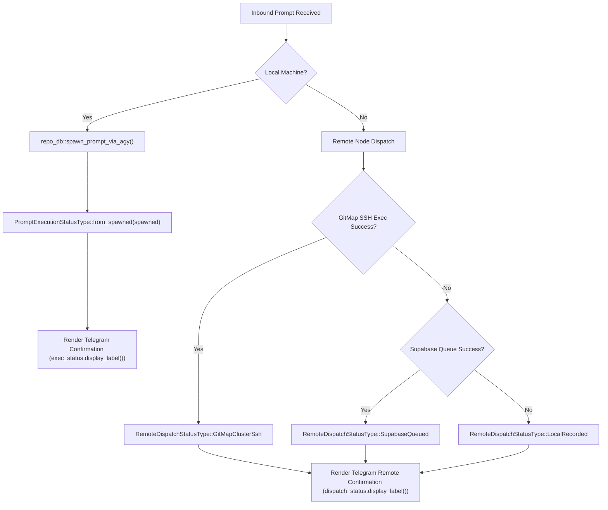

# Architecture Specification: Prompt Execution & Dispatch Status Enum Refactoring

## User Request (Verbatim)
> "codes like this should be repleaced with proper enum read enum cg execute prompt and execute properly"
> Attached image: `let exec_status = if spawned { "Executing now" } else { "Queued" };` in `src-tauri/src/modules/telegram_inbound/injection.rs:264`.

---

## 1. Executive Summary & Root Cause Analysis (RCA)

### 1.1 Problem Classification
- **Classification**: Code Quality / Coding Guidelines Violation (`06-constants-and-enums.md`, `02-spec/02-coding-guidelines/`).
- **Violation**: Use of raw string literals (`"Executing now"`, `"Queued"`, `"Sent via GitMap Cluster SSH"`, `"Queued on the secondary database..."`) selected via ad-hoc boolean conditionals (`if spawned { ... } else { ... }`), violating the enum and constant typing mandate.
- **Risks**:
  1. *Typo and Divergence Vulnerability*: Status string values are duplicated and compared as loose strings, lacking compile-time exhaustiveness checking.
  2. *Mixed Presentation & Logic*: UI presentation labels are intermixed with domain execution states.
  3. *Inconsistent States*: Statuses can diverge between local execution, remote cluster execution, and database queueing.

### 1.2 Target Resolution
Replace all ad-hoc ternary string selections with strongly typed, self-documenting enums adhering to the `*Type` / `*Status` suffix rule:
1. `PromptExecutionStatusType` (`ExecutingNow`, `Queued`) in `src-tauri/src/modules/telegram_inbound/types.rs`.
2. `RemoteDispatchStatusType` (`GitMapClusterSsh`, `SupabaseQueued`, `LocalRecorded`) in `src-tauri/src/modules/telegram_inbound/types.rs`.
3. `CommandExecutionStatusType` (`Completed`, `Failed`) in `src-tauri/src/modules/supabase_command_queue.rs`.

---

## 2. Architectural Invariants & Contracts

### Invariant 1: Enum Suffix and PascalCase Naming
All enum types must carry the `Type` or `Status` suffix and use `PascalCase` variants.
```rust
#[derive(Debug, Clone, Copy, PartialEq, Eq, Serialize, Deserialize)]
#[serde(rename_all = "snake_case")]
pub enum PromptExecutionStatusType {
    ExecutingNow,
    Queued,
}
```

### Invariant 2: Explicit State Construction
Never construct enums via loose string parsing where boolean predicates exist. Provide deterministic constructor methods:
- `PromptExecutionStatusType::from_spawned(is_spawned: bool) -> Self`
- `RemoteDispatchStatusType::resolve(is_dispatched_gitmap: bool, is_enqueued_supabase: bool) -> Self`
- `CommandExecutionStatusType::from_exit_code(exit_code: i32) -> Self`

### Invariant 3: Single Source of Truth for Display Labels
The enum itself owns its presentation text via `.as_str()`, `.display_label()`, and `std::fmt::Display`. Callers must never hardcode presentation strings.

---

## 3. Data Flow & Transition Diagrams



---

## 4. Detailed Component Specifications

### 4.1 `PromptExecutionStatusType`
```rust
#[derive(Debug, Clone, Copy, PartialEq, Eq, Serialize, Deserialize)]
#[serde(rename_all = "snake_case")]
pub enum PromptExecutionStatusType {
    ExecutingNow,
    Queued,
}

impl PromptExecutionStatusType {
    #[inline]
    pub fn from_spawned(is_spawned: bool) -> Self {
        if is_spawned {
            Self::ExecutingNow
        } else {
            Self::Queued
        }
    }

    #[inline]
    pub fn as_str(&self) -> &'static str {
        match self {
            Self::ExecutingNow => "executing_now",
            Self::Queued => "queued",
        }
    }

    #[inline]
    pub fn display_label(&self) -> &'static str {
        match self {
            Self::ExecutingNow => "Executing now",
            Self::Queued => "Queued",
        }
    }

    #[inline]
    pub fn is_executing(&self) -> bool {
        matches!(self, Self::ExecutingNow)
    }

    #[inline]
    pub fn is_queued(&self) -> bool {
        matches!(self, Self::Queued)
    }
}

impl std::fmt::Display for PromptExecutionStatusType {
    fn fmt(&self, f: &mut std::fmt::Formatter<'_>) -> std::fmt::Result {
        write!(f, "{}", self.display_label())
    }
}
```

### 4.2 `RemoteDispatchStatusType`
```rust
#[derive(Debug, Clone, Copy, PartialEq, Eq, Serialize, Deserialize)]
#[serde(rename_all = "snake_case")]
pub enum RemoteDispatchStatusType {
    GitMapClusterSsh,
    SupabaseQueued,
    LocalRecorded,
}

impl RemoteDispatchStatusType {
    #[inline]
    pub fn resolve(is_dispatched_gitmap: bool, is_enqueued_supabase: bool) -> Self {
        if is_dispatched_gitmap {
            Self::GitMapClusterSsh
        } else if is_enqueued_supabase {
            Self::SupabaseQueued
        } else {
            Self::LocalRecorded
        }
    }

    #[inline]
    pub fn as_str(&self) -> &'static str {
        match self {
            Self::GitMapClusterSsh => "gitmap_cluster_ssh",
            Self::SupabaseQueued => "supabase_queued",
            Self::LocalRecorded => "local_recorded",
        }
    }

    #[inline]
    pub fn display_label(&self) -> &'static str {
        match self {
            Self::GitMapClusterSsh => "Sent via GitMap Cluster SSH",
            Self::SupabaseQueued => "Queued on the secondary database — the node will pick it up",
            Self::LocalRecorded => "Queued (the node recorded your instruction)",
        }
    }
}

impl std::fmt::Display for RemoteDispatchStatusType {
    fn fmt(&self, f: &mut std::fmt::Formatter<'_>) -> std::fmt::Result {
        write!(f, "{}", self.display_label())
    }
}
```

### 4.3 `CommandExecutionStatusType`
```rust
#[derive(Debug, Clone, Copy, PartialEq, Eq, Serialize, Deserialize)]
#[serde(rename_all = "snake_case")]
pub enum CommandExecutionStatusType {
    Completed,
    Failed,
}

impl CommandExecutionStatusType {
    #[inline]
    pub fn from_exit_code(exit_code: i32) -> Self {
        if exit_code == 0 {
            Self::Completed
        } else {
            Self::Failed
        }
    }

    #[inline]
    pub fn as_str(&self) -> &'static str {
        match self {
            Self::Completed => "completed",
            Self::Failed => "failed",
        }
    }
}

impl std::fmt::Display for CommandExecutionStatusType {
    fn fmt(&self, f: &mut std::fmt::Formatter<'_>) -> std::fmt::Result {
        write!(f, "{}", self.as_str())
    }
}
```

---

## 5. Verification Gates
1. `cargo fmt -- --check` in `src-tauri` -> Exit 0.
2. `cargo check --lib` in `src-tauri` -> Exit 0.
3. Unit test coverage for each enum method -> Exit 0.
