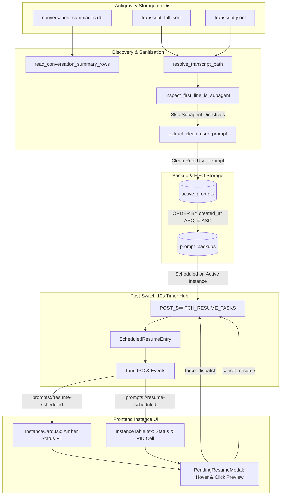

# Specification: Running Prompt Identification, FIFO Restore, and 10-Second Post-Switch Resume Labeling

> **Task Slug**: `prompt-restore-labeling-and-tree-overhaul`  
> **Subtask Code**: `TASK-01`  
> **Document Code**: `02-spec/21-app/prompt-restore-labeling-and-tree-overhaul/01-running-prompt-and-restore-spec.md`  
> **Target Version**: `v4.222.0`  
> **Author**: Spec Author 01  
> **Assigned Implementation Worker**: Worker 01 (Backend & Instance UI)  

---

## User Request (Verbatim)

```text
# High Priority Instruction

The backup and restore prompt is working, but it is not working correctly. The issue here is that when you send the prompt 10 seconds later, we should be able to see this somewhere with labeling in the instances. It could be a label like "Waiting to restore this many of the prompts," meaning all the running prompts, or send them again. This needs to show up, and if people hover over and click, they would see the operation that's going to happen 10 seconds later. Second, you need to correctly find what was the running prompt. The running prompt section is correct. You can detect when the prompts are running, which is good. But the main problem is you get the wrong prompt. That is the main issue at the moment. When we have a conversation on the right-hand side, we should be able to double-click and change the conversation title. When we get into a conversation, we should be able to right-click and change the conversation name, and also double-clicking on the conversation on the top-level header, we should be able to change the conversation name directly. At this point, you have not merged the buttons, the copy, send all, and rerun. That should be all together. It's not done yet. The suffix should be a template library, so there should be more, and the user can also add a suffix template into the send section. Try to add that option. Everything should also have the CLI options so that the user can customize from the CLI automation. If you fix this, it would be a top-notch product. The work is good, but there are some glitches, and the markdown preview is good, but not professional enough. It does not feel very charming. Look into how to make it a more charming UI/UX concept. Keep the prompt and results section on the right-hand side or together with the preview section. In the preview section, you can have this icon. Write this prompt instruction as input and output. Put it into the section where highlighted. Verify the code or create a verification prompt so that AI can verify the task. At the end, do a minor bump and release the product. Before that, check the build on the machine. Do not run too many tests. Send it to the CI/CD and check the gitmap E space D. E, D. Space D, not D-E, to check for any CI/CD issues. If there is, try to minor bump until you reach CI/CD green. That would be a goal.

# Actionable Items Must Follow Non-Negotiable

0. Gitmap do `gitmap pull <repo path> or run into the repo path` Make sure we have the latest and conflict resolve before starting.
1. Write spec under 02-spec/21-app/<slug>/ and enqueue plan task in .ai-memory/plans/<slug>.md (subtasks in .ai-memory/plans/subtasks/<slug>/) first
2. Search codebase exclusively via GitMap (gitmap aum search, gitmap find, gitmap cat, gitmap ps, gitmap py, gitmap llm train); TOTAL BAN on rg, ripgrep, grep, git grep, Select-String
3. Strictly use relative Git paths (02-spec/..., .ai-memory/..., cmd/...); only add the relative paths, never add the absolute path during your work, and ensure this is respected on the release page and in release notes as well
4. Implement labeling for prompts scheduled to send 10 seconds later, allowing users to hover and click to see pending operations.
5. Correctly identify and display the running prompt to avoid mismatches.
6. Enable double-click and right-click functionality to change conversation titles and names.
7. Merge buttons for copy, send all, and rerun into a single interface.
8. Add suffix template options to the send section and ensure CLI customization capabilities.
9. Enhance the markdown preview for a more professional and charming UI/UX.
10. Integrate prompt and results sections with the preview section, including icon placement.
11. Verify code and create a verification prompt for AI task validation.
12. Perform a minor version bump and release the product after build verification.
13. Check CI/CD status using `gitmap` E space D and resolve any issues by minor version bumps until green.

## Must follow and spawn agent using

@[.agents/skills/execute-parent-task-with-n-steps-v6]

## Additional Instructions

- /plan first before doing the work to reduce the credits.
- /learn from @[.agents/skills/gitmap] skill to leverage GitMap high-speed search, toolchain discovery, and caching.
- Only add the relative paths, never add the absolute path during your work; this should be respected on the release page and in release notes as well.
```

---

## Executive Summary & Scope

This specification addresses two high-severity problems in the Antigravity-Manager instance lifecycle and prompt resilience subsystem:

1. **Selecting the 'Wrong Prompt'**: While the system correctly identifies running conversations, it frequently captures and backs up the wrong prompt payload (e.g., internal subagent directives, `<SYSTEM_MESSAGE>` orchestrations, ancient turn-0 previews, truncated text, or random `state.vscdb` key/value state dumps). This spec defines strict multi-layer prompt sanitization, un-truncated full-transcript resolution, and strict FIFO queue ordering.
2. **Missing Post-Switch Resume Labeling & Visibility**: When account auto-rotation or manual instance switching occurs, prompts are scheduled to be re-injected ~10 seconds later. During this window, the UI previously showed zero visual feedback. Users had no visibility into what prompts were waiting to be restored, how many seconds remained, or any mechanism to accelerate or cancel the restore. This spec defines full state tracking in the Rust backend, new Tauri IPC commands and events, and an interactive amber badge with countdown, hover preview, and click modal in `InstanceCard.tsx` and `InstanceTable.tsx`.



---

## Root Cause Analysis: Selecting the Wrong Prompt (7 Core Flaws)

Through deep inspection of `src-tauri/src/modules/repo_db/`, `src-tauri/src/modules/backup_prompts_db/`, and `src-tauri/src/modules/instance/`, 7 distinct root causes have been isolated:

### Flaw A: Indiscriminate Subagent & System Directive Ingestion in `discovery.rs`

- **Location**: `src-tauri/src/modules/repo_db/discovery.rs` (lines 152–193).
- **Vulnerability**:
  ```rust
  for line in content.lines().rev() {
      if !line.contains("USER_INPUT") {
          continue;
      }
      if let Ok(val) = serde_json::from_str::<serde_json::Value>(line) {
          if val.get("type").and_then(|t| t.as_str()) == Some("USER_INPUT") {
              if let Some(txt) = val.get("content").and_then(|c| c.as_str()) {
                  if !txt.trim().is_empty() {
                      user_prompt = Some(txt.to_string());
                  }
              }
              ...
              if user_prompt.is_some() {
                  break;
              }
          }
      }
  }
  ```
- **Root Cause**: In the Antigravity architecture, subagent tasks and inter-agent directives (e.g. `[Message] timestamp=... sender=... content=You are Spec Author...` or `<SYSTEM_MESSAGE>...`) are logged into `transcript.jsonl` under the event type `USER_INPUT`. The reverse scan in `discovery.rs` blindly grabbed the first `USER_INPUT` line it encountered, which was frequently a subagent prompt or system message, completely missing the human user's actual prompt.
- **Architectural Remedy**:
  1. Use `inspect_first_line_is_subagent` to identify if the conversation is a subagent transcript.
  2. For user input lines, filter out lines where content starts with `<SYSTEM_MESSAGE>`, `The following is a <SYSTEM_MESSAGE>`, `[Message] timestamp=`, `Task id `, or subagent role assignments (`You are Research...`, `You are Worker...`, `You are Spec Author...`).
  3. Strip system wrappers using `extract_clean_user_prompt(&raw_text)`.
  4. Rely directly on `inspect_conversation_transcript(&base_dir, &cid).latest_prompt` which already implements validated multi-step user prompt extraction.

### Flaw B: Ingestion of Truncated Content from `transcript.jsonl`

- **Location**: `src-tauri/src/modules/repo_db/discovery.rs` (lines 145–151).
- **Vulnerability**: `discovery.rs` attempts to open `transcript_file` via `resolve_transcript_path(&base_dir, &cid)`. If `transcript.jsonl` contains truncated fields (indicated by `"truncated_fields": ["content"]` or strings ending in `<truncated N bytes>`), the raw truncated marker is stored as the prompt content.
- **Root Cause**: The prompt was not dereferenced from `transcript_full.jsonl` using the corresponding `step_index`.
- **Architectural Remedy**:
  1. Ensure `resolve_transcript_path` prioritizes `transcript_full.jsonl` if present and non-empty.
  2. When parsing a `USER_INPUT` record, if `truncated_fields` contains `"content"` or `<truncated` is detected, resolve the full content from `transcript_full.jsonl` using `get_line_from_full_transcript`.

### Flaw C: Fallback to Stale Turn-0 Conversation Preview

- **Location**: `src-tauri/src/modules/repo_db/discovery.rs` (lines 197–200).
- **Vulnerability**:
  ```rust
  if user_prompt.is_none() {
      user_prompt = live_prompt_text(&preview, "");
  }
  ```
- **Root Cause**: When the reverse scan failed to find a valid `USER_INPUT` line, it fell back to `preview` from `conversation_summaries.db`. This `preview` column stores the **first turn** (turn 0) of the conversation created hours or days ago. The user was actively running turn 15, but after a switch, turn 0 was restored and dispatched!
- **Architectural Remedy**:
  1. Do NOT fall back to turn-0 `preview` when an active conversation transcript exists.
  2. If the reverse transcript tail does not find a user prompt within the bounded tail, expand the bounded read or look up the latest active prompt from `active_prompts` table in `repo_prompts.db`.
  3. Only use `live_prompt_text(&preview, "")` as an absolute last resort if no transcript file exists on disk.

### Flaw D: Indiscriminate `state.vscdb` Key/Value Dumping

- **Location**: `src-tauri/src/modules/repo_db/backup.rs` (lines 487–505).
- **Vulnerability**:
  ```rust
  let mut stmt = ws_conn
      .prepare("SELECT key, value FROM ItemTable WHERE key LIKE '%prompt%' OR key LIKE '%chat%' OR key LIKE '%task%'")
      .ok();
  ```
- **Root Cause**: VS Code's `state.vscdb` stores internal editor configuration, telemetry state, and UI panel settings. Querying `LIKE '%prompt%' OR key LIKE '%chat%' OR key LIKE '%task%'` matches keys such as `chat.workspaceState`, `workbench.panel.chatSidebar...`, and layout dumps. Any string value > 10 characters was extracted as an `extracted` prompt! This injected arbitrary editor state strings as "prompts" into the restore pipeline.
- **Architectural Remedy**:
  1. Restrict SQLite queries on `state.vscdb` to known, verified prompt storage keys only (e.g., `workbench.action.chat.interactiveInputHistory` or specific conversation session keys).
  2. Validate that the extracted JSON parses into a structured chat input object with a non-empty `text` or `content` field.
  3. Reject arbitrary configuration strings that do not represent a valid user prompt.

### Flaw E: Inverted LIFO Query Ordering in `backup.rs:580`

- **Location**: `src-tauri/src/modules/repo_db/backup.rs` (lines 574–582).
- **Vulnerability**:
  ```rust
  "SELECT prompt_content, image_payload FROM active_prompts \
   WHERE (repo_path = ?1 OR project_id = ?2 OR project_id LIKE ?3) \
     AND status IN ('running', 'in_flight') \
     AND (?4 = 'all' OR instance_id = ?4 OR (?4 IN ('default', '__default__') AND instance_id IN ('default', '__default__'))) \
   ORDER BY updated_at DESC LIMIT 1"
  ```
- **Root Cause**: The query sorts by `ORDER BY updated_at DESC LIMIT 1` (Last-In-First-Out). If multiple prompts were queued or running, the latest updated prompt was taken instead of processing prompts in their chronological order of submission.
- **Architectural Remedy**:
  1. Enforce strict First-In-First-Out (FIFO) ordering invariant: `ORDER BY created_at ASC, id ASC`.
  2. Ensure the prompt that was submitted first is backed up and dispatched first.

### Flaw F: Timestamp Destruction in `restore.rs:114`

- **Location**: `src-tauri/src/modules/backup_prompts_db/restore.rs` (lines 105–118).
- **Vulnerability**:
  ```rust
  let active_p = ActivePrompt {
      id: rec.prompt_id.clone(),
      project_id: rec.project_id.clone(),
      instance_id: eff_inst.to_string(),
      repo_path: rec.project_path.clone(),
      prompt_content: rec.prompt_text.clone(),
      model: Some("gemini-3.8-flash-high".to_string()),
      session_id: Some(rec.conversation_id.clone()),
      status: restored_status.to_string(),
      created_at: now,
      updated_at: now,
      image_payload: rec.images_payload.clone(),
  };
  ```
- **Root Cause**: Overwriting `created_at` with `now` destroys the original chronological ordering of prompts. Subsequent FIFO queries (`ORDER BY created_at ASC, id ASC`) cannot distinguish the original sequence of user submissions.
- **Architectural Remedy**:
  1. Preserve `rec.created_at` from `PromptBackupRecord`:
     ```rust
     created_at: if rec.created_at > 0 { rec.created_at } else { now },
     ```
  2. Only update `updated_at: now`.

### Flaw G: Scoping to Target Instance Instead of Active Instance in `switch.rs:155`

- **Location**: `src-tauri/src/modules/instance/switch.rs` (lines 154–170).
- **Vulnerability**:
  ```rust
  let existing_backed_up = crate::modules::repo_db::count_backed_up_prompts(&instance.id);
  let newly_backed_up = match crate::modules::repo_db::backup_running_prompts(&instance.id) { ... };
  ```
- **Root Cause**: `instance` in `switch.rs` represents the **target** instance the user is switching *to*. Before stopping the currently active IDE, the snapshot query was executed with `&instance.id` (target instance) rather than `&registry.active_instance_id` (the active running instance)! As a result, 0 prompts were found and backed up from the active instance, or prompts already on the target were re-backed up.
- **Architectural Remedy**:
  1. Resolve `source_instance_id`:
     ```rust
     let source_instance_id = if !registry.active_instance_id.is_empty() {
         &registry.active_instance_id
     } else {
         &instance.id
     };
     ```
  2. Backup running prompts from `source_instance_id`.
  3. In `restore.rs` and `post_switch_resume.rs`, associate the backed-up prompts to be re-injected into the target `instance.id`.

---

## Post-Switch 10-Second Resume Tracking Subsystem

### Data Models & Memory Representation

In `src-tauri/src/modules/instance/post_switch_resume.rs`:

```rust
use serde::{Deserialize, Serialize};
use std::collections::HashMap;
use std::sync::Mutex;
use once_cell::sync::Lazy;
use tauri::async_runtime::JoinHandle;

/// Summary of a prompt pending post-switch re-injection
#[derive(Debug, Clone, Serialize, Deserialize)]
pub struct PendingPromptPreview {
    pub id: String,
    pub project_id: String,
    pub repo_name: String,
    pub repo_path: String,
    pub prompt_summary: String,
    pub full_prompt: String,
    pub created_at: i64,
    pub has_image: bool,
}

/// Information returned to frontend for a pending post-switch resume task
#[derive(Debug, Clone, Serialize, Deserialize)]
pub struct PendingResumeTaskInfo {
    pub instance_id: String,
    pub scheduled_at_ms: i64,
    pub fire_at_ms: i64,
    pub remaining_seconds: i64,
    pub total_delay_seconds: u64,
    pub prompt_count: usize,
    pub prompts: Vec<PendingPromptPreview>,
}

/// Internal registry entry holding the timer join handle and pending metadata
pub struct ScheduledResumeEntry {
    pub instance_id: String,
    pub scheduled_at_ms: i64,
    pub fire_at_ms: i64,
    pub total_delay_seconds: u64,
    pub prompt_count: usize,
    pub prompts: Vec<PendingPromptPreview>,
    pub handle: JoinHandle<()>,
}

/// Global registry of active post-switch resume timers
static POST_SWITCH_RESUME_TASKS: Lazy<Mutex<HashMap<String, ScheduledResumeEntry>>> =
    Lazy::new(|| Mutex::new(HashMap::new()));
```

### Scheduling & Lifecycle Flow

1. **`schedule_post_switch_resume(instance_id: String)`**:
   - First, cancel any existing resume for `instance_id` to prevent double-restores.
   - Query backed-up prompts awaiting dispatch for `instance_id` from `active_prompts` (status `backed_up`) and `prompt_backups`.
   - Populate `Vec<PendingPromptPreview>`.
   - Calculate `now_ms = Utc::now().timestamp_millis()` and `fire_at_ms = now_ms + (delay_seconds * 1000)`.
   - Store `ScheduledResumeEntry` in `POST_SWITCH_RESUME_TASKS`.
   - Spawn async timer task via `tauri::async_runtime::spawn`.
   - Emit Tauri event `prompts://resume-scheduled` with `PendingResumeTaskInfo`.
   - When timer fires:
     - Execute `run_resume_with_retry(&instance_id)`.
     - Remove entry from `POST_SWITCH_RESUME_TASKS`.
     - Emit `prompts://restored` with `{ instance_id, restored_count }`.

2. **`cancel_post_switch_resume(instance_id: &str, reason: &str)`**:
   - Abort the running `JoinHandle`.
   - Remove entry from `POST_SWITCH_RESUME_TASKS`.
   - Emit Tauri event `prompts://resume-cancelled` with `{ instance_id }`.
   - Log cancellation with reason.

3. **`force_dispatch_pending_resume(instance_id: &str) -> usize`**:
   - Abort the running `JoinHandle`.
   - Remove entry from `POST_SWITCH_RESUME_TASKS`.
   - Immediately execute `run_resume_with_retry(&instance_id)` on blocking runtime.
   - Emit `prompts://restored` with `{ instance_id, restored_count }`.
   - Return restored count to caller.

### Tauri IPC Commands & Signatures

Exposed in `src-tauri/src/commands/instance.rs` and registered in `src-tauri/src/lib/run.rs`:

```rust
/// Query all pending post-switch resume tasks across all instances
#[tauri::command]
pub fn get_pending_post_switch_resumes() -> Result<Vec<PendingResumeTaskInfo>, String> {
    Ok(crate::modules::instance::post_switch_resume::get_all_pending_resumes())
}

/// Query pending post-switch resume for a specific instance
#[tauri::command]
pub fn get_instance_pending_resume(instance_id: String) -> Result<Option<PendingResumeTaskInfo>, String> {
    Ok(crate::modules::instance::post_switch_resume::get_instance_pending_resume(&instance_id))
}

/// Cancel a pending post-switch resume task
#[tauri::command]
pub fn cancel_post_switch_resume(instance_id: String) -> Result<(), String> {
    crate::modules::instance::post_switch_resume::cancel_post_switch_resume(&instance_id, "User requested cancellation");
    Ok(())
}

/// Immediately force-dispatch pending prompts for an instance without waiting for timer expiry
#[tauri::command]
pub async fn force_dispatch_pending_resume(instance_id: String) -> Result<usize, String> {
    crate::modules::instance::post_switch_resume::force_dispatch_pending_resume(&instance_id).await
}
```

---

## UI/UX Specification: Interactive Labeling & Modal Controls

### Visual Evidence & Layout Reference

The user interface requirements map directly to `assets/screenshots/prompt-restore-labeling-and-tree-overhaul-01.png` and `assets/screenshots/prompt-restore-labeling-and-tree-overhaul-02.png`:
- In the Instances view, each instance displaying a pending restore must exhibit an amber badge.
- Clicking the badge opens an interactive review modal allowing instant dispatch or cancellation.

### Component 1: `InstanceCard.tsx` (Card View)

In `src/pages/instances/InstanceCard.tsx`:
- Under the card header row (next to PID / Default badge / Active dot), render the amber pill badge when `pendingResume` exists:
  ```tsx
  {pendingResume && (
      <button
          type="button"
          onClick={(e) => {
              e.stopPropagation();
              openPendingResumeModal(inst.config.id);
          }}
          className="inline-flex items-center gap-1.5 px-2 py-0.5 rounded-full text-[10px] font-bold bg-amber-500/15 text-amber-700 dark:text-amber-300 border border-amber-400/30 hover:bg-amber-500/25 transition-all shadow-2xs cursor-pointer animate-pulse"
          title={`Restoring ${pendingResume.prompt_count} prompt(s) in ${remainingSeconds}s - Click to inspect or restore now`}
      >
          <RotateCw className="w-2.5 h-2.5 animate-spin text-amber-500 shrink-0" />
          <span>Restoring {pendingResume.prompt_count} in {remainingSeconds}s</span>
      </button>
  )}
  ```

### Component 2: `InstanceTable.tsx` / `InstanceRowCells.tsx` (Table View)

In `src/components/instances/table/InstanceRowCells.tsx` inside `StatusCell`:
- In the `Status & PID` column, if `pendingResume` exists for the row:
  ```tsx
  {pendingResume ? (
      <button
          type="button"
          onClick={() => onOpenPendingResume(inst.config.id)}
          className="inline-flex items-center gap-1.5 px-2 py-0.5 rounded-full text-[10px] font-bold bg-amber-500/15 text-amber-700 dark:text-amber-300 border border-amber-400/30 hover:bg-amber-500/25 transition-all cursor-pointer shadow-2xs"
          title="Click to review or force restore"
      >
          <RotateCw className="w-2.5 h-2.5 animate-spin text-amber-500 shrink-0" />
          <span>Restoring {pendingResume.prompt_count} in {remainingSeconds}s</span>
      </button>
  ) : (
      /* Normal PID / Running / Idle pill */
  )}
  ```

### Component 3: `PendingResumeModal.tsx` (Interactive Inspector & Dispatch Modal)

A dedicated React modal (`src/components/instances/PendingResumeModal.tsx`):
1. **Header**:
   - Title: `Pending Post-Switch Prompt Restore`.
   - Instance Name Capsule: `[#1 default]`.
   - Countdown Indicator: `Restoring in {remainingSeconds}s` with an animated circular progress ring or bar.
2. **Body**:
   - List of pending prompts awaiting restoration:
     * Card for each prompt showing:
       - Repo Name & Path (`/path/to/project`).
       - Creation Timestamp (`2 minutes ago`).
       - Prompt Text Preview (with syntax highlighting and formatted markdown).
       - Image Attachment indicator (if `has_image: true`).
3. **Footer Actions**:
   - `⚡ Restore Now` (`bg-amber-500 hover:bg-amber-600 text-black font-bold px-3 py-1.5 rounded-[5px]`): Calls `force_dispatch_pending_resume(instanceId)`, immediately pushes prompt into IDE prompt channel, closes modal, and refreshes prompt tree.
   - `✕ Cancel Restore` (`bg-rose-500/15 hover:bg-rose-500/25 text-rose-400 border border-rose-500/30 px-3 py-1.5 rounded-[5px]`): Calls `cancel_post_switch_resume(instanceId)`, drops pending timers, closes modal.
   - `Dismiss` (`bg-slate-700 hover:bg-slate-600 text-white px-3 py-1.5 rounded-[5px]`): Closes modal while leaving timer running in background.

---

## Invariants & Compliance Rules

1. **No Silent Errors (House Rule 2026-10-10)**:
   - In Rust (`src-tauri/src/`): Every fallible I/O or DB query must route errors into `AppError` or log with `crate::error::record_ignored` and an explicit `// Justification:` comment. Bare `let _ = ...` or `.ok()` without logging is strictly forbidden.
   - In TypeScript (`src/`): Every promise catch must invoke `useErrorStore.getState().trackWarning(...)` or `captureError(...)`. Never use empty `catch {}`.
2. **Strict FIFO Queue Invariant**:
   - Every prompt query for backup, restore, or dispatch MUST specify `ORDER BY created_at ASC, id ASC`.
   - Inverted LIFO queries (`ORDER BY updated_at DESC`) are strictly banned in prompt queue processing.
3. **Single-Point Orchestration**:
   - Post-switch resume timer rides the existing STAGE_5_RESTORE unit (`push_backed_up_prompts_after_channel`). It does NOT create parallel restore pipelines.
4. **Strict Relative Git Paths**:
   - All paths referenced in specifications, logs, and release documentation must be relative to repository root (`02-spec/...`, `src/...`, `src-tauri/...`). Zero absolute paths.
