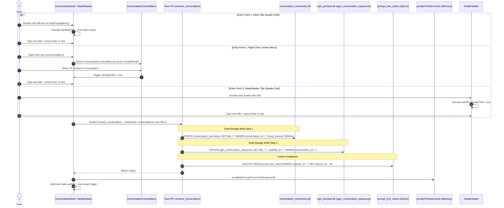

# 02-conversation-title-spec: Conversation Title Storage, Synchronization & Multi-Entry UI Editing Specification

- **Spec ID:** `02-spec/21-app/prompt-restore-labeling-and-tree-overhaul/02-conversation-title-spec.md`
- **Parent Plan:** `.ai-memory/plans/prompt-restore-labeling-and-tree-overhaul.md`
- **Task Slug:** `prompt-restore-labeling-and-tree-overhaul`
- **Subtask:** `TASK-02`
- **Application:** Antigravity-Manager (`agm`, Desktop GUI & Native CLI)
- **Status:** `APPROVED`
- **Author:** Spec Author 02 (`self`)
- **Target Files:**
  - `src-tauri/src/commands/instance.rs` (or `project_cmds.rs`)
  - `src-tauri/src/commands/mod.rs`
  - `src-tauri/src/lib/run.rs`
  - `src-tauri/src/modules/repo_db/sequences.rs`
  - `src-tauri/src/modules/repo_db/tree.rs`
  - `src-tauri/src/modules/cli/prompts.rs`
  - `src/components/instances/PromptTreeView/ConversationNode.tsx`
  - `src/components/instances/PromptTreeView/ConversationContextMenu.tsx` (new component)
  - `src/components/instances/PromptTreeView/DetailHeader.tsx`
  - `src/components/instances/PromptTreeView/usePromptTreeData.ts`

---

## User Request (Verbatim)

```text
The backup and restore prompt is working, but it is not working correctly. The issue here is that when you send the prompt 10 seconds later, we should be able to see this somewhere with labeling in the instances. It could be a label like "Waiting to restore this many of the prompts," meaning all the running prompts, or send them again. This needs to show up, and if people hover over and click, they would see the operation that's going to happen 10 seconds later. Second, you need to correctly find what was the running prompt. The running prompt section is correct. You can detect when the prompts are running, which is good. But the main problem is you get the wrong prompt. That is the main issue at the moment. When we have a conversation on the right-hand side, we should be able to double-click and change the conversation title. When we get into a conversation, we should be able to right-click and change the conversation name, and also double-clicking on the conversation on the top-level header, we should be able to change the conversation name directly. At this point, you have not merged the buttons, the copy, send all, and rerun. That should be all together. It's not done yet. The suffix should be a template library, so there should be more, and the user can also add a suffix template into the send section. Try to add that option. Everything should also have the CLI options so that the user can customize from the CLI automation. If you fix this, it would be a top-notch product. The work is good, but there are some glitches, and the markdown preview is good, but not professional enough. It does not feel very charming. Look into how to make it a more charming UI/UX concept. Keep the prompt and results section on the right-hand side or together with the preview section. In the preview section, you can have this icon. Write this prompt instruction as input and output. Put it into the section where highlighted. Verify the code or create a verification prompt so that AI can verify the task. At the end, do a minor bump and release the product. Before that, check the build on the machine. Do not run too many tests. Send it to the CI/CD and check the gitmap E space D. E, D. Space D, not D-E, to check for any CI/CD issues. If there is, try to minor bump until you reach CI/CD green. That would be a goal.
```

---

## 1. Executive Summary & Problem Classification

In Antigravity-Manager's Prompt Tree View (`PromptTreeViewModal`), conversation nodes represent individual AI interaction sessions. When new sessions are created, they typically receive automated, cryptic, or placeholder titles (such as short GitMap SHAs or generic opener previews). Users frequently need to customize and organize these sessions with descriptive names to quickly differentiate parallel threads and agent tasks.

### 1.1 The Problems
1. **No In-Place Title Renaming:** Users currently cannot rename a conversation directly from the UI. Title editing requires manual database tampering or external intervention.
2. **Missing Dual-Storage Synchronization:** Antigravity tracks conversation titles across two distinct SQLite stores:
   - `conversation_summaries.db` in the instance's `.gemini/antigravity` home directory (the IDE's internal state).
   - `repo_prompts.db` (`agm_conversation_sequences` table) in `%USERPROFILE%/.antigravity_tools` (AGM's unified cross-instance tracking and sequence table).
   Updating one without the other creates permanent data drift and UI inconsistencies.
3. **Double-Click Interaction Collision:** In `ConversationNode.tsx`, double-clicking the conversation row currently triggers the full inspection modal (`onOpenInspector`). Adding an inline double-click title editor without explicit event propagation suppression (`e.stopPropagation()`) would inadvertently pop up the inspector modal over the active editing input.
4. **Missing Right-Click Context Menu:** Unlike the accounts table (`AccountRowContextMenu.tsx`), conversation nodes lack a right-click context menu for quick actions (`Rename Conversation`, `Inspect Transcript`, `Copy Conversation ID`).
5. **No CLI Automation Parity:** While GUI users need visual editing, automated test harnesses and CLI operators require equivalent headless command execution (`agm prompts rename <conversation_id> "<new_title>"`).

---

## 2. Architecture & Data Flow Overview



---

## 3. Dual-Storage & Cache Invalidation Architecture

### 3.1 Dual-Storage Parity Specification

To preserve full structural integrity across both the host IDE runtime and AGM's multi-instance tracking engine, conversation renaming MUST atomically update both persistent SQLite stores:

| Storage Location | Table Name | Columns Updated | Concurrency / PRAGMA | Description |
| :--- | :--- | :--- | :--- | :--- |
| **Instance Gemini Home:** `<home>/.gemini/antigravity/conversation_summaries.db` | `conversation_summaries` | `title = ?` WHERE `conversation_id = ?` (with LIKE fallback) | `PRAGMA busy_timeout = 5000;`<br/>`PRAGMA journal_mode = WAL;` | Antigravity IDE's native summary database. Resolves via `crate::modules::repo_db::gemini_dirs::gemini_dirs_for_instance(instance_id)`. |
| **AGM Central Database:** `%USERPROFILE%/.antigravity_tools/repo_prompts.db` | `agm_conversation_sequences` | `title = ?`, `updated_at = ?` WHERE `conversation_id = ?` | `PRAGMA busy_timeout = 5000;`<br/>`PRAGMA journal_mode = WAL;` | AGM's global sequence and metadata tracking table. Keeps C001..C999 sequence codes mapped to human-readable titles. |

### 3.2 Target Database Resolution Ladder
When `rename_conversation(instance_id, conversation_id, new_title)` executes:
1. Normalize `instance_id`:
   - If `instance_id.is_none()` or empty, resolve active instance ID or fall back to `"default"`.
   - Call `crate::modules::instance::resolve_instance_id(raw_id)`.
2. Discover `conversation_summaries.db` path:
   - Query `crate::modules::repo_db::gemini_dirs::gemini_dirs_for_instance(resolved_id)`.
   - Search candidate paths in order:
     1. `<dir>/conversation_summaries.db`
     2. `<home>/.gemini/antigravity/conversation_summaries.db`
     3. `<data_dir>/conversation_summaries.db`
3. Execute SQL updates with 5000ms `busy_timeout` to prevent contention with active IDE processes writing telemetry:
   ```sql
   UPDATE conversation_summaries
   SET title = ?1
   WHERE conversation_id = ?2;
   ```
   If zero rows match, fallback to exact matching without dashes or prefix matching:
   ```sql
   UPDATE conversation_summaries
   SET title = ?1
   WHERE conversation_id LIKE ?2 OR conversation_id LIKE ?3;
   ```
4. Synchronize `repo_prompts.db`:
   ```sql
   UPDATE agm_conversation_sequences
   SET title = ?1, updated_at = ?2
   WHERE conversation_id = ?3;
   ```
   Also update `active_prompts` table title cache if a corresponding row exists:
   ```sql
   UPDATE active_prompts
   SET preview_raw = ?1, preview_clean = ?1
   WHERE session_id = ?2 AND (preview_raw IS NULL OR preview_raw = '' OR preview_raw LIKE 'Untitled%');
   ```

### 3.3 Cache Invalidation Invariant
Renaming a conversation invalidates two cache layers:
1. **Backend SQLite Cache:** `crate::modules::repo_db::invalidate_prompt_tree_cache(Some(&resolved_id))` immediately deletes stale JSON trees from `prompt_tree_cache`.
2. **Frontend In-Memory SWR Cache:** `invalidatePromptTreeCache(instanceId)` in `src/components/instances/PromptTreeView/usePromptTreeData.ts` purges the in-memory `promptTreeSwrCache` Map entry so the next render or background fetch returns fresh data.

---

## 4. Backend Tauri IPC & CLI Architecture

### 4.1 Tauri IPC Command: `rename_conversation`

Registered in `src-tauri/src/commands/instance.rs` (or `project_cmds.rs`) and exported via `src-tauri/src/commands/mod.rs`:

```rust
#[tauri::command]
pub async fn rename_conversation(
    instance_id: Option<String>,
    conversation_id: String,
    new_title: String,
) -> Result<(), crate::error::AppError> {
    let clean_title = new_title.trim();
    if clean_title.is_empty() {
        return Err(crate::error::AppError::Config(
            "Conversation title cannot be empty".to_string(),
        ));
    }
    if conversation_id.trim().is_empty() {
        return Err(crate::error::AppError::Config(
            "Conversation ID cannot be empty".to_string(),
        ));
    }

    let resolved_inst = instance_id
        .filter(|s| !s.is_empty())
        .unwrap_or_else(|| "default".to_string());

    tokio::task::spawn_blocking(move || {
        crate::modules::repo_db::rename_conversation_dual_store(
            &resolved_inst,
            &conversation_id,
            clean_title,
        )
    })
    .await
    .map_err(|e| crate::error::AppError::Process(format!("Task execution failed: {e}")))?
}
```

Registered in `src-tauri/src/lib/run.rs`:
```rust
.invoke_handler(tauri::generate_handler![
    // ... existing commands
    commands::rename_conversation,
])
```

### 4.2 CLI Command Parity: `agm prompts rename`

In `src-tauri/src/modules/cli/prompts.rs`, add the `rename` subcommand to `handle_prompts_subcommand`:

```text
SYNOPSIS:
  agm prompts rename <conversation_id> "<new_title>" [--instance <id>] [--json]

DESCRIPTION:
  Renames an existing conversation title across both conversation_summaries.db 
  and repo_prompts.db, purging prompt tree caches.

ARGUMENTS:
  <conversation_id>   Target conversation ID or full UUID
  <new_title>         The new display title string

OPTIONS:
  -i, --instance <id> Target instance identifier (defaults to active/default)
  -j, --json          Output machine-readable JSON envelope
  -h, --help          Print CLI command help
```

Implementation in `src-tauri/src/modules/cli/prompts.rs`:
```rust
pub(crate) fn execute_prompts_rename(sub_args: &[String]) {
    let instance_opt = extract_flag_value(sub_args, &["--instance", "-i", "--profile"]);
    let is_json = is_flag_present(sub_args, &["--json", "-j"]);

    // Extract positional arguments (skipping flags and their values)
    let positionals = extract_positional_args(sub_args);
    if positionals.len() < 2 {
        eprintln!("Error: Missing required arguments.");
        eprintln!("Usage: agm prompts rename <conversation_id> \"<new_title>\" [--instance <id>]");
        std::process::exit(1);
    }

    let conversation_id = &positionals[0];
    let new_title = &positionals[1];

    let resolved_inst = instance_opt
        .clone()
        .unwrap_or_else(|| "default".to_string());

    match repo_db::rename_conversation_dual_store(&resolved_inst, conversation_id, new_title) {
        Ok(_) => {
            if is_json {
                CliEnvelope::ok(
                    "prompts rename",
                    instance_opt,
                    serde_json::json!({
                        "renamed": true,
                        "conversation_id": conversation_id,
                        "new_title": new_title,
                        "instance": resolved_inst
                    }),
                )
                .print_and_exit();
            }
            println!(
                "[AGM] Successfully renamed conversation '{}' to '{}' (instance: {})",
                conversation_id, new_title, resolved_inst
            );
            std::process::exit(0);
        }
        Err(e) => {
            if is_json {
                CliEnvelope::error("prompts rename", e.to_string(), instance_opt).print_and_exit();
            }
            eprintln!("[AGM ERROR] Failed to rename conversation: {}", e);
            std::process::exit(1);
        }
    }
}
```

---

## 5. Frontend Interaction Models: The 3 Entry Points

```mermaid
graph TD
    subgraph Three Entry Points
        EP1["Entry Point 1:<br/>ConversationNode Inline Title Double-Click"]
        EP2["Entry Point 2:<br/>ConversationNode Row Right-Click Context Menu"]
        EP3["Entry Point 3:<br/>DetailHeader Top-Level Title Double-Click"]
    end

    EP1 -->|"Double click text span<br/>e.stopPropagation()"| EditState["Activate isEditingTitle"]
    EP2 -->|"onContextMenu(e)<br/>Click '✏️ Rename Conversation'"| EditState
    EP3 -->|"Double click header h3"| HeaderEditState["Activate isEditingHeaderTitle"]

    EditState -->|"Render inline <input>"| UserInput["User edits text"]
    HeaderEditState -->|"Render inline <input>"| UserInput

    UserInput -->|"Enter or blur"| Save["Invoke rename_conversation IPC"]
    UserInput -->|"Escape"| Cancel["Revert to original title without saving"]

    Save --> Refresh["Invalidate promptTreeSwrCache & reloadTree()"]
```



### 5.1 Entry Point 1: `ConversationNode.tsx` Title Inline Double-Click

#### Interaction Details:
- **Trigger:** User double-clicks specifically on the conversation title text span.
- **Event Propagation Invariant:** The title `<span>` handles `onDoubleClick`:
  ```tsx
  onDoubleClick={(e) => {
      e.stopPropagation(); // CRITICAL: Prevents row-level onOpenInspector from triggering!
      setIsEditingTitle(true);
  }}
  ```
  Double-clicking the empty background of the row still opens the inspector modal (`onOpenInspector`).
- **Inline Input Lifecycle:**
  - When `isEditingTitle === true`, replace the title span with an inline HTML `<input />`.
  - Properties: `autoFocus={true}`, `defaultValue={conv.title || ''}`, `className="px-1.5 py-0.5 text-[11px] bg-white dark:bg-[#1a102c] border border-blue-500 rounded text-slate-900 dark:text-white outline-none w-full"`.
  - On `onKeyDown`:
    - `Enter`: Trigger save, exit editing mode.
    - `Escape`: Cancel editing, revert to original title, exit editing mode.
  - On `onBlur`:
    - Auto-save if title changed and non-empty; revert if unchanged or empty.

### 5.2 Entry Point 2: `ConversationContextMenu.tsx`

#### Component Specification (`src/components/instances/PromptTreeView/ConversationContextMenu.tsx`):
- Created under `src/components/instances/PromptTreeView/ConversationContextMenu.tsx`.
- Rendered via React Portal (`createPortal(..., document.body)`) to prevent container clipping or z-index stacking issues inside scrollable tree containers.
- Viewport edge clamping:
  ```ts
  const left = Math.max(8, Math.min(x, window.innerWidth - 200));
  const top = Math.max(8, Math.min(y, window.innerHeight - 150));
  ```
- Dismissal listeners:
  - `Escape` keydown.
  - `mousedown` outside the menu ref.
  - `scroll` event across window / containers.
- Menu Items:
  1. **✏️ Rename Conversation:**
     - Closes context menu.
     - Triggers `onRename()` which sets `isEditingTitle(true)` on the target `ConversationNode`.
  2. **🔍 Inspect Transcript:**
     - Closes context menu.
     - Calls `onOpenInspector(conv, repoPath)`.
  3. **📋 Copy Conversation ID:**
     - Copies `conv.conversation_id` to clipboard via `copyToClipboard()`.
     - Displays brief toast / check indicator.

### 5.3 Entry Point 3: `DetailHeader.tsx` Top-Level Title Inline Double-Click

#### Interaction Details:
- **Location:** In `DetailHeader.tsx`, Row 1: Identity & Badges section (line 241).
- **Trigger:** Double-clicking on the title heading `<h3>`:
  ```tsx
  {isEditingHeaderTitle ? (
      <input
          type="text"
          autoFocus
          value={headerTitleDraft}
          onChange={(e) => setHeaderTitleDraft(e.target.value)}
          onKeyDown={async (e) => {
              if (e.key === 'Enter') {
                  await handleSaveHeaderTitle();
              } else if (e.key === 'Escape') {
                  setIsEditingHeaderTitle(false);
                  setHeaderTitleDraft(selectedConversation.title || selectedConversation.short_id || '');
              }
          }}
          onBlur={handleSaveHeaderTitle}
          className="text-xs font-bold text-slate-900 dark:text-white bg-white dark:bg-[#1f1535] border border-blue-500 rounded px-1.5 py-0.5 outline-none max-w-[260px] md:max-w-md shadow-inner"
      />
  ) : (
      <h3
          onDoubleClick={() => {
              setHeaderTitleDraft(selectedConversation.title || selectedConversation.short_id || '');
              setIsEditingHeaderTitle(true);
          }}
          className="text-xs font-bold text-slate-900 dark:text-white truncate max-w-[200px] md:max-w-xs cursor-pointer hover:underline decoration-blue-500/50 underline-offset-2"
          title={`${selectedConversation.title || selectedConversation.short_id} (Double-click to rename)`}
      >
          {selectedConversation.title || selectedConversation.short_id}
      </h3>
  )}
  ```

---

## 6. House Rules & Safety Gates Alignment

### 6.1 No Silent Errors Rule
- Every fallible backend database update MUST return `Result<(), AppError>` and record any soft ignored queries with `crate::error::record_ignored(result, "justification")`.
- Frontend errors during renaming MUST route through `useErrorStore.getState().captureException(err, { source: 'ConversationNode.rename', triggerAction: 'rename_conversation' })`.

### 6.2 Concurrency & File Lock Resilience
- Antigravity IDE frequently holds read/write locks on `conversation_summaries.db`.
- All database connections MUST configure `PRAGMA busy_timeout = 5000;` before executing write queries to eliminate SQLite `database is locked (5)` errors.

### 6.3 Input Validation Invariants
- Empty or whitespace-only names are strictly forbidden; renaming to empty must be rejected with user feedback or silently cancelled without altering database state.
- Conversation IDs must be validated before executing queries.

---

## 7. Acceptance Criteria (Verification Matrix)

| Test ID | Area | Scenario | Expected Outcome |
| :--- | :--- | :--- | :--- |
| **AC-01** | Frontend | Double-click title text in `ConversationNode.tsx` | Activates inline `<input>`; Inspector modal is NOT triggered (`e.stopPropagation()` verified). |
| **AC-02** | Frontend | Press Enter or blur in `ConversationNode` inline input | Invokes `rename_conversation`, updates UI text, caches invalidated. |
| **AC-03** | Frontend | Press Escape in `ConversationNode` inline input | Cancels editing; restores previous title without IPC invocation. |
| **AC-04** | Frontend | Right-click conversation row in `ConversationNode.tsx` | Opens `ConversationContextMenu` clamped to viewport with 3 items. |
| **AC-05** | Frontend | Click '✏️ Rename Conversation' in context menu | Closes context menu, activates inline editing on the target row. |
| **AC-06** | Frontend | Double-click title in `DetailHeader.tsx` | Activates header title inline input; Enter/blur commits rename. |
| **AC-07** | Backend | Call `rename_conversation(inst, cid, "New Name")` | Updates both `conversation_summaries.db` and `agm_conversation_sequences` in `repo_prompts.db`. |
| **AC-08** | Backend | Concurrency under active IDE file locks | 5000ms `busy_timeout` allows update without `database is locked` failure. |
| **AC-09** | CLI | `agm prompts rename <cid> "New Title"` | Headless command updates dual stores and invalidates tree cache. |
| **AC-10** | Error Handling | Rename with empty or whitespace string | Rejected with clean validation error; no corrupted database entries. |
